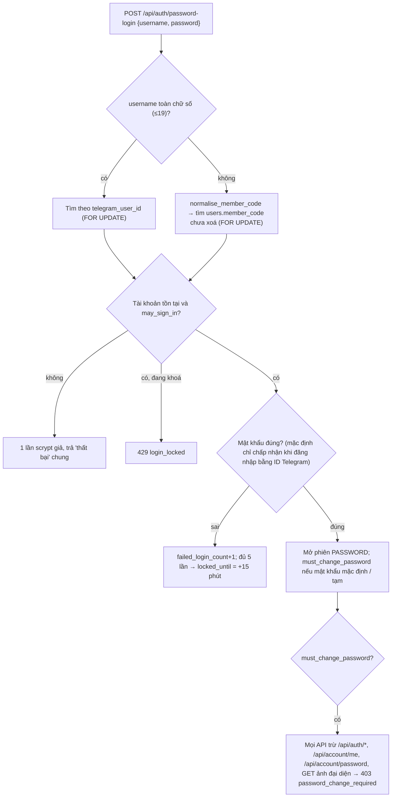

# Tài khoản

> Module này lo **tài khoản đăng nhập của từng người**: đăng nhập bằng mật khẩu (ID Telegram hoặc mã nhân viên), đổi / cấp lại mật khẩu, ảnh đại diện, mã nhân viên, thông tin công việc, khoá / mở / thu hồi / xoá tài khoản, đăng nhập thay, trang hồ sơ `/people/[id]`. Người dùng gặp nó ở `/login`, `/account` (Tài khoản của tôi + tab Thành viên), `/people/[id]` và **Quản trị › Quản lý tài khoản** (`/admin/accounts`).

Phòng ban, quyền, mã mời: xem [org.md](org.md). Chỉ số / điểm trên trang hồ sơ: [performance.md](performance.md). Phần giao diện của "Ghim menu": [platform.md](platform.md).

## Khái niệm & thuật ngữ

| Thuật ngữ | Nghĩa |
|---|---|
| **Tài khoản** (`users`) | Một người. Có `telegram_user_id` (có thể trống), `member_code`, `role` (vai trò hệ thống, xem [org.md](org.md)), `active`, `status`, `employment_status`. |
| **Trạng thái tài khoản** (`users.status`, `UserStatus`) | `active`; `suspended` = "Vô hiệu hoá" (mở lại được); `revoked` = "Đã thu hồi" (chỉ OWNER khôi phục); còn `pending`. Member rows trả `account_status`. |
| **Trạng thái nhân sự** (`users.employment_status`) | WORKING "Đang làm", PROBATION "Thử việc", ON_LEAVE, MOVED "Chuyển ban", MATERNITY "Nghỉ thai sản", UNPAID_LEAVE "Nghỉ không lương", LEFT "Đã nghỉ việc". Khác với trạng thái tài khoản: chỉ LEFT chặn đăng nhập. |
| **Xoá** (tombstone) | `users.deleted_at` được đặt; dòng vẫn còn để giữ lịch sử, tên thành "<tên> (đã xoá)", không hiện ở danh sách nào. |
| **Mật khẩu mặc định** | `Settings.web_default_password` (env `MEOBOT_WEB_DEFAULT_PASSWORD`). Tài khoản chưa đặt mật khẩu (`password_hash` null) mở bằng nó – chỉ khi đăng nhập bằng ID Telegram. |
| **Mật khẩu tạm** | 10 ký tự ngẫu nhiên (chữ + số) do "Quên mật khẩu" hoặc quản trị cấp lại, gửi qua Telegram; `password_temporary=true`. |
| **Phiên PASSWORD / TELEGRAM_LINK** (`web_sessions.auth_method`) | Phiên mở bằng mật khẩu, hoặc bằng link một lần do bot `/web` (hoặc "Đăng nhập thay") cấp. |
| **Phải đổi mật khẩu** | Phiên PASSWORD của người đang dùng mật khẩu mặc định hoặc mật khẩu tạm (`password_change_due`). Không lưu, tính mỗi lần đọc phiên. |
| **Mã nhân viên** (`users.member_code`) | Mã của một người (A-Z0-9, tối đa 12), duy nhất trong các tài khoản chưa xoá. Có bản sao trên mỗi tag luồng đang mở. |
| **Đăng nhập thay** | OWNER lấy link đăng nhập một lần để vào tài khoản của một người khác (hỗ trợ, sửa giúp). |

## Luồng chính

### Đăng nhập bằng mật khẩu



### Cấp lại mật khẩu

```mermaid
sequenceDiagram
    participant U as Người dùng / Quản trị
    participant API
    participant R as PasswordResetService
    participant O as Outbox → Telegram
    U->>API: POST /api/auth/password-reset {username} (tự xin)
    API->>R: request_reset (luôn 202, cùng một câu)
    U->>API: POST /api/account/members/{id}/reset-password (OWNER/ADMIN)
    API->>R: issue_temporary (409 nếu không nhắn riêng được)
    R->>R: mật khẩu tạm 10 ký tự, scrypt, password_temporary=true, gỡ khoá, đóng mọi phiên web
    R->>O: template account.temporary_password (HTML), cùng transaction
    O-->>U: Tin Telegram; payload bị xoá mật khẩu khi gửi xong
```

## Quy tắc nghiệp vụ hiện hành

### Đăng nhập & mật khẩu

1. **Tên đăng nhập** = ID Telegram (chuỗi số) **hoặc** mã nhân viên (`application/account/password_service.py:PasswordService.login`). Mã nhân viên được chuẩn hoá như mọi mã (`normalise_member_code`) và chỉ mở bằng **mật khẩu riêng** của người đó, không bao giờ bằng mật khẩu mặc định (mã in trên danh sách, ID Telegram thì không). Form đăng nhập ghi "Mã nhân viên hoặc ID Telegram"; thông báo sai chung "Sai mã nhân viên / ID Telegram hoặc mật khẩu.".
2. **Không lộ ai có tài khoản**: id lạ, sai mật khẩu, tài khoản bị khoá / vô hiệu hoá / đã nghỉ việc (`User.may_sign_in`) đều trả cùng một kết quả và mỗi lần đều tốn đúng một scrypt (`burn_dummy_hash`). Ngoại lệ duy nhất: tài khoản tồn tại, đang hoạt động và bị khoá → 429 `login_locked`.
3. **Khoá**: sai `web_login_max_failures` (mặc định 5) lần liên tiếp → `locked_until` = bây giờ + `web_login_lockout_seconds` (mặc định 900 giây = 15 phút) (`_register_failure`). Đăng nhập đúng xoá bộ đếm. Link Telegram không đọc bộ đếm / khoá, nên người bị khoá vẫn xin link qua bot được.
4. **Bắt đổi mật khẩu**: phiên `PASSWORD` trên mật khẩu mặc định hoặc mật khẩu tạm → mọi route trả 403 `password_change_required`, trừ `/api/auth/*`, đúng `/api/account/me`, đúng `/api/account/password`, và `GET /api/account/avatar/{user_id}` (`api/deps.py:get_current_web_actor`, `password_change_allows`). Phiên mở bằng link Telegram không bao giờ bị chặn.
5. **Đổi mật khẩu** `POST /api/account/password {current_password, new_password}` (`change_password`): mật khẩu mới chỉ cần không rỗng / không toàn khoảng trắng (422 `password_empty`), ≤1024 ký tự (`password_too_long`), khác mật khẩu mặc định (`password_is_default`). Được trùng mật khẩu hiện tại. Sai mật khẩu hiện tại → 422 `current_password_wrong` và **tính vào bộ đếm khoá** (route trả lỗi chứ không raise để giữ bộ đếm). Đang khoá → 429 `login_locked`. Thành công: hash scrypt mới, `password_temporary=false`, gỡ khoá, đóng mọi phiên khác (giữ phiên hiện tại). Không mật khẩu / hash nào bị ghi log hay audit.
6. **Hash** = `hashlib.scrypt` thư viện chuẩn, dạng `scrypt$N$r$p$salt$hash` (`application/account/passwords.py`).
7. **Tự xin cấp lại** `POST /api/auth/password-reset {username}` (`application/account/password_reset_service.py:PasswordResetService.request_reset`): luôn 202 `{"message": "Nếu ID tồn tại, mật khẩu tạm đã được gửi qua Telegram."}`; chỉ nhận ID Telegram (không nhận mã nhân viên); mỗi tài khoản tối đa 1 lần / 5 phút (`users.password_reset_at`, `RESET_INTERVAL`), xin trong cửa sổ thì im lặng bỏ qua. Kết quả thật (`sent`, `unknown_or_inactive`, `rate_limited`, `undeliverable`) chỉ vào audit.
8. **Quản trị cấp lại** `POST /api/account/members/{id}/reset-password` (`AccountService.reset_password`): OWNER hoặc ADMIN; không cho chính mình (dùng form đổi mật khẩu); ADMIN không cấp lại cho OWNER → 403 `password_reset_forbidden`. Người không nhắn riêng được với bot (không có Telegram id, chưa bấm Start) → 409 `password_reset_undeliverable`, không đổi gì. Audit `AUTH_PASSWORD_RESET` (không có mật khẩu).
9. **Một lần cấp lại làm gì** (`issue_temporary`): mật khẩu tạm 10 ký tự (`generate_temporary_password`, có cả chữ và số), hash scrypt, `password_temporary=true`, gỡ khoá, đóng **mọi** phiên web, gửi qua outbox (`NotificationRouter` → template `account.temporary_password`, `parse_mode` HTML) trong cùng transaction; `OutboxService` xoá trường bí mật (`secret_fields`) khi tin đã xong. Đổi mật khẩu thành công thì xoá cờ tạm.

### Đăng nhập thay

10. `POST /api/account/login-link {telegram_user_id | user_id}` (`AccountService.issue_login_link_for`) cấp link đăng nhập một lần, giống link `/web` của bot (`WebAuthService.issue_login_link`, sống `web_login_token_ttl_seconds`):
    - **chỉ OWNER**; không vào chính mình, không vào một OWNER khác → 403 `impersonation_forbidden`;
    - gửi đúng một trong hai bộ chọn, nếu không → 422 `target_required`; không có / đã xoá → 404 `account_not_found`; tài khoản không đăng nhập được → lỗi quyền từ `issue_login_link`; thiếu `WEB_BASE_URL` → lỗi cấu hình;
    - mỗi lần đều audit `WEB_LOGIN_LINK_ISSUED_FOR` (`entity_id` = người đích, `after_data` = người đích + hạn), **không bao giờ** ghi URL / token;
    - link đổi thành một phiên `TELEGRAM_LINK` bình thường, mọi luật và audit vẫn áp dụng.
    - Đây là **đường HTTP duy nhất** cấp link cho người khác (`tests/unit/test_web_security.py::test_41`).
11. Giao diện: Quản lý tài khoản, menu ⋯ của dòng "Đăng nhập thay…" (chỉ OWNER, dòng đang hoạt động, không phải OWNER) → `LoginLinkDialog` (`app/admin/accounts/page.tsx`) lấy link khi mở, có "Sao chép" và "Mở tài khoản này"; nên mở trong cửa sổ ẩn danh để không ghi đè phiên của OWNER. Client `api.issueLoginLink(userId)`.

### Ảnh đại diện

12. `PUT /api/account/avatar {content_type, data}` (`application/account/avatar_service.py:AvatarService.upload`): chỉ cho chính mình; trình duyệt tự cắt / thu về 256×256 WebP (JPEG nếu không encode được WebP), server không xử lý ảnh mà **kiểm tra**: loại `image/webp` / `image/jpeg` / `image/png`; base64 chặt (không tiền tố `data:`, không khoảng trắng); chuỗi dài hơn mức 300 KB có thể mã hoá (409600 ký tự) bị từ chối trước khi giải mã; 1 byte–300 KB sau giải mã (422 `avatar_too_large`); byte đầu đúng chữ ký của loại khai báo (422 `avatar_invalid_image`). Mỗi lần tải lên tăng `version`. Trả `{"avatar_url": "/api/account/avatar/<id>?v=<version>"}`.
13. `DELETE /api/account/avatar` → 204 (có ảnh hay không). Audit `user.avatar.updated` / `user.avatar.removed`, không có byte ảnh.
14. `GET /api/account/avatar/{user_id}` = byte ảnh thô cho **mọi người đã đăng nhập**: `Cache-Control: private, max-age=31536000, immutable` khi `?v=` đúng phiên bản hiện tại (sai phiên bản → `private, no-cache`), `X-Content-Type-Options: nosniff`, `Content-Disposition: inline`, `Content-Security-Policy: default-src 'none'; sandbox`. Không có → 404 `avatar_not_found`. `avatar_url` có trên `/api/auth/session`, `/api/account/me` và mọi dòng thành viên.

### Mã nhân viên

15. **Một mã cho một người** trên `users.member_code`, chép sang mọi tag luồng đang mở (`org_unit_members.member_code`). **Người viết duy nhất** là `application/account/member_code.py:write_member_code`; tag mở sau này nhận mã của tài khoản (`sync_stream_tags`).
16. **Duy nhất** trong các tài khoản chưa xoá (index một phần `uq_users_member_code`); mã đã thuộc người khác → 422 `member_code_taken` (`details.member_code`).
17. **Chuẩn hoá** `domain/units/member_code.py:normalise_member_code`: bỏ dấu (Đ→D), chỉ giữ A-Z0-9, viết hoa, tối đa 12; không bao giờ từ chối; rỗng = xoá mã.
18. **Ai sửa**: OWNER và ADMIN.
    - `PUT /api/account/members/{id}/member-code {member_code}` (`AccountService.set_member_code`): mọi tài khoản, có tag hay không → 403 `member_code_forbidden`, 404 `account_not_found`; audit `user.member_code.updated`.
    - `PATCH /api/units/{code}/members/{id}` với `member_code` **khác** giá trị cũ từ người không phải OWNER/ADMIN → 403 `member_code_forbidden`; gửi lại giá trị cũ thì qua.
    - Giao diện: Tài khoản › Thành viên cột "Mã nhân viên" và bảng Quản lý tài khoản (`MemberCodeField`, `components/account-fields.tsx`).
19. **Mã suy ra khi đặt order**: người đặt order lần đầu chưa có mã thì luồng order tự suy mã từ tên (`derive_member_code`, bỏ qua mã đã có người dùng) và lưu vào tài khoản + tag – xem [ord.md](ord.md). Script nhập tài nguyên chỉ cấp mã khi người nhập là OWNER/ADMIN – xem [resources.md](resources.md).

### Trạng thái tài khoản, xoá, khôi phục

20. **Vô hiệu hoá / kích hoạt lại** `POST /api/account/members/{id}/deactivate|reactivate` (`AccountService.set_active`): OWNER và ADMIN; không cho chính mình, không cho tài khoản OWNER → 403 `account_status_forbidden`; 404 `account_not_found`. Vô hiệu hoá = `status=suspended`, `active=false`, đóng mọi phiên web; tag, ghế, lịch sử giữ nguyên. Kích hoạt lại tài khoản `revoked` → 422 `account_revoked` (phải dùng "Khôi phục"). Đã đúng trạng thái thì không làm gì. Audit `USER_SUSPENDED` / `USER_ENABLED` (`via: "account"`).
21. **Khôi phục tài khoản đã thu hồi** `POST /api/account/members/{id}/restore` (`AccountService.restore_member` → `UserService.restore`): **chỉ OWNER**, không cho chính mình → 403 `account_status_forbidden`; đã xoá / không có → 404; không ở trạng thái thu hồi → 422 `account_not_revoked`. Audit `user.enabled` lý do "restored". Giao diện: dòng "Đã thu hồi" ở Quản lý tài khoản có ⋯ "Khôi phục tài khoản…" (`restoreAccountConfirmation`) thay cho "Kích hoạt lại…".
22. **Thu hồi** tài khoản vẫn là `/revoke_user` (Telegram) hoặc API nội bộ `POST /api/v1/users/{id}/revoke` (`api/routers/access.py`, system actor). "Loại khỏi PR" (`POST /api/pr/members/{id}/revoke`) chỉ đóng ghế PR, tài khoản vẫn hoạt động – xem [pr.md](pr.md).
23. **Xoá thành viên** `DELETE /api/account/members/{id}` (`AccountService.delete_member`): **chỉ OWNER**; không tự xoá, không xoá OWNER → 403 `member_delete_forbidden`; đã xoá → 404; còn order đang chạy hoặc giữ bước đang mở → 422 `member_has_open_work`. Kết quả: `deleted_at`, `active=false`, `status=revoked`, tên + " (đã xoá)", xoá Telegram id / username / chat, xoá `password_hash`, xoá ảnh đại diện, đóng mọi tag và ghế, ai báo cáo cho họ mất trưởng quản lý, đóng mọi phiên web; audit `USER_DELETED`. Order và công việc cũ giữ nguyên. Cùng Telegram đó có thể được mời lại như người mới. Tài khoản đã xoá bị lọc khỏi danh sách tài khoản, danh bạ luồng và danh sách PR.
24. **Đổi vai trò hệ thống** `POST /api/account/members/{id}/role {role}` (`UserService.change_role`): chỉ OWNER → 403 `role_change_forbidden`, 404 `member_not_found`. Giao diện: ⋯ của dòng ở Quản lý tài khoản (`RoleDialog`, `api.setAccountRole`). Chọn "Quản trị viên" biến tài khoản thành ADMIN (thấy mọi luồng), không tạo tag.

### Thông tin công việc, trạng thái nhân sự

25. `PATCH /api/account/members/{id}/work-info {job_title, branch, legal_entity_id, telegram_user_id}` (`AccountService.set_work_info`): chỉ khoá gửi lên; OWNER và ADMIN, ADMIN không sửa của OWNER → 403 `work_info_forbidden`; 404 `account_not_found`. Kiểm tra: `job_title` ≤150 ký tự (gộp khoảng trắng, rỗng = xoá) → 422 `job_title_too_long`; `branch` thuộc `BRANCHES` (`VP_HN`, `CS_HN`, `CS_HN2`, `CS_SG`) → `branch_invalid`; `legal_entity_id` là pháp nhân đang bật (giữ được pháp nhân cũ đã tắt) → `legal_entity_invalid`; `telegram_user_id` là số dương ≤ 2^63-1 → `telegram_id_invalid`, đã gắn tài khoản khác → `telegram_id_taken`, `null` / rỗng = gỡ liên kết. Đổi Telegram id thì quên chat cũ (username, chat riêng, cờ gửi được). Audit `user.work_info.updated` khi có thay đổi.
26. `PUT /api/account/members/{id}/employment-status {employment_status}` (`application/resources/employment.py:set_employment_status`): OWNER, ADMIN, hoặc người giữ `RESOURCES / HR_STATUS` (mặc định Trưởng phòng Tài nguyên) → 403 `employment_status_forbidden`. Đặt "Đã nghỉ việc" (LEFT) cho OWNER hoặc cho chính mình → 403 `employment_status_left_forbidden`. LEFT chặn đăng nhập (mật khẩu lẫn link) và đóng mọi phiên / link chưa dùng. Audit `USER_EMPLOYMENT_STATUS_UPDATED`. Module HR cũng đặt trạng thái này qua `apply_employment_status` – xem [hr.md](hr.md).

### Danh sách thành viên & trang hồ sơ

27. **Tự đổi tên** `PATCH /api/account/profile {full_name}`: 2–80 ký tự sau khi bỏ khoảng trắng thừa → 422 `full_name_invalid`; audit `USER_PROFILE_UPDATED`.
28. **`GET /api/account/members?month=&unit=&include_inactive=&team=`** (`AccountService.members`), ai thấy ai (`_visibility`):
    - OWNER / ADMIN: mọi người;
    - HEAD ORD (tag `HEAD` luồng ADS): người có tag ORD;
    - HEAD của phòng ban bất kỳ: `head_team` của mình (MEMBER phòng mình báo cáo cho mình, hoặc không báo cáo ai khi mình là HEAD duy nhất) + chính mình;
    - `team=mine` ("Thành viên nhóm tôi"): đội ORD của chính mình (Leader + người cùng Leader), mở cho mọi thành viên ORD, nhưng cột đăng nhập / mật khẩu bị để trống nếu người xem không có quyền xem danh sách đầy đủ;
    - không thuộc trường hợp nào → 403 `account_members_forbidden`; `include_inactive=true` chỉ OWNER/ADMIN (else 403); `unit` sai → 422 `invalid_unit`, `unit` ngoài phạm vi → 403.
    - Tài khoản đã xoá không bao giờ có mặt.
29. **Mỗi dòng** (`MemberRowResponse`): `user_id`, `full_name`, `telegram_user_id`, `role`, `role_label` (= `member_role_label`, xem [org.md](org.md) quy tắc 27), `units`, `unit_tags`, `function_tag`, `is_lead`, `member_code`, `departments` (ghế, kèm `manager_user_id`), `seeding`, `job_title`, `branch`, `branch_label`, `legal_entity_id`, `legal_entity_code`, `employment_status(_label)`, `active`, `account_status`, `avatar_url`, `last_login_at`, `has_custom_password`, `password_temporary`, `locked`, `stats` (chỉ số tháng, nhóm truy vấn theo tháng tiếng Việt – `application/account/stats_service.py`).
30. **Trang hồ sơ** `GET /api/account/members/{id}/profile?month=` (`AccountService.profile`) trả một `MemberRowResponse`. Ai mở được (`may_view_profile`): OWNER/ADMIN mọi người; chính mình; người giữ `PERFORMANCE / VIEW` phạm vi `ALL`; một HEAD mở được **mọi người ngồi trong phòng mình làm trưởng** (`department_people`, báo cáo cho mình hay không). Còn lại 403 `account_profile_forbidden` (kể cả id không tồn tại, để link không tiết lộ tài khoản có hay không); người được phép mà id không có / đã xoá → 404 `account_not_found`. `/api/units/me` `can_view_profiles` = OWNER/ADMIN, hoặc là HEAD phòng nào đó, hoặc có `PERFORMANCE VIEW ALL`.
31. Giao diện `/people/[id]`: tab "Hiệu suất" (`PerformancePanel` + `components/stat-cards.tsx` `StatCards` "Chỉ số công việc") và "Thông tin tài khoản". Tên người được vẽ bằng `components/person-link.tsx` `PersonLink` – chỉ thành link khi `can_view_profiles` – trên bảng task, Tài khoản › Thành viên, `/admin/accounts`.
32. **`/api/account/me`**: `user_id`, `telegram_user_id`, `telegram_username`, `full_name`, `role`, `role_label`, `units`, `must_change_password`, `has_custom_password`, `password_temporary`, `password_changed_at`, `stats`, `avatar_url`, `heads_department`, `member_code`. Tài khoản không có Telegram id hiện "Chưa liên kết Telegram" (ở `/account`, `/people`, Quản lý tài khoản).

### Ghim menu (phía lưu trữ)

33. `PUT /api/account/nav-pins {pins}` (`application/account/nav_pins.py:save_pins`): danh sách khoá nhánh menu của **chính mình**, theo thứ tự ghim. Mỗi khoá khớp `^[a-z][a-z0-9_-]{0,31}$`, bỏ trùng (giữ vị trí đầu), tối đa 20 sau khi bỏ trùng (gửi quá 40 phần tử cũng bị từ chối) → 422 `nav_pins_invalid`. Lưu ở `system_settings` khoá `nav_pins:<user id>` = `{"pins": [...]}`. Đọc lại qua `/api/units/me` `nav_pins` (`read_pins` lọc khoá sai dạng). Server không biết khoá nào hợp lệ; khoá menu không còn thì giao diện bỏ qua.

## Phân quyền

| Việc | OWNER | ADMIN | Khác |
|---|---|---|---|
| Đổi mật khẩu, ảnh, tên, ghim menu của mình | ✔ | ✔ | ✔ |
| Cấp lại mật khẩu người khác | ✔ | ✔ (trừ OWNER) | – |
| Đăng nhập thay | ✔ (trừ OWNER, chính mình) | – | – |
| Vô hiệu hoá / kích hoạt lại | ✔ (trừ OWNER, chính mình) | ✔ (như OWNER) | – |
| Khôi phục tài khoản thu hồi | ✔ | – | – |
| Xoá thành viên | ✔ | – | – |
| Đổi vai trò hệ thống | ✔ | – | – |
| Sửa mã nhân viên | ✔ | ✔ | – |
| Sửa thông tin công việc | ✔ | ✔ (trừ OWNER) | – |
| Đổi trạng thái nhân sự | ✔ | ✔ | `RESOURCES/HR_STATUS`; HR `EDIT` qua module HR |
| Xem danh sách thành viên | mọi người | mọi người | HEAD ORD: người ORD; HEAD phòng: `head_team`; `team=mine` |
| Xem trang hồ sơ | mọi người | mọi người | chính mình, HEAD (người trong phòng), `PERFORMANCE VIEW ALL` |

Frontend: `components/unit-panel.tsx` `mayChangeAccountStatus` / `mayDeleteAccount` quyết định nút nào hiện; server vẫn kiểm tra lại.

## Dữ liệu

| Bảng / khoá | Cột liên quan |
|---|---|
| `users` | `telegram_user_id` (BIGINT), `telegram_username`, `telegram_private_chat_id`, `private_chat_available`, `full_name`, `role`, `active`, `status`, `suspended_at/by`, `revoked_at/by`, `status_reason`, `last_status_changed_at`, `deleted_at`, `member_code` (index một phần `uq_users_member_code`), `legal_entity_id`, `job_title`, `branch`, `employment_status`, `password_hash`, `password_changed_at`, `failed_login_count`, `locked_until`, `password_temporary`, `password_reset_at` |
| `web_sessions` | `auth_method` `PASSWORD` / `TELEGRAM_LINK` |
| `user_avatars` | `user_id`, `content_type`, `data` (byte), `version` |
| `org_unit_members.member_code` | Bản sao mã nhân viên trên tag mở. |
| `system_settings` `nav_pins:<user id>` | `{"pins": [...]}` |
| `outbound_messages` | Tin mật khẩu tạm; trường bí mật bị xoá khi xong. |

Cấu hình: `web_default_password` (`MEOBOT_WEB_DEFAULT_PASSWORD`), `web_login_max_failures` (5), `web_login_lockout_seconds` (900), `web_login_token_ttl_seconds`, `web_session_ttl_seconds`, `web_base_url`.

## Code ở đâu

| Lớp | File |
|---|---|
| domain | `domain/account/errors.py` (mọi mã lỗi), `domain/units/member_code.py` (`normalise_member_code`, `derive_member_code`), `domain/access/models.py` (`UserStatus`), `domain/resources/models.py` (`EmploymentStatus`) |
| application | `application/account/account_service.py` (`AccountService`, `member_role_label`, `_visibility`), `password_service.py`, `passwords.py`, `password_reset_service.py`, `avatar_service.py`, `member_code.py`, `nav_pins.py`, `stats_service.py`; `application/web_auth_service.py` (`password_change_due`, `issue_login_link`, `revoke_all_for_user`); `application/user_service.py` (`restore`, `change_role`); `application/resources/employment.py` |
| api | `api/routers/account.py` (`/api/account`), `api/routers/web_auth.py` (`/auth/login`, `/api/auth/session`, `/api/auth/password-login`, `/api/auth/password-reset`, `/api/auth/logout`), `api/deps.py` (`get_current_web_actor`, `password_change_allows`), `api/schemas/account.py` |
| frontend | `app/login/page.tsx`, `app/account/page.tsx` (+ `password.tsx`, `invites.tsx`), `app/people/[id]/page.tsx`, `app/admin/accounts/page.tsx` (`LoginLinkDialog`, `RoleDialog`), `components/account-fields.tsx` (`MemberCodeField`, `EmploymentStatusField`, `LegalEntityField`, `WorkInfoDialog`, `PasswordStatus`), `components/unit-panel.tsx` (`AccountStatusButton`, `DeleteAccountButton`), `components/person-link.tsx`, `components/stat-cards.tsx`, `lib/api.ts` (`issueLoginLink`, `setAccountRole`, `setNavPins`), `lib/confirmations.ts` |
| tests | `tests/unit/test_password_login.py` (gồm `test_15/16` đăng nhập thay), `test_web_security.py` (`test_41`), `test_account_avatar.py`, `test_member_code.py`, `test_person_member_code.py`, `test_owner_controls.py`, `test_account_stats.py` (`test_08` hồ sơ), `test_pr_membership_admin.py` (`test_4c/5e/7a`), `test_nav_pins.py`, `test_telegram_id_width.py`; `tests/integration/test_org_structure_migration.py`; `frontend/tests/account.test.tsx` ("signs in with a member code"), `accounts-admin.test.tsx` ("Pháp nhân, chi nhánh, Telegram ID", "marks a revoked account"), `person-page.test.tsx`, `membership.test.tsx`, `nav-pins.test.tsx` |

## API

| Method | Path | Ghi chú |
|---|---|---|
| GET | `/auth/login?token=` | Đổi link Telegram một lần thành phiên. |
| GET | `/api/auth/session` | Ai đang đăng nhập (có `avatar_url`). |
| POST | `/api/auth/password-login` | `{username, password}`; 429 `login_locked`. |
| POST | `/api/auth/password-reset` | `{username}` → luôn 202. |
| POST | `/api/auth/logout` | 204. |
| GET | `/api/account/me` | Thẻ của tôi + chỉ số tháng này. |
| GET | `/api/account/me/stats?month=YYYY-MM` | Chỉ số một tháng. |
| PATCH | `/api/account/profile` | `{full_name}`. |
| POST | `/api/account/password` | `{current_password, new_password}` → 204. |
| PUT / DELETE | `/api/account/avatar` | Tải lên / gỡ ảnh của mình. |
| GET | `/api/account/avatar/{user_id}?v=` | Byte ảnh. |
| PUT | `/api/account/nav-pins` | `{pins}`. |
| GET | `/api/account/members` | `?month=&unit=&include_inactive=&team=mine`. |
| GET | `/api/account/members/{id}/profile?month=` | Trang hồ sơ. |
| POST | `/api/account/members/{id}/reset-password` | 409 `password_reset_undeliverable`. |
| POST | `/api/account/login-link` | `{telegram_user_id}` hoặc `{user_id}` → `{url, expires_at}`. |
| POST | `/api/account/members/{id}/deactivate` / `reactivate` / `restore` | 204. |
| DELETE | `/api/account/members/{id}` | 204. |
| PUT | `/api/account/members/{id}/member-code` | `{member_code}` → `{member_code}`. |
| PATCH | `/api/account/members/{id}/work-info` | Chỉ khoá gửi lên. |
| PUT | `/api/account/members/{id}/employment-status` | `{employment_status}`. |
| POST | `/api/account/members/{id}/role` | `{role}`, OWNER. |

Mọi lỗi mang mã ở cả `code` và `details.reason`.

## Cạm bẫy & chưa làm

- "Quên mật khẩu" chỉ nhận ID Telegram; người chỉ có mã nhân viên (tài khoản tạo từ file HR, chưa có Telegram) không tự xin lại được, và quản trị cấp lại cũng trả 409 `password_reset_undeliverable` vì không có chat riêng. Với họ, mật khẩu tạm lúc tạo tài khoản là đường duy nhất.
- Tài khoản tạo từ file HR mở bằng mã nhân viên chỉ khi đã có mật khẩu riêng hoặc mật khẩu tạm; mật khẩu mặc định không bao giờ mở được bằng mã.
- `/api/account/me/stats` và `/api/account/members` bị chặn khi phải đổi mật khẩu (so khớp đường dẫn chính xác, không theo tiền tố).
- `test_password_login.py` có hai `test_15_…` và hai `test_16_…` (trùng số thứ tự, khác tên): `test_15/16` của đăng nhập thay là `test_15_the_owner_mints_a_login_link…` và `test_16_impersonation_is_the_owners_alone`.
- Chưa có nút thu hồi tài khoản trên web; chỉ có `/revoke_user` (Telegram) và API nội bộ `/api/v1/users/{id}/revoke`.

## Mốc thay đổi

- 0045 (08/10/2026): đăng nhập bằng mật khẩu (`users.password_hash/password_changed_at/failed_login_count/locked_until`, `web_sessions.auth_method`).
- 0046 (08/10): cấp lại mật khẩu (`users.password_temporary/password_reset_at`).
- 0047 (08/10): bảng `user_avatars`.
- 0052 (09/10): bỏ index duy nhất mã nhân viên ở mức tag.
- 0054 (11/10): `users.deleted_at` – xoá thành viên kiểu tombstone, chỉ OWNER.
- 0055 (12/10): Telegram id trên mã mời / sheet profile thành BIGINT.
- 0063 (14/10): một mã nhân viên mỗi người (`users.member_code`), điền từ tag ORD rồi PR; `write_member_code`.
- 0068 (16/10): khử trùng rồi thêm index một phần `uq_users_member_code`; 422 `member_code_taken`.
- 19/10: trang hồ sơ `/people/[id]`, `may_view_profile`, `PersonLink`.
- 21/10: đăng nhập thay (`POST /api/account/login-link`).
- 30/10: "Khôi phục tài khoản" (OWNER), `account_status` trên dòng thành viên.
- 0095 (09/11): đăng nhập bằng mã nhân viên; `PATCH /work-info` (chức danh, chi nhánh, pháp nhân, Telegram id); nhãn vai trò ưu tiên chức danh.
- 12/11: Ghim menu (`nav_pins:<user id>`, `PUT /api/account/nav-pins`).
