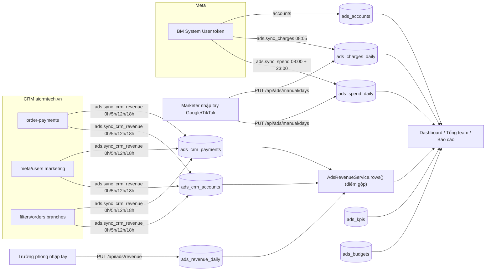
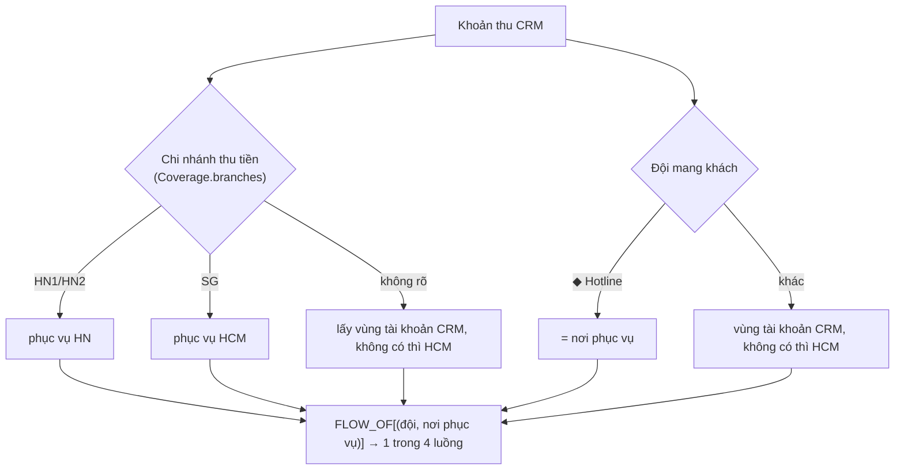

# Phòng Ads

> Báo cáo hiệu quả quảng cáo của Phòng Ads (phòng chạy quảng cáo, mã phòng `ADS`): chi tiêu, tin nhắn, SĐT đọc từ Meta, Google / TikTok nhập tay, doanh thu thực thu đọc từ CRM aicrmtech.vn, KPI và ngân sách tuần. Người dùng: nhân viên Marketing của phòng, Trưởng phòng, OWNER / ADMIN và những người được tích quyền xem. Trên giao diện: menu **Phòng Marketing › Phòng Ads** (`/ads…`), tab **Quản trị › Tài khoản CRM** (`/admin/crm`), và máy tính **Bảng order › Tính lương Ads** (`/tasks/salary`).

Đừng nhầm với **Luồng Order (ORD)**, mã kỹ thuật cũng là `ADS` (xem [ord.md](ord.md)). Module này là **Phòng Ads**: quảng cáo, không phải order video.

## Khái niệm & thuật ngữ

| Từ | Nghĩa |
|---|---|
| **BM** (Business Manager) | Một tài khoản doanh nghiệp Meta, chứa nhiều tài khoản quảng cáo. Mỗi BM gắn một **cơ sở** (`ads_connections.site`, ví dụ "Hà Nội", "Sài Gòn"). Hiện có **BM Hà Nội** và **BM Sài Gòn**. |
| **TKQC** | Tài khoản quảng cáo (`ads_accounts`). Facebook đọc từ BM; Google / TikTok do người dùng tự thêm. Mỗi TKQC được gán cho một marketer (`user_id`), chưa gán = "Chưa gán". |
| **HN / HCM / SG** | Hai vùng. Trong code `CrmRegion.HN` / `CrmRegion.HCM`; trên giao diện HCM thường ghi **SG** (Sài Gòn). |
| **Brand / nguồn ngân sách** | COREMIND, GPI, APEX hoặc Khác, đọc từ tên TKQC (`brand_of`); Trưởng phòng sửa tay được. |
| **Chi tiêu** (spend) | Tiền Meta báo đã tiêu theo ngày (`ads_spend_daily.spend`). |
| **Số tiền lập hoá đơn** (invoice / charges) | Tiền Meta đã trừ thẻ theo ngày (`ads_charges_daily.amount`). Hệ số nhân hiện là **1** (`invoice_factor`): không cộng VAT, không cộng phí thẻ. |
| **Mess / SĐT** | Số cuộc trò chuyện bắt đầu (`onsite_conversion.messaging_conversation_started_7d`) và số SĐT (`omni_purchase`) Meta báo. |
| **Thực thu** | Doanh thu = tiền khách đã trả, theo **ngày trả**, đọc từ CRM (`/raw-data/order-payments`). Không phải giá trị đơn. |
| **Doanh thu xét KPI** | Doanh thu **có VAT** (như sổ đối soát). Là con số so với KPI. |
| **DT hoa hồng** | Doanh thu xét KPI bỏ VAT 8%: `DT ÷ 1,08` (từ ngày 01/07/2026; trước đó bằng chính nó). Mẫu số của Ads / Doanh thu. |
| **Tài khoản CRM** | Một tài khoản marketing trên CRM (`ads_crm_accounts`, khoá = id CRM). Một người APM giữ được nhiều tài khoản CRM, doanh thu cộng lại. |
| **◆ Nguồn** (◆ source) | Dòng doanh thu không thuộc người nào: `HOTLINE`, `HN` ("HN chuyển HCM"), `GOOGLE`, `TIKTOK`, `SEEDING`, `UNASSIGNED` ("Chưa gán Marketing") - `RevenueSource`. Tính cho cả đội, không tính cho marketer. |
| **Nhân viên đã nghỉ** (former) | Tài khoản CRM của marketer đã nghỉ, không có tài khoản APM. Doanh thu là một dòng riêng mang tên trên CRM. |
| **Đội Marketing (team) vs Cơ sở phục vụ (site)** | Mỗi khoản thu có 2 vùng: vùng của **tài khoản CRM** (đội nào mang khách về) và vùng của **chi nhánh** thu tiền (khách được phục vụ ở đâu). |
| **Bốn luồng khách** (`FLOWS`) | `hcm_hcm` "SG", `hn_hn` "HN", `hn_hcm` "HN chuyển SG" (đội HN mang về, phục vụ ở SG), `hcm_hn` "SG chuyển HN". |
| **Doanh thu Marketing** | Theo đội mang khách: HN = HN + HN chuyển SG; SG = SG + SG chuyển HN. |
| **Doanh thu Cơ sở** | Theo nơi phục vụ: HN = HN + SG chuyển HN; SG = SG + HN chuyển SG. Tổng hai cách bằng nhau. |
| **Doanh số SG / Doanh số HN** | Phần doanh thu một dòng được phục vụ ở HCM (`amount`) / ở HN (`amount_hn`). |
| **Coverage** | Khoảng ngày đã đồng bộ CRM (`system_settings` key `ads_crm`). Trong khoảng này số CRM thay số nhập tay. |
| **Khối 1 / 2 / 3** | Ba khối của dashboard: tổng (thẻ số), theo nền tảng / marketer, bảng chi tiết. |

## Luồng chính

Điểm gộp doanh thu là **`AdsRevenueService.rows()`** (`application/ads/revenue_service.py`): mọi dashboard đọc qua đây. Trong khoảng coverage, người / nguồn nào giữ ít nhất một tài khoản CRM thì lấy số CRM (`crm_book`) và **bỏ qua** số đã nhập tay của họ những ngày đó; ngoài coverage hoặc người không có tài khoản CRM thì lấy số nhập tay.

Một khoản thu CRM được đặt vào luồng như sau (`crm_revenue.place`):

## Quy tắc nghiệp vụ hiện hành

### Đồng bộ Meta

1. **Lịch chạy** (`tasks/celery_app.py`, beat chạy giờ UTC): `ads.sync_spend` lúc **08:00 và 23:00** giờ VN, đọc **hôm qua** (`spend_window`; lần 23:00 đọc lại vì Meta còn sửa số). `ads.sync_charges` lúc **08:05**, đọc **5 ngày gần nhất**, và từ ngày 1-3 của tháng đọc thêm **cả tháng trước** (`charge_window`). Cả hai vào hàng đợi `q_sync` (chỉ service `worker-sync` nhận).
2. **Mỗi lần đồng bộ thay thế** các dòng của những ngày đã đọc, cho những tài khoản đã đọc được; tài khoản Meta không trả lời thì giữ số cũ (`AdsSyncService`, `application/ads/sync_service.py`).
3. **Mỗi BM một transaction** (`tasks/ads._sync`, `AdsSyncService.connection_ids`, `SyncReport.add`): BM đọc xong được lưu kể cả khi BM sau hết giờ.
4. **Gọi song song**: client Meta (`integrations/meta_ads/client.py`) gửi tối đa `PARALLEL` = 3 batch / trang `next` cùng lúc (`_each`, `billing_charges`). Batch 50 tài khoản (10 cho `/activities`). Tài khoản Meta báo "thử lại" (mã 960, giới hạn gọi) được hỏi lại trong batch nhỏ hơn. Một batch bị từ chối hẳn làm BM đó lỗi, sau khi các batch khác xong.
5. **Giới hạn thời gian**: `META_SOFT_TIME_LIMIT` 780 s / `META_TIME_LIMIT` 840 s, dưới ngưỡng 900 s `RUNNING_STALE_SECONDS` của bộ giám sát tác vụ.
6. **Kết quả** `SUCCESS` / `PARTIAL` / `FAILED` (mọi BM lỗi = FAILED) theo ngôn ngữ của bộ giám sát (`cron/recorder.outcome_of`): chạy lại theo chính sách, báo lỗi cho OWNER và các Trưởng phòng ADS (cờ `cron_jobs.notify`). Xem [platform.md](platform.md) mục tác vụ định kỳ.
7. **"Đồng bộ ngay" / "Kéo lại khoảng ngày"**: `POST /api/ads/sync {kind: spend|charges, since, until, connection_id}` - chỉ OWNER (`manage_connections`, else 403 `ads_connection_forbidden`), tối đa `MAX_SYNC_DAYS` 93 ngày, phải có cả 2 ngày hoặc không ngày nào (422 `ads_period_invalid`), 409 `cron_job_running` khi tác vụ đang chạy. Ghi audit `ads.sync.requested`.
8. **Token BM** được mã hoá ngay khi nhập bằng `SecretBox` (khoá `PR_SECRET_ENCRYPTION_KEY`, AAD `ads_connection:<id>`), trình duyệt chỉ thấy `••••abcd`; để trống token khi sửa = giữ token cũ (`application/ads/connection_service.py`). BM đã có tài khoản thì không xoá được (409 `ads_connection_in_use`), chỉ tắt (`active=false`).
9. **Gán TKQC**: chỉ Trưởng phòng ADS / OWNER / ADMIN (`manage_accounts`, else 403 `ads_account_forbidden`); chỉ người đang có ghế trong phòng ADS nhận được (`ads_people`, 422 `ads_assignee_invalid`). TKQC mới = "Chưa gán": chi tiêu tính cho phòng, không cho ai.

### Google / TikTok nhập tay

10. `ads_accounts.platform` = `FACEBOOK` (từ Meta) / `GOOGLE` / `TIKTOK`. Tài khoản nhập tay **không có BM** (`connection_id` NULL; ràng buộc giữ bắt buộc cho FACEBOOK), khoá chính `google:<id>` / `tiktok:<id>` (`manual_account_key`; id toàn số thì bỏ dấu gạch, nên `123-456` = `123456`), `external_id` giữ nguyên như gõ (chữ, số, `.`, `_`, `-`, tối đa 30 ký tự), có `site`, `created_by_user_id`.
11. **Ai thêm**: marketer thêm tài khoản của mình; Trưởng phòng / OWNER / ADMIN thêm cho bất kỳ ai có ghế ADS (`POST /api/ads/manual/accounts`). Cần `AdsAccess.in_ads` (có ghế ADS hoặc OWNER/ADMIN), người chỉ được tích quyền xem thì 403 `ads_manual_forbidden`. Lỗi 422 `ads_account_exists` / `ads_manual_invalid` / `ads_assignee_invalid`. Không thêm tay tài khoản Facebook.
12. **Sửa / xoá**: `PATCH` sửa tên, cơ sở, 4 số cuối thẻ. Xoá chỉ khi **chưa từng có số nào** (422 `ads_account_has_numbers`).
13. **Nhập số theo ngày**: `PUT /api/ads/manual/days {entries:[{account_id, day, field: spend|invoice, amount}]}` ghi vào **chính** `ads_spend_daily` / `ads_charges_daily` như Meta (`manual_service.AdsManualService.save`). Ô trống = xoá dòng (chưa nhập, khác 0). Không nhập ngày tương lai. Tài khoản Facebook → 422. Tài khoản người khác → 403 `ads_manual_forbidden`, không thấy → 404. Tối đa 2000 ô một lần. Mỗi thay đổi ghi `ads_manual_changes` + audit `ads.manual.saved`; `GET /api/ads/manual/changes` = "Lịch sử sửa" (mặc định 62 ngày gần nhất).
14. **Ai được gõ số** (`manual_service.may_edit`): tài khoản nhập tay, của chính mình; hoặc của bất kỳ ai nếu là Trưởng phòng / OWNER / ADMIN.

### Dashboard và báo cáo

15. **`platform=`** trên `/api/ads/dashboard`, `/team`, `/history`, `/history/day`: mặc định `FACEBOOK`, nên số Facebook **không gồm** Google / TikTok.
16. Google / TikTok: doanh thu = dòng ◆ `GOOGLE` / `TIKTOK` (chỉ ở cấp đội; xem một marketer thì `revenue_note = "platform"` và không có doanh thu), **không có KPI**, không có BM. Khối 3 liệt kê **mọi** tài khoản của nền tảng đó, kể cả chưa có số (`AccountLine.can_edit`, `spend_entered` / `invoice_entered`).
17. `/team` trả `channels` = mọi nền tảng cạnh nhau cho Khối 2, bất kể `platform` (`team_service._Raw.narrow`, `Channel`).
18. **Mặc định khoảng ngày** của dashboard nhân viên = **cả tháng** (không truyền ngày → tháng hiện tại; truyền 1 ngày → tháng chứa ngày đó). Phần điểm nhấn chỉ đọc tới hôm nay. Tối đa 366 ngày (422 `ads_period_invalid`).
19. `/team` nhận một tháng, hoặc `start` + `end` (so với cùng số ngày ngay trước). KPI luôn thuộc tháng mà khoảng kết thúc, đo trên doanh thu từ mùng 1 tháng đó tới ngày cuối khoảng.
20. **Chọn BM** (`connection_id`): chi phí (chi tiêu, hoá đơn, SĐT, các marketer giữ TKQC ở đó) chỉ của BM đó; **doanh thu** thu hẹp về **Doanh thu Marketing của vùng BM** (`team_service.bm_region`, `BM_REGION_FLOWS`: BM Hà Nội → `mkt_hn`, BM Sài Gòn → `mkt_hcm`). Thẻ chính đổi thành "Doanh thu MKT HN/SG (theo BM)" kèm `BmRevenueNote`; `RegionRevenue only=` chỉ hiện dòng Marketing của vùng đó. **"Doanh thu Cơ sở" vẫn để nguyên.**
21. Bộ lọc pháp nhân / brand / cơ sở chỉ thu hẹp **chi phí**, không đụng doanh thu.
22. **Không có bộ lọc "Miền" trên giao diện.** API vẫn nhận `site=` (`/team`, `/history`, `/history/day`) / `region=` (`/dashboard`) với các giá trị của `REGION_FLOWS`: `all`, `mkt_hcm`, `mkt_hn`, `site_hcm`, `site_hn`, từng luồng (`hcm_hcm`…), `hcm`, `hn`.
23. Dưới "Doanh thu tổng" có hai thẻ **Doanh thu Marketing** / **Doanh thu Cơ sở** (`components/ads.tsx` `RegionRevenue`, testid `revenue-marketing` / `revenue-site`), dữ liệu `regions` trên `/team` và `/dashboard` (`application/ads/regions.py` `region_split`).
24. **◆ Hotline + nhân viên đã nghỉ trong báo cáo đội**: `others[]` (`OtherLine`, kind `hotline` / `former`, có `kinds` cho hotline) vẽ sau các marketer ở Khối 3 (hàng `other-<key>`, chip Hotline / Đã nghỉ, chi phí "—", không có link) và dòng tổng "TỔNG GỒM HOTLINE & ĐÃ NGHỈ". `marketers` chỉ gồm người thật (ô chọn người, xếp hạng không đổi).
25. **Cảnh báo** ở Khối 2: marketer có Ads / Doanh thu > 60% (`ADS_RATIO_WATCH`) hoặc có chi tiêu mà không có doanh thu.
26. **Báo cáo tháng** (từ tháng 4, `REPORT_FROM_MONTH`, tới tháng chọn) và **Báo cáo ngày** (`AdsTeamService.history`): đội hoặc một marketer; nhân viên thường luôn nhận số của mình.
27. **Báo cáo ngày: mã khách**: mỗi khoản thu lưu `customer_code` (mã `KH…` của CRM; **không bao giờ** lưu tên / SĐT khách ở phía Phòng Ads). `GET /api/ads/history/day?day=&user_id=&connection_id=&site=&platform=` (`AdsTeamService.day_detail`, lọc giống `/history`: nhân viên = của mình, BM = luồng Marketing của vùng) trả `customers[{customer_code, amount, payments}]` (mỗi mã một dòng, hoàn tiền âm, điểm loại ra; dùng chung `crm_revenue.day_payments` + `place` / `FLOW_OF` với `crm_book`) và `typed` (phần nhập tay); tổng = `revenue`. Giao diện: số doanh thu của ngày là nút "Xem mã khách ngày dd/mm" mở `DayCustomers` (`components/ads-reports.tsx`: #, Mã khách, Thanh toán, dòng "Nhập tay", tổng dính đáy, "Sao chép danh sách" dạng TSV). Khoản thu đồng bộ trước khi có cột này thì `customer_code` null tới khi ngày đó được đồng bộ lại.
28. Số tiền trong câu được in đậm (`Money` trong `components/ads.tsx`).

### Doanh thu: nhập tay và từ CRM

29. **Nhập doanh thu** (`GET/PUT /api/ads/revenue`, mặc định hôm qua): mỗi người có ghế ADS một dòng (`u:<id>` = phần SG, `u:<id>:hn` = phần HN) + các ◆ nguồn (`s:HOTLINE`…). Ô trống = xoá dòng. Mỗi thay đổi ghi `ads_revenue_changes`, audit `ads.revenue.saved`. Chỉ Trưởng phòng ADS / OWNER / ADMIN (`edit_revenue`, 403 `ads_revenue_forbidden`); số 0-10.000 tỷ, gõ được "1.500.000" (422 `ads_revenue_invalid`).
30. Dòng đã có số CRM thì khoá (`from_crm`, nhãn "CRM"); lưu vào đó → 422 `ads_revenue_from_crm`.
31. **Đồng bộ CRM** = tác vụ chung với Tài chính `ads.sync_crm_revenue`, **0h / 5h / 12h / 18h** giờ VN. Cửa sổ `crm_window` = tháng này tới hôm nay; ngày 1-5 thì từ mùng 1 tháng trước. Chi tiết chung (các phần đơn hàng, công nợ…) ở [finance.md](finance.md#luồng-chính). Phần của Phòng Ads (`AdsCrmSyncService.apply`, `application/ads/crm_service.py`):
    - người dùng marketing trên CRM → `ads_crm_accounts` (tài khoản mới tự lấy vùng từ tên, `region_of`; id chỉ thấy trên khoản thu mà không có trong danh bạ → `in_directory = false`);
    - khoản thu của các ngày đọc **thay thế** số đã lưu (khoản thu bị xoá / đổi ngày trên CRM cũng mất theo);
    - chi nhánh đọc mỗi lần từ `/raw-data/filters/orders` (`branch_site`: tên HN1/HN2 → HN, SG → HCM); chưa đọc được thì dùng `DEFAULT_BRANCH_SITES` (12 → HN, 1 → HN, 9 → HCM); chi nhánh của khoản thu = chi nhánh của đơn;
    - coverage mở rộng theo những ngày đã đọc, lưu ở `system_settings` `ads_crm`;
    - sau đó gọi `mirror_ads_accounts` để bên Tài chính theo cùng liên kết (xem [finance.md](finance.md)).
32. **Thực thu CRM**: tính các loại thanh toán 1, 2, 4, 5, 6, 7 (`COUNTED_PAYMENT_TYPES`); loại 3 (điểm) không tính; loại 7 (hoàn tiền) đã âm sẵn.
33. **Vùng tài khoản CRM** (`region_of`): chữ đầu tên sau "Đã nghỉ" (nếu có): `HN` → HN, `SG` / `HCM` → HCM, khác → không rõ (tính như HCM). HCM / không rõ → "Doanh số SG" (`amount`), HN → "Doanh số HN" (`amount_hn`) - theo nơi phục vụ; `hn_team_hcm` / `hn_team_hn` = phần do tài khoản HN mang về.
34. **Một tài khoản CRM tính cho đúng một trong ba**: một người (`user_id`), một ◆ nguồn (`source`), hoặc nhân viên đã nghỉ (`former`, subject `c:<crm id>` = `crm_revenue.FORMER_PREFIX`). Ràng buộc DB `one_owner`. Không gán gì = không tính.
35. **◆ Hotline** mang `hotline_kind` FB / TIKTOK / GOOGLE (`HotlineKind`, tự đoán từ tên bằng `hotline_kind_of`, sửa bằng ô "Loại hotline"). Đội của hotline = **nơi phục vụ** (khách phục vụ ở HN tính cho BM HN). Đổi nguồn khỏi HOTLINE thì `hotline_kind` bị xoá.
36. **Nhân viên đã nghỉ**: chọn "Nhân viên đã nghỉ (dùng tên CRM)" trong "Tính cho", hoặc chữ "Nhân viên đã nghỉ" / "Đã nghỉ" trong cột nguồn khi nhập file. Vùng = vùng tài khoản.
37. **Màn "Tài khoản CRM"** = **Quản trị › Tài khoản CRM** `/admin/crm` (tab `crm` trong `components/admin-tabs.tsx`, hiện với `ads.edit_revenue`; `/ads/crm` tự chuyển sang). Đây là nơi duy nhất gắn tài khoản CRM cho cả Phòng Ads lẫn Tài chính. Gồm: trạng thái + coverage, "Đồng bộ ngay", "Nhập từ file Excel", sửa từng tài khoản, tổng tháng đã gắn / chưa gắn. Quyền: Trưởng phòng ADS / OWNER / ADMIN (`AdsCrmService._require`, 403 `ads_revenue_forbidden`).
    - `PATCH /api/ads/crm/accounts/{id}` chỉ đổi các khoá được gửi (`user_id`, `source`, `region`, `hotline_kind`, `former`, `note`). Chọn người thì bỏ nguồn và ngược lại; gửi **cả hai** trong một lần → 422 `ads_crm_invalid`. Audit `ads.crm.account.updated`.
    - `POST /api/ads/crm/import {data: base64}` - workbook "Gắn mã" (≤ 5 MB): cột **CRM ID**, **Mã nhân viên APM**, **Hoặc tính vào nguồn ◆**, tuỳ chọn **Khu vực**, **Ghi chú**; chữ "Không tính" = không gán. Một dòng sai → cả file bị từ chối, 422 `ads_crm_import_invalid` + `details.problems`, không ghi gì. Audit `ads.crm.imported`. Nguồn dữ liệu gắn mã thực tế: Google Sheet "Gắn mã" của người dùng (`1pdxGx0W0C78QvWwnljyzM4FoD7PNf2g3YMPcQa71CFY`).
    - `POST /api/ads/crm/sync {since, until}` - "Đồng bộ ngay" (không ngày) / kéo lại ≤ 93 ngày, không ngày tương lai; 409 `cron_job_running` khi đang chạy.
    - `GET /api/ads/crm?month=` - danh sách + thực thu tháng; `configured` = đã có `CRM_API_KEY`.

### KPI và ngân sách tuần (theo BM)

38. **Mọi KPI và ngân sách tuần thuộc một BM**: `HN` (BM Hà Nội) hoặc `HCM` (BM Sài Gòn) - cột `region`, nhãn `domain/ads/crm.BM_LABELS`.
39. **KPI**: `GET /api/ads/kpi?month=&region=` (mặc định `HN`; trả `region`, `regions`, `can_edit`), `PUT /api/ads/kpi {month, region, entries}` (`region` bắt buộc; khoá `team` = cả đội, `u:<id>` = một marketer). Ghi: `edit_revenue` (403 `ads_revenue_forbidden`), audit `ads.kpi.saved`. `AdsRevenueService.kpi_amounts(month, region=None)` cộng cả 2 BM khi không chọn BM.
40. **Đọc KPI**: báo cáo đội / lịch sử lấy BM từ `connection_id` (`bm_region`). Có BM → KPI đội + KPI marketer của BM đó so với **doanh thu Marketing của vùng** (`region_amount(row, BM_REGION_FLOWS[region])`). Không BM → KPI cả 2 BM cộng lại so với **toàn bộ** doanh thu (`gross`). Thẻ "Tiến độ KPI · BM …" / "· cả 2 BM".
41. **Ngân sách tuần**: mỗi tháng 4 tuần cố định: ngày 1-7, 8-14, 15-21, 22-cuối tháng (`domain/ads/budget.py` `budget_weeks`, nhãn "Tuần N · dd/mm - dd/mm").
42. **Trạng thái tuần** (`budget_status`): `OVER` "Vượt ngưỡng" (chi > ngân sách, ngay cả giữa tuần) / `REACHED` "Đạt ngưỡng" (tuần đã hết và chi ≥ 90% `REACHED_RATE`; ngân sách 0 cũng tính là đạt) / `UNDER` "Chưa đến ngưỡng" / `RUNNING` "Đang chạy" (tuần hiện tại, chưa vượt) / `UPCOMING` / `NO_BUDGET`.
43. **Chi tiêu so với ngân sách** = **mọi nền tảng** trên các TKQC người đó giữ (không lọc BM / site). Khi chọn một BM: chỉ chi tiêu của TKQC thuộc cơ sở đó (`place_region(site của BM, else site của tài khoản nhập tay)`); TKQC không rõ cơ sở chỉ tính ở chế độ xem cả 2 BM.
44. **Người trong bảng** = người có ghế ADS + người còn ngân sách trong tháng; dòng tổng "Cả phòng" (`application/ads/budget_service.py`; `vn_today` được patch trong test).
45. API: `GET /api/ads/budget?month=&user_id=&region=` (không `region` = cộng 2 BM, `region` null; nhân viên chỉ thấy dòng của mình, `total` null), `PUT /api/ads/budget {month, region, entries: {"<user id>:<week>": amount|null}}` (`edit_revenue`, 403 `ads_revenue_forbidden`; 422 `ads_budget_invalid`; tối đa 2000 ô; audit `ads.budget.saved`).

## Công thức

| Chỉ số | Công thức | Ở đâu |
|---|---|---|
| DT hoa hồng | `DT xét KPI ÷ 1,08` nếu ngày ≥ 01/07/2026, else `DT xét KPI` | `domain/ads/models.commission_revenue` |
| Ads / Doanh thu (cấp đội, thẻ Khối 1) | `(hoá đơn nếu > 0, else chi tiêu) ÷ DT hoa hồng` | `team_service.Figures.ads_ratio` (`charged`) |
| Ads / DT thực | `hoá đơn ÷ DT xét KPI` | `Figures.ads_ratio_real` |
| Ads / Doanh thu (một marketer, dashboard nhân viên, chuỗi theo ngày) | `chi tiêu ÷ DT hoa hồng` | `MarketerLine.ads_ratio`, `dashboard_service` |
| Màu Ads / DT | ≤ 40% tốt, ≤ 60% theo dõi, > 60% xấu | `ads_ratio_tone` |
| Hiệu suất vùng | `chi tiêu TKQC của cơ sở đó ÷ Doanh thu Marketing vùng đó (có VAT)` | `regions.RegionFigures.ads_ratio` |
| Doanh thu Marketing HN / SG | `hn_hn + hn_hcm` / `hcm_hcm + hcm_hn` | `regions.MARKETING_FLOWS` |
| Doanh thu Cơ sở HN / SG | `hn_hn + hcm_hn` / `hcm_hcm + hn_hcm` | `regions.SITE_FLOWS` |
| Bốn luồng của một dòng | `hcm_hcm = amount − hn_team_hcm`, `hn_hn = hn_team_hn`, `hn_hcm = hn_team_hcm`, `hcm_hn = amount_hn − hn_team_hn`; dòng ◆ "HN chuyển HCM" nhập tay = toàn bộ vào `hn_hcm` | `RevenueRow.flows` |
| Doanh thu KPI của marketer | `Doanh số SG + Doanh số HN` (`gross`) | `RevenueRow.gross` |
| % KPI | `doanh thu KPI ÷ KPI` | `MarketerLine.kpi_rate` |
| Chi phí / SĐT, Chi phí / Mess, Tỉ lệ ra SĐT | `chi tiêu ÷ SĐT`, `chi tiêu ÷ Mess`, `SĐT ÷ Mess` | `dashboard_service` |
| Số tiền lập hoá đơn | `charge Meta × 1` | `invoice_factor` |
| Hoá đơn khớp chi tiêu | chênh ≤ max(1% chi tiêu, 10.000 ₫) | `domain/ads/models.matches` |
| Trạng thái ngân sách | xem quy tắc 42 | `budget_status` |

**Tính lương Ads** (`frontend/src/lib/ads-salary.ts`, chỉ chạy trên trình duyệt, không lưu, không API; công thức **cố định trong code**, đổi tỉ lệ = sửa file này):

- Lương cứng P1+P2 theo bậc: 10,5 / 9,5 / 8 triệu; tháng chuẩn 23 ngày; đi làm ≥ 90% số ngày = đủ lương, dưới đó theo tỉ lệ (`attendanceFactor`).
- Phụ cấp ăn + đi lại 35.000 ₫ / ngày công.
- Thưởng bill lớn (Game): 100-200tr 300k, 200-300tr 500k, 300-500tr 1tr, ≥ 500tr 2tr; thưởng tuần (Nhất 900k, Nhì 500k, bill cao nhất 350k).
- **P3 hoa hồng mỗi vùng** = `80% × doanh thu × chuyên cần × tỉ lệ(KPI) × hệ số vùng chi phí` + `20% × doanh thu × tỉ lệ(KPI)`. Tỉ lệ theo % KPI: ≥120% 1,4%, ≥110% 1,3%, ≥100% 1,2%, ≥90% 1,1%, ≥80% 0,9%, ≥70% 0,7%, else 0,5%. Hệ số vùng theo `d = % chi phí thực − % khoán`: ≤ −5 → 1,2; ≤ −2 → 1,1; ≤ 2 → 1,0; ≤ 5 → 0,8; ≤ 10 → 0,7; còn lại 0,5.
- Thưởng quý / năm: doanh thu × % theo bậc KPI (`KPI_STEPS`).
- Máy tính cost: TK thuê + 2%, TK công ty (thuế) + 11,1%.

## Phân quyền

`application/ads/access.py` `ads_access(membership)` → `AdsAccess`:

| Ai | `view` | `view_all` | `manage_accounts` | `edit_revenue` | `manage_connections` | `in_ads` |
|---|---|---|---|---|---|---|
| OWNER | ✓ | ✓ | ✓ | ✓ | ✓ | ✓ |
| ADMIN | ✓ | ✓ | ✓ | ✓ | | ✓ |
| Trưởng phòng (ghế HEAD phòng `ADS`) | ✓ | ✓ | ✓ | ✓ | | ✓ |
| Nhân viên phòng `ADS` | ✓ (số của mình) | nếu được tích `DASHBOARD` | | | | ✓ |
| Người ngoài được tích **`ADS` / `DASHBOARD`** | ✓ | ✓ (**chỉ xem**) | | | | |
| Người khác | 404 `ads_not_visible` | | | | | |

- Quyền **`ADS` / `DASHBOARD`** "Xem dashboard Phòng Ads (toàn phòng, chỉ xem)" (`domain/ads/permissions.py`, module nằm trong `MODULES` trước `ASSISTANT`, phạm vi NONE / ALL, không có mặc định): OWNER tích trên trang "Quyền" của một người hoặc theo phòng ở Phòng ban (cơ chế ở [org.md](org.md)). Người được tích thấy mọi marketer, "Tổng team", Tài khoản QC, nhưng không nhập doanh thu / KPI / ngân sách, không sửa TKQC, không thêm tài khoản nhập tay (`can_add_account` false).
- `/api/ads/team` cần `view_all` (else 404 `ads_not_visible`). `/dashboard`, `/history`, `/history/day`, `/budget`: người không `view_all` luôn nhận số của chính mình, bỏ qua `user_id`.
- "Kết nối BM" (`/ads/connections`, mọi route `/api/ads/connections*`) và "Đồng bộ ngay" Meta: **chỉ OWNER**.
- `/api/units/me` `ads {view, view_all, manage_accounts, manage_connections, edit_revenue}` lái menu: "Nhập doanh thu", "KPI doanh thu", "Ngân sách tuần" chỉ khi `edit_revenue`; "Kết nối BM" khi `manage_connections` (`components/shell.tsx` `adsBranch`).
- **Tính lương Ads** (`/tasks/salary`, mục "Bảng order › Tính lương Ads"): `seesAdsSalary` = có ghế phòng `ADS`, hoặc OWNER / ADMIN, hoặc `can_view_all`; trang từ chối người khác.

## Dữ liệu

| Bảng | Nội dung | Ghi chú |
|---|---|---|
| `ads_connections` | Một BM: tên, `business_id` (unique), `site`, token mã hoá + `token_hint`, `active`, kết quả test / sync gần nhất | 0078 |
| `ads_accounts` | PK `account_id` (Meta `act_…` hoặc `google:<id>`), `connection_id` (NULL với nhập tay), `platform`, `brand` + `brand_custom`, `user_id`, `card_last4`, `external_id`, `site`, `created_by_user_id` | 0078, 0079, 0081 |
| `ads_spend_daily` | PK (day, account_id): `spend`, `messages`, `phones`, `synced_at` | Meta + nhập tay |
| `ads_charges_daily` | PK (day, account_id): `amount`, `charges` | Meta + nhập tay |
| `ads_manual_changes` | Lịch sử từng số nhập tay (field spend/invoice, cũ, mới, ai) | append-only, 0081 |
| `ads_revenue_daily` | Doanh thu nhập tay: (day, `subject_key` `u:<id>` / `s:<SOURCE>`), `amount` (SG), `amount_hn` | không dòng = chưa nhập ≠ 0; 0079 |
| `ads_revenue_changes` | Lịch sử sửa doanh thu (`part`) | append-only |
| `ads_kpis` | (month, `subject_key` `team` / `u:<id>`, `region`) → `amount` | `region` từ 0087, unique gồm region |
| `ads_budgets` | (month, user_id, week 1-4, `region`) → `amount` | 0082, `region` 0087 |
| `ads_crm_accounts` | PK `crm_id`: `name`, `active`, `in_directory`, `region`, `user_id` / `source` / `former` (check `one_owner`), `hotline_kind`, `note` | 0083, 0084 |
| `ads_crm_payments` | PK id CRM: `payment_date`, `price`, `payment_type`, `marketing_id`, `branch_id`, `order_id`, `is_upsale`, `source_id`, `customer_code`; từ 0105 thêm `telesales_id` / `cskh_id` / `carepage_id` / `owner_id`, `order_code`, `customer_name` (chỉ Tài chính dùng) | Phòng Ads **không bao giờ** hiển thị tên khách; không lưu SĐT |
| `system_settings` `ads_crm` | Coverage: `synced_from/to`, lần sync, `branches` | `crm_revenue.Coverage` |
| `cron_jobs.notify` / `notify_user_ids` | Ai nhận cảnh báo khi tác vụ lỗi; mặc định bật cho 2 tác vụ Meta, gửi Trưởng phòng ADS | 0080, xem [platform.md](platform.md) |

Cấu hình (env, khai ở `docker-compose.yml` `x-app-env` và `.env.example`): `CRM_API_BASE_URL` (mặc định `https://aicrmtech.vn/api/internal`), `CRM_API_KEY` (Settings `crm_api_base_url` / `crm_api_key`; key **chỉ** đi trong header `x-api-key`), `PR_SECRET_ENCRYPTION_KEY` (mã hoá token BM).

## Code ở đâu

| Lớp | File |
|---|---|
| domain | `domain/ads/models.py` (brand, platform, ◆ nguồn, `commission_revenue`, `manual_account_key`, `Period`), `domain/ads/crm.py` (vùng, hotline, chi nhánh, loại thanh toán, `BM_LABELS`), `domain/ads/budget.py`, `domain/ads/permissions.py` |
| application | `application/ads/access.py`, `connection_service.py` (Kết nối BM), `sync_service.py` (Meta), `accounts_service.py` (Tài khoản QC, `ads_people`), `manual_service.py`, `revenue_service.py` (nhập tay + `rows()` + KPI), `crm_service.py` (`AdsCrmSyncService`, `AdsCrmService`, `crm_window`), `crm_revenue.py` (`CrmBook`, `Coverage`, `place`, `day_payments`), `regions.py`, `dashboard_service.py` (dashboard nhân viên), `team_service.py` (Tổng team, báo cáo, `bm_region`), `budget_service.py`; dùng chung với Tài chính: `application/crm/sync.py`, `application/crm/staff_link.py` |
| integrations | `integrations/meta_ads/client.py` (`GraphMetaAdsClient`, Graph `v25.0`, `FakeMetaAdsClient`), `integrations/crm/client.py` (`HttpCrmClient`, `FakeCrmClient`) |
| tasks | `tasks/ads.py` (`ads.sync_spend`, `ads.sync_charges`, `ads.sync_crm_revenue`), lịch trong `tasks/celery_app.py` |
| api | `api/routers/ads.py`, `api/schemas/ads.py`; `api/routers/units.py` `_ads_block` |
| frontend | `app/ads/page.tsx` (Dashboard Ads: Tổng team / một marketer), `app/ads/{revenue,kpi,budget,accounts,connections}/page.tsx`, chuyển hướng `app/ads/{team,jobs,crm}`, `app/admin/ads` → `/ads/connections`, `app/admin/crm/page.tsx`, `app/tasks/salary/page.tsx`; `components/ads.tsx` (`PLATFORMS`, `PlatformSelect`, `BMS`, `BmPicker`, `bmLabel`, `RegionRevenue`, `BmRevenueNote`, `Money`), `components/ads-team.tsx` (`TeamDashboard`, `ManualSource`), `components/ads-staff.tsx`, `components/ads-reports.tsx` (`AdsReports`, `DayCustomers`), `components/ads-manual.tsx` (`ManualToolbar`, `ManualDayForm`, `ManualDailyTable`, `ManualAccountButton`), `components/ads-budget.tsx` (`BudgetBoard`, `BudgetTable`), `components/ads-entry.tsx`; `lib/ads-salary.ts` |
| tests (backend) | `tests/unit/test_ads_department.py`, `test_ads_manual.py`, `test_ads_budget.py`, `test_ads_crm.py`, `test_ads_permissions.py`; `tests/integration/test_ads_department_migration.py`, `test_ads_revenue_migration.py`, `test_ads_manual_migration.py`, `test_ads_budget_migration.py`, `test_ads_crm_migration.py`, `test_ads_crm_former_migration.py`, `test_ads_crm_customer_code_migration.py`, `test_ads_kpi_budget_bm_migration.py` |
| tests (frontend) | `frontend/tests/ads-department.test.tsx`, `ads-manual.test.tsx`, `ads-budget.test.tsx`, `ads-crm.test.tsx`, `ads-salary.test.tsx` |

Các test đáng biết: `test_ads_department.py::test_15` (người ngoài được tích chỉ xem), `::test_16` (gọi Meta 3 batch một lúc), `test_ads_budget.py::test_04` (ngân sách theo BM), `test_ads_crm.py::test_09` (mã khách ngày), `ads-department.test.tsx` "a day's revenue opens the customer codes", `ads-budget.test.tsx` "budgets are typed per BM".

## API

Tất cả dưới `/api/ads` (`api/routers/ads.py`). Người không có quyền xem nhận 404 `ads_not_visible`.

| Method + path | Ai | Ghi chú |
|---|---|---|
| `GET /connections` | OWNER | Danh sách BM, `secret_ready`, `sites` |
| `POST /connections` | OWNER | `{name, business_id, site, token, note}`; 422 `ads_connection_invalid` |
| `PATCH /connections/{id}` | OWNER | token trống = giữ; `active` |
| `DELETE /connections/{id}` | OWNER | 409 `ads_connection_in_use` khi đã có TKQC |
| `POST /connections/{id}/test` | OWNER | Thất bại là một câu trả lời (`ok:false` + lý do), không phải lỗi |
| `POST /sync` | OWNER | `{kind, since, until, connection_id}`, 202 `{task_id, job_key}` |
| `GET /accounts?connection_id=&unassigned=&q=&month=&platform=` | view | Tài khoản QC; `people` khi `manage_accounts` |
| `PATCH /accounts/{account_id}` | manage_accounts | `{user_id (null = Chưa gán), brand}`; audit `ads.account.assigned` |
| `GET /dashboard?start=&end=&group=day|week|month&user_id=&brand=&connection_id=&site=&platform=&region=` | view | Dashboard một người / cả phòng |
| `POST /manual/accounts` | in_ads | 201 |
| `PATCH /manual/accounts/{id}` · `DELETE /manual/accounts/{id}` | chủ TK / quản lý | audit `ads.account.created/updated/deleted` |
| `PUT /manual/days` | chủ TK / quản lý | `{entries}` → `{changed}` |
| `GET /manual/changes?start=&end=&account_id=&user_id=&platform=` | view | Lịch sử sửa |
| `GET /revenue?day=` · `PUT /revenue {day, entries}` | edit_revenue | Nhập doanh thu |
| `GET /kpi?month=&region=` · `PUT /kpi {month, region, entries}` | đọc: view; ghi: edit_revenue | |
| `GET /crm?month=` | edit_revenue | Tài khoản CRM |
| `PATCH /crm/accounts/{crm_id}?month=` | edit_revenue | |
| `POST /crm/import {data}` | edit_revenue | `{rows, changed, created}` |
| `POST /crm/sync {since, until}` | edit_revenue | 202 |
| `GET /budget?month=&user_id=&region=` · `PUT /budget {month, region, entries}` | đọc: view; ghi: edit_revenue | |
| `GET /team?month=&site=&connection_id=&start=&end=&platform=` | view_all | Tổng team |
| `GET /history?month=&user_id=&connection_id=&site=&platform=` | view | Báo cáo tháng + ngày |
| `GET /history/day?day=&user_id=&connection_id=&site=&platform=` | view | Mã khách của một ngày |

Mã lỗi khác: 404 `ads_connection_not_found`, `ads_account_not_found`, `ads_crm_account_not_found`; 422 `ads_period_invalid` (khoảng ngày / tháng sai).

## Cạm bẫy & chưa làm

- **Tháng 7/2026 là mốc VAT**: trước 01/07/2026 DT hoa hồng = DT xét KPI (`REVENUE_VAT_FROM`). Đừng "sửa" chỗ này cho đồng nhất.
- **Ads / DT có hai mẫu số khác nhau**: cấp đội dùng hoá đơn (else chi tiêu), cấp marketer và dashboard nhân viên dùng chi tiêu. Hiệu suất vùng chia doanh thu **có VAT**. Trợ lý AI và các agent đọc định nghĩa trong `domain/assistant/skill.py` `TERMS` ([assistant.md](assistant.md)): sửa công thức thì sửa cả đó.
- **Coverage thắng nhập tay**: trong khoảng đã đồng bộ, người có tài khoản CRM mà số nhập tay khác số CRM thì số nhập tay **bị bỏ qua**, không cộng.
- `ads_crm_payments` giờ có `customer_name` (do Tài chính cần). Phòng Ads không được hiển thị nó; mọi màn Phòng Ads chỉ dùng `customer_code`.
- Doanh thu nhập tay trên dòng của marketer luôn được coi là **đội HCM** (`hn_team_*` = 0); dòng ◆ "HN chuyển HCM" nhập tay = luồng `hn_hcm`.
- **Hàng đợi khi bấm tay**: `POST /api/ads/sync` và `POST /api/ads/crm/sync` gửi task vào `q_integrations` (worker thường), trong khi lịch tự động và `POST /api/finance/sync` dùng `q_sync` (`worker-sync`). Hệ quả: một lần kéo lại dài có thể chiếm slot của worker thường.
- Docstring cũ còn ghi "hourly" (`crm_window`, `CrmSyncRequest`, migration 0086); lịch thật là 4 lần / ngày.
- Mess / SĐT của Google / TikTok không nhập được (các thẻ đó để trống).
- Dữ liệu CRM của prod được kiểm 29/10 là gọi được (IP đi ra của prod đã được CRM cho phép).
- Chưa làm: API thật cho Google / TikTok Ads, khách hàng / booking / số bill trên dashboard, CRM riêng trong APM (kế hoạch ở `docs/crm/CRM_PLAN.md`, chưa bắt đầu).

## Mốc thay đổi

| Migration / ngày | Thay đổi |
|---|---|
| 0077 (27/10/2026) | Bộ giám sát tác vụ định kỳ (`cron_jobs`, `cron_job_runs`, `cron_job_incidents`) - nền cho các tác vụ đồng bộ. Chi tiết ở [platform.md](platform.md). |
| 0078 (27/10) | Phòng Ads: `ads_connections`, `ads_accounts`, `ads_spend_daily`, `ads_charges_daily`; đồng bộ Meta thay Google Sheet + Apps Script. Hệ số hoá đơn chốt = 1 (27/10). |
| 0079 (27/10) | Doanh thu nhập tay (`ads_revenue_daily`, `ads_revenue_changes`), `ads_kpis`, `ads_accounts.card_last4`. Dashboard tổng gộp vào Dashboard Ads. |
| 0080 (28/10) | `cron_jobs.notify` / `notify_user_ids`: bật cảnh báo cho 2 tác vụ Meta, gửi Trưởng phòng ADS. |
| 0081 (28/10) | Google / TikTok nhập tay: `ads_accounts.platform`, `external_id`, `site`, `created_by_user_id`, `connection_id` nullable; `ads_manual_changes`. |
| 0082 (29/10) | `ads_budgets` - ngân sách 4 tuần. |
| 0083 (29/10) | Doanh thu từ CRM: `ads_crm_accounts`, `ads_crm_payments`; đồng bộ mỗi giờ (đã đổi, xem dưới). |
| 30/10 (không migration) | Bốn luồng khách, Doanh thu Marketing / Cơ sở, hiệu suất theo vùng, BM chọn doanh thu Marketing; bỏ bộ lọc "Miền" trên giao diện; dashboard nhân viên mặc định cả tháng. |
| 0084 (30/10) | `hotline_kind`, `former`; ràng buộc `one_owner` cho phép người / nguồn / đã nghỉ. |
| 0086 (31/10) | `ads_crm_payments.customer_code`, "Xem mã khách" trong Báo cáo ngày. |
| 0087 (02/11) | KPI và ngân sách tuần theo BM (`region`); mọi dòng cũ thành BM Hà Nội. Thay quy tắc 30/10 "KPI đội để nguyên khi chọn BM". |
| 02/11 (không migration) | Quyền `ADS` / `DASHBOARD` cho người ngoài phòng, `AdsAccess.in_ads`. |
| 03/11 (không migration) | Đồng bộ Meta: mỗi BM một transaction, 3 lời gọi song song, giới hạn 780 / 840 s (sự cố ngày 03/11: 299 tài khoản vượt 540 s, không lưu gì). |
| 0105 (13/11) | Đồng bộ CRM gộp với Tài chính, 4 lần / ngày (0h, 5h, 12h, 18h) thay cho mỗi giờ; `ads_crm_payments` thêm cột cho Tài chính. "Tài khoản CRM" chuyển sang Quản trị `/admin/crm`; "Tác vụ định kỳ" về lại `/admin/cron`. |
| 0108 (13/11) | Liên kết tài khoản CRM của Phòng Ads tự chép sang `crm_staff` của Tài chính. |
| 20/10 (frontend) | Máy tính "Tính lương Ads" `/tasks/salary` (từ file MayTinhLuong_Ads.html của phòng). |
