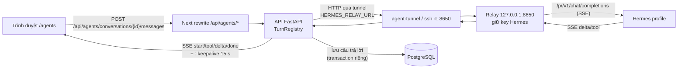
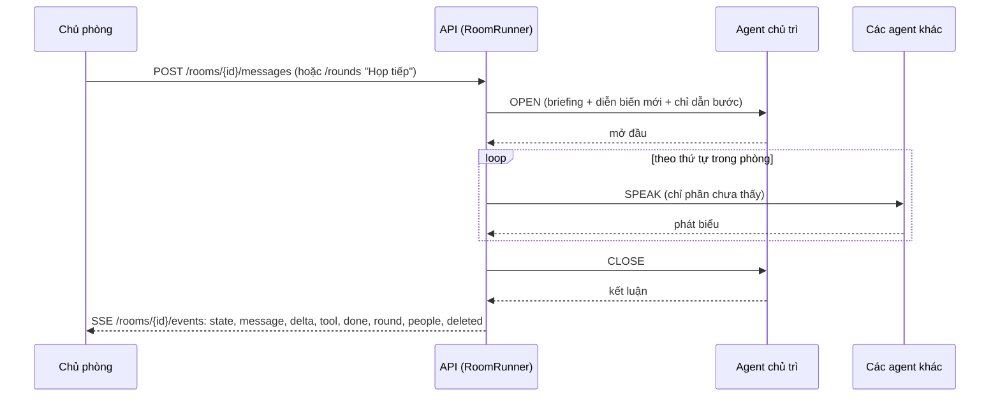

# Đội agent (Hermes)

> Cho người trong công ty chat với 15 agent AI Hermes của Apexmed (Chủ tịch, CEO, CFO, CMO, Marketing Ads, Pháp chế…) ngay trong APM: gửi câu hỏi kèm ảnh / tài liệu, nhận câu trả lời chạy dần (stream), ảnh, giọng đọc, trang HTML; mở "Phòng họp" cho nhiều agent bàn nhau. Agent cũng đọc được số liệu APM qua một cổng riêng. Trên giao diện: menu **"Đội agent"** (`/agents`, tab "Chat riêng" / "Phòng họp"), và **Quản trị › Đội agent** (`/admin/agents`) cho người quản lý.

Kế hoạch gốc: `docs/ai-assistant/AGENT_TEAM_CHAT_PLAN.md` (bối cảnh; code là chuẩn). Trợ lý báo cáo trên **Telegram** là module khác: [assistant.md](assistant.md).

## Khái niệm & thuật ngữ

- **Hermes**: phần mềm agent chạy trên VPS riêng của agent (SSH alias `secondbrain`). Mỗi agent là một *profile* Hermes, gọi bằng **slug**: `chutich ceo cco cfo cmo mktads mktnghiencuu mktnoidung mktthietke mktdung telesale cskh chatpage nhansu phapche`. APM không chạy model; APM chỉ chuyển câu hỏi và lưu câu trả lời.
- **Relay**: chương trình nhỏ trên VPS agent (`/opt/apexmed/agent-relay.py`, service user `apm-agent-relay`, nghe `127.0.0.1:8650`). Relay giữ API key Hermes của từng agent; APM chỉ giữ token của relay. Mã nguồn relay nằm ở repo `apm-agent` (xem [Cạm bẫy](#cạm-bẫy--chưa-làm)).
- **Đường hầm (tunnel)**: kết nối SSH chỉ mở đúng cổng 8650 của relay. Máy dev tự mở bằng tay; server dùng service compose `agent-tunnel`.
- **Lượt trả lời (turn)**: một câu trả lời của agent cho một câu hỏi. Chạy như *background task* trong tiến trình API, tách khỏi kết nối trình duyệt.
- **Transcript Hermes**: Hermes tự nhớ lịch sử hội thoại theo `X-Hermes-Session-Id`; APM chỉ gửi câu hỏi mới nhất.
- **Phạm vi trí nhớ dài hạn**: `X-Hermes-Session-Key` = `apm:<user id>:<slug>` (mỗi người × mỗi agent một vùng nhớ).
- **Tệp đính kèm**: ảnh (agent nhìn thấy), tài liệu (APM đọc ra chữ rồi gửi kèm câu hỏi), skill (`SKILL.md` hoặc `.zip` chứa nó).
- **Skill**: hướng dẫn dạng Markdown của Hermes. Ba nguồn: `kho` (đã duyệt trong Second Brain), `rieng` (agent tự có, chưa duyệt), `co-san` (Hermes có sẵn).
- **`MEDIA:` tag**: cách Hermes trả một tệp trong câu trả lời: dòng `MEDIA:/đường/dẫn/tuyệt/đối.png` trên VPS. APM tự lấy tệp đó qua relay.
- **Phòng họp (room)**: 2-6 agent nói lần lượt theo vòng, có một agent **chủ trì** (chair), cộng những người được mời.
- **Vòng (round)**: chủ trì mở đầu (`OPEN`) → mỗi agent khác phát biểu một lần (`SPEAK`) → chủ trì kết luận (`CLOSE`).
- **Cổng số liệu (gateway)**: `/api/agents/gateway/*`, nơi agent (qua công cụ `apm_bao_cao` của brain-mcp) đọc báo cáo APM. Không dùng phiên web; dùng token riêng.
- **Vùng dữ liệu (data area)**: loại báo cáo một agent được đọc: `COMPANY`, `ADS_REVENUE`, `ADS_KPI_BUDGET`, `PERFORMANCE`, `ORDERS`, `PR`, `RESOURCES`.

## Luồng chính

### Đường đi của một câu hỏi



1. Trình duyệt tải tệp trước (nếu có), mỗi tệp một request, rồi gửi `{text, attachment_ids}`.
2. API kiểm tra, ghi câu hỏi + một dòng câu trả lời rỗng `STREAMING`, **commit**, rồi mới khởi chạy task trả lời (task lưu trên transaction riêng, nên câu hỏi phải có trong DB trước).
3. Task đọc SSE từ relay, phát lại cho mọi người đang nghe. Đóng tab không làm mất câu trả lời: task vẫn chạy tới cuối và lưu.
4. Khi xong: tách ảnh / tệp / trang HTML khỏi chữ (xem quy tắc 15-18), lưu với trạng thái `DONE` / `FAILED` / `CANCELLED`.

### Vòng họp



## Quy tắc hiện hành

### Ai chat với agent nào

1. Một agent hiện cho người dùng khi agent **đang bật** (`active`) và một trong các điều sau đúng: người dùng là OWNER/ADMIN (`membership.sees_all`); người dùng giữ quyền `AGENTS` / `CHAT`; agent `everyone`; một ghế đang mở của người dùng thuộc `allowed_department_ids`; hoặc người dùng nằm trong `allowed_user_ids`. Thực thi: `application/agents/access.py:AgentAccess.may_chat`. Agent không được thấy → 404 `agent_not_found`.
2. Quản lý agent (bật/tắt, danh sách phòng ban/người, vùng dữ liệu) cần `AgentAccess.manage` = OWNER, hoặc người được tích `AGENTS` / `MANAGE`. Thiếu → 403 `agents_forbidden` (`AgentAccess.require_manage`).
3. Cuộc trò chuyện chỉ chủ của nó đọc được. Của người khác → 404 `conversation_not_found` (`AgentChatService.conversation`). Tệp cũng vậy → 404 `attachment_not_found`.

### Gửi câu hỏi

4. Tin nhắn: bỏ khoảng trắng hai đầu; trống mà không có tệp → 422 `agent_message_invalid`; dài hơn `MAX_MESSAGE_CHARS` (8000) → 422 `agent_message_invalid`. Thực thi: `AgentChatService.prepare_turn`.
5. Giới hạn tốc độ: tối đa `RATE_LIMIT` (20) câu hỏi mỗi `RATE_WINDOW_SECONDS` (300 s) mỗi người → 429 `agent_rate_limited`.
6. Mỗi cuộc trò chuyện chỉ một câu trả lời chạy cùng lúc: `TurnRegistry.reserve` → 409 `agent_busy`.
7. Relay chưa cấu hình (`HERMES_RELAY_URL` hoặc `HERMES_RELAY_TOKEN` trống) → 503 `agents_not_configured`. Danh sách agent vẫn trả về với `configured: false`.
8. Câu hỏi **đầu tiên** của cuộc trò chuyện được thêm tiền tố `[Người hỏi: <tên> - <nhãn ghế>. Hỏi qua APM Management.]` để agent biết ai hỏi (`prepare_turn`, nhãn từ `domain/org/models.seat_label`).
9. Tên cuộc trò chuyện = dòng đầu của câu hỏi đầu, cắt ở `TITLE_CHARS` (60) (`domain/agents/models.conversation_title`). Đổi tên qua PATCH: 1-120 ký tự, sai → 422 `agent_message_invalid`.
10. Audit `agent.message.sent` ghi agent, số ký tự và loại tệp, **không bao giờ ghi nội dung hay tên tệp**. Tạo cuộc trò chuyện: `agent.conversation.created`.

### Câu trả lời

11. Câu trả lời chạy tối đa `ANSWER_TIMEOUT_SECONDS` (300 s); quá → `FAILED` mã `timeout`. Trả về rỗng → `FAILED` `empty_answer`. Lỗi relay → `FAILED` với mã của relay: `agent_relay_refused` (401), `agent_not_on_relay` (404), `agent_request_too_large` (413), `agent_error`, `agent_timeout`, `agent_unreachable`. Lỗi lạ → `agent_error`. Phần chữ đã nhận luôn được giữ. Thực thi: `application/agents/turns.py:TurnRegistry._run`. Giao diện dịch mã lỗi bằng `frontend/src/lib/agents.ts:answerError` / `ANSWER_ERRORS`.
12. "Dừng" (`POST .../stop`) huỷ task; phần đã nhận lưu với `CANCELLED`.
13. Một dòng `STREAMING` không còn trong registry (API khởi động lại giữa chừng) bị đổi thành `FAILED` mã `interrupted` lần đầu cuộc trò chuyện được đọc (`AgentChatService.fail_orphans`). Registry nằm **trong tiến trình**, nên API phải chạy **một** worker uvicorn.
14. SSE gửi trình duyệt: `start` (câu hỏi đã lưu + `answer_id`), `tool` (agent bắt đầu dùng một công cụ), `delta` (một đoạn chữ), `done` (câu trả lời đã lưu, mọi trạng thái), và dòng chú thích `: keepalive` mỗi `KEEPALIVE_SECONDS` (15 s). Header `Cache-Control: no-cache, no-transform`, `X-Accel-Buffering: no` để proxy không gom.

### Tệp đính kèm (người gửi)

15. Tải lên: `POST /api/agents/conversations/{id}/attachments?name=` với **thân request là bytes thô**. Giới hạn (`domain/agents/models.py`): tệp ≤ `MAX_FILE_BYTES` 20 MB; ảnh ≤ `MAX_IMAGE_BYTES` 5 MB; ≤ `MAX_ATTACHMENTS` 6 tệp đang chờ mỗi cuộc trò chuyện; ≤ `UPLOAD_RATE_LIMIT` 40 lần tải / 5 phút; tệp tải lên mà không gửi bị xoá sau `UNSENT_UPLOAD_HOURS` 24 giờ (dọn lúc tải tệp mới). Một câu hỏi: ≤ 6 tệp, ảnh cộng lại ≤ `MAX_IMAGE_BYTES_PER_MESSAGE` 6 MB, chữ đọc từ tệp cộng lại ≤ `MAX_ATTACHED_TEXT_CHARS` 200 000. Mọi từ chối → 422 `agent_file_invalid` kèm câu nói nên gửi gì thay.
16. Cách đọc tệp (`application/agents/files.py:read_upload`, chạy qua `asyncio.to_thread`):
    - Ảnh PNG / JPEG / WebP / GIF, nhận theo **byte đầu** (magic), không theo tên → kind `IMAGE`, gửi cho agent dưới dạng `data:` URL (`integrations/hermes/relay.py:chat_content`). Trình duyệt thu nhỏ trước về JPEG cạnh dài 2048 px (`lib/agents.ts:shrinkImage`).
    - PDF (`pypdf`), `.docx` / `.pptx` (đọc XML trong zip, từ chối DTD, giới hạn kích thước từng phần), `.xlsx` / `.xlsm` (openpyxl), `.txt .md .csv .tsv .json …` → kind `DOCUMENT`, chữ ≤ `MAX_FILE_TEXT_CHARS` 80 000 mỗi tệp (dài hơn thì cắt, cờ `truncated`), gửi trong câu hỏi dưới khối `[Tệp đính kèm: …]` (`service.attached_block`).
    - `SKILL.md` hoặc `.zip` chứa nó → kind `SKILL`, note "Skill: <tên> · N tệp"; agent được dặn dùng ngay và đề xuất lưu (Emma duyệt).
    - `.svg` → `DOCUMENT` `image/svg+xml` chứa mã SVG (cắt base64 nhúng; tải về, không hiển thị inline). Trình duyệt tải kèm một PNG vẽ từ SVG (`lib/agents.ts:svgToPng`, nền trắng, 2048 px) để agent nhìn thấy.
    - `.ai` (Illustrator lưu kiểu PDF-compatible) và PDF không có chữ (bản scan) → APM vẽ trang 1 bằng `pypdfium2` thành PNG (2048 → 1600 → 1200 px cho tới khi ≤ 5 MB) và **giữ ảnh thay cho tệp** (tên "<tên> - trang 1.png", kind `IMAGE`). `.ai` không PDF-compatible bị từ chối.
    - Video, âm thanh, `.doc` / `.xls` / `.ppt` cũ, HEIC, zip thường… → từ chối.
    - PDF có mật khẩu, tệp hỏng, zip giải nén quá lớn → từ chối.
17. Tệp đã gửi không gỡ được (`DELETE /api/agents/attachments/{id}` chỉ cho tệp đang chờ → 422 `agent_file_invalid`).
18. Mở tệp `GET /api/agents/attachments/{id}`: ảnh và âm thanh hiển thị inline với đúng content-type; tệp khác tải về dạng `application/octet-stream`. Luôn kèm `X-Content-Type-Options: nosniff` và `Content-Security-Policy: default-src 'none'; sandbox`.

### Tệp trong câu trả lời của agent

19. APM tìm trong câu trả lời (`domain/agents/media.py:find_media`): tag `MEDIA:/path.<ext>` và ảnh ``; tối đa `MAX_ANSWER_IMAGES` (6) mỗi câu, mỗi tệp ≤ `MAX_ANSWER_IMAGE_BYTES` 25 MB. Đường dẫn được tải qua relay `GET /agents/<slug>/media?path=` (`AgentRelay.fetch_media`). Tất cả trong ≤ `MEDIA_TIMEOUT_SECONDS` 60 s. Thực thi: `turns.answer_files`, lưu bằng `service.finish_answer(files=)`.
20. Ảnh → `agent_attachments` kind `IMAGE` của câu trả lời (chủ = chủ cuộc trò chuyện). Tệp không phải ảnh có đuôi trong `FILE_TYPES` (svg, pdf, ai, eps, psd, zip, ttf, otf, woff, woff2, mp3, ogg, wav, m4a) → kind `DOCUMENT`, note "Tệp agent gửi", chỉ tải về. Âm thanh (`AUDIO_TYPES`) → note "Giọng đọc agent gửi", phát inline. Dấu `[[audio_as_voice]]` của Hermes bị bỏ (`VOICE_MARKER`).
21. Tag bị xoá khỏi chữ đã lưu; tệp lấy không được thành dòng "(Không lấy được ảnh x)" / "(Không lấy được tệp x)".
22. Trang HTML: một khối ```` ```html ```` chứa **cả trang** (có doctype / `<html>` / `<body>`), tối đa `MAX_ANSWER_PAGES` 3, mỗi trang ≤ 2 MB (`find_html_pages`) → tệp `giao-dien-N.html` (`DOCUMENT`, `text/html`), trong chữ thay bằng một dòng nhắc tên tệp. Đoạn HTML lẻ giữ nguyên là code.
23. Xem trang: `GET /api/agents/attachments/{id}/view` trả trang với CSP `PAGE_PREVIEW_CSP` (`api/routers/agents.py`): `sandbox allow-scripts allow-popups` **không** `allow-same-origin` (không cookie / storage của APM), `connect-src 'none'`, ảnh/font/style chỉ từ https. `frontend/src/middleware.ts` (`AGENT_PAGE_PREVIEW`) không ghi đè CSP của đường này. Tệp không phải `text/html` → 404.

### Xoá

24. "Xoá" (`DELETE /api/agents/conversations/{id}`) dừng câu trả lời đang chạy, xoá **vĩnh viễn** tin nhắn + tệp (audit `agent.conversation.deleted`), rồi gọi relay `DELETE /agents/<slug>/sessions/<id>` để xoá transcript bên Hermes (cố gắng hết sức: lỗi chỉ ghi log, bản APM vẫn mất). Không có "Lưu trữ" (cột `archived_at` còn trong bảng; dòng có giá trị vẫn bị ẩn).

### Skill

25. `GET /api/agents/skills` → `{available, agents: {slug: {approved, own, builtin}}}` chỉ cho các agent người gọi thấy. Nguồn: relay `GET /skills` (`AgentRelay.skills`, `parse_skills`), cache `SKILLS_TTL_SECONDS` 120 s theo URL relay. Relay cũ / không tới được → `available: false` (lỗi thì trả bản cache cũ nếu có).

### Phòng họp

26. Phòng có 2-6 agent (`MIN_ROOM_AGENTS`, `MAX_ROOM_AGENTS`) theo thứ tự (`AgentRoomAgent.position`), chủ trì phải là một agent trong phòng, tối đa `MAX_ROOM_PEOPLE` 30 người, tên ≤ 120 ký tự. Sai → 422 `room_invalid` (`application/agents/rooms.py:_pick_agents`, `add_member`).
27. **Luật quyền (luật của Second Brain)**: một người chỉ vào phòng nếu được chat với **mọi** agent trong phòng; một agent chỉ vào phòng nếu **mọi** người trong phòng được chat với nó. Sai → 422 `room_access_mismatch` kèm `details.people` / `details.agents`. Người khác được kiểm bằng `access.agent_access_for(session, user)` (role + ghế + quyền cá nhân).
28. Đọc phòng: chỉ chủ phòng + thành viên, và chỉ khi người đọc **vẫn** được chat với mọi agent đang bật trong phòng; không thì 404 `room_not_found` (`AgentRoomService.view`).
29. Chỉ chủ phòng: đổi tên, chọn agent / chủ trì (PATCH), mời, loại người, "Họp tiếp", "Dừng", xoá. Người khác → 403 `room_forbidden`. Thành viên được đọc, viết, và tự rời (`DELETE /members/<id của mình>`).
30. Sửa agent của phòng khi đang họp → 409 `room_busy`. "Họp tiếp" khi đang họp → 409 `room_busy`. Relay chưa cấu hình → 503 `agents_not_configured`.
31. Tin của chủ phòng **tự mở một vòng** nếu chưa có vòng nào chạy và relay đã cấu hình (`round_started: true` trong phản hồi). Tin của thành viên không mở vòng; các agent nói sau sẽ đọc nó.
32. Prompt mỗi lượt (`domain/agents/rooms.py:turn_prompt`): lượt đầu của agent có `room_briefing` (tên phòng, chủ trì, agent, người, luật ~`TURN_WORDS` 200 chữ, không nói thay người khác); sau đó "Diễn biến mới" = tin từ `seen_until` của agent đó (không gồm tin của chính nó, chỉ tin `DONE`/`CANCELLED`/`FAILED` có chữ); cuối cùng `step_instruction` theo bước.
33. Mỗi agent trong phòng có transcript Hermes riêng: session id `apm-room-<agent_room_agents.id>`, khoá nhớ `apm:room:<room>:<slug>`.
34. Vòng chạy như task trong tiến trình API (`application/agents/room_runs.py:RoomRunner`, `app.state.agent_rooms`), mỗi lượt một transaction, mỗi lượt giới hạn `ANSWER_TIMEOUT_SECONDS`. Một lượt hỏng không dừng vòng. "Dừng" = lượt đang viết giữ chữ (`CANCELLED`), phần còn lại bỏ qua. Lượt `STREAMING` không còn chạy → `FAILED` `interrupted` khi đọc phòng.
35. Viết trong phòng: giới hạn `ROOM_RATE_LIMIT` 20 tin mỗi 5 phút → 429 `agent_rate_limited`; trống / quá dài → 422 `agent_message_invalid`.
36. Xoá phòng hoặc bỏ agent khỏi phòng cũng xoá transcript Hermes tương ứng qua relay (cố gắng hết sức).
37. Audit: `agent.room.created`, `agent.room.updated`, `agent.room.deleted`, `agent.room.member_added`, `agent.room.member_removed`, `agent.room.message_sent`, `agent.room.round_started` (không bao giờ ghi nội dung).

### Cổng số liệu cho agent

38. Cổng `/api/agents/gateway/*` **không** dùng phiên web. Kiểm tra theo thứ tự (`api/routers/agent_gateway.py:_caller`, `application/agents/data_gateway.py`):
    - `AGENT_GATEWAY_TOKEN` chưa đặt → 404 `not_found` (như thể cổng không tồn tại).
    - Header `Authorization: Bearer <token>` sai → 401 `gateway_unauthorized` (so sánh hằng thời gian `hmac.compare_digest`).
    - `AGENT_GATEWAY_ALLOWED_IPS` có giá trị (danh sách IP / mạng, ngăn bằng dấu phẩy) mà IP người gọi không nằm trong → 403 `gateway_ip_forbidden`. IP lấy từ `CF-Connecting-IP` (Cloudflare), không có thì IP socket. Để trống = mọi IP (máy dev).
    - Header `X-Agent: <slug>` không phải agent đang bật → 403 `agent_unknown`.
39. Quyền đọc tính **theo agent**, không theo người đang chat: agent đọc các vùng được tích cho nó, ai chat với nó cũng vậy. Vì thế "ai thấy agent nào" chính là thứ giữ số liệu trong đúng phòng ban. Vùng lạ → 422 `data_area_unknown`; vùng không được tích → 403 `data_area_forbidden` (kèm `details.allowed`); tham số sai → 422 `data_arguments_invalid` (kèm `details.problems`).
40. Mặc định (`domain/agents/data.py:DEFAULT_DATA_AREAS`) khi OWNER chưa đổi: `chutich`, `ceo` đọc tất cả; `cfo` COMPANY + Ads + RESOURCES; `cco` Ads + ORDERS; `cmo` Ads + ORDERS + PR + PERFORMANCE; `mktads` Ads + RESOURCES; `mktnghiencuu` ADS_REVENUE; `mktnoidung` ORDERS + PERFORMANCE + PR; `mktthietke`, `mktdung` ORDERS + PERFORMANCE; `nhansu` PERFORMANCE; `telesale`, `cskh`, `chatpage`, `phapche` không gì cả.
41. Báo cáo lấy từ **cùng** `AssistantReportService` với trợ lý Telegram (xem [assistant.md](assistant.md)), chạy dưới tên `agent_actor` (góc nhìn toàn công ty), dùng lại model tham số của `tools/report_tools.py`. Câu trả lời `{area, title, text, lines, notes, data, link}`; `text` không dùng giọng "em - sếp". Audit `agent.data.read` ghi vùng + tham số, **không** ghi số liệu.
42. OWNER (người có `manage`) tích vùng: `GET /api/agents/admin/data`, `PUT /api/agents/admin/data/{slug}` `{areas}` → lưu trong `system_settings` khoá `agent_data_areas`, audit `agent.data.areas_updated`. Agent không tồn tại → 404 `agent_not_found`.

## Phân quyền

| Ai | Được gì |
|---|---|
| OWNER | Chat với mọi agent đang bật; quản lý agent, danh sách thấy, vùng dữ liệu. |
| ADMIN | Chat với mọi agent đang bật. Không quản lý (trừ khi được tích `AGENTS` / `MANAGE`). |
| Người giữ `AGENTS` / `CHAT` (cá nhân hoặc theo phòng ban) | Chat với mọi agent đang bật. |
| Người giữ `AGENTS` / `MANAGE` | Như OWNER ở phần quản lý agent. |
| Người khác | Chỉ agent có `everyone`, có phòng ban của họ, hoặc có tên họ. |

- Module quyền `AGENTS` (`domain/agents/models.py`): `CHAT` và `MANAGE`, phạm vi `NONE` / `ALL`. `MANAGE` là `owner_only`: ADMIN không có theo role. Cách tích quyền cá nhân và theo phòng ban: [org.md](org.md).
- `/api/units/me` trả `agents: {chat, manage}`; `chat` = người dùng thấy ít nhất một agent (menu "Đội agent" chỉ hiện khi `chat`).
- Quy ước vận hành (người dùng chốt): mỗi phòng thấy agent của phòng mình; Pháp chế (`phapche`) để `everyone`.

## Dữ liệu

| Bảng | Migration | Nội dung |
|---|---|---|
| `agent_profiles` | 0091 | Một dòng mỗi agent: `slug`, tên, chức danh, mô tả, `badge`, `group` (BOARD / MARKETING / SALES / SUPPORT), `sort_order`, `active`, `everyone`, `allowed_department_ids`, `allowed_user_ids` (JSON). 15 agent được seed. |
| `agent_conversations` | 0091 | Chủ (`user_id`), agent, `title`, `hermes_session_id` (`apm-<id>`), `last_message_at`, `archived_at` (không còn dùng). |
| `agent_messages` | 0091 | `role` USER / ASSISTANT, `content`, `status` STREAMING / DONE / FAILED / CANCELLED, `error_code`, `tools_used`, thời gian. |
| `agent_attachments` | 0092 | Bytes (`data`, deferred), chữ đọc ra (`content`), `kind`, `content_type`, `pages`, `truncated`, `note`, `message_id` (NULL = đang chờ gửi). Xoá theo cuộc trò chuyện (CASCADE). |
| `agent_rooms`, `agent_room_agents`, `agent_room_members`, `agent_room_messages` | 0093 | Phòng (chủ, tên, `chair_agent_id`, `rounds`), agent trong phòng (`position`, `seen_until`), người được mời (chủ phòng không có dòng), tin nhắn (người / agent, bước, vòng). |
| `system_settings` khoá `agent_data_areas` | — | `{slug: [area, …]}` do OWNER tích. Thiếu khoá của một agent = dùng mặc định. |

Model ORM: `db/models/agent_chat.py`, `db/models/agent_room.py`.

## Code ở đâu

| Việc | File |
|---|---|
| Hằng số, enum, seed 15 agent | `src/meobot/domain/agents/models.py` |
| Mã lỗi | `src/meobot/domain/agents/errors.py` |
| Tìm `MEDIA:` / ảnh data / trang HTML | `src/meobot/domain/agents/media.py` |
| Vùng dữ liệu + mặc định | `src/meobot/domain/agents/data.py` |
| Kế hoạch vòng họp, prompt | `src/meobot/domain/agents/rooms.py` |
| Ai thấy agent nào | `src/meobot/application/agents/access.py` |
| Cuộc trò chuyện, gửi câu hỏi, tệp, quản lý agent | `src/meobot/application/agents/service.py` (`AgentChatService`, `finish_answer`, `seed_default_agents`) |
| Task trả lời, SSE, tách tệp khỏi câu trả lời | `src/meobot/application/agents/turns.py` (`TurnRegistry`, `answer_files`) |
| Đọc tệp đính kèm | `src/meobot/application/agents/files.py` |
| Phòng họp | `src/meobot/application/agents/rooms.py`, `room_runs.py` |
| Cổng số liệu | `src/meobot/application/agents/data_gateway.py` |
| Client relay (thật + giả) | `src/meobot/integrations/hermes/relay.py` (`HttpAgentRelay`, `FakeAgentRelay`) |
| Router | `src/meobot/api/routers/agents.py`, `agent_rooms.py`, `agent_gateway.py`; schema `api/schemas/agents.py` |
| Frontend | `frontend/src/app/agents/` (`page.tsx`, `rooms/page.tsx`), `frontend/src/app/admin/agents/page.tsx`; `components/agent-chat.tsx` (`AgentsWorkspace`, `AgentStrip`, `Conversations`, `Chat`, `SentFiles`, `AudioCard`, `PageCard`, `FileBadge`), `agent-rooms.tsx` (`RoomAgentsDialog`, `InviteDialog`), `agent-common.tsx` (`AgentTabs`, `Badge`, `agentAvatarUrl`), `agent-skills.tsx` (`AgentSkillList`, `AgentSkillsDialog`), `agent-markdown.tsx` (Markdown an toàn tự viết, link chỉ http(s)/mailto), `agent-access-matrix.tsx` (`AgentAccessMatrix`), `agent-data-matrix.tsx`; `lib/agents.ts` (`sendAgentMessage` đọc SSE bằng tay, `uploadAgentAttachment`, `shrinkImage`, `svgToPng`, `hideAnswerMedia`, `answerError`, `listenAgentRoom`) |
| Ảnh đại diện agent | `frontend/public/agent-avatars/<slug>.svg` + `default.svg` (DiceBear Bottts 9.2.2, seed `apm-<slug>`; agent mới: sinh lại cùng seed) |
| Xác nhận | `lib/confirmations.ts`: `deleteAgentConversationConfirmation`, `agentMatrixConfirmation` |
| Test | `tests/unit/test_agent_chat.py`, `test_agent_rooms.py`, `test_agent_data_gateway.py`; `tests/integration/test_agent_chat_migration.py`, `test_agent_attachments_migration.py`, `test_agent_rooms_migration.py`; `frontend/tests/agents-chat.test.tsx`, `agent-rooms.test.tsx` |

Router `agent_gateway` và `agent_rooms` được include **trước** `agents` trong `api/main.py` (vì `agents` có route `/{slug}/…`). Mọi lỗi dưới `/api/agents` dùng envelope `{"error": {...}}`. `AgentRateLimitedError` → 429, `AgentsNotConfiguredError` → 503 (bảng ánh xạ lỗi trong `api/main.py`).

## API

Tiền tố `/api/agents` (Next rewrite `/api/agents` và `/api/agents/:path*` trong `frontend/next.config.mjs`).

| Method | Đường | Ai | Ghi chú |
|---|---|---|---|
| GET | `/api/agents` | đã đăng nhập | Agent người gọi thấy + `configured`, `manage`. |
| GET | `/api/agents/skills` | đã đăng nhập | Skill của các agent thấy được. |
| GET | `/api/agents/admin` | manage | Mọi agent kèm danh sách thấy. |
| PUT | `/api/agents/admin/{slug}` | manage | `{active, everyone, department_ids, user_ids}`; audit `agent.access.updated`; 422 `agent_access_invalid` (phòng ban / tài khoản không tồn tại). |
| GET | `/api/agents/{slug}/conversations` | đã đăng nhập | Cuộc trò chuyện của mình với agent (`running`). |
| POST | `/api/agents/{slug}/conversations` | đã đăng nhập | Tạo mới (201). |
| GET | `/api/agents/conversations/{id}/messages?before=` | chủ | 50 tin, cũ trước; câu đang chạy kèm phần đã có. |
| POST | `/api/agents/conversations/{id}/messages` | chủ | `{text, attachment_ids}` → SSE. |
| POST | `/api/agents/conversations/{id}/stop` | chủ | "Dừng". |
| PATCH | `/api/agents/conversations/{id}` | chủ | Đổi tên `{title}`. |
| DELETE | `/api/agents/conversations/{id}` | chủ | Xoá vĩnh viễn (204). |
| POST | `/api/agents/conversations/{id}/attachments?name=` | chủ | Thân = bytes thô (201) → `AttachmentResponse`. |
| GET | `/api/agents/attachments/{id}` | chủ | Tệp (inline ảnh / âm thanh, còn lại tải về). |
| GET | `/api/agents/attachments/{id}/view` | chủ | Trang HTML trong sandbox. |
| DELETE | `/api/agents/attachments/{id}` | chủ | Gỡ tệp chưa gửi (204). |
| GET / POST | `/api/agents/rooms` | đã đăng nhập | Danh sách phòng (+ `configured`) / tạo phòng (201). |
| GET / POST | `/api/agents/rooms/{id}/messages` | thành viên | Tin (80 mỗi trang) / viết (`round_started`). |
| PATCH | `/api/agents/rooms/{id}` | chủ phòng | Tên, agent, chủ trì. |
| DELETE | `/api/agents/rooms/{id}` | chủ phòng | 204. |
| GET | `/api/agents/rooms/{id}/candidates` | chủ phòng | Người mời được (`allowed`) / không (`missing`). |
| POST | `/api/agents/rooms/{id}/members` | chủ phòng | Mời. |
| DELETE | `/api/agents/rooms/{id}/members/{user_id}` | chủ phòng, hoặc chính mình | 204. |
| POST | `/api/agents/rooms/{id}/rounds` | chủ phòng | "Họp tiếp". |
| POST | `/api/agents/rooms/{id}/stop` | chủ phòng | "Dừng". |
| GET | `/api/agents/rooms/{id}/events` | thành viên | SSE phòng (`state` trước, rồi `message`/`delta`/`tool`/`done`/`round`/`people`/`deleted`, keepalive). Frontend nối lại mỗi 3 s. |
| GET | `/api/agents/gateway/areas` | token gateway | `{agent, name, areas}`. |
| POST | `/api/agents/gateway/reports/{area}` | token gateway | Body `{month, day, day_to, person, department, state}` tuỳ vùng. |
| GET | `/api/agents/admin/data` | manage | Vùng của mọi agent + `gateway_configured`. |
| PUT | `/api/agents/admin/data/{slug}` | manage | `{areas}`. |

### Hợp đồng với relay (những gì APM gọi)

| Gọi | Mục đích |
|---|---|
| `POST /agents/<slug>/chat` | Body OpenAI chat (`model: <slug>`, `stream: true`, một message `user`, nội dung là chuỗi hoặc mảng phần `text` + `image_url`). Header `Authorization: Bearer <HERMES_RELAY_TOKEN>`, `X-Hermes-Session-Id`, `X-Hermes-Session-Key`, `Idempotency-Key` (= id câu hỏi). Trả SSE của Hermes nguyên vẹn. |
| `DELETE /agents/<slug>/sessions/<session id>` | Xoá transcript. |
| `GET /skills` | Skill mọi agent (đọc tệp trên VPS, không gọi Hermes). |
| `GET /agents/<slug>/media?path=` | Trả một tệp agent làm ra: ảnh png/jpg/webp/gif trong thư mục profile của agent hoặc `~/.hermes/cache`; tài sản thương hiệu (ảnh + svg/pdf/ai/eps/psd/zip/ttf/otf/woff/woff2) trong `/srv/brain/tai-san`; âm thanh mp3/ogg/wav/m4a. Relay kiểm magic bytes. |

Relay phải nhận body tới 10 MB (`MAX_BODY`) để chở ảnh. Thời gian chờ đọc phía APM 60 s (Hermes gửi keepalive mỗi 10 s).

### Thứ APM trông đợi ở phía VPS (không nằm trong repo này)

- **Kho tài sản thương hiệu**: thư mục vault `10-chung/thuong-hieu/tai-san/` được skill-sync chép sang `/srv/brain/tai-san`; agent lấy tệp bằng công cụ brain-mcp `tai_san_thuong_hieu` và trả tag `MEDIA:/srv/brain/tai-san/...`.
- **Giọng đọc ElevenLabs**: công cụ Hermes `text_to_speech` (provider elevenlabs) trả `MEDIA:/.../x.mp3`. Bật cho từng agent bằng script `apm-agent/hermes/set-tts.sh <agent>`.
- **Vẽ ảnh**: `image_generate` của Hermes trả `MEDIA:/path.png` (Hermes chỉ tự nhúng ảnh khi không stream, nên APM tự làm).
- **Trang web**: brain-mcp `chup_trang` (chụp một trang / HTML) và `duyet_web` (mở trang công khai, chạy vài bước cố định, lấy chữ + ảnh). Agent được dặn APM hiển thị Markdown / ảnh / HTML qua `platform_hints` (script `apm-agent/hermes/set-platform-hint.sh`). Phiên Hermes đang chạy giữ prompt cũ: chỉ cuộc trò chuyện **mới** nhận thay đổi.
- **Cổng số liệu**: công cụ brain-mcp `apm_bao_cao` gọi cổng với token đặt ở `/etc/brain-mcp/apm-gateway-token` (cài bằng `apm-agent/brain-mcp/install-apm-bao-cao.sh`); token này chép sang `AGENT_GATEWAY_TOKEN` của APM. Khi agent trả lời một đồng nghiệp, brain-mcp thu hẹp về giao của hai agent; agent không được vùng nào thì công cụ bị ẩn.

### Đường hầm

- **Máy dev**: `ssh -N -L 8650:127.0.0.1:8650 secondbrain`; container dùng `HERMES_RELAY_URL=http://host.docker.internal:8650`.
- **Server**: service compose `agent-tunnel` (profile `tunnel`, `alpine` + `openssh-client`, `restart: unless-stopped`), khoá `secrets/agent_tunnel_key` (sinh trên server, không chép đi đâu) của user `apmtunnel` trên VPS agent; user này bị giới hạn `restrict,port-forwarding,permitopen="127.0.0.1:8650"`, không shell. Host key ghim ở `deploy/agent-tunnel/known_hosts`. Không có khoá thì container chỉ ngủ. API dùng `HERMES_RELAY_URL=http://agent-tunnel:8650`.
- Biến môi trường (chỉ tên): `HERMES_RELAY_URL`, `HERMES_RELAY_TOKEN`, `AGENT_GATEWAY_TOKEN`, `AGENT_GATEWAY_ALLOWED_IPS` (đều có trong anchor `x-app-env` của `docker-compose.yml` và `.env.example`); `AGENT_TUNNEL_PORT`, `AGENT_TUNNEL_TARGET` (chỉ service `agent-tunnel`).

## Cạm bẫy & chưa làm

- **Một worker API duy nhất.** `TurnRegistry` và `RoomRunner` sống trong bộ nhớ tiến trình. Chạy nhiều worker uvicorn sẽ làm "Dừng", `agent_busy`, SSE phòng hỏng. Deploy / restart API giữa lúc đang trả lời → câu đó thành `FAILED interrupted`.
- **Upload lớn qua Next**: middleware CSP của Next cắt body ở 10 MB nếu không đặt `experimental.middlewareClientMaxBodySize: "25mb"` (`frontend/next.config.mjs`). `experimental.proxyTimeout` 120 s không cắt SSE dài vì có keepalive 15 s.
- **Bản relay trong repo đã cũ.** `deploy/brain-mcp/agent-relay.py` là bản cũ: `MAX_BODY` 256 KB, chưa có `/skills`, `/media`, `DELETE /sessions`. Bản đang chạy lấy từ repo `apm-agent`. Đừng cài lại relay từ thư mục này.
- **Seed theo mã phòng ban cũ.** 0091 gán phòng ban cho agent theo mã lúc đó (`BGD`, `TCKT`, `SALE`, `TK`, `BT`, `D`, `ADS`, `PR`, `MEDIA`). Production đổi tên phòng ban **tại chỗ** (giữ id) nên danh sách vẫn đúng; một DB mới đã dùng mã mới (`BOD`, `KT`, `TELE`, `MEDIA-TK`…) sẽ seed agent **không có phòng ban nào**, phải tích lại trên `/admin/agents`.
- **IP của cổng số liệu** tin header `CF-Connecting-IP`. Chỉ an toàn khi API chỉ tới được qua Cloudflare tunnel (đúng với production: mọi cổng bind `127.0.0.1`).
- **Hermes chỉ nhận chữ + ảnh**: không có tệp thật; mọi tài liệu thành chữ trong câu hỏi.
- Không gửi tệp trong phòng họp; chưa báo cho người được mời vào phòng; chưa có "Mời X nói" cho một agent. Ảnh / tệp / giọng / trang HTML chỉ có ở chat riêng, không có trong phòng họp.
- `browser_exec` của Hermes bị ẩn trong APM vì cần toolset `terminal` (chạy Python trên host).

## Mốc thay đổi

- 2026-11-05: Đội agent (0091): chat qua relay + tunnel, SSE, quyền `AGENTS`. Tệp đính kèm + Xoá vĩnh viễn (0092). Phòng họp agent (0093).
- 2026-11-06: Lưới agent × phòng ban (`AgentAccessMatrix`); hàng agent + skill (`/api/agents/skills`); ảnh agent gửi qua `MEDIA:`.
- 2026-11-09: Kho tài sản thương hiệu (tệp không phải ảnh, tới 25 MB); cổng số liệu APM cho agent (`/api/agents/gateway`).
- 2026-11-10: Giọng đọc ElevenLabs; trang HTML xem trước; nhận tệp logo `.svg` / `.ai` / PDF scan (vẽ trang 1).
- 2026-11-12: `duyet_web` trên brain-mcp; `vision_analyze` đọc được SVG.
