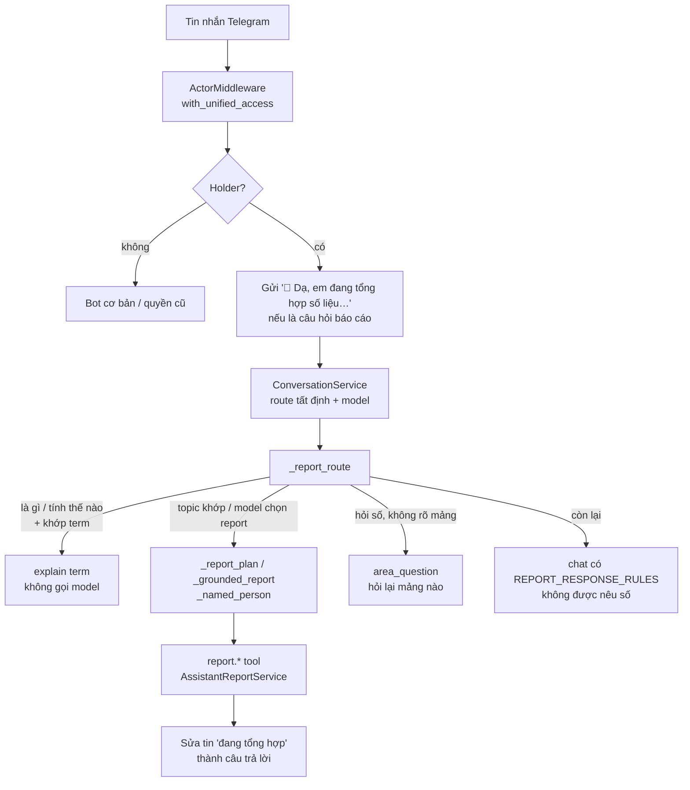
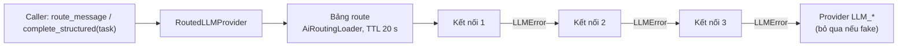

# Trợ lý AI báo cáo (Telegram) và Kết nối AI

> Hai phần dùng chung lớp AI. **Trợ lý AI báo cáo**: người được OWNER tích hỏi bot Telegram số liệu công ty (doanh thu Ads, KPI, điểm hiệu suất, order, tài nguyên, PR) và nhận câu trả lời lấy thẳng từ báo cáo của hệ thống, xưng "em", gọi "sếp". **Kết nối AI**: OWNER khai báo các dịch vụ AI (ChatGPT, Gemini, DeepSeek, 9router…) và chọn dịch vụ nào phục vụ việc nào, trên **Quản trị › Kết nối AI** (`/admin/ai`).

Kế hoạch gốc: `docs/ai-assistant/BOT_REPORT_ASSISTANT_PLAN.md`; danh sách câu hỏi của các sếp: `docs/ai-assistant/BOSS_QUESTIONS.md`. Chat với agent Hermes trên web là module khác: [agents.md](agents.md). AI duyệt kịch bản order: xem [ord.md](ord.md).

## Khái niệm & thuật ngữ

- **Holder (người giữ trợ lý)**: người giữ quyền `ASSISTANT` / `CHAT`. OWNER giữ theo role; người khác chỉ qua quyền **cá nhân**.
- **Report tool**: công cụ chỉ đọc, rủi ro `LOW`, một công cụ mỗi báo cáo: `report.company`, `report.ads_revenue`, `report.ads_kpi_budget`, `report.performance`, `report.orders`, `report.resources`, `report.pr`. Câu trả lời do **chính công cụ** viết từ con số nó trả về; model chỉ chọn công cụ và vài tham số.
- **Route**: quyết định câu tin nhắn đi đâu (chat, tool, hỏi lại). Có phần tất định (khớp chữ) và phần model.
- **Topic**: báo cáo mà câu hỏi nhắc tới, tìm bằng cụm từ đã bỏ dấu (`report_topic`). Cụm **mạnh** tự nó đủ ("doanh thu", "KPI", "trễ hạn", "tài nguyên"); cụm **yếu** ("order", "video", "điểm", "PR") chỉ tính khi đi cùng từ hỏi số ("bao nhiêu", "tình hình", "báo cáo", "liệt kê"…).
- **Term**: một định nghĩa trong "skill" của trợ lý (`domain/assistant/skill.py:TERMS`, 28 mục), đã đối chiếu với code: thực thu, DT hoa hồng = DT ÷ 1,08, Ads/DT, Marketing/Cơ sở, BM, KPI, ngân sách, trạng thái order, trễ hạn, ai duyệt, huỷ/trả, điểm, hình thức, định mức, hệ số, PR, tài nguyên, phân quyền… Mỗi term có link web và báo cáo nên hỏi.
- **Kết nối AI (connection)**: một dịch vụ AI với loại, URL, model, API key (mã hoá).
- **Mục đích (purpose)**: việc gọi AI để làm gì (`AiPurpose`): `DEFAULT`, `ORDER_SCRIPT` (AI duyệt kịch bản order), `PR_REVIEW` (AI duyệt nội dung PR), `ASSISTANT` (trợ lý Telegram: định tuyến, chat, lập kế hoạch, tóm tắt).
- **Chuỗi (chain)**: danh sách tối đa `MAX_CHAIN` (3) kết nối cho một mục đích; cái đầu trả lời được thì dùng, hỏng thì sang cái sau.
- **Provider môi trường**: provider đặt bằng biến `LLM_*`; dùng khi chưa cấu hình gì và là mắt xích cuối của mọi chuỗi (trừ khi là `fake`).

## Luồng chính

### Một câu hỏi số liệu trên Telegram

### Gọi AI có chuỗi dự phòng

## Quy tắc hiện hành

### Ai dùng trợ lý

1. Holder = OWNER, hoặc người có quyền cá nhân `ASSISTANT` / `CHAT` (`application/assistant/access.py:may_chat_assistant`). ADMIN **không** giữ theo role. Tích = **toàn công ty**: không có phạm vi "của mình" (scope chỉ `NONE` / `ALL`, `domain/assistant/reports.py:assistant_allowed_scopes`).
2. Quyền này **không có ô theo phòng ban** (`ModuleSpec.department_cells=False` trong `domain/org/modules.py`): không xuất hiện trong danh mục Phòng ban; ghi quyền phòng ban cho nó bị từ chối. Chỉ tích trên trang "Quyền" của một người (xem [org.md](org.md)).
3. Trên bot, `application/org/bot_access.py:with_unified_access` (gọi trong `ActorMiddleware` mỗi update) cho holder: `full_bot` (cả bot, không chỉ lệnh cơ bản) và quyền ma trận `Permission.ASSISTANT_REPORT` (`assistant.report`) trong `extra_permissions`. Mọi report tool đòi quyền này (`required_permission`); danh mục tool đưa cho model lọc bằng `ToolRegistry.summaries_for(actor)` (role + `extra_permissions`).
4. `/api/units/me` trả `assistant: {chat}`.

### Định tuyến câu hỏi (`application/conversation_service.py:_report_route`)

Chỉ áp dụng cho holder. Theo thứ tự:

5. Câu hỏi "là gì / tính thế nào / nghĩa là" (`domain/assistant/skill.py:asks_to_explain`, không chứa từ hỏi số) mà chữ trong câu khớp một term (`term_for`: cụm dài nhất thắng, tên term cũng tính) → trả **nguyên văn** định nghĩa (`explain`, canned `report_term`), không gọi model. Không khớp term mà model định gọi một report → đổi thành chat (prompt có skill).
6. Model đã chọn một tool **không phải** report thì giữ nguyên. Model chọn `report.company` mà câu hỏi nêu một mảng cụ thể → dùng report của mảng đó.
7. Câu có topic (`report_topic`) → tool của topic, kể cả khi model nói chat, lỗi, hay không chọn tool.
8. Câu ngắn (≤ 6 từ) hoặc có từ hỏi số mà chỉ nêu một ngày / tháng / khoảng ngày ("Hôm nay thôi", "còn tháng 9?") → hỏi lại **report vừa đọc** trong luồng (`_last_report`: `RecentReference` có `entity_type` "report"; `_names_a_period`).
9. Câu hỏi số (`asks_for_figures`: "bao nhiêu", "số liệu", "thống kê", "tỷ lệ"…) mà không nêu mảng, model lại định chat → hỏi lại mảng nào (`area_question`, canned `report_area`), không bao giờ để model tự nói số.
10. Kế hoạch report luôn ép `risk_level=LOW`, `requires_confirmation=False`. Khi model lập kế hoạch hỏng hoặc trả "unknown", `_report_plan` dựng kế hoạch từ chữ trong câu (tool + kỳ). `_grounded_report` buộc kỳ của kế hoạch theo **đúng chữ** trong câu: ngày thắng tháng; khoảng ngày → `day` + `day_to`. `_named_person`: với tool có tham số `person`, tên tài khoản tìm thấy trong câu (`person_in`: tên đầy đủ dài nhất khớp nguyên từ, không thì hai chữ cuối nếu chỉ một người khớp; bỏ qua dấu và hoa thường) ghi đè giá trị model viết.

### Đọc kỳ trong câu (`domain/assistant/reports.py`)

11. Tháng (`month_in`): "tháng này", "tháng trước", "tháng 9", "tháng 9/2026", "09/2026", "2026-09". Tháng không có năm mà lớn hơn tháng hiện tại = năm ngoái. "so với tháng trước" không tính là kỳ (`_period_words`).
12. Ngày (`day_in`): "hôm nay / hôm qua / hôm kia", "3/11", "03/11/2026", "2026-11-03", "ngày 3" (tháng này). Không bao giờ là ngày tương lai; ngày không có năm mà chưa tới = năm ngoái. "Hôm nay" theo giờ Việt Nam.
13. Khoảng (`span_in`): "tuần này" (thứ Hai → hôm nay), "tuần trước" (thứ Hai → Chủ nhật tuần trước), "tuần qua" (7 ngày gồm hôm nay), "N ngày qua", "từ d/m đến d/m". Tối đa `MAX_SPAN_DAYS` 62 ngày.
14. "liệt kê order bị trả lại" / "order nào đang chờ duyệt" → `report.orders` với `state` (`listed_state`).

### Câu trả lời

15. Mọi số liệu đến từ `application/assistant/reports.py:AssistantReportService`, đọc như OWNER thấy: Ads qua `COMPANY_ADS` (`AdsAccess` view_all), bảng task qua `company_viewer` (OWNER không có dòng user). Thiếu số = "chưa có dữ liệu".
16. Câu trả lời của tool (`Report.message`): mở đầu `REPORT_OPENER` "Dạ, em gửi sếp số liệu ạ:", tiêu đề đậm, các dòng, ghi chú nghiêng, cuối là "Sếp đối chiếu trên web" + `WEB_BASE_URL` + link. Số liệu cũng nằm trong `ToolResult.data`.
17. `report.company` gom mọi mảng; mỗi phần chạy trong một SAVEPOINT (`begin_nested`), phần hỏng ghi "không lấy được số liệu lúc này", **không bao giờ** đoán số.
18. `report.ads_revenue`:
    - theo tháng = báo cáo "Tổng team" của Phòng Ads (`AdsTeamService.report`);
    - `day` (+ `day_to`) = `ads_revenue_day`: khoảng 7 dòng (doanh thu so với kỳ ngay trước cùng độ dài, Marketing HN/SG, chi phí Facebook + Ads/DT, SĐT, luỹ kế tháng + % KPI, top 3), có ghi chú khi là hôm nay (số chưa chốt);
    - `person` = `ads_revenue_person`: số của một marketer như trang `/ads?user_id=` (`AdsDashboardService.staff`), KPI từ dòng marketer của báo cáo team. Không ai / nhiều người trùng tên → câu "không rõ người nào" (`_not_one`).
19. `report.ads_kpi_budget`: KPI từng marketer + ngân sách tuần (`AdsBudgetService.month`), hai BM cộng lại; `person=` để xem một người.
20. `report.performance`: toàn công ty / `department=` / `person=`, kèm định mức. `report.orders`: số order theo `TASK_STATES`, order trễ hạn, dashboard tháng; `state=` liệt kê. `report.resources`: tổng hợp + cảnh báo (`ResourceReportService` với quyền xem tất cả) và đề xuất mua đang mở. `report.pr`: task PR theo pha, nội dung tạo / xong trong tháng, bài đã đăng (`pr_publications`).
21. Trong lượt chat (không chạy tool nào), prompt của holder có thêm `REPORT_RESPONSE_RULES` (`application/prompt_context_service.py`): xưng "em" gọi "sếp", **không nêu bất kỳ con số kinh doanh nào**, gợi ý hỏi rõ mảng + tháng. Prompt cũng có khối `[ASSISTANT SKILL]` (`skill.skill_block`: hướng dẫn định tuyến, các term câu hỏi chạm tới, tên các term khác), là phần được bảo vệ khi cắt prompt; `MAX_CONTEXT_CHARS` = 23 000 để `[CURRENT USER]` không bị cắt.

### Giọng "em - sếp"

22. Holder (gồm OWNER) được gọi "sếp", bot xưng "em": `application/actor_profile_service.py:_compose` đặt `preferred_address` = `ASSISTANT_USER_ADDRESS`, `self_address` = `ASSISTANT_SELF_ADDRESS`, **ghi đè** `/set_preferred_address` khi còn giữ quyền. Mọi câu viết sẵn cũng theo giọng này (`REPORT_OPENER`, `area_question`, câu trả lời dự phòng `application/chat_fallback.py` (`DeterministicReplies`), `ASSISTANT_*_REPLY` trong bot handler và conversation service). Người không giữ quyền vẫn "mình - bạn".
23. Bot Telegram gửi ngay `THINKING_REPLY` "🤔 Dạ, em đang tổng hợp số liệu, sếp chờ em chút ạ…" cho câu hỏi báo cáo của holder (`bot/handlers/conversation.py:_thinking`), rồi **sửa** tin đó thành câu trả lời (`bot/formatting.py:replace_or_answer`; sửa không được thì xoá và gửi tin mới).

### Kết nối AI

24. Chỉ **OWNER** đọc và sửa (`application/ai/connection_service.py`, 403 `ai_forbidden`).
25. Loại (`domain/ai/models.py:AiProviderKind`, `PROVIDER_KINDS`): `OPENAI` (mặc định `https://api.openai.com/v1`), `GEMINI` (endpoint OpenAI-compatible của Google), `DEEPSEEK`, `OPENAI_COMPATIBLE` (9router, OpenRouter, vLLM…; bắt buộc URL). Mọi loại đi qua cùng một client `integrations/llm/openai_compatible.py`.
26. Kiểm tra khi lưu: tên (`ai_name_missing`), model (`ai_model_missing`, `ai_model_invalid` khi quá dài), key (`ai_key_missing`, `ai_key_invalid`), URL (`ai_base_url_required`, `ai_base_url_invalid`), lỗi chung `ai_validation_error`; không tìm thấy → 404 `ai_connection_not_found`. Tất cả 422 với `details.reason` + `field`.
27. API key mã hoá bằng `SecretBox` của PR (AAD `ai_connection:<id>`, `application/ai/routing.py:key_aad`). Chỉ `api_key_hint` "••••abcd" rời server. Sửa mà để trống key = giữ key cũ. Không có / không đọc được `PR_SECRET_ENCRYPTION_KEY` → 422 `ai_secret_not_configured` (tổng quan trả `secret_ready`). Một key không giải mã được lúc chạy chỉ ghi log `ai_connection_key_unreadable` và bỏ kết nối đó khỏi chuỗi.
28. Route: `PUT /api/ai/routes` lưu chuỗi cho từng mục đích; trùng kết nối trong chuỗi → `ai_route_duplicate`, quá `MAX_CHAIN` → `ai_route_too_long`, kết nối không tồn tại → `ai_route_unknown_connection`. Xoá một kết nối cũng gỡ nó khỏi mọi route.
29. Lúc chạy (`integrations/llm/routed.py:RoutedLLMProvider`): mỗi lần gọi lấy chuỗi của mục đích, không có thì chuỗi `DEFAULT`; gặp `LLMError` (key bị từ chối, hết quota, timeout, câu trả lời dùng không được) thì sang kết nối sau; cuối cùng là provider `LLM_*` (không nối khi `LLM_PROVIDER=fake`). Mục đích của *structured task* theo `STRUCTURED_TASK_PURPOSES`: `order_script_review` → `ORDER_SCRIPT`; `script_review`, `pr_full_review` → `PR_REVIEW`; các task khác `DEFAULT`. Các lệnh hội thoại (`route_message`, `generate_chat_reply`, `plan_tool_action`, `plan`, `decide`, `summarize`) → `ASSISTANT`.
30. Bảng route nạp bằng `AiRoutingLoader` (phiên DB riêng), cache `DEFAULT_TTL_SECONDS` 20 s, nên API, bot, worker thấy thay đổi trong ≤ 20 s mà không cần khởi động lại; tiến trình API gọi `refresh()` ngay sau khi ghi. Nạp lỗi thì giữ bảng cũ.
31. "Thử kết nối" (`POST /api/ai/connections/{id}/test`): một lời gọi structured nhỏ, `max_retries` 0; kết quả lưu `last_test_*`; thất bại trả `ok: false` (không phải lỗi HTTP).
32. Audit: `ai.connection.created`, `ai.connection.updated`, `ai.connection.deleted`, `ai.connection.tested`, `ai.routes.updated` (không bao giờ ghi key).

## Phân quyền

| Ai | Trợ lý báo cáo (Telegram) | Kết nối AI |
|---|---|---|
| OWNER | Có (theo role), toàn công ty | Đọc + sửa |
| ADMIN | Không, trừ khi được tích cá nhân | Không (403 `ai_forbidden`) |
| Người được tích `ASSISTANT` / `CHAT` | Có, toàn công ty, cả bot | Không |
| Người khác | Bot cơ bản (xem [org.md](org.md) › bot Telegram) | Không |

`ASSISTANT` / `CHAT` là `owner_only`: ADMIN không có theo role. Ai được tích quyền cá nhân cho người khác (OWNER, và từ 0098 cả ADMIN): xem [org.md](org.md).

## Dữ liệu

- Trợ lý không có bảng riêng. Lịch sử hội thoại Telegram và `RecentReference` nằm trong các bảng hội thoại chung của bot (xem `docs/handover/02_SYSTEM_ARCHITECTURE.md`).
- `ai_connections` (0064): tên, loại, `base_url`, `model`, key đã mã hoá, `api_key_hint`, `last_test_*`.
- `ai_routes` (0064): một dòng mỗi mục đích, `connection_ids` theo thứ tự.
- Model ORM: `db/models/ai_connection.py`.

## Code ở đâu

| Việc | File |
|---|---|
| Quyền, tên tool, khớp topic, đọc ngày / tháng / khoảng / người | `src/meobot/domain/assistant/reports.py` |
| 28 term + skill block | `src/meobot/domain/assistant/skill.py` |
| Tính số liệu | `src/meobot/application/assistant/reports.py` (`AssistantReportService`, `REPORT_OPENER`, `COMPANY_ADS`, `company_viewer`) |
| Ai là holder | `src/meobot/application/assistant/access.py`, `src/meobot/application/org/bot_access.py` |
| Report tools | `src/meobot/tools/report_tools.py` (`build_report_tools`, model tham số `MonthArguments`, `RevenueArguments`, `KpiArguments`, `PerformanceArguments`, `OrderArguments`) |
| Định tuyến | `src/meobot/application/conversation_service.py` (`_report_route`, `_report_plan`, `_report_period`, `_grounded_report`, `_named_person`, `_last_report`, `_names_a_period`) |
| Prompt | `src/meobot/application/prompt_context_service.py` (`REPORT_RESPONSE_RULES`, `MAX_CONTEXT_CHARS`) |
| Giọng | `src/meobot/application/actor_profile_service.py` |
| Telegram | `src/meobot/bot/handlers/conversation.py` (`THINKING_REPLY`, `_thinking`), `src/meobot/bot/formatting.py` (`replace_or_answer`) |
| Kết nối AI | `src/meobot/domain/ai/models.py`, `src/meobot/application/ai/connection_service.py`, `src/meobot/application/ai/routing.py` (`AiRoutingLoader`, `build_ai_provider`), `src/meobot/integrations/llm/routed.py`, `src/meobot/api/routers/ai.py` |
| Frontend Kết nối AI | `frontend/src/app/admin/ai/page.tsx` (tab "Kết nối AI", `components/admin-tabs.tsx`) |
| Test | `tests/unit/test_assistant_reports.py`, `tests/unit/test_assistant_questions.py` (= danh sách `BOSS_QUESTIONS.md`), `tests/unit/test_basic_bot.py`; `tests/unit/test_ai_connections.py`, `frontend/tests/ai-connections.test.tsx` |

Cùng các số liệu đó cũng được đưa cho agent Hermes qua cổng số liệu: [agents.md](agents.md) › Cổng số liệu.

## API

Trợ lý báo cáo không có API web; chỉ chạy qua bot Telegram.

| Method | Đường | Ghi chú |
|---|---|---|
| GET | `/api/ai` | Tổng quan: kết nối, route, `secret_ready`, `env_provider`, `env_model`. |
| POST | `/api/ai/connections` | Tạo (201). |
| PATCH | `/api/ai/connections/{id}` | Sửa; key trống = giữ. |
| DELETE | `/api/ai/connections/{id}` | 204; gỡ khỏi mọi route. |
| POST | `/api/ai/connections/{id}/test` | Thử một lời gọi nhỏ. |
| PUT | `/api/ai/routes` | Lưu chuỗi theo mục đích. |

Mọi route `/api/ai` dùng envelope `{"error": {...}}`; tất cả đòi OWNER.

## Cạm bẫy & chưa làm

- **Chưa có vòng nhiều tool trong một câu hỏi.** Câu hỏi cần nhiều mảng thì `report.company` đứng thay.
- Muốn trợ lý chạy, route "Trợ lý Telegram" (`AiPurpose.ASSISTANT`) phải trỏ tới một model chạy được trên `/admin/ai`. Phần số liệu và term vẫn chạy khi model hỏng (tất định), nhưng chat và lập kế hoạch thì không.
- Test dùng provider giả (`integrations/llm/fake.py`); khi viết câu test cho định tuyến, so với `docs/ai-assistant/BOSS_QUESTIONS.md` và `test_assistant_questions.py`.
- Thêm term mới: chỉ ghi điều code thật sự làm, đối chiếu với module tính ra nó (quy ước ghi ở đầu `skill.py`).
- Đổi khoá `PR_SECRET_ENCRYPTION_KEY` mà không giữ khoá cũ (`PR_SECRET_ENCRYPTION_KEYS_OLD`) sẽ làm mọi kết nối AI mất key.

## Mốc thay đổi

- 2026-10-14: AI duyệt kịch bản order dùng LLM (xem [ord.md](ord.md)); khi đó key OpenAI hết quota nên mọi lần duyệt "fail open".
- 2026-10-15 (0064): Kết nối AI (bảng `ai_connections`, `ai_routes`), chuỗi dự phòng theo mục đích.
- 2026-10-31: Trợ lý AI báo cáo: module quyền `ASSISTANT`, 7 report tool, giọng "em - sếp", tin "đang tổng hợp" rồi sửa thành câu trả lời.
- 2026-11-03: Doanh thu một ngày; câu hỏi tiếp theo chỉ đổi kỳ thì hỏi lại báo cáo vừa đọc.
- 2026-11-04: Skill + 28 term, khoảng ngày (tuần này, N ngày qua, từ … đến …), liệt kê order theo trạng thái, doanh thu của một marketer.
- 2026-11-10 (0098): ADMIN cũng tích được các quyền `owner_only` cho người khác trên trang "Quyền".
