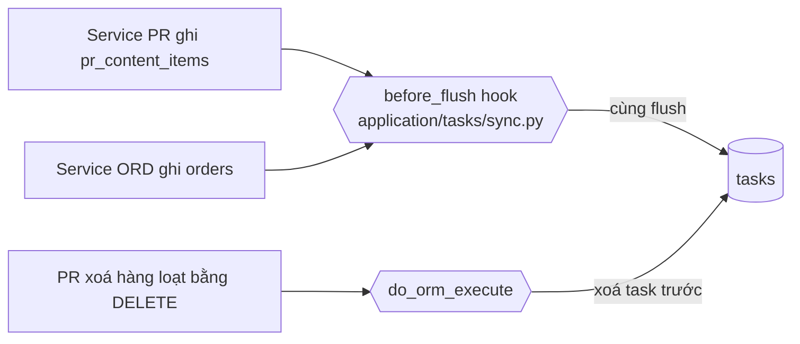
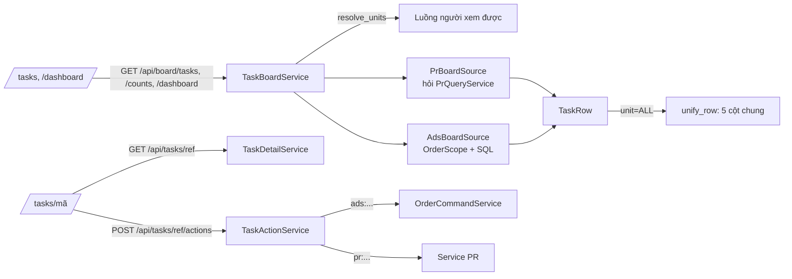

# Bảng task dùng chung (Board) + một bảng `tasks`

> Một bảng, một trang task cho cả hai luồng: Luồng PR (nội dung PR) và Luồng Order (ORD, mã kỹ thuật `ADS`). Mọi người dùng nó để xem việc, lọc, và bấm vào một dòng để mở trang task. Trên giao diện: **Dashboard** `/dashboard`, **"Bảng order › Order tổng"** `/tasks` (kèm `?unit=PR|ADS|ALL`), bảng sinh nhật `/tasks/birthday`, và trang task chung `/tasks/<mã>`.

Quy tắc nghiệp vụ của order (ai duyệt, ai giao, mã task…) nằm ở [ord.md](ord.md). Quy trình nội dung PR (đóng băng) nằm ở [pr.md](pr.md). Bảng chỉ **đọc và hiển thị**: nó không tự quyết quy tắc nào, mà hỏi engine của từng luồng.

## Khái niệm & thuật ngữ

- **Luồng** (unit / stream, `UnitCode`): `PR` = "Luồng PR", `ADS` = "Luồng Order (ORD)". Người dùng chỉ thấy luồng mình thuộc (suy ra từ ghế phòng ban, xem [org.md](org.md)). `ALL` = xem cả hai, chỉ cho OWNER / ADMIN (`membership.sees_all`).
- **Task** (bảng `tasks`): một dòng cho mỗi nội dung PR (`pr_content_items`) hoặc mỗi order (`orders`). Cột `source_type` = `PR_CONTENT` / `ORDER`. Là bản chiếu (projection), được hệ thống tự ghi.
- **Pha** (`Phase`): năm pha chung cho cả hai luồng: `ORDER` "Order", `REVIEW` "Duyệt", `PRODUCTION` "Sản xuất", `FINAL_REVIEW` "Duyệt", `DONE` "Hoàn thành", cộng `CANCELLED` "Huỷ". Mỗi stage của PR (14 stage) và của ORD được ánh xạ vào một pha (`domain/board/models.py:PR_STAGE_PHASE`, `ADS_STAGE_PHASE`).
- **Dòng** (`TaskRow`): một task như bảng vẽ: mã, tên, loại, người tạo, pha, trạng thái, các **ô** (`cells`), người đang giữ, deadline, cờ ưu tiên / gấp, "Cần làm"…
- **Ô** (`TaskCell`): một cột bước của dòng: người, trạng thái, có phải bước hiện tại không, deadline, token, thời điểm "Nhận" / "Trả".
- **Người đang giữ** (holder, `current_person_name`): người dòng đang chờ. Luôn là một (hoặc vài) người có tên, hoặc "Chờ giao" khi không có ai; không bao giờ là tên một vai trò.
- **Cần làm** (`TaskRow.awaiting_me`): dòng đang chờ chính người xem.
- **Trạng thái chờ** (`TaskRow.state`, trên trang task là `task.state`; ô bước dùng `status`): mã để tô màu: `CHO_DUYET` (chờ quyết định), `CHO_PHAN_CONG` (chờ Leader phân công), `DA_GIAO` (đã giao, chưa nhận), `CHUA_GIAO` (không ai giao được); còn lại là trạng thái bước. Mọi trạng thái chờ tô màu hổ phách.
- **Gấp** (`urgent`): chưa xong và đã quá N ngày từ lúc gửi (ORD: `UnitSettings.urgent_days`, mặc định 7; PR: 7 ngày).
- **Trễ hạn** (`overdue`): deadline đang tính đã qua (chỉ ORD có deadline).

## Luồng chính

### Ghi: bảng `tasks` luôn theo nguồn

### Đọc: bảng và trang task

## Quy tắc nghiệp vụ hiện hành

### A. Một bảng `tasks`

1. **Không bao giờ ghi `tasks` bằng tay.** Một listener `before_flush` toàn cục trên lớp `Session` (mọi session: web, bot Telegram, Celery, test) nhìn các dòng `PrContentItem` / `Order` sắp ghi và ghi `Task` tương ứng trong cùng flush (`application/tasks/sync.py`, cài từ `db/models/__init__.py:install_task_sync`). Không service PR hay ORD nào biết bảng này tồn tại.
2. **Cột được chép**: mã, tên, loại (`content_type` / `video_type`), người tạo, cờ ưu tiên (PR: HIGH / URGENT / CRITICAL), stage gốc và pha tương ứng. `stage_since` đổi khi stage đổi; `finished_at` đặt khi pha thành `DONE` / `CANCELLED`, xoá khi hoàn tác ra khỏi đó.
3. **Xoá**: PR xoá nội dung bằng câu `DELETE` hàng loạt (không qua flush) → `do_orm_execute` xoá task trước với cùng `WHERE`; khoá ngoại `ON DELETE CASCADE` là lưới an toàn cho SQL thô. `session.delete(item)` được xử lý trong flush.
4. **Tìm task** (`application/tasks/detail_service.py:TaskDetailService.resolve`): `ref` = id task, mã task, id nguồn (nội dung PR / order) hoặc mã nguồn. Nguồn chưa có task (ghi bằng SQL thô sau backfill) → tạo task ngay lúc đó (`build_task`). Không thấy → 404 `task_not_found`; luồng không xem được → 404 `unit_not_visible`. Order ngoài phạm vi của người xem → 404 từ engine ORD.

### B. Luồng được đọc

1. `unit` trống → luồng đầu tiên người xem có; `ALL` → chỉ người `sees_all`; luồng không thuộc → 404 `unit_not_visible` (`application/board/task_board_service.py:resolve_units`).
2. Bộ lọc chỉ của ORD (`video_kind_id`, `category=BIRTHDAY`) khi xem `ALL` → chỉ hỏi ORD (`TaskBoardService._narrow`).
3. **Tab "Tất cả"** (`unit=ALL`): mỗi luồng được hỏi cùng một tiền tố (0 → offset+limit), rồi trộn theo khoá (Cần làm trước nếu `todo_first`, ưu tiên, mới nhất). Tổng chính xác; trang 2 nối tiếp trang 1 không lặp, không sót. Mọi dòng được viết lại về 5 cột chung **Order · Biên kịch · Thiết kế · Dựng / Sản xuất · Duyệt final** (`application/board/unified.py:unify_row`); bước một luồng không có hiện "—".

### C. Dòng ORD

Dựng ở `application/board/sources.py:AdsBoardSource`. Phạm vi = `OrderScope` của ORD ([ord.md](ord.md) mục J).

1. **Đơn bị huỷ ẩn khỏi bảng** trừ khi hỏi rõ: `state=DA_HUY` hoặc `status=CANCELLED` (`_statement`). Mọi bộ lọc khác và mặc định đều bỏ chúng ra.
2. **Ô**: một ô cho mỗi bước sản xuất của quy trình (Biên kịch, Design, Dựng; bước `GAN_LINK` cũ không có ô) + ô **"Duyệt final"** (`FINAL`) = cổng duyệt video / duyệt final của người order (`_final_cell`).
3. **Trạng thái ô** (`_node_state`), phân biệt các kiểu chờ:
   - `CHUA_GIAO` "Chờ giao": bước không ai giao được.
   - `CHO_PHAN_CONG` "Chờ X phân công": bước được chuyển cho Leader lúc kích hoạt, Leader chưa giao cũng chưa nhận (`awaiting_hand_out`: `DANG_LAM`, chưa nhận, người giữ không phải người được chọn sẵn, `assigned_at` ≤ `activated_at`).
   - `DA_GIAO` "Đã giao X": đã giao cho người làm nhưng họ chưa bấm "Nhận việc" (`awaiting_acceptance`).
   - `CHO_DUYET` "Chờ X duyệt": X = Trưởng quản lý của người làm nếu có, không thì mọi Leader của ban (`AdsApprovers.reviewers`).
   - Còn lại: trạng thái bước (`DANG_LAM`, `DANG_SUA`, `HOAN_THANH`, `CHUA_TOI`, `BO_QUA`).
   - Design nhiều người (`_multi_design`): "Đã giao" (chưa ai nhận) / "Đang nhận/làm" (một số đã nhận) / "Đang làm" (tất cả) / "Đang sửa"; ô ghi tên mọi người.
   - Đơn bị huỷ: mọi bước chưa xong đọc "Đã huỷ" (màu xám, không phải bước hiện tại, không deadline); bước đã xong giữ "Hoàn thành".
4. **Người trong ô** (`_cell_person`): người làm, nếu không thì người được chọn sẵn, nếu chưa tới thì "<người giao> giao". `person_user_id` chỉ có khi ô nêu đúng một người (để vẽ link hồ sơ).
5. **"Nhận" / "Trả" trong ô bước**: ô vẽ "Nhận: dd/mm HH:mm" (hổ phách, `TaskCell.reached_at` = `order_nodes.activated_at`, **lúc order tới bước**, không phải lúc người làm bấm "Nhận việc") và "Trả: dd/mm HH:mm" (xanh, `handed_in_at` = `submitted_at`, nếu không thì `approved_at`, chỉ khi bước ở `CHO_DUYET` / `HOAN_THANH`). Các ô bước không còn vẽ deadline + "N ngày trước"; cột Deadline của dòng vẫn còn. Token và "sửa N" vẫn hiện (`frontend/src/app/tasks/page.tsx:Cell`).
6. **Người đang giữ + trạng thái dòng** (`_holder`):
   - `ORDER_PENDING`: người duyệt (đã chọn, else mặc định), "Chờ X duyệt order", `CHO_DUYET`.
   - `ORDER_RETURNED`: người order, "Trả <người order> sửa", state `DANG_SUA`.
   - `DUYET_VIDEO_BT`: Leader Biên kịch, "Chờ X duyệt video".
   - `FINAL_REVIEW`: chỉ người order, "Chờ X duyệt final" (người đứng thay không bao giờ được ghi tên).
   - Bước đang mở: ví dụ "Dựng · Đã giao Quỳnh Như", "Dựng · Đang làm", "Thiết kế · Chờ Nam phân công".
   - Không có ai: "<bước> · Chờ giao", `CHUA_GIAO`. Xong / huỷ: không ai.
7. **Deadline dòng**: deadline của bước đang mở; ở cổng của người order (`ORDER_PENDING`, `ORDER_RETURNED`, `DUYET_VIDEO_BT`, `FINAL_REVIEW`) là deadline mong muốn của order. Ô "Duyệt final" mang deadline mong muốn. Đơn huỷ: không deadline. Bộ lọc `overdue=true` = deadline đang tính đã qua (`_overdue`).
8. **Token** trong ô = ước tính + sửa; null khi tắt chế độ effort.
9. **Loại** (`kind_label`) = tên loại video, nếu không có thì nhãn quy trình ("Biên kịch › Design › Dựng"); order sinh nhật = "Sinh nhật". `extras`: nguồn kịch bản, số bản nộp, loại video, điểm.
10. **Phòng của người order** (`owner_department`) = tên các phòng người đó ngồi, hiện dưới ngày order.
11. **Khối Design** (`design`, mọi dòng ORD; `design_view`): link kịch bản mới nhất + người làm Biên kịch, link tham khảo (tất cả), ghi chú, mã Design (`codes`), mã đang chờ duyệt (`proposed_codes`), người thiết kế, `assignees[]`, `submitted_count` / `assignee_total`, link Design + `design_submitted_at`. Khối `birthday` cho order sinh nhật.
12. **Nút ngay trên dòng** (`actions` = các loại hành động người xem làm được, từ `pipeline.available_actions`; `AdsBoardSource.action_kinds`): bảng của ban Design dùng để vẽ Giao việc / Nhận việc / Nộp bài / Duyệt ngay trên dòng (không có nút "Mở": bấm dòng là mở task), chạy qua `GET /api/tasks/{code}` + `POST .../actions`. Trưởng phòng ORD duyệt / không duyệt order ngay trên bảng qua cùng các action `/api/orders`.

### D. Dòng PR

Dựng ở `sources.py:PrBoardSource`, hỏi `PrQueryService` (phạm vi và "Cần tôi xử lý" là của PR, không đổi).

1. **Ba ô pha**: `ORDER` (pha ORDER + REVIEW), `PRODUCTION` (PRODUCTION + FINAL_REVIEW), `DONE`. Không có ô riêng cho duyệt: một lần duyệt được vẽ trong ô của pha mà nó duyệt (`PrBoardSource._row` → `cell(key, phases, …)`). Trang task vẽ các bước theo cùng cách.
2. **Người được ghi tên chỉ là nhân viên PR** (`holders.py:pr_member_ids` = người có ghế mở ở phòng chức năng PR, `seats.function_staff`). `pr_reviewers` / `pr_production_assigners` không bao giờ ghi tên OWNER / ADMIN / Ban Giám đốc ngoài PR, dù họ vẫn thao tác được.
3. Ở cổng duyệt: người duyệt có quyền phủ tới nội dung đó, "Chờ X duyệt", `CHO_DUYET`. Ở APPROVED / PRODUCTION chưa có người sản xuất: người giao sản xuất, "Chờ X giao sản xuất" (`CHO_PHAN_CONG`) hoặc "Chờ giao" (`CHUA_GIAO`). Đang viết / AI review / sẵn sàng đăng: người tạo.
4. PR không có deadline: lọc `overdue` không ra dòng PR nào. `priority` = HIGH. `kind` = loại nội dung PR; `owner` = "Người phụ trách"; `assignee` / `person` = người phụ trách theo luật PR.
5. Lọc theo pha, gấp, trễ hạn hay `todo_first` được làm trong bộ nhớ sau khi lấy tối đa 500 dòng (`_OVERFETCH`).

### E. Bộ lọc và sắp xếp (`GET /api/board/tasks`)

1. **Ngày** `date_from` / `date_to`: ORD theo `submitted_at`, PR theo `created_at`, tính theo múi giờ ứng dụng, bao gồm hai đầu.
2. **Pha** `phase` (PR, ALL); pha lạ → 404 `unknown_phase` (`api/routers/board.py:_phase`). **Bước** `step` (ORD): `ORDER` / `BIEN_TAP` / `THIET_KE` / `DUNG` (`ADS_STEPS`).
3. **Trạng thái task** `state` (ORD, "Trạng thái task"), một trong `TASK_STATES` (`domain/board/models.py`), sai → 422 `invalid_task_state`. Danh sách có trong trang (`task_states`). SQL ở `sources.py:_task_state`, đọc bước order đang ở:
   - `CHO_DUYET` = cổng chờ quyết (`ORDER_PENDING`, `DUYET_VIDEO_BT`, `FINAL_REVIEW`) hoặc bước đang mở ở `CHO_DUYET`;
   - `ORDER_RETURNED` = order bị trả;
   - `CHO_PHAN_CONG`, `DA_GIAO`, `DANG_LAM`, `DANG_SUA` = trạng thái của bước đang mở;
   - `HOAN_THANH` = `COMPLETED`; `DA_HUY` = `CANCELLED`.
   - Test `test_board.py::test_11b`, frontend `task-table.test.tsx` "the ORD table's filters".
4. **Trạng thái Design** `design_status` (bảng của ban Design), một trong `DESIGN_STATES` (`CHO_PHAN_CONG` gồm cả "Chờ giao", `DA_GIAO`, `DANG_LAM`, `CHO_DUYET`, `DANG_SUA`, `HOAN_THANH`), sai → 422 `invalid_design_status`. SQL `sources.py:_design_state` trên bước `THIET_KE`.
5. **Loại order** `category` (ORD): mặc định `STANDARD` ("Order tổng" không liệt kê order sinh nhật); `BIRTHDAY` = bảng sinh nhật, chỉ ra dòng khi người xem có `OrderScope.birthday_board`; giá trị lạ → 422 `invalid_category`.
6. **Người**:
   - `owner` = người tạo.
   - `assignee` = người làm (assignee) của một bước bất kỳ, kể cả bước đã xong và dòng Design nhiều người.
   - `person` = mọi task dính tới người đó: ORD = order họ tạo **hoặc** bất kỳ bước nào họ làm, xong hay chưa; PR = phụ trách theo luật PR.
   - `mine` = "Task của tôi" (ORD: mình tạo hoặc mình là người làm của một bước).
   - `awaiting_me` = "Cần làm" (mục F).
7. Khác: `priority`, `urgent`, `overdue`, `q` (mã hoặc tên, không phân biệt hoa thường), `kind` (PR: loại nội dung; ORD: mã quy trình), `video_kind_id`, `status` (stage gốc), `limit` 1-200 (mặc định 50), `offset`.
8. **Sắp xếp** `order` (`""` / `default` / `todo_first` / `birthday`; lạ → 422 `invalid_order`):
   - mặc định ORD: ưu tiên trước, rồi (với người order) order bị trả của mình, rồi mới nhất, rồi mã;
   - `todo_first`: dòng "Cần làm" của người xem trước, rồi phần còn lại, mỗi phần giữ thứ tự thường, phân trang xuyên qua cả hai (PR / ADS / ALL);
   - `birthday`: sinh nhật sắp tới gần nhất trước, đã qua trong năm sau đó, không có ngày cuối cùng.
9. **Bảng ORD trên web** (`frontend/src/app/tasks/page.tsx`):
   - Không còn "Quy trình", "Loại video", "Marketing": trang web không gửi `kind`, `video_kind_id`, `owner` cho ORD (API vẫn nhận nếu gửi tay). PR giữ `kind` + "Người phụ trách".
   - "Người làm" chọn hai bước: "Phòng ban" rồi người. `dept` chỉ nằm trên URL để thu hẹp danh sách người theo ghế (`departments` của mỗi thành viên), **không gửi lên server**.
   - ORD gửi lựa chọn dưới dạng `person`; PR giữ `assignee` (chỉ các bước). Một `assignee` trên URL (link "Theo người làm" của dashboard) vẫn hiện là lựa chọn.
   - **Bảng của ban Design** (`/api/units/me` `design.view`): cột Order, Tên · Loại, Trạng thái, Deadline rồi "Nội dung", "Tên task", "Thiết kế" (`components/design-cells.tsx`) thay cho các ô bước; trạng thái + deadline là của ô `THIET_KE`. Bộ lọc: `design_status` + "Phòng ban" / "Người làm" của **cả luồng** (người Design lên đầu), để Trưởng phòng Design tìm được người ban khác. Dòng vẫn theo phạm vi của người xem. Bộ lọc đã gỡ mà còn trên URL (link cũ) thì không gửi.
   - Nhân viên thường của luồng (không phải trưởng, không phải Leader) mở bảng ở "Task của tôi" + `todo_first`; `mine=false` trên URL tắt đi.
   - Cỡ trang `?size=`; bấm đúp tiêu đề cột để sắp các dòng đang hiện `?sort=` (chỉ trên trang này, server vẫn phân trang theo thứ tự của nó).

### F. "Cần làm" (`awaiting_me`)

ORD (`sources.py:AdsBoardSource._awaiting`), dòng chờ người xem khi một trong:

1. Giữ `ORDER_APPROVE` và order `ORDER_PENDING` chọn mình duyệt (người đó còn hoạt động), hoặc tới mình theo mặc định (`approval_reaches`).
2. Mình là người order và order ở `FINAL_REVIEW` (người đứng thay không tính).
3. Giữ `VIDEO_REVIEW` trên Biên kịch và order ở `DUYET_VIDEO_BT`.
4. Giữ `NODE_ASSIGN` trên ban và bước của ban đó `CHUA_GIAO`; hoặc bước được chuyển tới Leader / Trưởng phòng chờ phân công (chờ **mọi** người giao được của ban, không chỉ người được chuyển); hoặc (bật effort) bước còn chờ "Nhập token sửa".
5. Giữ `NODE_REVIEW` trên ban và bước `CHO_DUYET`, người làm không có Trưởng quản lý hoặc Trưởng quản lý là mình.
6. Mình là người làm của bước `DANG_LAM` / `DANG_SUA` (bước một người); hoặc có dòng Design nhiều người của mình chưa nộp trên bước đang làm.
7. Mình là người order và order `ORDER_RETURNED`.

PR: đúng "Cần tôi xử lý" của PR (`PrContentViewScope.MY_ACTIONS`).

### G. Số đếm và dashboard

1. **`GET /api/board/counts?unit=&category=`** → `mine`, `awaiting_me`, `priority`, `urgent`, `overdue` = tổng mà riêng bộ lọc đó sẽ liệt kê, trên bảng của `category` đó (mặc định STANDARD). Dùng cho nút lọc nhanh "Task của tôi (8)". `TaskBoardService.totals` dựng nguồn mỗi luồng một lần và chỉ đếm (`BoardSource.count`), không vẽ dòng; PR quay về `rows` khi có lọc pha / gấp / trễ (lọc trong bộ nhớ).
2. **`GET /api/board/dashboard`** (`application/board/dashboard_service.py`): mặc định tháng hiện tại; đọc tối đa 500 dòng (`SAMPLE_LIMIT`) cùng nguồn và bộ lọc với bảng. Thẻ: tổng, xong, chờ duyệt (pha REVIEW + FINAL_REVIEW), gấp, trễ hạn, % tiến độ, đếm theo pha. `by_owner` (đã lên đơn / xong / trễ, ORD trễ = quá deadline mong muốn, PR = gấp; token) và `by_worker` (theo **tên** trong ô: ô giữ / ô xong / ô trễ). Lọc `owner`, `person`.
3. Giao diện dashboard: dải "Order đang ở từng pha" và "Chờ tôi xử lý" đã bỏ (bảng task có cả hai). "Theo người order" có cột Lên đơn / Hoàn thành / Đơn gấp (PR: Lên task / Hoàn thành / Task gấp). "Theo ban" của ORD: [ord.md](ord.md) mục H7.

### H. Trang task (`/tasks/<mã>`)

1. `GET /api/tasks/{ref}` (`TaskDetailService.detail`): một trang chi tiết cho cả hai luồng; tab riêng của PR dùng lại `frontend/src/components/pr-content-detail/*`. Có `steps` (theo ô của dòng), người liên quan, các trường, bài nộp, lịch sử, các nút (`actions` với `key`, `inputs`, `required_inputs`, giá trị mặc định, `hint`, `multi_assign`, `blocked` cho PR), `task_codes[]` (ORD), `can_delete`.
2. `POST /api/tasks/{ref}/actions {key, version, ...}` (`application/tasks/action_service.py`): khoá là chuỗi mờ do trang chi tiết đưa: `ads:<ACTION>[:<node_id>]` hoặc `pr:...`. Khoá được tách ra và chuyển nguyên cho đúng service của luồng (`OrderCommandService` / các service PR) với đúng tham số route gốc truyền; không quy tắc nào bị viết lại. Khoá lạ → 422 `task_action_unknown`; thiếu người được giao → 422 `assignee_required`.
3. **Lỗi thời**: ORD so `orders.version` (409 `order_stale_version`); PR so số bản nháp đang hiện (409 `pr_stale_version`, trước khi ghi gì).
4. **Xoá task** `DELETE /api/tasks/{ref}`: chỉ OWNER (403 `task_delete_forbidden`, `application/tasks/delete_service.py:may_delete_tasks`). Order: xoá cùng bước, bài nộp, duyệt, lịch sử, sổ token, điểm, KPI, thông báo; audit ghi trước dưới dạng chữ. Nội dung PR: xoá bằng luật xoá vĩnh viễn của PR (`lifecycle.delete_content`; bài đã đăng vẫn không xoá được), và trước đó bỏ claim điểm PR + điểm của nó và của các bài đăng ([performance.md](performance.md)).
5. `/orders/:ref` và `/pr/content/:id` chuyển hướng về `/tasks/...`.

### I. Duyệt task hàng loạt (bảng PR)

1. Trên `/tasks?unit=PR`, Trưởng phòng PR (ghế HEAD ở phòng chức năng PR) hoặc OWNER / ADMIN có ô tích mỗi dòng + "Chọn tất cả trên trang" (`selecting` trong `app/tasks/page.tsx`) và thanh hàng loạt `components/task-bulk-bar.tsx`.
2. "Duyệt task" gửi một `POST /api/pr/reviews/bulk-approve` cho mỗi cổng (`TEAM_LEAD_REVIEW` / `HEAD_REVIEW` / `INTERNAL_REVIEW`) với các dòng đã tích đang ở cổng đó; dòng khác bị bỏ qua. Quyền và kết quả do PR quyết ([pr.md](pr.md)).
3. Đổi bất kỳ gì trên URL (luồng, lọc, trang, sắp xếp) là bỏ chọn. Bảng ORD và tab "Tất cả" chưa có hành động hàng loạt.

### J. Tên người và trang hồ sơ

1. Tên người trên bảng (người tạo + người trong ô, nhờ `person_user_id`), Tài khoản › Thành viên và `/admin/accounts` được vẽ bởi `components/person-link.tsx:PersonLink`: là link tới `/people/<id>` chỉ khi `/api/units/me` `can_view_profiles` (OWNER / ADMIN, người là HEAD của một phòng, hoặc người xem hiệu suất toàn công ty); người khác thấy chữ thường.
2. Trang hồ sơ `/people/[id]`: tab "Hiệu suất" (`components/stat-cards.tsx:StatCards`, chuyển ra từ `/account`, cùng `PerformancePanel`) và "Thông tin tài khoản". Dữ liệu `GET /api/account/members/{id}/profile?month=` → `MemberRowResponse` (`AccountService.profile`). Ai xem được (`may_view_profile`): OWNER / ADMIN mọi người; Trưởng phòng mọi người ngồi trong phòng mình làm trưởng (`org/departments.department_people`, báo cáo cho mình hay không); ai cũng xem chính mình; người giữ `PERFORMANCE` / `VIEW` ALL xem mọi người; ngoài ra 403 `account_profile_forbidden` (id không tồn tại: 404, chỉ với người được xem). Chi tiết: [account.md](account.md). Test `test_account_stats.py::test_08`, frontend `person-page.test.tsx`.

### K. Màu trạng thái và ngày giờ

1. `frontend/src/lib/status-colors.ts`: `WAITING_STATES` (`CHO_DUYET`, `CHO_PHAN_CONG`, `DA_GIAO`, `CHUA_GIAO`) luôn hổ phách; `isWaitingLabel` = lưới an toàn cho nhãn bắt đầu bằng "Chờ" hoặc "Đã giao"; `rowStatusColor` cho dòng, `stepColor` cho ô; `DANG_LAM` xanh dương, `DANG_SUA` đỏ, `HOAN_THANH` xanh lá, đã huỷ xám. Dải bước trên trang task dùng cùng màu.
2. Ô trên bảng order bỏ năm: `dd/mm HH:mm` / `dd/mm` (`formatShortDateTime`, `formatShortDate`), ngày đầy đủ trong `title`. Quy ước ngày giờ chung: [platform.md](platform.md).

## Phân quyền

- Đọc bảng = luồng người xem thuộc (`membership.has(unit)`); `ALL` = `sees_all` (OWNER / ADMIN). Không có quyền riêng cho bảng.
- Dòng nào hiện: ORD theo `OrderScope` ([ord.md](ord.md) mục J); PR theo phạm vi của PR.
- Nút trên dòng / trang task: do engine của luồng quyết (`pipeline.available_actions` cho ORD, capability PR cho PR).
- Bảng sinh nhật: `OrderScope.birthday_board`.
- Duyệt hàng loạt: Trưởng phòng PR / OWNER / ADMIN (giao diện); server PR kiểm tra lại.
- Xoá task: chỉ OWNER.
- Link hồ sơ: `can_view_profiles`.

## Dữ liệu

| Bảng | Cột chính | Migration |
|---|---|---|
| `tasks` | `unit_id`, `source_type` (`PR_CONTENT` / `ORDER`), `pr_content_id` / `order_id` (1-1, FK `ON DELETE CASCADE`), `code`, `title`, `kind`, `owner_user_id`, `is_priority`, `stage`, `phase`, `stage_since`, `finished_at`, `created_at`, `updated_at` | 0043 |

Bảng chỉ đọc thêm từ `orders`, `order_nodes`, `order_node_assignees`, `order_submissions` ([ord.md](ord.md)), `pr_content_items`, `pr_production_submissions`, `pr_brands` ([pr.md](pr.md)), `department_members` (phòng của người order, nhân viên PR).

## Code ở đâu

| Lớp | File | Nội dung |
|---|---|---|
| Domain | `src/meobot/domain/board/models.py` | `Phase`, `PR_STAGE_PHASE`, `ADS_STAGE_PHASE`, `TaskRow`, `TaskCell`, `BoardQuery`, `TASK_STATES`, `DESIGN_STATES`, `ADS_STEPS`, `DashboardSummary` |
| Application | `src/meobot/application/board/task_board_service.py` | chọn luồng, trộn tab "Tất cả", `totals` |
| Application | `src/meobot/application/board/sources.py` | `PrBoardSource`, `AdsBoardSource`, `_task_state`, `_design_state`, `awaiting_hand_out`, `awaiting_acceptance`, `design_view` |
| Application | `src/meobot/application/board/holders.py` | ai đang giữ: `AdsApprovers`, `pr_member_ids`, `pr_reviewers`, `pr_production_assigners`, `waiting_for` |
| Application | `src/meobot/application/board/unified.py`, `dashboard_service.py` | 5 cột chung, dashboard |
| Application | `src/meobot/application/tasks/sync.py` | hook đồng bộ `tasks` |
| Application | `src/meobot/application/tasks/detail_service.py`, `action_service.py`, `delete_service.py` | trang task, hành động, xoá |
| DB | `src/meobot/db/models/task.py`, `db/models/__init__.py` (cài hook) | |
| API | `src/meobot/api/routers/board.py`, `api/routers/tasks.py`, `api/schemas/board.py` | |
| Frontend | `frontend/src/app/tasks/page.tsx` | bảng task, bộ lọc, ô `Cell`, chọn hàng loạt |
| Frontend | `frontend/src/components/task-table.tsx` | phần dùng chung giữa `/tasks` và `/tasks/birthday`: trạng thái + người giữ, deadline, phân trang, `useRowNavigation`, `SortHeader` |
| Frontend | `frontend/src/components/task-bulk-bar.tsx`, `person-link.tsx`, `design-cells.tsx`, `deadline-badge.tsx` | |
| Frontend | `frontend/src/app/tasks/[ref]/page.tsx`, `components/task-actions.tsx`, `components/pr-content-detail/*` | trang task |
| Frontend | `frontend/src/app/dashboard/page.tsx`, `app/people/[id]/page.tsx`, `components/stat-cards.tsx` | dashboard, hồ sơ |
| Frontend | `frontend/src/lib/status-colors.ts`, `lib/datetime.ts`, `lib/api.ts` | màu, ngày giờ, client API |
| Test backend | `tests/unit/test_board.py` (`test_10`, `test_10b`, `test_10c`, `test_11b`, `test_11c`…), `tests/unit/test_unified_tasks.py`, `tests/unit/test_owner_controls.py::test_04/05/07`, `tests/unit/test_hot_routes.py`, `tests/unit/test_account_stats.py::test_08` | |
| Test migration | `tests/integration/test_task_migrations.py` | |
| Test frontend | `frontend/tests/task-table.test.tsx` ("the Trưởng phòng PR ticks rows", "the ORD table's filters"), `task-detail.test.tsx`, `status-colors.test.ts`, `person-page.test.tsx`, `pr-board-assign.test.tsx`, `units-screens.test.tsx` | |

## API

- `GET /api/board/tasks?unit=PR|ADS|ALL&...` - bảng task (bộ lọc ở mục E); trả thêm `task_states`, `design_states` và các bước ORD.
- `GET /api/board/counts?unit=&category=` - số cho nút lọc nhanh.
- `GET /api/board/dashboard?unit=&date_from=&date_to=&owner=&person=` - thẻ + thống kê theo người.
- `GET /api/tasks/{ref}` - trang task.
- `POST /api/tasks/{ref}/actions` - chạy một hành động theo khoá.
- `DELETE /api/tasks/{ref}` - xoá vĩnh viễn (OWNER).
- `POST /api/pr/reviews/bulk-approve` - duyệt hàng loạt (route của PR, bảng gọi tới).

## Cạm bẫy & chưa làm

- **Đừng ghi `tasks` bằng tay** và đừng thêm cột vào `tasks` mà không sửa `sync.py` (`_PR_FIELDS`, `_ORDER_FIELDS`). Dòng nguồn đổi mà các cột chép không đổi thì hook không tốn truy vấn nào.
- **`/api/board/counts` phải khớp `/api/board/tasks`**: mọi bộ lọc mới trong `_statement` của ORD tự động có trong đếm; PR thì lọc trong bộ nhớ nên `count` phải quay về `rows` cho các bộ lọc đó.
- **Đơn bị huỷ bị ẩn mặc định**, nên dashboard ORD (đọc cùng nguồn) không đếm đơn huỷ trong pha `CANCELLED`.
- **`by_worker` gộp theo tên** (id = uuid5 của tên): hai người trùng tên bị gộp.
- **Tab "Tất cả" phân trang bằng cách trộn hai danh sách**: đúng thứ tự nhưng mỗi trang hỏi lại cả tiền tố; tab từng luồng mới là chế độ xem chính xác.
- Test frontend **quét mã nguồn**: `confirmation.test.tsx` đòi mọi file có `useMutation` (như `app/tasks/page.tsx`) import `@/components/confirm`; `ux.test.tsx` kiểm danh sách href của menu. Chuyển code giữa file thì sửa các test đó. Test chi tiết PR đọc mã qua `readPrContentDetailSource()` trong `frontend/tests/helpers.tsx`.
- `content-views.test.tsx` cấm `producer_user_id` trong `app/pr/content/page.tsx`; nút "Giao sản xuất" của bảng PR vì vậy nằm ở `components/assign-producer-dialog.tsx` ([pr.md](pr.md)).
- `tests/unit/test_tasks.py` là bộ test Celery chế độ eager, không phải test của bảng `tasks`; test bảng `tasks` là `test_unified_tasks.py`.
- Chưa làm: hành động hàng loạt trên bảng ORD và tab "Tất cả".

## Mốc thay đổi

- 0042 - engine order ORD (`orders`, `order_nodes`…) ra đời bên cạnh PR; bảng và dashboard đọc cả hai qua 5 pha chung.
- 0043 - bảng `tasks` một-một với nội dung PR / order, đồng bộ bằng hook `before_flush`; trang task chung `/tasks/<mã>`, `GET /api/tasks/{ref}`, `POST /api/tasks/{ref}/actions`.
- 0053 - ô và dòng ORD có deadline, token; lọc `overdue`; thẻ "Trễ hạn".
- 0054 - `GET /api/board/counts` cho nút lọc nhanh; OWNER xoá task.
- 0058 - `category` (mặc định STANDARD), `order=birthday`, `design_status`, khối `design` / `birthday`, `actions` trên dòng ORD, bảng của ban Design.
- 0073 - ô Design nhiều người, "Đã nộp N/M".
- 19/10/2026 - dòng PR còn 3 ô pha (duyệt vẽ trong ô của pha nó duyệt); người được ghi tên trên task PR chỉ là nhân viên PR; duyệt task hàng loạt trên bảng PR; bảng ORD bỏ "Quy trình" / "Loại video" / "Marketing", thêm "Trạng thái task" (`state`) và "Người làm" = "Phòng ban" rồi người; trang hồ sơ `/people/[id]` + `PersonLink`.
- 30/10/2026 - "nhân viên PR" = ghế ở phòng chức năng PR (Ban Giám đốc có tag PR không còn được ghi tên).
- 02/11/2026 - bảng ORD gửi "Người làm" dưới dạng `person` (mọi task dính tới người đó, kể cả order họ đặt).
- 03/11/2026 - ô bước ORD vẽ "Nhận" / "Trả" thay cho deadline; bảng của ban Design có "Phòng ban" / "Người làm" của cả luồng.
- 12/11/2026 - `/api/board/counts` chỉ đếm (`TaskBoardService.totals`, `BoardSource.count`), không vẽ dòng; `membership` được nhớ trong request.
- Không rõ ngày (sau 0058) - đơn bị huỷ bị ẩn khỏi bảng trừ khi lọc "Đã huỷ" (`test_board.py::test_11c`).
