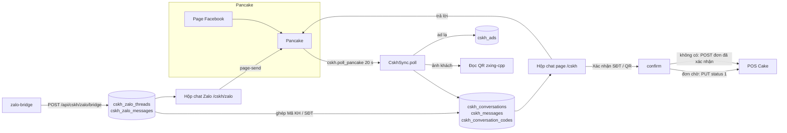

# Hộp chat CSKH (Chăm sóc khách hàng)

> Một hộp chat chung cho khoảng 90 page Facebook quản lý trong **Pancake**, nút xác nhận số điện thoại / mã QR thành đơn **POS Cake**, và hộp chat **Zalo** của các nick Zalo công ty do telesale dùng (ghép với khách trên page theo Mã KH hoặc SĐT). Người dùng: Phòng Tư vấn online (trực page), Telesales (Zalo), người quản trị hộp chat. Trên giao diện: nhánh menu **"Chăm sóc khách hàng"**, các trang dưới `/cskh/*`.

Module này được chuyển từ bản mẫu `hop-chat-apexmed` (tài liệu bàn giao Pancake / Zalo của bản mẫu nằm ngoài repo). Nó thay luồng "agent trả lời page" cũ của migration 0094 (bảng `pancake_*` đã bị xoá).

## Khái niệm & thuật ngữ

- **Pancake**: công cụ quản lý page Facebook. APM đọc qua Public API (`pages.fm`). Có hai loại token:
  - **user token** của một tài khoản Pancake (`cskh_pancake_accounts`): liệt kê page, tạo page token;
  - **page token** (`cskh_pages.token_encrypted`): đọc / gửi tin một page. Tạo page token mới làm token cũ hết hiệu lực.
- **POS Cake** (`pos.pages.fm`): phần mềm đơn hàng. Mỗi **shop** có API key (`cskh_pos_keys`). Một đơn POS "Đã xác nhận" (status 1) thì Pancake báo Purchase về Facebook.
- **Zalo bridge**: dịch vụ Node riêng (`deploy/zalo-bridge`, thư viện không chính thức `zca-js`) đăng nhập nick Zalo bằng QR, **chỉ nghe**, đẩy mọi tin về APM.
- **Hội thoại page** (`cskh_conversations`): một khách (PSID) trên một page.
- **Thread Zalo** (`cskh_zalo_threads`): một cuộc chat trên một nick Zalo.
- **Mã KH**: mã khách hàng, dạng `KH` + số (ví dụ `KH1426035`). Lấy từ đơn đã xác nhận và từ **ghi chú Pancake** của khách.
- **Ghép** (link): thread Zalo nối với hội thoại page. `link_kind` = `code` (ghép bằng Mã KH: phía page hiện SĐT bị che 4 số cuối) hoặc `phone`.
- **Chủ page / Nhân viên trực** (`MemberRole` OWNER / STAFF, `cskh_page_members`): tài khoản APM gắn với page; cũng quyết định ai thấy page (quyền `INBOX OWN`).
- **Trạng thái hội thoại** (`ConvStage`): `NEW` Mới, `CONSULTING` Đang tư vấn, `CALLBACK` Chờ gọi lại, `CLOSED` Đã chốt.
- **Marketing bị khoá**: khi số điện thoại đã có ở dữ liệu cũ, marketing của dữ liệu cũ nhất giữ số đó trong `mkt_lock_days` ngày.
- **OWN / ALL**: phạm vi quyền (xem [org.md](org.md)).

## Luồng chính

Việc nền (Celery, queue `q_integrations`, `tasks/cskh.py`):

| Task | Lịch | Việc |
|---|---|---|
| `cskh.poll_pancake` | 20 giây | Đọc mọi page đang kết nối |
| `cskh.refresh_meta` | 10 phút | Thẻ + nhân viên Pancake mỗi page, page mới trên tài khoản, shop POS, bổ sung ghi chú cũ |
| `cskh.connect_pages` | khi bấm "Kết nối page" | Kết nối các page được chọn, tiến độ trong `system_settings` `cskh_job` |

## Quy tắc nghiệp vụ hiện hành

### Đọc Pancake (`application/cskh/sync.py:CskhSync`)

1. Mỗi lượt poll chỉ một lượt chạy (Postgres advisory lock `POLL_LOCK`); lượt trước còn chạy thì lượt sau bỏ qua. Poll không bao giờ báo FAILED cho màn hình tác vụ định kỳ (lỗi page hiện ở "Kết nối page", `cskh_pages.poll_error`). `tasks/cskh.py:_locked`.
2. 5 page song song (`PARALLEL_PAGES`), mỗi page một transaction riêng. Lỗi một page không chặn page khác.
3. **Một người đọc mỗi page** (`pg_advisory_xact_lock(PAGE_LOCK, hashtext(page))`, `_page_lock`): poll bỏ qua page đang được job kết nối đọc; job kết nối thì chờ.
4. Mỗi page lấy 60 hội thoại mới nhất. Thẻ, người phụ trách, SĐT, quảng cáo cập nhật mỗi lần; chỉ đọc lại thread khi `updated_at` của Pancake đổi. Đọc 4 thread một lúc, nghỉ 0,25 giây mỗi page, dùng chung một pool httpx giữ kết nối (`HttpPancakeClient.session()`); một thread lỗi thì lần sau đọc lại; GET bị 5xx thì thử lại một lần sau 2 giây.
5. **Lần đọc đầu** của một page (`polled_at` là NULL): nạp lịch sử, **không** tính chưa đọc và **không** tự trả lời.
6. Thẻ / người phụ trách mà nhân viên vừa sửa từ APM được giữ 60 giây (`RECENT_EDIT_SECONDS`, `edited_at`) để poll không ghi đè.
7. Pancake báo "access_token renewed" (`pancake_token_renewed`): APM tạo lại page token từ tài khoản của page, **tối đa 30 phút một lần** mỗi page (`TOKEN_REPAIR_EVERY`, ghi ở `system_settings` `cskh_token_repairs`). `_repair_token`.
8. **Nhiều tài khoản Pancake**: tạo page token thử tài khoản đang giữ page trước, rồi lần lượt mọi tài khoản khác (bị "Thiếu quyền Admin" thì thử tiếp; bị 429 thì dừng). `page.pancake_account_id` = tài khoản tạo được. Dùng cho cả kết nối lẫn sửa token. `_make_token`.
9. **Tự trả lời ngoài giờ** (`maybe_auto_reply`): khi bật, ngoài giờ làm việc (giờ Việt Nam), cho tin khách mới trong 15 phút (`AUTO_REPLY_FRESH_MINUTES`), tối đa một lần / hội thoại / 12 giờ (`AUTO_REPLY_COOLDOWN_HOURS`); đặt hội thoại "Chờ gọi lại". Gửi lỗi chỉ ghi log `cskh_auto_reply_failed`.
10. Ảnh của khách được đọc mã QR (`zxing-cpp` + Pillow, `decode_qr`), chỉ tải ảnh `https` từ host Pancake / Facebook (`image_url_allowed`), ≤12 MB. Loại QR: Zalo / Ngân hàng (VietQR) / Liên kết / Văn bản (`qr_kind`). Quảng cáo lạ được tra qua Pancake.
11. Job kết nối nhập 3 page một lúc (token tạo lần lượt, nghỉ 1,5 giây), ghi `beat` mỗi bước; im lặng quá 10 phút (`JOB_SILENT`) thì coi là chết (deploy giết job). Đang có job → 422 `cskh_job_running`.

### Mã KH từ ghi chú Pancake (`application/cskh/codes.py`)

12. Mỗi lượt poll đọc `page_customer.notes` của **mọi** hội thoại trong danh sách (trước bước "không có gì mới" - ghi chú đổi mà không có tin mới). `save_notes`.
13. `domain/cskh/models.py:parse_notes`: bỏ ghi chú đã xoá / rỗng; giữ `{id, text, by, at}` cũ trước mới (tối đa 50); thời gian là epoch ms / giây hoặc chữ. `note_codes` (`NOTE_CODE_RE`): `KH` + ≥3 chữ số; `kh 1425469`, `KH-50081` → `KH1425469`, `KH50081`; không nhận `SKH…` hay `KH12`.
14. Ghi chú lưu ở `cskh_conversations.notes`; mã lưu ở `cskh_conversation_codes` (nguồn `pancake_note`). Mã không còn ghi chú nào chứa thì bị xoá.
15. Mã mới → `link_threads_by_code`: thread Zalo **chưa ghép** có tin chứa mã đó (nguyên từ, ≥4 ký tự) được ghép kiểu `code`, lý do "Mã KH … trong tin Zalo (ghi chú Pancake)".
16. `backfill_notes` (trong lượt refresh 10 phút) lật trang `conversations(after=last_conversation_id)` tối đa 10 × 60, chỉ cho hội thoại APM đã có, bỏ qua page đang được đọc.
17. Thứ tự mã của một hội thoại: mã từ đơn trước, rồi mã từ ghi chú (`codes_of`). Dùng cho: ghép Zalo (`find_conversation`, `resolve`, link, gợi ý, `/conversations/{id}/zalo` `codes` + `notes`), tìm kiếm hộp chat ("Mã KH (ghi chú)"), cột `codes` của danh sách, chi tiết, ô Mã KH điền sẵn khi xác nhận.

### Hộp chat page (`application/cskh/inbox.py:CskhInbox`)

18. Mọi đọc / ghi bị thu hẹp theo page của người gọi (`page_scope`); hội thoại page khác = 404 `cskh_conversation_not_found`.
19. Danh sách (`conversations`): lọc theo page, nhãn APM, thẻ Pancake, chiến dịch; tab `all` / `unread` / `callback` / `phone`; `stage`; `mine=true` "Của tôi" = hội thoại mình đã trả lời từ APM **hoặc** Pancake giao cho nhân viên Pancake trùng tên (bỏ dấu) với mình (nhân viên Pancake không phải tài khoản APM). 60 dòng / trang.
20. Sắp xếp: `sort=recent` (mới nhất trước, phân trang bằng `before` → `next_before`); `sort=wait` "Chờ lâu nhất" (khách chưa được trả lời trong 24 giờ qua, chờ lâu nhất trước, rồi phần còn lại mới nhất trước; phân trang bằng `offset` → `next_offset`).
21. Tìm kiếm không dấu theo mã, SĐT, tên, quảng cáo, nội dung tin.
22. Mở chi tiết = đánh dấu đã đọc. Dòng mang `stage`, `codes`, `page_short`, `page_color`, `last_in_at`.
23. Gửi tin (`send`): 1-2000 ký tự (422 `cskh_message_invalid`), qua Pancake `reply_inbox`; Pancake từ chối → 422 với lý do (ví dụ quá cửa sổ 24 giờ của Facebook), **không lưu gì**. Page chưa nối / đang tắt → 422 `cskh_page_not_connected`.
24. **Trạng thái** (`sync.set_stage`; `CALLBACK` ⇔ cờ `callback`):
    - nhân viên trả lời khi đang `NEW` → `CONSULTING`;
    - tự trả lời ngoài giờ → `CALLBACK`;
    - tắt "Chờ gọi lại", hoặc trả lời kèm xoá cờ chờ gọi lại → `CONSULTING`;
    - xác nhận đơn → `CLOSED`;
    - đổi tay: `POST /conversations/{id}/stage` (422 `cskh_stage_invalid`, audit `cskh.stage.changed`).
25. Gắn thẻ / giao người trên Pancake (`pancake-tags`, `assign`), quét lại QR (`scan-qr`), đánh dấu chưa đọc (`unread`).

### Kiểm tra trùng & xác nhận đơn

26. `phone-check` (`_check`): với mỗi số của hội thoại (khoá = 9 số cuối, `phone_key`): các hội thoại khác có số đó, nội dung QR trùng, đơn đã xác nhận trong APM, đơn POS của **mọi** shop (8 shop một lúc, cache 60 giây, bỏ shop trùng từ khoá `pos_dup_skip_keywords`). Trả `need_ack` khi có trùng.
27. `old_marketer` (`_old_marketer`): marketing của dữ liệu cũ nhất (marketing của đơn, nếu không thì marketing của page), **tính cả lần đầu chính hội thoại này thấy số**; bị khoá nếu chưa quá `mkt_lock_days` ngày (mặc định 30).
28. `confirm`:
    - `need_ack` mà không gửi `dup_ack` → 409 `cskh_duplicate` + `details.dup`.
    - Đổi marketing đang bị khoá mà không có `MANAGE` → 403 `cskh_forbidden`.
    - Không chọn marketing → lấy marketing cũ, nếu không thì marketing của page.
    - Hội thoại có đơn POS đang chờ (`PENDING_POS`) → PUT status 1 (Đã xác nhận) kèm ghi chú nối thêm (`order_note_text`: Trạng thái, Dịch vụ, Nền tảng, Marketing, Người tạo, Telesale, Mã KH, Ghi chú); không có → POST một đơn đã xác nhận. Đơn không thuộc page → 422 `cskh_pos_wrong_page`; đã xác nhận rồi → 422 `cskh_pos_already`.
    - Lưu một dòng `cskh_orders` (Mã KH viết hoa, `dup_info`), hội thoại → `CLOSED`, audit `cskh.order.confirmed`.
    - Nền tảng: Facebook / TikTok / Google (mặc định Facebook).

### Zalo (`application/cskh/zalo.py`)

29. Bridge đẩy `{type, zaloAccountId, source:"zca", data:{msgs|groupMsgs|status|info}}` vào `POST /api/cskh/zalo/bridge` với header `x-bridge-secret`. Đây là **route CSKH duy nhất không cần phiên đăng nhập**. Chưa đặt secret → 404; sai secret → 403; body quá lớn → 413. `take_push`, `domain/cskh/models.py:parse_zalo_push`.
30. Thread mới tự ghép: Mã KH (≥4 ký tự, nguyên từ, `code_in_text`) trong tin trước; nếu không thì SĐT (đơn trước, rồi số của hội thoại). `find_conversation`.
31. Ghép bằng mã (`link_kind` = `code`): phía page hiện cho telesale với **mọi SĐT bị che 4 số cuối** (`mask_phone`, `mask_message`), làm ở server.
32. Ghép / bỏ ghép tay từ cả hai hộp chat (`/zalo/threads/{id}/link|unlink`; không tìm thấy → `cskh_zalo_no_match`). Audit `cskh.zalo.linked`.
33. Telesale trả lời khách **trên page** từ thread Zalo (`page-send`): thread phải đã ghép (422 `cskh_zalo_unlinked`); người gửi hiện "X (từ hộp chat Zalo)".
34. Đăng nhập nick bằng QR: `POST /zalo/qr` → `GET /zalo/qr/{session}`. Bảng "phiên → chủ" nằm trong bộ nhớ tiến trình API; hỏi phiên không phải của mình → 403. Người có `ZALO OWN` (không MANAGE) quét thì nick được giao cho chính họ; người quản lý chọn telesale. Giao nick (`/zalo/accounts/assign`), ngắt (`/logout`).

### Cấu hình (`application/cskh/config.py:CskhConfig`, cần `MANAGE`)

35. Tối đa 20 tài khoản Pancake, 20 API key POS, 200 nhãn (422 `cskh_too_many`); token / key trùng → 422 `cskh_duplicate_key`.
36. Token, key, page token mã hoá bằng `SecretBox` của PR (khoá `PR_SECRET_ENCRYPTION_KEY`), AAD `cskh_pancake_account:<id>` / `cskh_pos_key:<id>` / `cskh_page:<page id>`. Chỉ `••••abcd` (4 ký tự cuối) ra khỏi server. Không có khoá → 422 `cskh_secret_not_configured`.
37. Kết nối page: cần có tài khoản Pancake (422 `cskh_pancake_missing`), chọn ít nhất một page (`cskh_no_pages`). Page có tên chứa từ khoá `skip_keywords` không phải của Apexmed.
38. Sửa page (`/pages/update`): chủ page / nhân viên trực (vai trò sai → `cskh_role_invalid`, người sai → `cskh_person_invalid`), nhãn (`cskh_label_invalid`), marketing của page. **Giao diện page** - tên ngắn (≤24 ký tự) + màu (`PAGE_COLORS`: blue / pink / green / purple / amber / teal / slate) - chỉ sửa **một page mỗi lần** (422 `cskh_page_look_one`, `cskh_page_short_name_invalid`, `cskh_page_color_invalid`). Giao diện: "Đặt tên ngắn" trên dòng page (`PageLookDialog`).
39. Câu trả lời nhanh: ai có quyền đọc đều đọc; ghi cần `MANAGE`; nhập hàng loạt (`parse_quick_replies`), chia sẻ cho page khác.
40. **Cài đặt hộp chat** (`system_settings` `cskh`, `InboxSettings`; 422 `cskh_settings_invalid`): bật tự trả lời, giờ làm (HH:MM, bắt đầu < kết thúc), ngày làm, câu tự trả lời, danh sách trạng thái đơn của Apexmed, `mkt_lock_days` (0-3650), `skip_keywords`, `pos_dup_skip_keywords`, `wait_alert_minutes` (1-240, mặc định 8).

### Giao diện (`frontend/src/components/cskh-inbox.tsx`)

41. Một dòng trên cùng (số page, chưa đọc, giờ làm) thay khối tiêu đề. Số cột theo **container query** trên bề rộng nội dung: `@3xl` 2 cột, `@5xl` 3 cột, `@7xl` 390/400 px; dưới `@5xl` thẻ khách là ngăn kéo bên phải.
42. Mỗi dòng 3 hàng: avatar tô màu theo tên (`nameTone`), nhãn page (`PageTag`, `pageTone` / `pageShort`), SĐT, người phụ trách Pancake, đồng hồ chờ `WaitClock` (vàng / đỏ theo `wait_alert_minutes`, tính lại mỗi 30 giây).
43. Bảng "Lọc" (page dùng `Select` có tìm kiếm, nhãn / thẻ / chiến dịch, trạng thái, "Của tôi") + chip + "Xếp"; tab có số đếm. Đầu khung chat: quảng cáo một dòng + chọn "Trạng thái". Tin của page màu navy; SĐT trong tin khách in đậm kèm "Xác nhận số" / "Chép" (`splitPhones`). Thanh công cụ: "Gắn thẻ", "Chờ gọi lại", "Mã QR Zalo", "⋯" (`RowMenu`: Xác nhận SĐT / QR, Quét lại QR, Đánh dấu chưa đọc).
44. **Ctrl/⌘+Enter gửi** (Enter = xuống dòng, vẫn chèn câu mẫu đang chọn); ↑/↓ đổi khách khi không gõ. Thẻ khách: Mã KH (từ đơn / ghi chú) + ô SĐT, "Người phụ trách", "Ghi chú Pancake", đơn + "Xác nhận đơn", page.
45. `frontend/src/middleware.ts` cho phép ảnh / media từ CDN Pancake / Facebook / Zalo (`img-src`, `media-src`) chỉ dưới `/cskh`.

## Phân quyền

Module `CSKH` (`domain/cskh/permissions.py`, `application/cskh/access.py:cskh_access`):

| Quyền | Scope | Ý nghĩa |
|---|---|---|
| `INBOX` | `OWN` | Page mình là chủ page / nhân viên trực |
| `INBOX` | `ALL` | Mọi page |
| `ZALO` | `OWN` | Nick Zalo được giao cho mình |
| `ZALO` | `ALL` | Mọi nick |
| `MANAGE` | `ALL` | Kết nối page / Zalo, nhãn, câu mẫu, cài đặt, khoá Pancake + POS; đổi marketing đang bị khoá. Kéo theo `INBOX ALL` + `ZALO ALL`. **Không** owner_only |

- OWNER/ADMIN có tất cả. Phòng ban tạo mới không có quyền gì ở module này (`default_cskh_grants` rỗng).
- 0102: quyền cũ `REPLY` → `INBOX ALL`; gieo `TVOL` (Tư vấn online: HEAD `INBOX ALL` + `ZALO ALL`, MEMBER `INBOX OWN`) và `TELE` (Telesales: HEAD `ZALO ALL` + `INBOX ALL`, MEMBER `ZALO OWN`).
- Lỗi: 403 `cskh_forbidden`; dòng không thấy được → 404.
- `/api/units/me` khối `cskh`: `inbox`, `zalo`, `manage`, `unread`, `zalo_unread` (badge). Menu: "Hộp chat page" `/cskh` (inbox), "Hộp chat Zalo" `/cskh/zalo` (zalo), "Kết nối Zalo" `/cskh/zalo/accounts` (zalo hoặc manage), "Kết nối page" `/cskh/pages` + "Nhãn & câu mẫu" `/cskh/replies` (manage).

## Dữ liệu

Module **có lưu dữ liệu khách**: tên, SĐT, tin nhắn (để tìm kiếm, kiểm tra trùng, ghép Zalo). Không đưa dữ liệu này ra ngoài, không chép vào tài liệu hay test.

| Bảng | Nội dung | Migration |
|---|---|---|
| `cskh_pancake_accounts` | User token Pancake (mã hoá), thứ tự | 0102 |
| `cskh_pos_keys`, `cskh_pos_shops` | API key POS (mã hoá) + shop | 0102 |
| `cskh_pages` | Page, page token (mã hoá), `pancake_account_id`, `polled_at`, `poll_error`, marketing, `short_name`, `color` (0104) | 0102, 0104 |
| `cskh_page_members` | Chủ page / nhân viên trực | 0102 |
| `cskh_labels`, `cskh_page_labels` | Nhãn APM gắn page | 0102 |
| `cskh_pancake_tags`, `cskh_pancake_users` | Thẻ và nhân viên của Pancake | 0102 |
| `cskh_quick_replies` | Câu mẫu | 0102 |
| `cskh_conversations` | Hội thoại page (SĐT, `phone_digits`, QR, thẻ, người phụ trách, `unread`, `callback`, `last_*`, `notes` + `stage` từ 0104) | 0102, 0104 |
| `cskh_conversation_codes` | Mã KH từ ghi chú | 0104 |
| `cskh_messages` | Tin nhắn (`kind`: customer / staff / page / auto) | 0102 |
| `cskh_ads` | Quảng cáo đã tra | 0102 |
| `cskh_orders` | Đơn đã xác nhận từ APM | 0102 |
| `cskh_zalo_accounts`, `cskh_zalo_threads`, `cskh_zalo_messages` | Nick, thread, tin Zalo | 0102 |
| `system_settings` `cskh` / `cskh_job` / `cskh_state` / `cskh_token_repairs` / `cskh_pancake_pages` | Cài đặt / job kết nối / trạng thái / lần sửa token / danh sách page cache | - |

- 0104 điền `stage` cho dữ liệu cũ: có `callback` → CALLBACK, có đơn → CLOSED, đã trả lời → CONSULTING, còn lại NEW.
- Phiên Zalo nằm **trong volume của bridge** (`meobot_zalo_sessions`), mã hoá AES-256-GCM bằng khoá suy ra từ `ZALO_BRIDGE_SECRET`; không nằm trong DB.

## Code ở đâu

| Lớp | Đường dẫn |
|---|---|
| domain | `src/meobot/domain/cskh/models.py` (SĐT, đính kèm, QR, `InboxSettings`, ghi chú, stage, Zalo push), `permissions.py`, `errors.py` |
| application | `src/meobot/application/cskh/access.py`, `common.py` (khoá settings, AAD, `CskhClients`), `sync.py`, `inbox.py`, `codes.py`, `zalo.py`, `config.py` |
| integrations | `src/meobot/integrations/pancake/client.py` (`HttpPancakeClient`, `HttpPosClient`, fakes), `src/meobot/integrations/zalo_bridge/client.py` (`HttpZaloBridge`, `FakeZaloBridge`) |
| tasks | `src/meobot/tasks/cskh.py`; lịch trong `src/meobot/tasks/celery_app.py` |
| api | `src/meobot/api/routers/cskh.py` (prefix `/api/cskh`), `units.py:_cskh_block` |
| bridge | `deploy/zalo-bridge/` (`bridge.mjs`, `Dockerfile`, Node 22, `zca-js` 2.2.0); compose service `zalo-bridge`, volume `meobot_zalo_sessions` |
| frontend | trang `frontend/src/app/cskh/{page,zalo,zalo/accounts,pages,replies}`; `frontend/src/components/cskh-common.tsx`, `cskh-inbox.tsx`, `cskh-confirm.tsx`, `cskh-zalo.tsx`, `cskh-pages.tsx`, `cskh-replies.tsx`; `frontend/src/lib/cskh.ts`; menu `cskhBranch` trong `shell.tsx` |
| tests | `tests/unit/test_cskh_inbox.py`, `tests/integration/test_cskh_inbox_migration.py`, `tests/integration/test_cskh_notes_stage_migration.py`, `frontend/tests/cskh.test.tsx` |

Cấu hình môi trường: `ZALO_BRIDGE_URL` (mặc định `http://zalo-bridge:8091`), `ZALO_BRIDGE_SECRET` (Settings `zalo_bridge_url` / `zalo_bridge_secret`; bridge nhận cùng giá trị qua `BRIDGE_SECRET`, đẩy về `PUSH_URL=http://api:8000/api/cskh/zalo/bridge`). Không có secret thì container bridge chạy không làm gì. Bridge không publish cổng; chỉ API gọi tới.

Dockerfile của API: builder biên dịch `zxing-cpp` trên ARM; x86_64 dùng wheel có sẵn.

## API

Tất cả dưới `/api/cskh` (envelope web).

Hộp chat page (`INBOX`):

| Method | Path | Ghi chú |
|---|---|---|
| GET | `/access` | |
| GET | `/state` | Page, nhãn, câu mẫu, chiến dịch, trạng thái đơn, `people` + mã phòng ban, `callback_total`, `wait_alert_minutes`, `stages` |
| GET | `/conversations` | `page_id`, `label_id`, `pancake_tag`, `campaign_id`, `tab`, `q`, `before`, `stage`, `mine`, `sort=recent|wait`, `offset` |
| GET | `/conversations/{id}` | Chi tiết (đánh dấu đã đọc), `codes`, `notes` |
| POST | `/conversations/{id}/messages` | Gửi |
| POST | `/conversations/{id}/callback` | Bật / tắt chờ gọi lại |
| POST | `/conversations/{id}/stage` | |
| POST | `/conversations/{id}/unread` | |
| POST | `/conversations/{id}/pancake-tags` | |
| POST | `/conversations/{id}/assign` | |
| POST | `/conversations/{id}/scan-qr` | |
| GET | `/conversations/{id}/phone-check` | |
| GET | `/conversations/{id}/pos-orders` | |
| POST | `/conversations/{id}/confirm` | 409 `cskh_duplicate` khi thiếu `dup_ack` |
| GET | `/conversations/{id}/zalo` | Thread Zalo đã ghép / gợi ý, `codes`, `notes` |

Zalo (`ZALO`):

| Method | Path | Ghi chú |
|---|---|---|
| POST | `/zalo/bridge` | Chỉ bridge, header `x-bridge-secret`, không phiên |
| GET | `/zalo/threads`, `/zalo/threads/{id}` | |
| GET | `/zalo/threads/{id}/page` | Tin phía page (SĐT bị che nếu ghép bằng mã) |
| POST | `/zalo/threads/{id}/page-send` | |
| POST | `/zalo/threads/{id}/link`, `/unlink` | |
| GET | `/zalo/search` | |
| GET | `/zalo/accounts` | |
| POST | `/zalo/accounts/assign`, `/zalo/accounts/{id}/logout` | |
| POST | `/zalo/qr`; GET `/zalo/qr/{session_id}` | |

Cấu hình (`MANAGE`):

| Method | Path |
|---|---|
| GET | `/connections` |
| POST / PATCH / DELETE | `/pancake-accounts[/{id}]` |
| GET | `/pancake/pages` |
| POST / DELETE | `/pos-keys[/{id}]`; POST `/pos-keys/reload` |
| POST | `/pages/connect` (202), `/pages/refresh` (202), `/pages/update`, `/pages/{page_id}/disconnect` |
| GET / POST / PATCH / DELETE | `/labels[/{id}]` |
| GET / POST / PATCH / DELETE | `/quick-replies[/{id}]`; POST `/quick-replies/import`, `/quick-replies/share` |
| GET / PUT | `/settings` |

Audit: `cskh.page.created/updated/deleted`, `cskh.pancake_account.saved/removed`, `cskh.pos_key.saved/removed`, `cskh.settings.updated`, `cskh.message.sent`, `cskh.stage.changed`, `cskh.order.confirmed`, `cskh.zalo.account.updated`, `cskh.zalo.account.logout`, `cskh.zalo.linked`.

## Cạm bẫy & chưa làm

- Pancake từ chối bằng **HTTP 200 + `success: false`**, không phải mã lỗi HTTP. Client tự kiểm (`_check`). Giới hạn 5 gọi / giây / page; gọi cấp tài khoản bị 429 thì chờ 5 → 15 → 30 giây.
- Token / key đi trong query string (Pancake và POS yêu cầu vậy). `RedactingFilter` che `*token` / `api_key` trong log - đừng log URL theo cách khác.
- Tạo page token mới làm token cũ hết hạn. Nếu một công cụ khác cũng dùng page, hai bên sẽ "giành" token: APM chỉ tự tạo lại 30 phút một lần và báo lỗi trên page.
- Bảng phiên QR Zalo nằm trong bộ nhớ của tiến trình API (một worker): restart giữa lúc quét thì phải quét lại.
- Deploy giết job kết nối đang chạy; sau 10 phút im lặng nó được coi là chết và chạy lại được.
- Bridge Zalo dùng thư viện **không chính thức** (`zca-js`) và chỉ đọc; không bao giờ gửi tin Zalo.
- **Việc cần làm trên prod**: nhập user token Pancake + API key POS ở "Kết nối page"; đặt `ZALO_BRIDGE_SECRET` trong `.env` của server.
- **Chưa làm**: kết nối trực tiếp Meta Graph + CAPI (POS đang tự gửi Purchase), webhook Pancake (đang poll), gửi ảnh, Salework; theo thiết kế 12/11 còn thiếu: thao tác nhanh khi rê chuột, giao / gắn thẻ hàng loạt, âm thanh + nháy tiêu đề.
- Dữ liệu demo local (`demo-page-1/2` + một thread Zalo) được tạo tay, không có script.

## Mốc thay đổi

| Migration | Ngày | Thay đổi |
|---|---|---|
| 0094 | 09/11/2026 | Agent trả lời page qua `pancake_*` (đã bỏ ở 0102) |
| 0102 | 11/11/2026 | Hộp chat CSKH: Pancake, POS, Zalo bridge, quyền `INBOX` / `ZALO` / `MANAGE`; lên prod 11/11 |
| - | 11-12/11/2026 | Sửa lỗi prod: một người đọc mỗi page, tự tạo lại token khi "access_token renewed", đọc thread 4 cái một lúc có nhịp nghỉ, thử lại 5xx |
| 0104 | 12/11/2026 | Mã KH từ ghi chú Pancake (`notes`, `cskh_conversation_codes`), nhiều tài khoản Pancake, `stage`, sắp "Chờ lâu nhất", "Của tôi", tên ngắn + màu page, giao diện mới |
