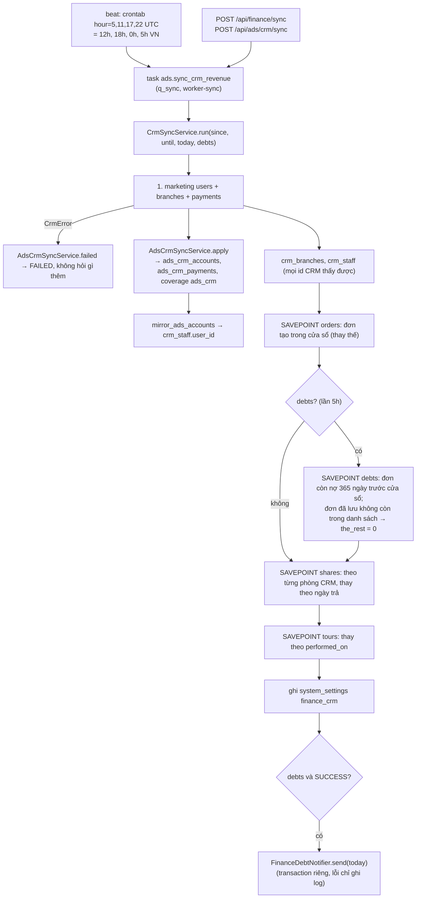
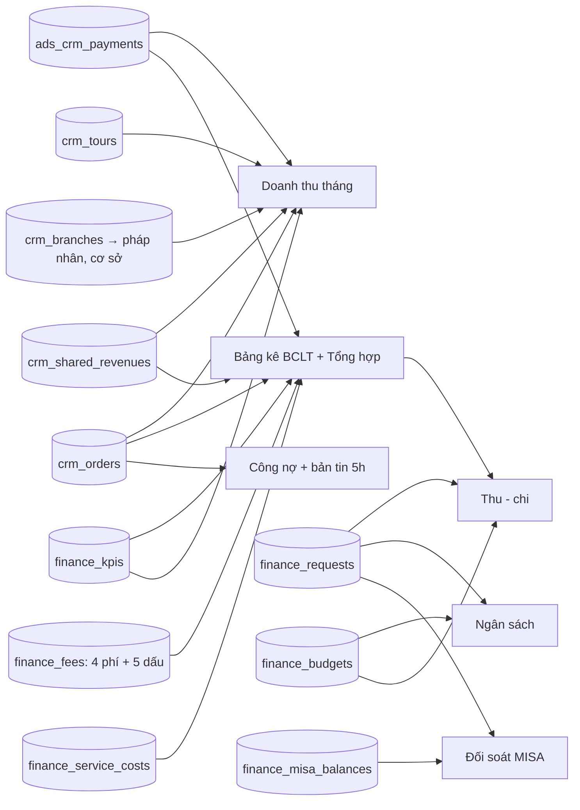
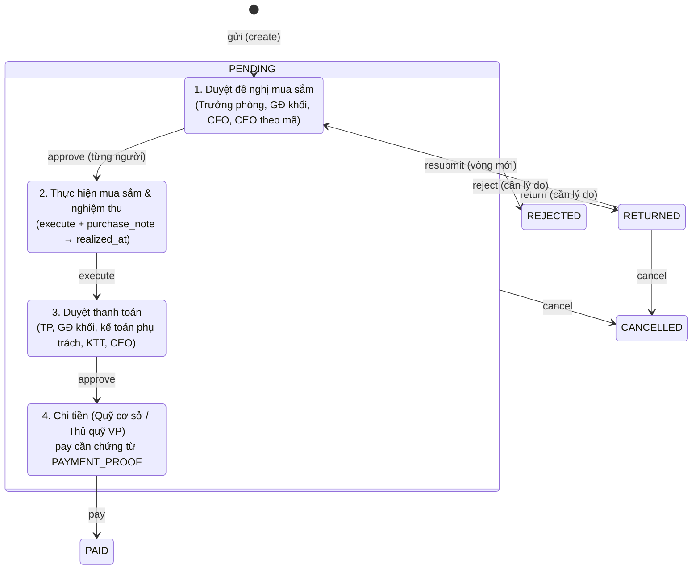

# Tài chính

> Module của Phòng Kế toán / Tài chính: doanh thu đọc từ CRM aicrmtech.vn (thực thu, doanh số, công nợ), bảng kê BCLT giống sổ kế toán, và phần chi (hồ sơ chi có tuyến duyệt, ngân sách, đối soát MISA, báo cáo thu - chi). Người dùng: Kế toán, Văn phòng khối Tài chính - Kế toán, Ban giám đốc; ai cũng lập được hồ sơ chi. Trên giao diện: menu **Tài chính** (`/finance/…`). **Hiện đang ẩn với mọi người trừ OWNER** ("Tính năng đang phát triển").

## Khái niệm & thuật ngữ

| Từ | Nghĩa |
|---|---|
| **CRM** | Phần mềm quản lý khách hàng của phòng khám (aicrmtech.vn). APM chỉ **đọc** (GET), không ghi. |
| **Thực thu** (tiền về) | Tiền khách đã trả, có VAT, theo **ngày trả** (`ads_crm_payments`). Loại thanh toán 3 (điểm) không tính; loại 7 (hoàn tiền) tính âm. |
| **Doanh số** | Giá trị đơn hàng có VAT (`all_total`), theo **ngày tạo đơn**. |
| **Doanh thu** | Doanh số trừ VAT (`amount_before_vat`). |
| **Còn nợ / Công nợ** | `crm_orders.the_rest` - phần đơn khách chưa trả. Tuổi nợ tính từ ngày tạo đơn. |
| **Pháp nhân** | Công ty pháp lý (`legal_entities`, xem [hr.md](hr.md) / [org.md](org.md)). Mỗi chi nhánh CRM được gắn một pháp nhân. |
| **Cơ sở APM** | `BRANCHES` của APM: `VP_HN`, `CS_HN`, `CS_HN2`, `CS_SG`. Mỗi chi nhánh CRM gắn một cơ sở. |
| **Chi nhánh CRM** | Chi nhánh trên CRM (`crm_branches`), ví dụ HN1, HN2, SG. |
| **Đội Marketing HN / SG** | Vùng của tài khoản CRM marketing (của Phòng Ads, `ads_crm_accounts.region`). Xem [ads.md](ads.md). |
| **BCLT** | Bảng kê doanh thu trong file kế toán "KÉO DỮ LIỆU KẾ TOÁN". Một dòng = **một đơn CRM trong một ngày**. |
| **Dòng NEW** ("Đơn mới") | Ngày đơn được tạo: doanh số, còn nợ, các khoản trả trong ngày đó. |
| **Dòng TTCN** ("Thanh toán công nợ") | Một ngày sau đó có tiền trả cho đơn. Khoản trả không gắn đơn = dòng riêng. |
| **Tổng hợp** | Tab tổng theo ngày của file kế toán (`DaySummary`). |
| **4 phí** | Phí quẹt thẻ (`card_fee`), HH giới thiệu (`referral_fee`), CP xe (`car_fee`), Viện phí / giá cost (`cost`) - `FEE_FIELDS`. |
| **"BCLT new"** | Bố cục mới của bảng kê + 5 ô đánh dấu Kế toán chọn (Tình trạng 2, Mới, Tình trạng, Up, Phân loại). |
| **NV bán** | TVV / KTV / Y tá được chia doanh thu trên CRM. **Bác sĩ** = phòng "Bác Sĩ" trên CRM (id 10). |
| **Công tua** | Lượt KTV làm tua (công chính / hỗ trợ), `crm_tours`. |
| **Hồ sơ chi** | Đề nghị chi tiền (`finance_requests`), mã `DC-YYMM-NNNN`, đi qua tuyến duyệt của mã chi. |
| **Mã chi / mã ngân sách** | Mã trong "Sổ tay" (vd `CO.06.06.02`), có nhóm và mã chi tiết (lá). Mỗi mã lá có **tuyến duyệt**. |
| **Thực hiện (realized)** / **Cam kết (committed)** | Hồ sơ chi đã nghiệm thu (mua sắm) hoặc đã chi / vẫn đang sống chưa thực hiện. Dùng để trừ ngân sách. |
| **MISA F01-DNN** | Bảng cân đối tài khoản xuất từ phần mềm kế toán MISA. |

## Luồng chính

### Một lần đồng bộ CRM cho cả Phòng Ads và Tài chính

Bảng → báo cáo:

### Hồ sơ chi

Mã chi `no_approval` (Phí ngân hàng `CO.06.06.02`) chỉ có bước Chi tiền.

## Quy tắc nghiệp vụ hiện hành

### Đồng bộ CRM (dùng chung với Phòng Ads)

1. **Một lần gọi CRM** cho cả hai module: task `ads.sync_crm_revenue` (giữ tên cũ; nhãn "Đồng bộ CRM (Phòng Ads + Tài chính)"), một mục beat `crontab(hour="5,11,17,22")` UTC = **0h, 5h, 12h, 18h** giờ VN (`tasks/celery_app.py`). Hàng đợi `q_sync`.
2. **Cửa sổ**: tháng này tới hôm nay; ngày 1-5 thì từ mùng 1 tháng trước (`crm_window`). Lần bấm tay có thể truyền `since` / `until`.
3. **Lần 5h đọc thêm công nợ cũ**: task tự quyết `debts` = không truyền ngày và giờ VN hiện tại là 5 (`tasks/ads.py` `DEBTS_HOUR`). Phần `debts` đọc `orders(unpaid=True)` từ `today − 365` (`DEBT_DAYS`) tới ngày trước cửa sổ; đơn đã lưu trong khoảng đó còn `the_rest > 0` mà không có trong danh sách → `the_rest = 0`.
4. **Thứ tự** (`application/crm/sync.py` `CrmSyncService.run`): người dùng marketing + chi nhánh + khoản thu; lỗi CRM ở bước này → `AdsCrmSyncService.failed`, không hỏi gì thêm, báo FAILED. Thành công → `AdsCrmSyncService.apply` (phần Phòng Ads, không đổi) + `crm_branches` + `crm_staff` (mọi id CRM thấy, vai trò `marketing` / `telesales` / `cskh` / `carepage` / `owner` / `share` / `tour`, phòng ban lấy từ phần chia doanh thu). Sau đó từng phần trong **SAVEPOINT riêng** (`_part`): `orders` (đơn tạo trong cửa sổ, thay thế), `debts` (chỉ lần 5h), `shares` (`share_departments()` từ `/raw-data/filters/shared-revenues` rồi từng phòng; thay theo ngày trả), `tours` (thay theo `performed_on`). Một phần bị CRM từ chối → cả lần chạy báo FAILED (bộ giám sát chạy lại), các phần khác vẫn giữ.
5. Ghi nhận trong `system_settings` `finance_crm`: lúc chạy, trạng thái, thông báo, khoảng đã đọc, từng phần.
6. **Client** `integrations/crm/client.py` `HttpCrmClient`: chỉ GET, key **chỉ** trong header `x-api-key` (không bao giờ trong URL, log hay trình duyệt), 500 dòng / trang, sắp `id` tăng dần (`_pages`), 429 và 5xx chờ rồi hỏi lại (5 s, 20 s, 60 s). Giờ của CRM là giờ VN không có múi giờ, lưu thành thời điểm có múi giờ. `FakeCrmClient` cho test.
7. **Không có `CRM_API_KEY`** → lần chạy báo "chưa cấu hình", không gọi gì.
8. **"Đồng bộ ngay"** của Tài chính: `POST /api/finance/sync {since, until}` (cần SETTINGS; cả hai ngày hoặc không; ≤ 93 ngày; không ngày tương lai → 422 `period_invalid`; đang chạy → 409 `cron_job_running`); audit `finance.sync.requested`. `GET /api/finance/sync` = trạng thái.

### Một cách gắn tài khoản CRM

9. Cả hai bên khoá người CRM bằng **cùng id người dùng CRM**. **Phòng Ads là nguồn** cho mọi id có trong `ads_crm_accounts`: `application/crm/staff_link.py` `mirror_ads_accounts(session, ids=None)` đặt `crm_staff.user_id` = người Phòng Ads gắn (tạo dòng vai trò `marketing` nếu thiếu; ◆ nguồn / nhân viên đã nghỉ / chưa gắn → NULL). Gọi sau mỗi `AdsCrmSyncService.apply`, `AdsCrmService.update` và `import_mapping`.
10. Sửa một id như thế ở Tài chính (`PATCH /api/finance/staff/{crm_id}`) → 422 `crm_staff_from_ads`. Dòng `/api/finance/staff` có `from_ads` + `ads_label` ("Gắn bên Phòng Ads" / "Chưa gắn bên Phòng Ads" / "Nguồn ◆ X (Phòng Ads)" / "Nhân viên đã nghỉ (Phòng Ads)"). Lọc "Chỉ người chưa gắn" (`unmapped=true`) bỏ qua id là ◆ nguồn / đã nghỉ. Tab "Nhân viên CRM" vẽ các dòng này chỉ đọc, kèm link "Sửa ở Quản trị › Tài khoản CRM" (`/admin/crm`, xem [ads.md](ads.md)).
11. Id telesales / CSKH / bác sĩ… (Phòng Ads không giữ) do Tài chính gắn tay, từng dòng "Lưu".

### Đang phát triển

12. FINANCE nằm trong danh sách `system_settings` `developing_modules` (0105 thêm vào). Khi đó **mọi người trừ OWNER (kể cả ADMIN)** nhận `FinanceAccess` rỗng (`load_finance_access` → `hidden_modules`): không menu, API 403 `finance_forbidden`, cờ trên `/api/units/me` đều false; quyền đã cấp vẫn lưu, mở lại khi OWNER bỏ module khỏi danh sách (Quản trị › Đang phát triển `/admin/developing`). Cơ chế chung ở [org.md](org.md).
13. Trong lúc ẩn, bản tin công nợ và nhắc việc 8:00 chỉ gửi cho người nhận là OWNER.

### Doanh thu tháng

14. `GET /api/finance/revenue?month=` → `FinanceRevenueService.month` (`application/finance/revenue.py`): figures + `previous` (cả tháng trước; nếu đang trong tháng thì chỉ cùng số ngày - `previous_from` / `previous_to`), chia theo pháp nhân / cơ sở APM (theo gắn chi nhánh CRM) / chi nhánh CRM / đội Marketing (vùng tài khoản CRM của Phòng Ads), thực thu theo ngày, người theo vai trò trên khoản thu (`PAYMENT_ROLES`: telesales "người phụ trách", marketing, cskh, carepage, owner "Người lên đơn" - là người có trên hồ sơ khách **lúc đồng bộ**, không phải người bán, đó là quy tắc CRM), chia doanh thu theo người, công tua chính / hỗ trợ. Dòng chưa gắn = "Chưa gắn". Kèm `fees`, `collected_after_fees`, `kpi`, KPI từng dòng cơ sở / đội.
15. **VAT trong một khoản thu** = tỉ lệ VAT của đơn (`order_vat_percent`) nếu biết đơn; else tỉ lệ cấu hình của pháp nhân; else mặc định `DEFAULT_VAT_PERCENT` 8%.
16. **Tên khách** chỉ hiện khi có quyền CUSTOMERS; không có thì chỉ mã khách. **Không bao giờ lưu SĐT.**

### Cấu hình

17. **Chi nhánh CRM** → `legal_entity_id` + `apm_branch` (`PATCH /api/finance/branches/{id}`, chỉ khoá gửi lên; 422 `branch_invalid` / `legal_entity_invalid`; 404 `finance_branch_not_found`; audit `finance.branch.updated`). **Không có ngày hiệu lực**: đổi là đổi cả các tháng cũ.
18. **VAT**: mặc định + theo pháp nhân (`PUT /api/finance/vat`, 422 `vat_invalid`; audit `finance.settings.updated`).
19. **Phí quẹt thẻ theo phương thức** (`GET/PUT /api/finance/fee-rules`): chỉ các phương thức `FEE_METHODS` 1, 2, 4, 5, 6; 422 `fee_method_invalid` / `percent_invalid`. Chưa lưu lần nào → mặc định **Thẻ 2%** (`settings.DEFAULT_CARD_FEE` `{2: 2}`, như file kế toán).
20. **Giá cost dịch vụ** (`GET /api/finance/service-costs?q=` = mọi dịch vụ thấy trên `crm_orders.items` + giá đã lưu; `PUT /service-costs/{id}`, để trống = xoá).
21. **Công nợ**: 1-6 mốc, mỗi mốc 1-3650 ngày (mặc định `DEFAULT_DEBT_MILESTONES` 30 / 45 / 60), ≤ 20 người nhận (422 `debt_milestones_invalid` / `debt_recipients_invalid`).
22. **KPI doanh thu** (`application/finance/kpi.py` `FinanceKpiService`): ô = (tháng, chiều, khoá): `total:` (công ty), `site:<BRANCHES>`, `team:HN|HCM`. `PUT /api/finance/kpi` entries `{"dim:key": amount|null}`; 422 `kpi_cell_invalid` / `kpi_invalid`. Là chỉ tiêu **thực thu**.
23. Mọi thao tác ghi ở Cấu hình cần SETTINGS và có audit.

### Bảng kê (BCLT) và Tổng hợp

24. `FinanceLedgerService.build(since, until, today)` (`application/finance/ledger.py`) dựng dòng: NEW (ngày tạo đơn: doanh số, còn nợ + tuổi nợ, các khoản trả hôm đó) / TTCN (ngày trả sau đó; khoản trả không có đơn = dòng riêng). Dòng TTCN lấy mã khách của đơn khi khoản trả thiếu.
25. Mỗi dòng: tiền theo phương thức (thứ tự `METHOD_ORDER`: trả góp, thẻ, nhà xe, CK, tiền mặt), hoàn tiền (loại 7), VAT, 4 phí, Sale / MKT / Chat page lấy từ khoản thu, chia doanh thu ghép theo (mã đơn, ngày trả): phòng Bác sĩ (`DOCTOR_DEPARTMENT` 10) theo `share_type` → cột Bác sĩ phẫu / tiêm / khác / khác 2 (`SHARE_TYPE_LABELS`); **mọi phòng khác** → NV bán.
26. **Phí của dòng** = số Kế toán gõ (`finance_fees`, PK `order_id + day`, NULL = tự động) else tự động: phí quẹt = tiền mỗi khoản trả × % phương thức đó; cost = các dòng hàng của đơn × giá cost dịch vụ, **chỉ trên dòng NEW**; HH giới thiệu và CP xe = 0.
27. **Sửa phí và dấu**: `PATCH /api/finance/fees` (cần FEES; chỉ khoá gửi lên; 422 `fee_row_invalid` khi không có dòng đó, `money_invalid`, `mark_invalid`, `fee_field_invalid`; dòng không còn gì gõ thì xoá; audit `finance.fees.updated`). Trả lại dòng như hiện tại.
28. **5 dấu "BCLT new"** (`domain/finance/ledger_marks.py` `MARKS`, danh sách từ tab "GHI CHÚ" của file): Tình trạng 2 [Đã lên đơn PM / Đã đăng ảnh / Đã làm cả 2], Mới [Mới / Cũ], Tình trạng [đã Cọc TT, đã Cọc TN, Cọc CS TN, Cọc onl TN, TTCNTT, TTCNTN], Up [Up / Sale / GT], Phân loại [V1, V3, Da, CSCB, Tiêm, DV #]. Lưu trên `finance_fees`; "" / null = về gợi ý; không phân biệt hoa thường, khoảng trắng.
29. **Gợi ý của APM** (`FinanceLedgerService._suggest`): Mới = "Cũ" nếu mã khách đã có đơn / khoản trả CRM trước ngày của dòng (dòng TTCN luôn Cũ; APM chỉ giữ dữ liệu CRM từ 10/2026 nên khách cũ hơn có thể hiện "Mới"); Up = "Up" khi có khoản trả CRM đánh `is_upsale`; Phân loại = V3 / V1 khi mã dịch vụ kết thúc bằng nó (`category_of`; dòng sản phẩm không đoán). Tình trạng và Tình trạng 2 không bao giờ đoán. Lựa chọn của Kế toán luôn thắng (`LedgerRow.marks`).
30. **Nhiều người trên một dòng** = dòng phụ (`bclt_lines`): dòng 1 mang tiền + NV bán / Bác sĩ đầu tiên; mỗi người thêm là một dòng chỉ có mã đơn, ngày và 4 ô người (giao diện `ledger-subrow` "↳ DH…").
31. **Diễn giải** = từng dịch vụ + giá CRM `total_price` của nó (`LedgerRow.items`; Excel "tên: 27.000.000" mỗi dòng một mục). Số lượng CRM = 0 nghĩa là chưa nhập, không hiện.
32. `GET /api/finance/ledger?since=&until=` tối đa **31 ngày** (`check_span`, 422 `period_invalid`). `GET /api/finance/ledger.xlsx?month=` = workbook 2 sheet "BCLT" (`BCLT_HEADERS`; tên khách chỉ khi có CUSTOMERS) + "Tổng hợp" (+ % VỀ), dựng qua `asyncio.to_thread`.
33. **Ẩn cột bảng kê** (mỗi người tự chọn, theo tài khoản): `GET/PUT /api/finance/ledger/columns {hidden}` (`application/finance/ledger_columns.py`, `system_settings` `finance_ledger_columns:<user id>`, ≤ 80 khoá dạng `^[a-z][a-z0-9_:]{0,39}$`, 422 `ledger_columns_invalid`). Excel luôn đủ cột.
34. **Chi tiết đơn**: bấm một dòng mở `/finance/ledger/orders/[code]` = `GET /api/finance/ledger/orders/{code}` (REVENUE; tên khách với CUSTOMERS; 404 `finance_order_not_found`) → `OrderDetail`: số liệu đơn, dòng hàng, khoản trả (Sale / MKT / CSKH / Carepage), chia doanh thu, công tua, các dòng BCLT của đơn, và `roles[]`: Người lên đơn, Sale (người phụ trách), MKT (nguồn), CSKH, Chat page / Carepage, từng dòng chia doanh thu (bác sĩ theo `SHARE_TYPE_LABELS`, khác = "NV bán (<phòng CRM>)") với số tiền + ngày, "KTV làm tua (<loại công>)". Mỗi người `{crm_id, name, user_name}` (tài khoản APM nếu đã gắn). Hai cột kiểm tra `seller_check` / `doctor_check` (hiện "Khớp" / "Lệch") chỉ ở trang đơn và Excel, không ở bảng.

### Công nợ

35. `GET /api/finance/debts?min_bucket=&q=` (`FinanceDebtService.report`): mọi đơn `the_rest > 0`, tuổi tính từ `created_on`, xếp vào mốc lớn nhất đã vượt (`debt_bucket`: tuổi > mốc).
36. **Bản tin công nợ** (`FinanceDebtNotifier.send`): gọi sau lần 5h thành công; một tin / ngày / người (idempotent), hộp thư web + Telegram, template `finance.debts` (MANAGEMENT_ONLY), sự kiện `finance_debts_digest`. Người nhận = danh sách ở Cấu hình › Công nợ.

### Hồ sơ chi, mã chi, vai trò

37. **Mã chi + tuyến** lấy từ "Sổ tay" (Google Sheet `1BfQxhhJ3MPYjYeuOhuWaMd1qB0FZJPT05lbHx50JKQY`, tab "Mã ngân sách" + "Phân quyền"), chép tay vào `domain/finance/codebook.py` `ROWS` (104 mã, 91 mã lá), đọc bằng `domain/finance/spend.py` `parse_codebook` thành `Route`: duyệt mua (DEPT_HEAD / BLOCK_DIRECTOR / CFO = "Phòng Tài chính" / CEO), người thực hiện (`executor_of`: Phòng ban đề xuất / Cơ sở = REQUESTER, HCMS, HCNS, lái xe, Ban thư ký, Kế toán kho VP), duyệt thanh toán (TP, GĐ khối, một trong 8 kế toán `ACCOUNTANTS`, Kế toán trưởng, CEO), người chi (FUND_BRANCH / CASHIER_VP), 8 loại chứng từ `SHEET_DOCUMENTS` + ghi chú.
38. Mã lá chưa có tuyến (`CO.05.01`-`CO.05.05`, `CO.06.03.08`, `CO.DP`) → lập hồ sơ bị 422 `finance_code_no_route` cho tới khi cấu hình. `CO.06.06.02` Phí ngân hàng = `no_approval`: chỉ bước chi tiền.
39. **Sửa tuyến / tên mã** (`FinanceCodeService`, `application/finance/codes.py`; cần CODES): mỗi thay đổi ghi `finance_code_changes`; mã nhóm không có tuyến (422 `code_is_group`); tuyến sai 422 `route_invalid`; tên 1-300 ký tự (422 `code_name_invalid`). Hồ sơ đã gửi giữ tuyến lúc gửi.
40. **Ngưỡng CEO** (`spend_settings.ceo_threshold`, mặc định tắt): số tiền > ngưỡng thì thêm CEO vào cuối duyệt mua (không có duyệt mua thì cuối duyệt thanh toán), trừ khi tuyến đã có CEO hoặc `no_approval`. Thư mục Drive chứng từ `docs_drive_folder_id`. Cả hai ở `system_settings` `finance`; `PUT /api/finance/spend-settings` (422 `threshold_invalid`, `drive_folder_invalid`).
41. **Vai trò** (`application/finance/roles.py` `FinanceRoleService`): DEPT_HEAD / BLOCK_DIRECTOR đọc từ sơ đồ tổ chức bằng `HrAbsenceService.chain_for` (người đầu = người duyệt, người thứ hai = duyệt thay); REQUESTER = người lập. Vai trò khác gán ở "Cấu hình › Vai trò tài chính" (`finance_role_assignments`): một người, tuỳ chọn cho một pháp nhân và / hoặc một cơ sở, có người duyệt thay. Chọn **một** người duyệt mỗi bước theo độ khớp: pháp nhân + cơ sở > pháp nhân > cơ sở > không điều kiện. Gán vai trò sơ đồ tổ chức → 422 `role_from_org_chart`; người thay trùng người duyệt → 422 `standin_invalid`. Cần CODES.
42. **Lập hồ sơ**: **ai cũng lập được** (`FinanceAccess.requests` = có tài khoản, khi module không ẩn). Chọn pháp nhân (422 `legal_entity_invalid`), phòng ban (`department_invalid`), cơ sở (`branch_invalid`), mã lá còn dùng (`finance_code_invalid`), nội dung 1-300 ký tự (`title_invalid`), số tiền (`amount_invalid`). Mã hồ sơ `DC-YYMM-NNNN`. Tuyến được chụp lại vào hồ sơ.
43. **Các bước mỗi vòng** (`_plan`): PURCHASE (từng người) → EXECUTE → PAYMENT (từng người) → CASH. Người chi: hồ sơ của cơ sở (`apm_branch` bắt đầu bằng `CS`) → Quỹ cơ sở nếu tuyến có, else Thủ quỹ VP (`cash_role`).
44. **Mở bước** (`_advance`): bước WAITING tiếp theo thành PENDING và tìm người (`_resolve`). Bước cấp sơ đồ tổ chức (TP, GĐ khối) không có ai → SKIPPED (như đơn từ Nhân sự). Vai trò gán mà chưa ai giữ → bước chờ với ghi chú "gán ở Tài chính › Cấu hình › Vai trò tài chính", được tìm lại mỗi lần đọc (`_refresh_open`).
45. **Người lập không tự duyệt**: ở bước duyệt mà người duyệt là người lập → chuyển lên cấp trên theo `ESCALATION` (Trưởng phòng → GĐ khối → Phòng Tài chính → Kế toán trưởng → PTGĐ / CEO, bỏ qua cấp đã có sau đó trong cùng pha; kế toán thì bắt đầu từ KTT), hết cấp → một thành viên Ban giám đốc khác; ghi chú lý do trên bước.
46. **Chỉ người duyệt hoặc người duyệt thay của bước** được thao tác (`_may_act`), kể cả OWNER / ADMIN (họ thấy hết nhưng chỉ làm khi giữ vai trò). Bước không chờ mình → 403 `finance_forbidden`. Bước đã đổi (`step_id` cũ) → 409 `finance_request_moved`.
47. **Thao tác** (`POST /api/finance/requests/{id}/actions {action, note, step_id, purchase_note}`):
    - `approve` (bước PURCHASE / PAYMENT);
    - `return` / `reject` (bước duyệt, **bắt buộc lý do** - 422 `note_required`): đóng các bước còn lại; RETURNED về người lập sửa, REJECTED là kết thúc;
    - `execute` (bước EXECUTE, cần `purchase_note` - 422 `purchase_note_required`): ghi `realized_at` = lúc nghiệm thu;
    - `pay` (bước CASH, cần ít nhất một chứng từ `PAYMENT_PROOF` - 422 `payment_proof_required`): hồ sơ PAID; thiếu chứng từ theo tuyến thì `docs_due_on` = +7 ngày (`DOCS_GRACE_DAYS`) - **chứng từ không bao giờ chặn**;
    - `cancel`: người lập (hoặc OWNER / ADMIN) khi PENDING / RETURNED; đã nghiệm thu thì cần VIEW_REQUESTS (422 `already_realized` "nhờ Kế toán huỷ");
    - `resubmit`: chỉ người lập, từ RETURNED → vòng mới (`round` + 1). Sửa nội dung bằng `PATCH /requests/{id}` khi RETURNED.
    - Thao tác sai bước → 422 `action_invalid`.
48. **Ai thấy hồ sơ** (`_sees`): người lập, người có VIEW_REQUESTS, Trưởng phòng của phòng ban trên hồ sơ, bất kỳ ai từng là người duyệt / duyệt thay ở một bước. Người khác 404 `finance_request_not_found`. Danh sách `?tab=mine|awaiting|all`.
49. **Chứng từ**: `POST /requests/{id}/documents?kind=&name=` (thân là file thô; người lập hoặc người có bước; PDF / ảnh JPEG / PNG / WebP nhận theo magic bytes `hr.files.sniff`, `.docx`, `.xlsx`; ≤ 10 MB; 422 `file_invalid` / `document_kind_invalid`). Lưu lên Google Drive khi có thư mục và API giữ `GoogleDriveClient` (`upload_bytes` / `download_bytes`), Drive lỗi thì lưu trong DB (`storage` `db` / `drive` / `paper`). "Đã nhận bản giấy" (`POST /requests/{id}/papers`) chỉ kế toán / thủ quỹ đang ở bước, hoặc VIEW_REQUESTS. Tải về: PDF / ảnh mở inline với CSP sandbox; Drive chưa nối → 422 `drive_unavailable`. Xoá: người tải lên hoặc VIEW_REQUESTS; chứng từ chi của hồ sơ đã chi không xoá được (422 `document_locked`).
50. **Thông báo** (`FinanceNotifier` trong `requests.py`): template `finance.request` (PERSONAL_PRIVATE), sự kiện `finance_request_awaiting` (bước mở chờ mình) / `finance_request_updated` (người lập: bị trả, không duyệt, đã chi) / `finance_request_reminder`.
51. **Nhắc việc 08:00 VN** (`finance.reminders`, `tasks/finance.py`, `application/finance/reminders.py`, hàng đợi `q_default`): mỗi người có việc chờ nhận một tin "Có N hồ sơ chi chờ bạn, M quá 24 giờ"; mỗi người lập có hồ sơ đã chi còn thiếu chứng từ nhận một dòng / hồ sơ (hạn hoặc quá hạn). "24 giờ" hiện là giờ lịch, chưa phải giờ làm việc.

### Ngân sách, MISA, Thu - chi

52. **Ngân sách** (`application/finance/budgets.py`): dòng = tháng × pháp nhân × phòng ban × mã chi (không theo cơ sở). Phòng con tính vào **phòng cha** (`parent_id`, một cấp). **Cam kết** = hồ sơ PENDING / RETURNED / PAID chưa thực hiện; **thực hiện** = đã nghiệm thu (mua sắm) hoặc đã chi. `còn lại = ngân sách − cam kết − thực hiện`. Hồ sơ chỉ hiện ngân sách của dòng nó dùng, **không chặn** khi vượt.
53. Sửa ô (`PUT /budgets/cell`), tải file mẫu (`/budgets/template.xlsx`), nhập file (`POST /budgets/import`, thân file thô, tất cả hoặc không: 422 `budget_import_invalid` + `problems`). Cần BUDGET; xem cần BUDGET hoặc REPORT hoặc VIEW_REQUESTS. Audit `finance.budget.updated`.
54. **MISA** (`application/finance/misa.py`): tải F01-DNN (.xlsx ≤ 5 MB, 422 `misa_file_invalid`) cho **một pháp nhân, một tháng** chọn lúc tải; dòng "Tháng MM năm YYYY" trong file khác tháng chọn → 422 `misa_month_mismatch`. Các dòng tài khoản thay số của tháng đó. Đối soát: **Doanh thu** MISA = PS Có 511 − PS Có 5114 so với APM = đơn CRM tạo trong tháng ở các chi nhánh của pháp nhân, trước VAT; **Chi phí** MISA = PS Nợ 632 + 642 + 811 so với APM = hồ sơ chi thực hiện trong tháng của pháp nhân. Nhập cần MISA (`finance.misa.imported`); xem cần MISA hoặc REPORT.
55. **Thu - chi** (`application/finance/pnl.py`, cần REPORT): theo pháp nhân: thu = thực thu sau VAT & phí của bảng kê (theo gắn chi nhánh, "Chưa gắn" nếu chưa gắn), chi thực hiện / cam kết, ngân sách, KPI; theo phòng ban: chi + ngân sách (ở phòng cha).

## Công thức

| Chỉ số | Công thức | Ở đâu |
|---|---|---|
| Thực thu | Σ khoản trả loại 1, 2, 4, 5, 6, 7 (7 âm); loại 3 điểm bỏ | `domain/finance/crm.counted` |
| VAT trong khoản thu | `số tiền × p ÷ (100 + p)`, p = VAT đơn else pháp nhân else 8 | `vat_inside` |
| VAT % của đơn | `vat_amount × 100 ÷ (all_total − vat_amount)` | `order_vat_percent` |
| Thực thu sau VAT (tháng) | `thực thu − VAT trong thực thu` | `Figures.collected_net` |
| Thực thu sau VAT & phí (tháng) | `thực thu − VAT − tổng phí` | `collected_after_fees` (schema) |
| Doanh thu | `doanh số − VAT` (`amount_before_vat`) | CRM |
| Dòng BCLT: THỰC THU | `trả góp + thẻ + nhà xe + CK + tiền mặt` (hoàn tiền tách riêng) | `LedgerRow.received` |
| Dòng BCLT: TỔNG HỢP PHÍ | `hoàn tiền + 4 phí` | `LedgerRow.charges` |
| Dòng BCLT: Thực thu sau VAT & phí (`net`) | `tiền thu (đã trừ hoàn) − VAT − 4 phí` | `LedgerRow.net` |
| Phí quẹt tự động | `Σ (khoản trả × % phương thức)`; mặc định chỉ Thẻ 2% | `build`, `DEFAULT_CARD_FEE` |
| Giá cost tự động | `Σ (số lượng × giá cost dịch vụ)` trên dòng NEW | `build` |
| Kiểm tra NV bán | `DT NV bán 1-3 − thực thu` | `seller_check` |
| Kiểm tra bác sĩ | `DT phẫu + tiêm + khác + khác 2 − thực thu` (dịch vụ; sản phẩm = không có) | `doctor_check` |
| Tổng hợp: thực thu thuần | `tiền về − hoàn tiền` | `DaySummary.collected` |
| Tổng hợp: KPI ngày | `KPI tháng (total) ÷ số ngày của tháng` | `_days` |
| Tuổi nợ / mốc | `today − ngày tạo đơn`; mốc = mốc lớn nhất mà tuổi > mốc | `debt_bucket` |
| Ngân sách còn lại | `ngân sách − cam kết − thực hiện` | `BudgetLine.remaining` |
| MISA doanh thu | `PS Có 511 − PS Có 5114` | `misa.py` |
| MISA chi phí | `PS Nợ 632 + 642 + 811` | `misa.py` |

Lưu ý: "Thực thu sau phí" của APM dùng **VAT theo từng đơn**, không phải phép chia phẳng `/1,08` của file kế toán.

## Phân quyền

Module **`FINANCE`** (`domain/finance/permissions.py`, trong `MODULES` trước ASSISTANT), mỗi quyền NONE / ALL, không có mặc định cho phòng mới (`default_finance_grants` rỗng):

| Quyền | Cho phép |
|---|---|
| `REVENUE` | Doanh thu, Bảng kê, Công nợ, chi tiết đơn, ẩn cột |
| `CUSTOMERS` | Thấy tên khách (không có thì chỉ mã khách) |
| `SETTINGS` | Cấu hình: chi nhánh, nhân viên CRM, VAT, phí, giá cost, KPI, công nợ, "Đồng bộ ngay" |
| `FEES` | "Nhập phí": 4 phí và 5 dấu trên bảng kê |
| `VIEW_REQUESTS` | Thấy mọi hồ sơ chi; huỷ hồ sơ đã nghiệm thu; xoá chứng từ; tick bản giấy |
| `CODES` | Mã chi & tuyến, vai trò tài chính, ngưỡng CEO, thư mục Drive |
| `BUDGET` | Nhập / sửa / nhập file ngân sách |
| `MISA` | Nhập file MISA và đối soát |
| `REPORT` | Thu - chi (và xem ngân sách, MISA) |

- OWNER / ADMIN giữ hết theo vai trò (`membership.sees_all`) - nhưng khi module đang ẩn thì chỉ OWNER.
- Lập hồ sơ chi: **ai cũng được** (không cần quyền), khi module không ẩn.
- Seed: 0105 KT HEAD REVENUE + CUSTOMERS + SETTINGS, KT MEMBER REVENUE + CUSTOMERS, VPTCKT HEAD cả ba, BOD HEAD REVENUE + CUSTOMERS; 0106 FEES cho KT HEAD + MEMBER, VPTCKT HEAD; 0107 KT HEAD VIEW_REQUESTS + CODES + BUDGET + MISA + REPORT, KT MEMBER VIEW_REQUESTS + MISA, VPTCKT HEAD cả năm, BOD HEAD VIEW_REQUESTS + REPORT.
- Cấp quyền theo phòng / cá nhân: xem [org.md](org.md).
- `application/finance/access.py` `FinanceAccess` / `load_finance_access`; `/api/finance/access` không bao giờ 403 (menu đọc nó). `/api/units/me` `finance {revenue, customers, settings, fees, requests, awaiting, view_requests, codes, budget, misa, report}`; `awaiting` = số hồ sơ chờ mình (badge "Hồ sơ chi").
- Menu (`components/shell.tsx` `financeBranch`, sau Nhân sự): Hồ sơ chi (requests), Doanh thu / Bảng kê / Công nợ (revenue), Ngân sách (budget / report / view_requests), Thu - chi (report), Đối soát MISA (misa / report), Cấu hình (revenue / settings / codes).

## Dữ liệu

| Bảng | Nội dung |
|---|---|
| `ads_crm_payments` | Khoản thu CRM (của Phòng Ads, xem [ads.md](ads.md)) + từ 0105: `telesales_id`, `cskh_id`, `carepage_id`, `owner_id`, `order_code`, `customer_name` (không bao giờ SĐT) |
| `crm_branches` | Chi nhánh CRM, `legal_entity_id`, `apm_branch`, `location_id`, `seen_at` |
| `crm_staff` | Mọi người CRM thấy được, `roles`, phòng CRM, `user_id` APM |
| `crm_orders` | Đơn theo ngày tạo: doanh số, VAT, `the_rest`, `items`, khách, chủ đơn, `role_type` (2 = sản phẩm) |
| `crm_shared_revenues` | Chia doanh thu theo phòng CRM / người / `share_type` / ngày trả |
| `crm_tours` | Công tua theo `performed_on`, loại công |
| `finance_fees` | PK (order_id, day): 4 phí (NULL = tự động), `note`, 5 dấu `status2` / `customer` / `status` / `upsale` / `category` |
| `finance_service_costs` | Giá cost theo dịch vụ CRM |
| `finance_kpis` | (month, dimension, key) → amount, unique |
| `finance_codes` (+ `finance_code_changes`) | Mã chi, nhóm / lá, tuyến (JSON), lịch sử |
| `finance_role_assignments` | Vai trò → người (+ pháp nhân / cơ sở, người thay) |
| `finance_requests`, `finance_request_steps`, `finance_request_events` | Hồ sơ chi, bước theo vòng, nhật ký |
| `finance_documents` | Chứng từ (`storage` db / drive / paper, `data` hoặc `drive_file_id`, sha256) |
| `finance_budgets` | tháng × pháp nhân × phòng ban × mã chi |
| `finance_misa_balances` | Dòng F01-DNN theo pháp nhân / tháng |
| `system_settings` `finance_crm` | Lần đồng bộ CRM gần nhất + các phần |
| `system_settings` `finance` | VAT mặc định / theo pháp nhân, `card_fee_pct`, mốc + người nhận công nợ, `ceo_threshold`, `docs_drive_folder_id` |
| `system_settings` `developing_modules` | `{"modules": ["FINANCE"]}` |
| `system_settings` `finance_ledger_columns:<user id>` | Cột bảng kê người đó ẩn |

Env: `CRM_API_BASE_URL`, `CRM_API_KEY` (xem [ads.md](ads.md#dữ-liệu)).

## Code ở đâu

| Lớp | File |
|---|---|
| domain | `domain/finance/crm.py` (thực thu, VAT, nhãn, `FEE_FIELDS`, `debt_bucket`), `domain/finance/ledger_marks.py`, `domain/finance/permissions.py`, `domain/finance/spend.py` (vai trò, tuyến, bước, `parse_codebook`, `escalate`, `cash_role`), `domain/finance/codebook.py`, `domain/finance/errors.py` |
| application | `application/crm/sync.py` (`CrmSyncService`), `application/crm/staff_link.py`; `application/finance/access.py`, `revenue.py`, `settings.py`, `ledger.py` (`FinanceLedgerService`, `ledger_workbook`, `check_span`), `ledger_columns.py`, `kpi.py`, `debts.py` (`FinanceDebtService`, `FinanceDebtNotifier`, `digest_text`), `codes.py`, `roles.py`, `requests.py`, `budgets.py`, `misa.py`, `pnl.py`, `reminders.py`; `application/org/developing.py` |
| integrations | `integrations/crm/client.py`, `integrations/google/drive.py` |
| tasks | `tasks/ads.py` (`ads.sync_crm_revenue`, `_sync_crm`), `tasks/finance.py` (`finance.reminders`), lịch `tasks/celery_app.py` |
| api | `api/routers/finance.py` (doanh thu, cấu hình, bảng kê, công nợ, KPI), `api/routers/finance_spend.py` (chi tiêu, cùng prefix), `api/schemas/finance.py`; `api/routers/permissions.py` (developing-modules); `api/routers/units.py` (khối `finance`) |
| frontend | `app/finance/page.tsx` (→ `/finance/revenue`), `app/finance/{revenue,ledger,debts,settings,budgets,pnl,misa}/page.tsx`, `app/finance/ledger/orders/[code]/page.tsx`, `app/finance/requests/{page,new/page,[id]/page}.tsx`, `app/admin/developing/page.tsx`; `components/finance.tsx` (`TabStrip`, `MonthSwitch`, `FIELD`, `statusTone`), `components/finance-fees.tsx` (`FeeDialog`, `marks=`); `lib/finance.ts` (`financeApi`, `developingApi`, `monthBounds`) |
| tests (backend) | `tests/unit/test_finance_crm.py` (test_01-10: quy tắc, một lần chạy, nợ 5h, tháng + cấu hình, đang phát triển, bảng kê / phí / nợ / KPI / workbook, chi tiết đơn, liên kết Phòng Ads, BCLT new, ẩn cột), `tests/unit/test_finance_spend.py` (test_01-04), `tests/integration/test_finance_crm_migration.py` |
| tests (frontend) | `frontend/tests/finance.test.tsx` (gồm "Tài chính đợt 2", "Bảng kê: một đơn hàng", "lists the bảng kê like BCLT new", "locks a CRM marketing account", "Tài chính đợt 3") |

Giao diện chính: "Doanh thu" (thẻ số, cột theo ngày, tab Theo pháp nhân / cơ sở / chi nhánh CRM / đội Marketing / Theo người / Chia doanh thu / Công tua; ghi chú + "Gắn ngay" khi còn chi nhánh chưa gắn), "Bảng kê" (tháng ‹ ›, tab "Bảng kê (BCLT)" có chọn ngày, tìm, "Sửa dòng" / "Tổng hợp theo ngày", "Xuất Excel"; gợi ý in nghiêng mờ "APM gợi ý", lựa chọn in đậm), "Công nợ" (thẻ theo mốc, lọc "Tuổi nợ", tìm), "Cấu hình" (tab Chi nhánh CRM, Nhân viên CRM, Thuế VAT, Đồng bộ CRM, Phí & giá cost, KPI doanh thu, Công nợ, Mã chi & tuyến duyệt (`RouteEditor`), Vai trò tài chính, Chứng từ & ngưỡng), "Hồ sơ chi" (`/new` có tóm tắt tuyến + gợi ý số tiền `amountSuggestions`; `[id]` có bước, ngân sách, chứng từ, thao tác, lịch sử, "In phiếu" = `window.print()` với `@media print` trong `globals.css` ẩn `#app-sidebar`, `.brand-topbar`, `[data-print-hide]`), "Đối soát MISA" (xác nhận trước khi nhập).

## API

Prefix `/api/finance` (cả hai router; có rewrite Next và envelope web). Lỗi quyền: 403 `finance_forbidden`.

| Method + path | Quyền | Ghi chú |
|---|---|---|
| `GET /access` | đăng nhập | không 403 |
| `GET /revenue?month=` | REVENUE | |
| `GET /branches` · `PATCH /branches/{id}` | xem: vào được module; sửa: SETTINGS | |
| `GET /staff?q=&unmapped=&page=` · `PATCH /staff/{crm_id}` | SETTINGS để sửa | 100 dòng / trang |
| `GET /people` | SETTINGS | ô chọn tài khoản APM |
| `GET /vat` · `PUT /vat` | SETTINGS để sửa | |
| `GET /sync` · `POST /sync {since, until}` | SETTINGS để chạy | 202, job `ads.sync_crm_revenue` |
| `GET /ledger/columns` · `PUT /ledger/columns {hidden}` | REVENUE | của chính mình |
| `GET /ledger?since=&until=` | REVENUE | ≤ 31 ngày |
| `GET /ledger/orders/{code}` | REVENUE | |
| `GET /ledger.xlsx?month=` | REVENUE | |
| `PATCH /fees` | FEES | trả dòng mới |
| `GET /debts?min_bucket=&q=` | REVENUE | |
| `GET /debts/settings` · `PUT /debts/settings` | SETTINGS để sửa | |
| `GET /fee-rules` · `PUT /fee-rules` | SETTINGS để sửa | |
| `GET /service-costs?q=` · `PUT /service-costs/{id}` | SETTINGS để sửa | |
| `GET /kpi?month=` · `PUT /kpi` | SETTINGS để sửa | |
| `GET /spend/catalog` | vào được | nhãn + lựa chọn cho form |
| `GET /codes` · `PATCH /codes/{code}` · `GET /codes/{code}/history` | CODES để sửa | audit `finance.code.updated` |
| `GET /roles` · `POST /roles` · `DELETE /roles/{id}` | CODES để sửa | audit `finance.role.updated`; 404 `finance_role_not_found` |
| `GET /spend-settings` · `PUT /spend-settings` | CODES để sửa | |
| `GET /requests?tab=mine|awaiting|all&status=&q=` | requests | |
| `GET /requests/form` | requests | |
| `POST /requests` | requests | 201 |
| `GET /requests/{id}` · `PATCH /requests/{id}` | thấy được | PATCH khi RETURNED |
| `POST /requests/{id}/actions` | người của bước / người lập | audit `finance.request.action` |
| `POST /requests/{id}/documents?kind=&name=` | người lập / người của bước | thân file thô, 201 |
| `POST /requests/{id}/papers` | kế toán / thủ quỹ của bước, VIEW_REQUESTS | |
| `GET /documents/{id}` · `DELETE /documents/{id}` | thấy hồ sơ / người tải lên, VIEW_REQUESTS | 404 `finance_document_not_found` |
| `GET /budgets?month=&legal_entity_id=` · `PUT /budgets/cell` · `GET /budgets/template.xlsx` · `POST /budgets/import` | xem: BUDGET / REPORT / VIEW_REQUESTS; ghi: BUDGET | |
| `GET /misa?legal_entity_id=&month=` · `POST /misa/import?legal_entity_id=&month=` | xem: MISA / REPORT; nhập: MISA | thân file thô |
| `GET /pnl?month=` | REPORT | |

Ngoài prefix: `GET/PUT /api/permissions/developing-modules` (OWNER, 403 `developing_forbidden`, 422 `developing_invalid`, audit `system.developing_modules.updated`) - xem [org.md](org.md).

Mã lỗi khác: 422 `month_invalid`, `period_invalid`, `user_invalid`, `role_invalid`, `legal_entity_invalid`; 404 `finance_staff_not_found`, `finance_code_not_found`.

## Cạm bẫy & chưa làm

- **Câu hỏi còn mở - loại chia doanh thu bác sĩ**: trên CRM, phần chia cho bác sĩ loại **tiêm / khác / khác 2** phần lớn là số rất nhỏ (1-45, ví dụ một đơn "Bác sĩ khác" 10, "Bác sĩ tiêm" 6), còn loại **phẫu** mới là tiền. APM hiện hiển thị đúng như CRM gửi, chờ Kế toán giải thích ý nghĩa. Vì vậy `doctor_check` thường "Lệch".
- **Người trên khoản thu là người của hồ sơ khách lúc đồng bộ**, không phải người bán (quy tắc của CRM). Muốn biết ai bán, xem phần chia doanh thu.
- **Gắn chi nhánh không có ngày hiệu lực**: đổi pháp nhân / cơ sở của một chi nhánh làm thay đổi cả số các tháng đã qua.
- APM giữ dữ liệu CRM từ khoảng 10/2026, nên gợi ý "Mới / Cũ" có thể sai cho khách cũ hơn.
- Đơn được tạo trước cửa sổ và trả xong ngoài lần 5h thì `the_rest` chỉ cập nhật ở lần 5h kế tiếp.
- Tên khách **được lưu** (Tài chính cần) nhưng chỉ hiện với CUSTOMERS; Phòng Ads không bao giờ hiện. Không lưu SĐT.
- Migration test cũ bỏ qua các cột khoản thu do 0105 thêm (`LATER`).
- Ngân sách chỉ cộng lên phòng cha **một cấp**.
- Docstring `domain/finance/ledger_marks.py` ghi `finance_fees` "0108"; đúng là **0109**.
- Chưa làm: B7 (nút "Duyệt chi" của Đề xuất tài nguyên chuyển sang đây - Tài nguyên vẫn dùng luồng riêng, xem [resources.md](resources.md)), tạm ứng, thanh toán nhiều đợt, AI gợi ý, đếm "24 giờ làm việc" (hiện đếm giờ lịch).

## Mốc thay đổi

| Migration / ngày | Thay đổi |
|---|---|
| 0105 (13/11/2026) | Đợt 1: một lần gọi CRM cho Phòng Ads + Tài chính, 4 lần / ngày (0h, 5h, 12h, 18h; Phòng Ads trước đó chạy mỗi giờ). Bảng `crm_branches`, `crm_staff`, `crm_orders`, `crm_shared_revenues`, `crm_tours`; cột mới trên `ads_crm_payments`; quyền FINANCE REVENUE / CUSTOMERS / SETTINGS; module ẩn ("đang phát triển"). Kiểm trên CRM thật 01-13/11: 466 khoản thu / 443 đơn / 647 dòng chia / 892 công tua trong ~5 s, thực thu khớp số Phòng Ads. |
| 0106 (13/11) | Đợt 2 (bảng kê theo file "KÉO DỮ LIỆU KẾ TOÁN"): `finance_fees`, `finance_service_costs`, `finance_kpis`, quyền FEES; công nợ + bản tin 5h. |
| 13/11 (không migration) | BCLT đầy đủ cột + trang chi tiết đơn; phí thẻ mặc định 2%. |
| 0107 (13/11) | Đợt 3: mã chi + tuyến (Sổ tay), vai trò, hồ sơ chi, chứng từ, ngân sách, MISA, thu - chi, nhắc 8:00; quyền VIEW_REQUESTS / CODES / BUDGET / MISA / REPORT. |
| 0108 (13/11) | Liên kết tài khoản CRM của Phòng Ads chép sang `crm_staff` (chỉ dữ liệu); từ đây `mirror_ads_accounts` giữ đồng bộ. |
| 0109 (13/11) | "BCLT new": 5 dấu trên `finance_fees`, bảng theo thứ tự cột của tab "BCLT new", dòng phụ cho nhiều người, Diễn giải tách giá từng dịch vụ. |
| 14/11 (không migration) | Mỗi người tự ẩn cột bảng kê (`/ledger/columns`). |
