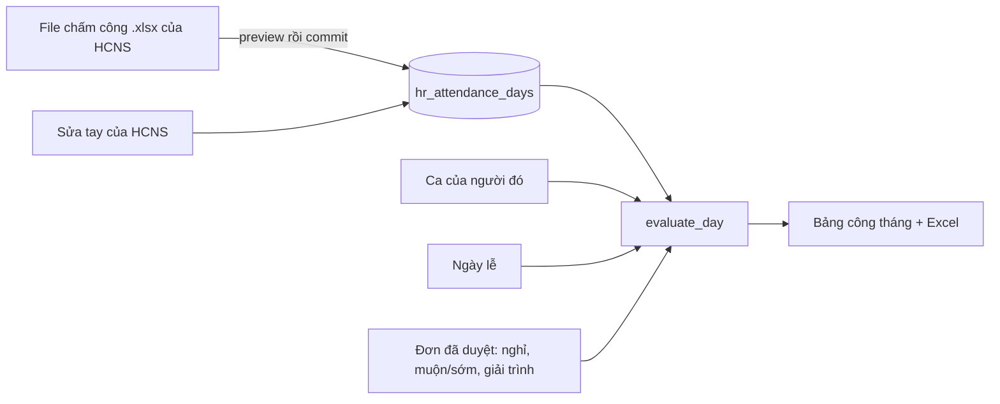

# Nhân sự (HR)

> Module "Nhân sự" kiểu MISA AMIS HRM bản cơ bản: hồ sơ nhân sự, hợp đồng, tài liệu, đơn từ (nghỉ / đi muộn / về sớm / giải trình chấm công), phép năm, ca làm việc và bảng công. Người dùng chính là Phòng HCNS, các Trưởng phòng và mọi nhân viên (hồ sơ của mình, đơn của mình). Trên giao diện: nhánh menu **"Nhân sự"** (sau "Hiệu suất"), các trang dưới `/hr/*`.

Phần cơ cấu tổ chức (phòng ban, khối, pháp nhân, chi nhánh) và đăng nhập bằng mã nhân viên (HR đợt 1, migration 0095) không nằm ở đây: xem [org.md](org.md) và [account.md](account.md). Kế hoạch gốc: `docs/hr/HR_MODULE_PLAN.md` (bối cảnh; code là chuẩn).

## Khái niệm & thuật ngữ

- **HCNS**: Phòng Hành chính nhân sự, mã phòng ban `HCNS` (`HR_DEPARTMENT_CODE`). Là phòng vận hành module.
- **Module quyền `HR`**: một module trong hệ phân quyền thống nhất (xem [org.md](org.md)). Mỗi quyền có phạm vi (scope) `NONE` / `OWN` / `ALL`:
  - `OWN` = phạm vi hẹp (ở đây: người trong các phòng mình làm trưởng phòng).
  - `ALL` = toàn công ty.
- **TIMESHEET**: quyền `HR` / `TIMESHEET` ALL = "Chấm công, phép năm & xác nhận đơn từ (HCNS)". Ai giữ quyền này là người duyệt bước cuối của mọi đơn từ, nhập file chấm công, sửa ca, ngày lễ, phép năm, khoá bảng công.
- **Hồ sơ** (`hr_profiles`): một dòng cho mỗi tài khoản, tạo lười (lazy) khi cần.
- **Dữ liệu nhạy cảm (sensitive)**: CCCD, SĐT, ngày sinh, email cá nhân, địa chỉ, tài khoản ngân hàng, lương, bảo hiểm, thuế, tài liệu đính kèm.
- **Niêm phong (sealed)**: mã hoá bằng `SecretBox` (cùng khoá PR `PR_SECRET_ENCRYPTION_KEY`), chỉ 4 số cuối để trần.
- **Đơn từ** (`hr_absence_requests`): 4 loại `AbsenceKind`: `LEAVE` "Nghỉ", `LATE` "Đi muộn", `EARLY` "Về sớm", `EXPLAIN` "Giải trình chấm công" (quên chấm vào/ra).
- **Bước duyệt** (`StepLevel`): `MANAGER` "Trưởng phòng", `BLOCK` "Giám đốc khối", `DIRECTOR` "Giám đốc", `HR` "HCNS xác nhận".
- **Văn phòng khối**: phòng ban đang hoạt động cùng `block` ("Khối …") và có mã bắt đầu bằng `VP` (ví dụ VPKVH, VPTCKT). Trưởng của phòng này là "Giám đốc khối".
- **Ca** (`hr_shifts`): mỗi ngày trong tuần có buổi sáng và/hoặc buổi chiều; mỗi buổi = ½ công. Có số phút cho phép trễ (grace).
- **Công tính lương** (`payable`) = đi làm + nghỉ có lương + lễ.
- **Khoá tháng** ("Khoá bảng công"): tháng đã khoá thì không nhập file, không sửa giờ, không gửi/huỷ đơn, không thêm/xoá ngày lễ trong tháng đó.

## Luồng chính

### Duyệt đơn từ

```mermaid
flowchart TD
    A[Nhân viên gửi đơn] --> B{Loại đơn}
    B -- LEAVE --> M1[Trưởng phòng]
    M1 --> M2[Giám đốc khối]
    M2 --> M3[Giám đốc]
    M3 --> H[HCNS xác nhận]
    B -- LATE / EARLY / EXPLAIN --> F[Cấp quản lý đầu tiên có người<br/>Trưởng phòng hoặc GĐ khối hoặc GĐ]
    F --> H
    H --> OK[APPROVED]
    M1 & M2 & M3 & F & H -- Không duyệt + lý do --> R[REJECTED, các bước còn lại CLOSED]
    A -. Người gửi rút khi PENDING .-> C[CANCELLED]
    OK -. HCNS / OWNER / ADMIN huỷ + lý do .-> C
```

- Mỗi bước bị **bỏ qua** (`SKIPPED`) khi trên đó không có ai ngoài người gửi, hoặc có người đã duyệt một bước trước đó của chính đơn này.
- Mọi bước đều bỏ qua → đơn được duyệt ngay.

### Bảng công một tháng

## Quy tắc nghiệp vụ hiện hành

### Hồ sơ

1. Ai cũng xem được **toàn bộ** hồ sơ của chính mình. `application/hr/access.py:HrAccess.may_view`, `sees_sensitive`.
2. Hồ sơ người khác không được xem → 404 `hr_not_found` (không lộ là có tồn tại). `HrAccess.require_view`.
3. Phần nhạy cảm của người khác chỉ hiện cho người giữ `SENSITIVE` ALL **và** xem được hồ sơ đó. Mỗi lần đọc phần nhạy cảm của người khác được ghi audit `hr.profile.sensitive_viewed`. `application/hr/profiles.py:HrProfileService.profile`.
4. CCCD, số tài khoản ngân hàng (cả tài khoản 2), loại lương, ghi chú lương, lương cơ bản, phụ cấp, lương đóng bảo hiểm được niêm phong trong `hr_profiles.secret` (một JSON, AAD `hr_profile:<user id>`); `id_last4`, `bank_last4`, `bank2_last4` để trần. Lương trên hợp đồng niêm phong trong `hr_contracts.salary_secret` (AAD `hr_contract:<id>`). Không có khoá mã hoá → không lưu được, 422 `hr_secret_not_configured`. `HrProfileService._seal_box`.
5. Một số trường nằm trên bảng `users` (họ tên, chức danh, chi nhánh, pháp nhân, trạng thái nhân sự) và được sửa từ hồ sơ. Đổi trạng thái nhân sự đi qua `application/resources/employment.py:apply_employment_status` (để module Tài nguyên báo động người nghỉ). Trạng thái có thêm `MATERNITY` "Nghỉ thai sản", `UNPAID_LEAVE` "Nghỉ không lương" (vẫn đăng nhập được).
6. Danh sách "Quản lý hồ sơ" lọc theo: từ khoá (mã NV, họ tên, email công việc, SĐT, email cá nhân, chức danh; không dấu), phòng ban, chi nhánh, trạng thái (mặc định ẩn người đã nghỉ `LEFT`), pháp nhân, giới tính, hợp đồng (`expiring` = còn 0-60 ngày, `expired`, `none`). `HrProfileService.filter_rows`. Bộ lọc "Phòng ban" lấy từ `/api/hr/access` `choices.departments` (mọi phòng đang hoạt động), vì nhân viên HCNS thường không đọc được API Phòng ban.
7. Tổng quan: tổng số, % nữ, theo phòng ban / trạng thái, hợp đồng sắp hết hạn, người mới, yêu cầu chờ duyệt, thiếu tài liệu. Tuổi trung bình, sinh nhật và quỹ lương chỉ hiện cho người có `SENSITIVE`. `HrProfileService.overview`.
8. Thêm nhân viên (`EDIT`): cần mã NV (chưa ai dùng, 422 `member_code_taken` / `member_code_missing`), họ tên, phòng ban đang hoạt động (422 `department_invalid`). Tạo tài khoản không Telegram, trạng thái `PROBATION`, mật khẩu tạm (chỉ hiện một lần), xếp ghế (seat) vào phòng ban rồi `sync_stream_tags`. `HrProfileService.create_employee`.
9. Sửa hàng loạt chỉ các trường `BULK_FIELDS`: chức danh, chi nhánh, pháp nhân, trạng thái nhân sự, bậc, hình thức làm việc. 422 `hr_bulk_invalid`.
10. Hợp đồng: loại hợp đồng (`hr_contract_types`, 6 loại gieo sẵn, sửa được) có số tháng; ngày hết hạn tự tính từ số tháng (0 = không xác định thời hạn). Trạng thái tính theo ngày: `UPCOMING` / `ACTIVE` / `EXPIRED` / `ENDED`. "Gia hạn / thêm HĐ" cho nhiều người: bắt đầu từ ngày được nhập, nếu không thì ngày sau khi hợp đồng hiện tại hết, nếu không thì hôm nay. `HrProfileService.renew_contracts`.
11. Cài đặt module (`system_settings` key `hr`): số ngày cảnh báo hợp đồng (mặc định 30) và danh sách tài liệu bắt buộc (mặc định CV, CCCD, BIRTH, RESIDENCE, HEALTH, DEGREE). 422 `hr_settings_invalid`.

### Tài liệu, hồ sơ giấy, link scan

12. Tài liệu đính kèm: PDF / JPEG / PNG / WebP nhận theo magic bytes, tối đa 10 MB, lưu trong DB kèm SHA-256 (cột `data` deferred). Chỉ `EDIT` tải lên / xoá; tải xuống chỉ cho chính người đó và người giữ `SENSITIVE`; mọi lần tải xuống đều ghi audit. Lỗi 422 `hr_document_invalid` / `hr_document_too_large`. `application/hr/files.py:HrFileService`.
13. Hồ sơ giấy: `PAPER_DOCUMENTS` (CV, CCCD, BIRTH, VSSID, ETAX, RESIDENCE, HEALTH, DEGREE, LICENSE) được đánh dấu "đã nộp" trong `hr_profiles.paper_documents`. Thiếu tài liệu = bắt buộc − (đã tải lên ∪ đã đánh dấu). Phần `papers` của hồ sơ chỉ hiện cho người xem được phần nhạy cảm; sửa `paper_documents` / `scan_note` cần `SENSITIVE`.
14. Link hồ sơ scan: mỗi link là một dòng `hr_scan_links` (nhãn, url, thứ tự). Chỉ `http(s)`, ≤2000 ký tự, tối đa 30 link/người (`MAX_SCAN_LINKS`) → 422 `hr_scan_link_invalid`; trùng → 422 `hr_scan_link_duplicate`. Sửa cần `EDIT` và xem được phần nhạy cảm của người đó. Phần chữ còn lại là `hr_profiles.scan_note`.
15. Yêu cầu sửa hồ sơ của nhân viên (chỉ SĐT, email cá nhân, chỗ ở hiện tại, hộ khẩu thường trú - `REQUEST_FIELDS`): giá trị mới giống cũ → 422 `hr_request_unchanged`; >500 ký tự / trường khác → 422 `hr_request_invalid`; yêu cầu đang chờ cùng trường bị thay (cũ thành `CANCELLED`). HCNS (`EDIT`) duyệt (hồ sơ đổi theo) hoặc từ chối kèm lý do (422 `hr_request_note_missing`); đã xử lý rồi → 422 `hr_request_decided`. `HrFileService.submit`, `decide`.

### Đơn từ

16. **Chuỗi duyệt** được chốt lúc gửi (`hr_absence_steps.approver_ids`, đã bỏ người gửi). `application/hr/absences.py:HrAbsenceService.chain_for`:
    - `MANAGER`: với nhân viên = trưởng phòng mình báo cáo (`manager_user_id`, nếu người đó vẫn là trưởng phòng) nếu không thì mọi trưởng phòng của phòng đó; với trưởng phòng = các trưởng phòng của phòng cha (`parent_id`).
    - `BLOCK`: trưởng của văn phòng khối cùng `block` (nếu phòng không có block thì lấy block của phòng cha).
    - `DIRECTOR`: trưởng các phòng có function `BOARD` (Ban Giám đốc).
    - `HR`: mọi người giữ `HR` / `TIMESHEET` ALL qua ghế hoặc quyền cá nhân (`timesheet_holders`; OWNER/ADMIN không bị điểm danh chỉ vì vai trò).
17. **Thứ tự bước** (`domain/hr/attendance.py:plan_levels`): `LEAVE` đi đủ 4 cấp; `LATE` / `EARLY` / `EXPLAIN` đi cấp quản lý đầu tiên có người (ngoài người gửi) rồi HCNS; không có cấp quản lý nào → chỉ HCNS.
18. Bỏ qua bước: `level_skipped` (xem Luồng chính). Mở bước kế: `HrAbsenceService._advance`.
19. Ai duyệt một bước: bất kỳ ai trong `approver_ids` của bước đang chờ; OWNER/ADMIN đứng thay ở mọi bước; người giữ TIMESHEET ở bước `HR`. Không ai tự duyệt đơn của mình → 403 `hr_forbidden`. Bước không chờ mình → 403. `_may_decide`, `decide`.
20. Gửi kèm `step_id` cũ (bước đã đổi) hoặc đơn không còn PENDING → 409 `hr_absence_moved`.
21. Không duyệt phải có lý do → 422 `hr_absence_note_required`; từ chối đóng mọi bước còn lại (`CLOSED`) và đơn thành `REJECTED`.
22. Huỷ (`cancel`): người gửi huỷ khi đơn còn PENDING; HCNS / OWNER / ADMIN huỷ đơn PENDING hoặc APPROVED, **bắt buộc lý do** (422 `hr_absence_note_required`). Người khác → 403.
23. Kiểm tra khi gửi (`submit`):
    - Lý do bắt buộc, ≤1000 ký tự (422 `hr_absence_invalid`).
    - `LEAVE`: loại nghỉ đang hoạt động; tối đa 62 ngày lịch/đơn (`MAX_SPAN_DAYS`); nhiều ngày thì luôn cả ngày; số ngày = ½ cho mỗi buổi có ca, trừ ngày lễ (`leave_days`); 0 ngày → 422 `hr_absence_no_workday`.
    - `LATE`: giờ đến phải sau giờ vào ca đầu; `EARLY`: giờ về phải trước giờ hết ca cuối → 422 `hr_absence_time_invalid`. Số phút được lưu. Ngày không có ca → 422 `hr_absence_no_shift`.
    - `EXPLAIN`: ngày đã qua hoặc hôm nay, có ca; ít nhất một trong giờ vào / giờ ra thực tế; giờ ra sau giờ vào; 1-5 ảnh làm bằng chứng (xem mục 26).
    - Trùng đơn **cùng loại** đang chờ hoặc đã duyệt → 422 `hr_absence_overlap`. Ngoại lệ: hai đơn nghỉ nửa ngày khác buổi (sáng + chiều) trong cùng một ngày. `_refuse_overlap`.
    - Tháng đã khoá → 422 `hr_month_locked` (`application/hr/shifts.py:require_open`).
24. **Thông báo** (`HrAbsenceService._announce` + `application/hr/absence_notifications.py:AbsenceNotifier`): mỗi người một tin, có tiêu đề riêng; tin trong hộp thư web (target_kind `hr_absence` → `/hr/leave/<id>`) và bản Telegram (template `hr.absence`) kèm `_chain_text` (trạng thái + mỗi bước một dòng ✅/❌/⏳/▫️/↷, ai và lúc nào).
    - Gửi: người duyệt bước đầu ("Có đơn từ chờ bạn duyệt"), người gửi nhận biên nhận "Đã gửi đơn", HCNS "Có đơn từ mới". Duyệt ngay (không cấp nào) → người gửi + HCNS nhận "đã duyệt".
    - Một bước được duyệt: người duyệt bước kế, người gửi, những người cùng bước ("bạn không cần duyệt nữa"), những người đã duyệt bước trước.
    - Bước cuối duyệt / bị từ chối: người gửi, người cùng bước, người duyệt trước, HCNS.
    - Huỷ: người gửi (trừ khi tự rút), người mà bước đang chờ, người duyệt trước, HCNS.
    - HCNS **không** nhận tin các bước giữa. Không ai nhận tin về việc chính mình làm (trừ biên nhận của người gửi).
    - Sự kiện: `HR_ABSENCE_AWAITING`, `HR_ABSENCE_SUBMITTED`, `HR_ABSENCE_STEP_APPROVED`, `HR_ABSENCE_APPROVED`, `HR_ABSENCE_REJECTED`, `HR_ABSENCE_CANCELLED`.
25. Ai thấy một đơn: OWNER/ADMIN, người giữ TIMESHEET, người xem được hồ sơ người gửi (chính mình, trưởng phòng `VIEW OWN`, `VIEW ALL`), và người có tên trên chuỗi duyệt. Không thấy → 404. `_may_see`.
26. **Ảnh giải trình**: tải lên trước (`POST /api/hr/absence-files?name=`, body thô), PNG / JPEG / WebP theo magic bytes, ≤5 MB/ảnh (`MAX_EVIDENCE_BYTES`) → sai thì 422 `hr_absence_file_invalid`. Ảnh chờ (chưa gắn đơn, `request_id` NULL) quá 24 giờ bị dọn; tối đa 15 ảnh chờ mỗi người. Gửi đơn kèm `file_ids` (chỉ ảnh chờ của chính mình, 1-5 ảnh - `MAX_EVIDENCE_FILES`); không có → 422 `hr_absence_files_required`. Xem ảnh: người tải lên (khi còn chờ), sau đó ai thấy đơn; trả inline, `nosniff`, CSP sandbox. Xoá: người tải lên, chỉ ảnh chưa gửi.
27. Giải trình được duyệt → bảng công dùng giờ khai báo thay giờ máy chấm (`HrTimesheetService.compute` biến `declared`, `DayResult.explained`; Excel ghi "Giải trình đã duyệt").

### Phép năm

28. Phép năm theo luật: 12 ngày + 1 ngày cho mỗi 5 năm làm đủ (tính từ `joined_on` đến cuối năm). Phép được **tích luỹ theo tháng** từ ngày chính thức (`official_on`): một tháng được tính khi đã chính thức trước hoặc đúng ngày 15 của tháng đó; thử việc không tích. Không chuyển phép sang năm sau. `domain/hr/attendance.py:annual_balance`, `earning_months`.
29. Còn lại = đã tích + điều chỉnh − đã dùng (đơn đang chờ không trừ). Đã dùng = số ngày của đơn đã duyệt thuộc loại nghỉ có cờ `annual`. HCNS điều chỉnh (`hr_leave_adjustments`, số ngày có dấu, theo năm, bắt buộc lý do → 422 `hr_leave_adjust_invalid`).
30. Loại nghỉ (`hr_leave_types`, HCNS sửa; 422 `hr_leave_type_invalid`): 7 loại gieo sẵn ANNUAL "P" (phép năm, có lương), SICK "Ô", UNPAID "KL", MARRIAGE "R" 3 ngày, CHILD_MARRIAGE "R" 1 ngày, BEREAVEMENT "R" 3 ngày, COMPENSATORY "NB".

### Ca, ngày lễ, bảng công

31. Ca của một người: ca đang hoạt động đầu tiên có ghi một phòng ban của họ (`department_ids`), nếu không thì ca có ghi chi nhánh của họ (`branches`), nếu không thì ca mặc định (`is_default`, chỉ một), nếu không có gì thì ca có sẵn "Hành chính": Thứ 2-6 08:00-12:00 + 13:30-17:30, Thứ 7 buổi sáng, cho phép trễ 5 phút. `application/hr/shifts.py:ShiftBook.row_for`, `domain/hr/attendance.py:default_shift`.
32. Lưu ca (`HrTimesheetService.save_shift`, 422 `hr_shift_invalid`): cần tên, ít nhất một buổi, grace 0-120 phút, chi nhánh trong `BRANCHES`, phòng ban có thật; không tắt được ca mặc định.
33. Ngày lễ (`organization_holidays`): một ngày hoặc một chuỗi ≤16 ngày cùng tên (ví dụ Tết); 422 `hr_holiday_invalid`.
34. Một ngày trong bảng công (`domain/hr/attendance.py:evaluate_day`):
    - Không có ca → "-" (giờ chấm nếu có vẫn hiện, không tính). Ngày lễ có ca → "L", tính đủ công lễ.
    - Buổi đi làm khi khoảng giờ vào đầu tiên - giờ ra cuối cùng chồng lên buổi đó.
    - Đi muộn / về sớm = số phút vượt quá grace, trừ đi số phút đơn muộn/sớm đã duyệt.
    - Chỉ có một lần chấm (hoặc ra trước vào) → "!" (thiếu giờ). Không chấm gì → "V" (vắng) trừ ngày tương lai.
    - Ngày nghỉ theo đơn mang ký hiệu của loại nghỉ (ví dụ "P"); nửa nghỉ nửa làm → ví dụ "KL/X"; nửa nghỉ nửa vắng → "P/V".
35. Tổng tháng (`MonthTotals`): công chuẩn, đi làm, nghỉ có lương, nghỉ không lương, lễ, vắng, số lần + phút muộn / sớm, số ngày thiếu giờ; công tính lương = đi làm + nghỉ có lương + lễ.
36. **File chấm công** (`application/hr/attendance_import.py:read_workbook`, `HrTimesheetService.import_file`): body thô ≤20 MB (`MAX_IMPORT_BYTES`), chạy trong `asyncio.to_thread`. Đọc mọi tab có hàng tiêu đề (trong 15 hàng đầu) chứa "Mã nhân viên" + "Ngày" + ít nhất một cột "Vào…"/"Ra…"; tab khác ghi là bỏ qua. Lấy giờ vào nhỏ nhất và giờ ra lớn nhất; cùng người cùng ngày ở nhiều tab được gộp. Mã khớp `users.member_code` qua `normalise_member_code`; mã không khớp được liệt kê (mã + số dòng). `commit=false` = xem trước; commit khi file có lỗi / không khớp dòng nào → 422 `hr_attendance_invalid`; tháng đã khoá → 422 `hr_month_locked`. Ngày đã được HCNS sửa tay (`edited_by_user_id`) được giữ nguyên khi nhập lại.
37. Sửa giờ một ngày (HCNS): bắt buộc lý do, giờ ra sau giờ vào (422 `hr_attendance_invalid`), nguồn thành "Sửa tay".
38. Ai xem bảng công: chính mình; trưởng phòng (`VIEW OWN`) xem người trong phòng mình; HCNS (TIMESHEET) và `VIEW ALL` xem tất cả. Nhân viên thường mở `/hr/timesheet` bị chuyển sang `/hr/timesheet/me`.

### Giao diện bảng công

39. Mỗi ô ngày vẽ bằng `DayMark` (icon màu: ✓ xanh đi làm, nửa hình tròn nửa ngày, đồng hồ vàng muộn/sớm, ✕ đỏ vắng, ⚠ đỏ thiếu giờ, ★ xanh dương lễ, – không ca; ngày nghỉ giữ chữ trong viên màu magenta). Chữ ký hiệu vẫn nằm trong `sr-only`; Excel vẫn dùng chữ. `symbolTone` chỉ tô nền ô. Chú giải: `MarkLegend`.
40. Rê chuột / focus một ô hiện thẻ `useDayTip` (một tooltip portal mỗi lưới, nội dung từ `dayTipLines`: thứ + ngày, Check in / Check out hoặc "chưa chấm", phút muộn/sớm, loại nghỉ, "Giải trình đã duyệt", "HCNS đã sửa tay").
41. Trang một người `/hr/timesheet/[id]` (cả `me`) mở đầu bằng `MonthCalendar` (tuần bắt đầu Thứ 2). Ngày "!" của chính mình có link "Giải trình" → `/hr/leave?new=1&kind=EXPLAIN&day=` mở sẵn form.

## Phân quyền

| Quyền `HR` | Scope | Ý nghĩa | Mặc định |
|---|---|---|---|
| `VIEW` | `OWN` | Xem phần công việc trong hồ sơ của người ngồi trong các phòng mình làm trưởng (`department_people`) | Mọi HEAD (`default_hr_grants`) |
| `VIEW` | `ALL` | Xem mọi hồ sơ | HCNS |
| `EDIT` | `ALL` | Thêm/sửa hồ sơ, hợp đồng, tài liệu, sửa hàng loạt, duyệt yêu cầu sửa (EDIT kéo theo VIEW ALL) | HCNS |
| `SENSITIVE` | `ALL` | Xem dữ liệu nhạy cảm. **owner_only**: ADMIN không có theo vai trò | HCNS |
| `EXPORT` | `ALL` | Xuất Excel hồ sơ | HCNS |
| `TIMESHEET` | `ALL` | Bước HCNS của đơn từ, file chấm công, ca, ngày lễ, phép năm, mọi bảng công, khoá tháng | HCNS HEAD + MEMBER (0100) |

- OWNER/ADMIN được mọi quyền theo vai trò (trừ `SENSITIVE` với ADMIN). Hệ quyền chung xem [org.md](org.md).
- 0096 gieo cho phòng `HCNS` (cả HEAD và MEMBER) bốn quyền VIEW/EDIT/SENSITIVE/EXPORT ALL.
- `/api/units/me` khối `hr`: `lists` (mở "Quản lý hồ sơ"), `overview` (= VIEW ALL), `edit`, `sensitive`, `export`, `pending` (yêu cầu sửa chờ duyệt, chỉ với `edit`), `timesheet`, `lists_attendance`, `absences_awaiting` (badge "Đơn từ"). `api/routers/units.py:_hr_block`.
- Lỗi: 403 `hr_forbidden`, 404 `hr_not_found`.

## Dữ liệu

| Bảng | Nội dung | Migration |
|---|---|---|
| `hr_profiles` | Một dòng/tài khoản. Cột trần: thông tin công việc + cá nhân; `secret` (JSON niêm phong); `id_last4`, `bank_last4`, `bank2_last4`; `team`, `bank2_name`, `bank2_holder`, `insurance_title`, `fingerprint_id/on/floor`, `paper_documents` (JSON), `scan_note` | 0096, 0097, 0099 |
| `hr_contract_types` | Loại HĐ (6 gieo sẵn: TV, XD12, XD36, KXD, KV, CTV) | 0096 |
| `hr_contracts` | Hợp đồng; `salary_secret` niêm phong | 0096 |
| `hr_documents` | Tài liệu, `data` (bytes, deferred) + `sha256` | 0096 |
| `hr_change_requests` | Yêu cầu sửa hồ sơ | 0096 |
| `hr_scan_links` | Link hồ sơ scan | 0099 |
| `hr_leave_types` | Loại nghỉ (7 gieo sẵn) | 0100 |
| `hr_absence_requests` | Đơn từ (+ `check_in`, `check_out` từ 0101) | 0100, 0101 |
| `hr_absence_steps` | Các bước duyệt, `approver_ids` chốt khi gửi | 0100 |
| `hr_absence_files` | Ảnh giải trình, `request_id` NULL = đang chờ | 0101 |
| `hr_shifts` | Ca (tuần JSON, grace, `department_ids`, `branches`, `is_default`) | 0100 |
| `hr_attendance_days` | Giờ vào/ra mỗi người mỗi ngày (unique user+day), `machine_code`, `source`, `edited_by_user_id` | 0100 |
| `hr_leave_adjustments` | Điều chỉnh phép năm | 0100 |
| `organization_holidays` | Ngày lễ (bảng có sẵn, dùng chung) | cũ |
| `system_settings` `hr` / `hr_timesheet` | Cài đặt hồ sơ / danh sách tháng đã khoá | - |

Hai bảng cũ `hr_requests` + `hr_request_events` (và `work_schedules`) thuộc luồng Telegram cũ, xem "Cạm bẫy".

## Code ở đâu

| Lớp | Đường dẫn |
|---|---|
| domain | `src/meobot/domain/hr/profiles.py` (quyền, nhãn, hợp đồng, `split_scan_cell`), `src/meobot/domain/hr/attendance.py` (đơn từ, ca, phép năm, `evaluate_day`) |
| application | `src/meobot/application/hr/access.py`, `profiles.py`, `files.py`, `absences.py`, `absence_notifications.py`, `shifts.py`, `timesheet.py`, `attendance_import.py`, `sheet_import.py` |
| models | `src/meobot/db/models/hr_profile.py`, `hr_attendance.py`, `hr.py` (holidays + luồng cũ) |
| api | `src/meobot/api/routers/hr.py` (hồ sơ), `src/meobot/api/routers/hr_attendance.py` (đơn từ, chấm công; include sau `hr.router`), `src/meobot/api/routers/units.py:_hr_block` |
| scripts | `scripts/hr_profile_import.py` (nạp file HCNS, mặc định chạy thử), `scripts/hr_org_import.py` (đợt 1, xem [org.md](org.md)) |
| frontend | trang `frontend/src/app/hr/{page,me,profiles,profiles/[id],requests,org,settings,leave,leave/[id],leave/balances,timesheet,timesheet/[id],attendance-settings}`; `frontend/src/components/hr-profile.tsx` (`HrProfileView`, `SectionEditor`, `Papers`, `PapersDialog`, `ScanLinks`, `ScanLinkDialog`), `frontend/src/components/hr-attendance.tsx` (`AbsenceDialog`, `EvidencePicker`, `EvidenceGallery`, `BalanceCard`, `StepStrip`, `DayMark`, `MarkLegend`, `useDayTip`, `MonthCalendar`); client `frontend/src/lib/hr.ts`, `frontend/src/lib/hr-attendance.ts`; menu `hrBranch` trong `frontend/src/components/shell.tsx` |
| tests | `tests/unit/test_hr_profiles.py`, `tests/unit/test_hr_attendance.py`, `tests/integration/test_hr_profiles_migration.py`, `test_hr_profile_extras_migration.py`, `test_hr_scan_links_migration.py`, `test_hr_attendance_migration.py`, `test_hr_absence_explain_migration.py`; frontend `frontend/tests/hr.test.tsx`, `frontend/tests/hr-attendance.test.tsx` |

## API

Tất cả dưới `/api/hr` (bọc envelope web, Next rewrite).

Hồ sơ (`api/routers/hr.py`):

| Method | Path | Ghi chú |
|---|---|---|
| GET | `/access` | Quyền + `choices` (phòng ban, chi nhánh, pháp nhân, `max_document_mb`…) + `settings` |
| GET | `/overview` | Tổng quan |
| GET | `/profiles` | Danh sách + lọc (`q`, `department_id`, `branch`, `status`, `legal_entity_id`, `gender`, `contract`) |
| GET | `/profiles/{user_id}` | `me` = chính mình. Mở tab bằng `?tab=documents` ở trang web |
| PATCH | `/profiles/{user_id}` | Sửa (gồm `paper_documents`, `scan_note`) |
| POST | `/profiles` | Thêm nhân viên (trả mật khẩu tạm) |
| POST | `/profiles/bulk` | Sửa hàng loạt |
| POST / PATCH | `/profiles/{user_id}/contracts[/{contract_id}]` | Hợp đồng |
| DELETE | `/contracts/{contract_id}` | |
| POST | `/contracts/renew` | Gia hạn nhiều người |
| PUT | `/settings` | Cài đặt (đọc qua `/access`) |
| GET / POST / PATCH | `/contract-types[/{type_id}]` | |
| POST | `/profiles/{user_id}/documents` | Body thô |
| GET / DELETE | `/documents/{document_id}` | |
| POST | `/profiles/{user_id}/scan-links` | `{label?, url}` |
| PATCH / DELETE | `/scan-links/{link_id}` | |
| GET / POST | `/requests` | Yêu cầu sửa hồ sơ |
| POST | `/requests/{change_id}/decide` | |
| GET | `/org` | Sơ đồ tổ chức |
| GET | `/export.xlsx` | `EXPORT` |

Đơn từ & chấm công (`api/routers/hr_attendance.py`):

| Method | Path | Ghi chú |
|---|---|---|
| GET | `/attendance/access` | |
| GET | `/absences/form` | Loại nghỉ, ca, chuỗi duyệt dự kiến |
| GET / POST | `/absences` | `?tab=mine|awaiting|all` |
| POST | `/absence-files?name=` | Body thô (ảnh) |
| GET / DELETE | `/absence-files/{file_id}` | |
| GET | `/absences/{absence_id}` | `own`, `can_decide`, `can_cancel`, steps, `balance`, `files` |
| POST | `/absences/{absence_id}/decide` | `{step_id, approve, note}` |
| POST | `/absences/{absence_id}/cancel` | `{note}` |
| GET / POST / PATCH | `/leave-types[/{type_id}]` | Ghi: TIMESHEET |
| GET | `/leave/me` | |
| GET | `/leave/balances?year=&department_id=&q=` | |
| GET / POST / DELETE | `/leave/adjustments[/{adjustment_id}]` | |
| GET / POST / PATCH | `/shifts[/{shift_id}]` | |
| GET / POST / DELETE | `/holidays[/{holiday_id}]` | |
| GET | `/timesheet?month=` | |
| GET | `/timesheet/people/{user_id}` | `me` = chính mình |
| GET | `/timesheet/export.xlsx` | Sheets Bảng công / Chi tiết / Ký hiệu |
| PUT | `/timesheet/lock` | |
| POST | `/attendance/import?commit=` | Body thô .xlsx |
| PUT | `/attendance/{user_id}/{day}` | Sửa tay, `note` bắt buộc |

Audit: `hr.profile.created/updated/bulk_updated/sensitive_viewed`, `hr.contract.saved/deleted`, `hr.document.uploaded/downloaded/deleted`, `hr.scan_link.added/updated/deleted`, `hr.change_request.submitted/decided`, `hr.exported`, `hr.settings.updated`, `hr.absence.submitted/decided/cancelled`, `hr.leave_type.saved`, `hr.leave.adjusted`, `hr.shift.saved`, `hr.holiday.saved`, `hr.attendance.imported/edited`, `hr.timesheet.locked`.

## Cạm bẫy & chưa làm

- **Luồng đơn từ Telegram cũ là thứ khác**: `src/meobot/application/hr_request_service.py` + `src/meobot/bot/handlers/hr.py` + bảng `hr_requests` / `hr_request_events` (và `work_schedules`, quyền `HR_REQUEST_APPROVE`) là luồng xin nghỉ / đi muộn qua bot Telegram từ trước, chỉ OWNER duyệt, không dùng trên prod. Nó không liên quan tới `hr_absence_requests` (0100). Đừng sửa nhầm.
- Không có khoá mã hoá thì các trường niêm phong không lưu được và đọc ra như đã ẩn.
- Phép năm: APM chỉ biết `joined_on` / `official_on` trong hồ sơ; thiếu ngày chính thức thì phép = 0.
- Đơn trùng chỉ kiểm tra **cùng loại**: một đơn nghỉ và một đơn đi muộn cùng ngày không chặn nhau.
- `organization_holidays` dùng chung với phần cũ.
- Các file nhập (nhân sự, chấm công) chứa dữ liệu thật: không commit, không đưa vào tài liệu.
- Chưa làm: tăng ca / làm Chủ nhật (giờ chấm ngày không có ca chỉ hiện, không tính), tính lương, các tab gia đình / học vấn / khen thưởng-kỷ luật / điều chuyển / lịch sử, trộn mẫu DOCX, gửi e-mail, OCR CCCD.

## Mốc thay đổi

| Migration | Ngày | Thay đổi |
|---|---|---|
| 0095 | 09/11/2026 | Đợt 1: cơ cấu tổ chức, pháp nhân, đăng nhập bằng mã NV (xem [org.md](org.md), [account.md](account.md)) |
| 0096 | 10/11/2026 | Đợt 2: hồ sơ nhân sự, hợp đồng, tài liệu, yêu cầu sửa, module quyền `HR`. Nạp prod từ file HCNS cùng ngày |
| 0097 | 10/11/2026 | Trường thêm từ file HCNS (team, ngân hàng 2, vân tay, bảo hiểm…), hồ sơ giấy `paper_documents`, thêm loại tài liệu; bộ lọc phòng ban lấy từ `/access`, cột "Mã hợp đồng" |
| 0099 | 10/11/2026 | Link hồ sơ scan thành bảng `hr_scan_links`; `scan_link` đổi tên `scan_note` |
| 0100 | 10/11/2026 | Đợt 3-4: đơn từ, phép năm, ca, ngày lễ, chấm công, khoá tháng, quyền `TIMESHEET` |
| 0101 | 11/11/2026 | Giải trình chấm công (`EXPLAIN`) + ảnh bằng chứng; icon ngày + tooltip trên bảng công |
| - | 12/11/2026 | Thông báo đơn từ gửi tới mọi người liên quan, kèm cả chuỗi duyệt |
