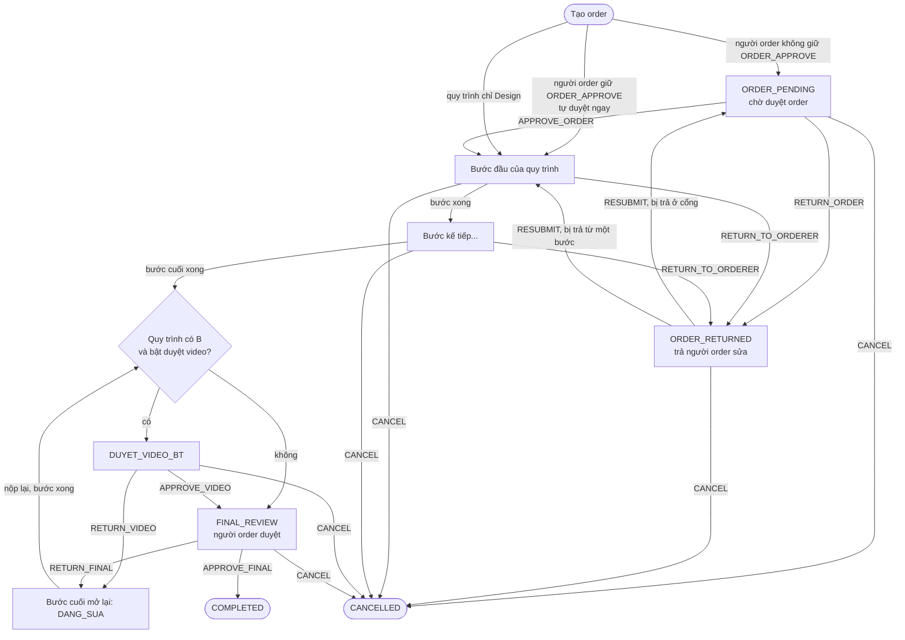
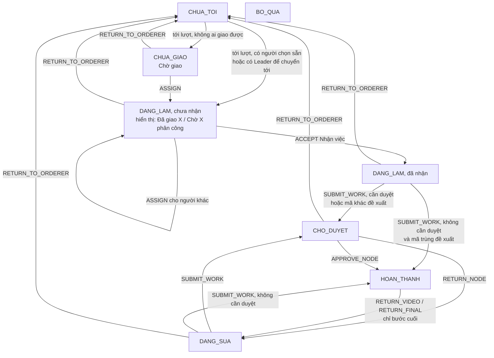

# Luồng Order (ORD)

> Luồng Order là nơi một người (thường là nhân viên Marketing) đặt một video / thiết kế cho đội sản xuất làm: Biên kịch viết kịch bản, Design làm hình, Dựng dựng video, rồi người order duyệt sản phẩm cuối. Ai dùng: người order, các Trưởng phòng duyệt order, Trưởng phòng và nhân viên ba ban sản xuất, OWNER / ADMIN. Trên giao diện: nhóm menu **"Bảng order"** (trong "Phòng Marketing"): "Order tổng" `/tasks`, "Order sinh nhật" `/tasks/birthday`, "Danh mục điểm" `/tasks/task-codes`, "Effort" `/tasks/effort`, "Thư viện" `/tasks/library`; tạo order ở `/orders/new`; mỗi order mở ở trang task chung `/tasks/<mã>`.

Bảng task dùng chung (bảng, bộ lọc, ô bước, đếm) nằm ở [board.md](board.md). Điểm, báo cáo hiệu suất, định mức nằm ở [performance.md](performance.md). Phòng ban, ghế, quyền theo phòng nằm ở [org.md](org.md). Mã nhân viên phía tài khoản nằm ở [account.md](account.md). Kế hoạch gốc (bối cảnh, có thể cũ): `docs/ord/ORD_TOKEN_DEADLINE_PLAN.md` (token + deadline), `docs/perf/TASK_CODES_PLAN.md` (mã task + điểm).

## Khái niệm & thuật ngữ

- **ORD = `ADS`**. Trong code, cơ sở dữ liệu, API, luồng này luôn tên `ADS` (`UnitCode.ADS`). Chỉ chữ hiển thị ghi "ORD" / "Luồng Order (ORD)". Đừng nhầm với **Phòng Ads** (chạy quảng cáo, [ads.md](ads.md)).
- **Order** (`orders`): một yêu cầu sản xuất. Có **mã order** 5 ký tự (ví dụ `K7Q2M`).
- **Người order** (`orders.owner_user_id`): người tạo order. Là người **duyệt final** và là người duy nhất được huỷ order của mình (trừ OWNER / ADMIN).
- **Bước / node** (`order_nodes`): một công đoạn sản xuất. Ba loại (`OrderNodeType`):
  - `BIEN_TAP` = **Biên kịch** (viết kịch bản), chữ `B`.
  - `THIET_KE` = **Design** (thiết kế), chữ `T`.
  - `DUNG` = **Dựng** (dựng video), chữ `D`.
  - `GAN_LINK` = bước "Gắn link" cũ. Order mới không có. Chỉ còn để đọc được order cũ.
- **Quy trình** (`orders.video_type`): các bước order đi qua, ghi bằng chữ cái theo thứ tự B → T → D: `B`, `T`, `D`, `BT`, `BD`, `TD`, `BTD` (`OrderVideoType`). Tên cột `video_type` còn từ thời chỉ có 3 "loại video" cố định.
- **Bước cuối** (`last_production_node`): bước cuối của quy trình. Bài nộp của bước này **là sản phẩm**, phải có link.
- **Stage** (`orders.stage`, `OrderStage`): order đang ở đâu. Gồm các cổng duyệt (`ORDER_PENDING`, `ORDER_RETURNED`, `DUYET_VIDEO_BT`, `FINAL_REVIEW`), các bước (`BIEN_TAP`, `THIET_KE`, `DUNG`), và hai trạng thái kết thúc `COMPLETED`, `CANCELLED`.
- **Trạng thái bước** (`order_nodes.status`, `OrderNodeStatus`): `CHUA_TOI` (chưa tới), `BO_QUA` (quy trình không đi qua), `CHUA_GIAO` (chưa ai được giao), `DANG_LAM`, `CHO_DUYET`, `DANG_SUA`, `HOAN_THANH`. (`AI_DANG_REVIEW` có trong enum nhưng chưa code nào đặt.)
- **Cổng duyệt order** (gate `ORDER`): Trưởng phòng duyệt order trước khi sản xuất.
- **Duyệt video** (`DUYET_VIDEO_BT`): Trưởng phòng Biên kịch xem video thành phẩm. Chỉ có khi quy trình có B và bật `review_video_by_script_lead`.
- **Duyệt final** (`FINAL_REVIEW`): người order duyệt sản phẩm cuối.
- **Leader / Trưởng phòng ban**: Trưởng phòng Biên kịch / Design / Dựng (`is_lead` trên tag luồng; nhãn "Trưởng phòng Biên kịch|Design|Dựng", `LEAD_ROLE_LABELS`).
- **Trưởng phòng ORD** (vai trò `HEAD` trong luồng ADS): duyệt order, đứng thay duyệt final, đặt ưu tiên. **Không** giao việc hay duyệt bài của ba ban sản xuất.
- **Trưởng quản lý** (`manager_user_id`): người mình báo cáo trực tiếp (trong ghế phòng ban). Bài nộp / order của mình chờ đúng người đó.
- **Giao việc / Nhận việc / Nộp bài**: Leader giao (`ASSIGN`), người làm bấm nhận (`ACCEPT`), rồi mới được nộp (`SUBMIT_WORK`).
- **Trả order** (`RETURN_TO_ORDERER`): Leader của bước đang làm trả order về người order sửa.
- **Mã task công việc** (bảng `unit_design_codes`, màn "Danh mục điểm"): mỗi bước có danh mục mã riêng: Biên kịch `N1…N5`, Design `T1…T5`, Dựng `D1…D7`, cộng một dòng "Việc khác" (`N0`/`T0`/`D0`, người làm tự gõ việc và điểm).
- **Hình thức** (`task_forms`): hệ số nhân điểm: Làm mới 100%, Adapt 50%, Resize 20%, Diễn hoạt 125%, After Effects 150%.
- **Mã đề xuất / mã thực tế**: mã chọn lúc tạo order chỉ là **đề xuất**. Mã người làm chọn lúc nộp là **thực tế**, điểm tính theo mã thực tế.
- **Order sinh nhật** (`orders.category = BIRTHDAY`): thiệp sinh nhật của một người, chỉ qua bước Design.
- **Order chỉ Design** (quy trình `T`, loại STANDARD): không qua cổng duyệt order.
- **Token / effort** (chế độ "tính effort"): mỗi bước có số token ước tính; token trừ vào ngân sách ngày của người làm.
- **Loại video, Nền tảng, Thời lượng** (`unit_video_kinds`, `unit_platforms`, `unit_durations`): danh mục của luồng, chụp tên lại trên order.

## Luồng chính

### Stage của một order STANDARD

Order sinh nhật: tạo xong vào thẳng bước Design; Design xong là `COMPLETED` (không có duyệt final).

### Trạng thái của một bước

`BO_QUA` được đặt lúc tạo cho các bước quy trình không đi qua và không bao giờ đổi.

## Quy tắc nghiệp vụ hiện hành

Mọi hành động đi qua một chỗ duy nhất: `domain/orders/pipeline.py:available_actions` quyết định ai được làm gì; `application/orders/command_service.py` gọi `assert_allowed` trước khi ghi. Nên nút trên màn hình và lời từ chối không bao giờ lệch nhau.

- Stage không cho phép thao tác → 409 `order_invalid_state` (`details.reason` = `order_stage_mismatch`).
- Stage cho phép nhưng người này không được → 403 `order_forbidden` (`order_action_forbidden`).
- Order ngoài phạm vi nhìn thấy → 404 `order_not_found` (`order_not_visible` / `unit_not_visible` / `node_not_found`).
- Mọi hành động gửi kèm `version` đang thấy; order đã đổi → 409 `order_stale_version` (`command_service.py:_load`).
- Lỗi nhập liệu → 422 `order_validation_error`, lý do cụ thể trong `details.reason` (liệt kê ở từng quy tắc dưới).

### A. Tạo order

1. **Ai được tạo**: người giữ `ORDER_CREATE` phạm vi ALL. Không có → 422 `not_an_orderer` (`command_service.py:create`).
2. **Quy trình**: gửi `video_type` (mã) hoặc `process` (danh sách bước). Không chọn bước nào → 422 `process_empty`; bước lạ → `invalid_process`; mã lạ → `invalid_video_type`; gửi cả hai mà khác nhau → `process_mismatch` (`api/routers/orders.py:_process`).
3. **Trường bắt buộc**: tên (`title_missing`), nội dung (`content_missing`), **deadline mong muốn** `desired_deadline_at` (`deadline_required`, ở quá khứ → `deadline_in_past`) (`command_service.py:_validate_fields`, `_desired_deadline`).
4. **Nền tảng** (`platform_id`) bắt buộc khi luồng có ít nhất một nền tảng đang bật, trừ order chỉ Design (`platform_required` / `platform_invalid`, `command_service.py:_platform`).
5. **Loại video, Thời lượng**: không bắt buộc nữa; gửi thì phải là mục đang bật (`video_kind_invalid`, `duration_invalid`). Tên + điểm được chụp lại trên order (`video_kind_name/points`, `duration_name/points`). `video_kind_required` / `duration_required` vẫn còn trong code nhưng không còn đường nào gọi `required=True`.
6. **Link thiết kế** (`design_link`) không bắt buộc ở mọi quy trình.
7. **Chọn sẵn người làm** (`preassigned`, theo bước): chỉ cho bước có trong quy trình (`preassign_not_in_plan`), người đó phải là thành viên ADS đúng ban (`not_a_unit_function_member`, `_check_function_member`).
8. **Mã order**: 5 ký tự ngẫu nhiên từ bảng chữ `23456789ABCDEFGHJKMNPQRSTUVWXYZ` (bỏ 0/O/1/I/L), luôn có cả chữ và số, không trùng `orders.code` lẫn `tasks.code`. Thử 30 lần không được → 422 `order_code_unavailable` (`application/orders/code_service.py:random_order_code`, `OrderCodeService.allocate`). Áp dụng cho cả order thường và sinh nhật. Order cũ giữ mã dạng `MEMBERCODE-TYPE-yymmdd-nn`; bảng `order_code_counters` không còn được ghi.
9. **Mã nhân viên của người order**: mã order không còn chứa mã nhân viên, nhưng người order chưa có mã vẫn được sinh một mã từ tên (`domain/units/member_code.py:derive_member_code`), tránh mã đã có người dùng, rồi lưu lên tài khoản qua `write_member_code` (`command_service.py:_assign_member_code`). Quy tắc mã nhân viên: [account.md](account.md).
10. **Người duyệt order** (`approver_user_id`, ô "Người duyệt order", "Tự động" = không gửi):
    - Người tạo đang giữ `ORDER_APPROVE` (mọi Trưởng phòng, xem C1) → **không cần duyệt**: order được duyệt ngay lúc tạo, không lưu người duyệt, không báo ai (`create` gọi `approve_order`).
    - Người được chọn phải nằm trong danh sách chọn được và không phải chính người order, sai → 422 `approver_invalid` (`command_service.py:_approver`). Danh sách = Trưởng phòng đang hoạt động, thuộc luồng ADS, ngồi ở phòng có cấp quyền ORDER khác VIEW (`holders.py:ads_approvers` → `department_head_people`); không có ai thì lấy người giữ `ORDER_APPROVE`.
    - Không chọn ai → người duyệt mặc định (`AdsApprovers.default_approvers`): ở mỗi phòng của người order, Trưởng phòng mà họ báo cáo, nếu không thì mọi Trưởng phòng của phòng đó. Người không có ghế nào: Trưởng phòng ORD của họ trên tag luồng, nếu không thì mọi người duyệt. Không ra ai → 422 `approver_required` (phải chọn).
    - `GET /api/orders/approvers` trả `own_gate`, `required`, `default`, `candidates` để form hiển thị.
    - Người order chờ ai: `AdsApprovers.order_approvers(owner, chosen)` = người đã chọn (khi người đó còn duyệt được), nếu không thì mặc định. Người duyệt đã chọn mà bị khoá tài khoản → quay về người duyệt mặc định (SQL `scope.py:approval_reaches`, `board/sources.py:_chosen_approver`). Chỉ người được chọn nhận thông báo (`notifications.py:order_submitted`).
11. **AI đọc kịch bản** (chỉ order không phải "chỉ Design"): xem mục G.
12. **Mã task đề xuất** (`task_codes: {PHASE: [picks]}`, hoặc trường cũ `design_codes` cho Design): đều không bắt buộc. Mã Design → `orders.design_items`; mã Biên kịch / Dựng → `order_nodes.task_items`; bản gốc giữ ở `orders.suggested_task_items` (`command_service.py:_suggestions`). Chỉ lưu khi bật `design_codes_enabled` và bước có trong quy trình.
13. **Sau khi tạo**: tạo 3 bước (bước ngoài quy trình = `BO_QUA`, còn lại `CHUA_TOI`) (`pipeline.py:initial_node_statuses`); stage `ORDER_PENDING`, báo người duyệt (`notifications.py:order_submitted`). Order chỉ Design hoặc người tạo tự duyệt thì vào ngay bước đầu.

### B. Bước sản xuất

1. **Kích hoạt bước** (`command_service.py:_activate`): có người chọn sẵn → giao luôn cho người đó (`DANG_LAM`, chưa nhận). Không có → chuyển cho **người giao việc** của ban (`AdsApprovers.assigner`): người giữ `NODE_ASSIGN` trên bước đó, ưu tiên Leader của ban, rồi Trưởng phòng ORD, rồi bất kỳ ai giữ quyền đó trong luồng ADS. Hiển thị "Chờ X phân công". Không ai giao được → `CHUA_GIAO` "Chờ giao".
2. **Trưởng phòng ORD không chạy sản xuất**: mặc định vai trò HEAD có mọi quyền trừ `NODE_ASSIGN`, `NODE_REVIEW`, `VIDEO_REVIEW` (`permissions.py:PRODUCTION_PERMISSIONS`, `DEFAULT_MATRIX`). Bước không có Leader không còn chuyển cho Trưởng phòng ORD.
3. **Giao việc** (`ASSIGN`, `command_service.py:assign`): người giữ `NODE_ASSIGN` trên ban đó, khi bước đang `CHUA_GIAO` / `DANG_LAM` / `DANG_SUA`. Phải chọn ít nhất một người (`assignee_required`); bước không phải Design chỉ một người (`single_assignee`). Danh sách chọn chỉ gồm **nhân viên** của ban, không gồm Leader: Leader muốn tự làm thì bấm "Nhận việc" (`detail_service.py:_ads_assignees`). Giao cho người khác thì xoá `accepted_at` và nháp mã task của người cũ.
4. **Nhận trước, nộp sau**: `SUBMIT_WORK` chỉ hiện khi bước đã có `accepted_at` (bước Design nhiều người: chính người đó đã nhận). Áp dụng cả cho người được chọn sẵn và người được Leader giao. `ACCEPT` cũng hiện trên bước `DANG_SUA` vừa giao cho người mới (`pipeline.py:available_actions`).
5. **Nộp bài** (`SUBMIT_WORK`, `command_service.py:submit_work`):
   - Bước cuối phải có link sản phẩm → 422 `link_required`. Bước khác cần link hoặc nội dung kịch bản → `submission_empty`.
   - Mã task: xem mục E.
   - Không cần duyệt (công tắc ban đang tắt, xem B7) **và** mã trùng đề xuất → bước xong ngay, bước sau bắt đầu. Ngược lại → `CHO_DUYET`, báo Leader (`notifications.py:submission_ready`).
6. **Duyệt bài** (`APPROVE_NODE` / `RETURN_NODE`): người giữ `NODE_REVIEW` trên ban đó, khi bước `CHO_DUYET`. Trả sửa bắt buộc ghi lý do (`note_required`) và, khi bật mã task, chọn một trong ba lý do `return_reason` (`return_reason_required`, xem E6). Trả sửa → `DANG_SUA`, cùng người làm, `revision_count` +1 (trừ lý do "Mã công việc chưa hợp lý").
7. **Công tắc duyệt theo ban** (`UnitSettings.review_bien_tap`, `review_thiet_ke`, `review_dung`, mặc định **đều tắt**; `pipeline.py:node_needs_review`). Tắt = nộp bài là xong bước. `review_video_by_script_lead` (mặc định tắt) bật bước duyệt video.
8. **Bước xong** (`command_service.py:_complete_node`): `HOAN_THANH`, trừ token (nếu bật effort, xem F), ghi điểm (`_record_points`, xem E8), ghi KPI ở lần hoàn thành **đầu tiên** của mỗi bước B / T / D (`work_recorder.py:record_first_approval` → `PrWorkResultService.record_source_result(source_type=ORDER)`, khoá `order:<id>:<bước>`, một kết quả cho mỗi người làm Design; loại công việc lấy từ `order_work_rules`, không có luật thì không ghi và log `order_kpi_rule_missing`; Leader tự làm thì kết quả để `PENDING`), rồi kích hoạt bước sau. Bước cuối xong → mở cổng (`_open_gates`): lưu `orders.product_link` = link nộp mới nhất, rồi `DUYET_VIDEO_BT` hoặc `FINAL_REVIEW`; order sinh nhật thì `COMPLETED`.
9. **Không còn bước "Gắn link"**: order mới chỉ có 3 bước sản xuất; bước cuối nộp link. Order cũ còn bước `GAN_LINK` vẫn đọc được: ở stage `GAN_LINK` người giữ nhận rồi nộp link; trả lại thì bước đó thành `BO_QUA`; `function_node` coi nó thuộc ban của bước cuối. Endpoint `POST /orders/{id}/link`, `attach_link`, `ATTACH_LINK` đã bị bỏ; `UnitSettings.btd_link_attacher` vẫn còn nhưng bị bỏ qua.
10. **Sửa token / deadline** (`SET_NODE_PLAN`, `POST .../nodes/{n}/plan`): người giữ `NODE_ASSIGN`, khi bước đang mở. Không gửi gì đổi → 422 `plan_empty`.

### C. Duyệt order, trả order, huỷ

1. **Mọi Trưởng phòng duyệt được order**: mỗi ghế HEAD ở bất kỳ phòng nào có sẵn quyền `ORDER_APPROVE` OWN (`application/org/seats.py:HEAD_ORDER_GRANT`, `builtin_order_grants`). Quyền cá nhân có thể ghi đè (xem [org.md](org.md)). Hệ quả: order do Trưởng phòng tạo không cần duyệt (A10). Test `test_departments.py::test_05`.
2. **Duyệt / không duyệt order** (`APPROVE_ORDER` / `RETURN_ORDER`): ai giữ `ORDER_APPROVE` và nhìn thấy order, khi `ORDER_PENDING`. Không duyệt bắt buộc ghi lý do → `ORDER_RETURNED` + `returned_reason`, báo người order.
3. **Trả order** (`RETURN_TO_ORDERER`, `command_service.py:return_to_orderer`): người giữ `NODE_ASSIGN` trên bước order đang ở (Leader của ban, OWNER, ADMIN), không phải chính người order, chỉ order STANDARD, stage Biên kịch / Design / Dựng, bước `CHUA_GIAO` / `DANG_LAM` / `DANG_SUA` / `CHO_DUYET`. Bắt buộc lý do. Bước dừng lại: về `CHUA_TOI`, xoá người làm / thời điểm nhận / deadline / mã đề xuất chờ duyệt / nháp mã; bước Design nhiều người đóng hết các dòng người làm. Order → `ORDER_RETURNED`, ghi sự kiện `ORDER_RETURNED` kèm bước, audit `order.returned`, báo người order "Trưởng phòng X trả lại order … Sửa order rồi gửi lại." (`notifications.py:order_returned(node=)`). Bảng hiển thị "Trả <người order> sửa". Form sửa order ghi ai đã trả và từ bước nào (test frontend `ads-process.test.tsx` "names the step that sent the order back").
4. **Gửi lại** (`RESUBMIT`, chỉ người order, chỉ ở `ORDER_RETURNED`; `command_service.py:resubmit`, `_resume_node`):
   - Order đã qua cổng (có `order_approved_at`, hoặc order chỉ Design) → quay thẳng về bước đầu tiên chưa xong (`_activate(..., again=True)`, thông báo "đã được sửa và quay lại công đoạn X"), không duyệt lại.
   - Order bị trả ở cổng → về `ORDER_PENDING`, báo người duyệt.
   - AI đọc lại kịch bản (trừ order chỉ Design).
   - Bước đã `HOAN_THANH` giữ nguyên người làm và mã task (`_apply_edit`).
5. **Sửa order khi chưa tiến triển** (`EDIT`, `POST /api/orders/{id}/edit`, `command_service.py:edit`): người order, order STANDARD, chưa được duyệt (`order_approved_at` rỗng) và chưa ai nhận bước nào (`pipeline.py:nobody_took`). Giữ nguyên stage. Nếu đang `ORDER_PENDING` thì báo lại người duyệt. AI đọc lại kịch bản.
6. **Ai được huỷ** (`CANCEL`, bắt buộc lý do; `pipeline.py:available_actions`):
   - **OWNER và ADMIN** (`OrderActorContext.is_system_admin`): huỷ mọi order chưa kết thúc. Điểm của bước đã xong (`order_node_points`, KPI) vẫn giữ; bước đang mở rơi khỏi điểm "dự kiến" (`DEAD_STAGES` của báo cáo hiệu suất). Test `test_task_codes.py::test_11`.
   - **Người order**, với order của mình, khi một trong các điều kiện sau đúng:
     - giữ `CANCEL` phạm vi ALL: bất kỳ lúc nào;
     - order đang `ORDER_PENDING` hoặc `ORDER_RETURNED`;
     - order sinh nhật: lúc nào cũng được, tới khi xong;
     - người order giữ `ORDER_APPROVE` (Trưởng phòng, order tự duyệt) và **chưa ai nhận bước nào** (`nobody_took`: chưa có `accepted_at`, không bước nào ở `CHO_DUYET` / `DANG_SUA` / `HOAN_THANH`; đã giao mà chưa nhận vẫn tính là chưa ai nhận);
     - order chỉ Design chưa được Leader Design duyệt (xem D3).
   - Ngoài ra **không ai** huỷ order của người khác. Trưởng phòng ORD dùng "Không duyệt"; Leader ban dùng "Trả order".
   - Huỷ bởi người khác → báo người order "Order đã bị huỷ" (sự kiện thông báo `ORDER_CANCELLED`, `notifications.py:order_cancelled`).
   - Test: `test_order_pipeline.py::test_09b`, `test_order_commands.py::test_09/09b`, `test_departments.py::test_05b`.
7. **Ưu tiên** (`SET_PRIORITY`): người giữ `PRIORITY` ALL.

### D. Order chỉ Design (quy trình `T`, loại STANDARD)

1. Không qua cổng duyệt order: tạo xong vào thẳng bước Design, chuyển cho Leader Design "Chờ X phân công" (`command_service.py:create`, `pipeline.py:is_design_only`). Không lưu người duyệt.
2. Không hỏi loại video / nền tảng / thời lượng. "Task công việc" = mã Design đề xuất (không bắt buộc). "Khung nhập kịch bản" thành ô "Nội dung" thường: không có nguồn kịch bản (`script_source` = null), AI không đọc, cả lúc tạo lẫn lúc gửi lại.
3. **Leader Design thay người duyệt**: lần đầu Leader giao hoặc nhận bước Design → ghi duyệt cổng ORDER (`order_approved_at/by`, dòng `order_approvals`, sự kiện `ORDER_APPROVED`) (`command_service.py:_design_only_approval`). Lần sau không ghi thêm.
4. Người order huỷ được tới khi được duyệt (C6, `OrderView.approved`). Sau đó Leader Design không huỷ mà "Trả order". Test `test_design_ban.py::test_design_only_*` (đặc biệt `test_design_only_the_design_leader_approves_by_taking_or_returns`), frontend `ads-process.test.tsx` "a Design-only order".
5. Duyệt final vẫn là của người order. Trang task bỏ các trường loại video / điểm / nguồn kịch bản.

### E. Mã task công việc và điểm

1. **Công tắc**: `UnitSettings.design_codes_enabled` (mặc định bật). Tắt = nộp bài không hỏi mã, không chờ duyệt mã, không tính điểm. Chỉ áp dụng cho order STANDARD (order sinh nhật có quy tắc riêng, E9).
2. **Danh mục** (`unit_design_codes`): mỗi mã có `phase` (BIEN_TAP / THIET_KE / DUNG), `code`, `name` (không bắt buộc; Design hiển thị ví dụ thay tên), `points`, `unit_label`, `examples`, `note`, `free_points` (dòng "Việc khác"). Không bao giờ xoá, chỉ tắt; order đã chụp mã thì giữ bản chụp. Seed: `domain/orders/task_codes.py:SEED_TASK_CODES`.
3. **Ai sửa danh mục và hình thức**: **chỉ OWNER** (điểm là tiền lương). Không có Trưởng phòng, không có ADMIN (`design_code_service.py:manages_task_codes` = `membership.is_owner`; 403 `design_code_forbidden`; hình thức 403 `task_form_forbidden`). Đọc: mọi thành viên ORD. `include_inactive` cũng chỉ OWNER. Lỗi khác: `design_code_missing`, `design_code_name_missing`, `design_code_taken`, `design_code_not_found`, `task_code_points_invalid`. Hình thức sai → 422 `task_form_invalid` ("Làm mới" 100% luôn có và luôn bật), pha sai → `invalid_phase`.
4. **Hình thức theo bước** (`task_codes.py:DEFAULT_TASK_FORMS`, `forms_for`): Làm mới (mọi bước); Adapt 50%, Resize 20% (Design, Dựng); Diễn hoạt 125%, After Effects 150% (Dựng).
5. **Điểm một dòng** = điểm mã × % hình thức × số lượng, làm tròn nửa lên (`design_codes.py:line_points`). Một dòng mang `form/form_label/form_pct/unit_points/note/free`. Hai danh sách "giống nhau" khi trùng (mã, hình thức, điểm tự gõ) và số lượng (`same_items`).
6. **Số mã mỗi bước**: Dựng đúng một mã, số lượng 1 (`SINGLE_CODE_PHASES`, 422 `task_code_single`). Design và Biên kịch nhiều mã, mỗi mã có số lượng. Lỗi chọn mã: `design_code_invalid`, `design_quantity_invalid`, `task_form_invalid`, `task_other_invalid` (`design_code_service.py:resolve`).
7. **Nộp bài với mã** (`command_service.py:_task_hand_in`, `_design_hand_in`, `_submit_design`):
   - Biên kịch / Dựng gửi `task_codes`. Không gửi và bước không có đề xuất → 422 `task_codes_required`. Trùng đề xuất → đi tiếp như thường. Khác đề xuất (kể cả đề xuất rỗng, khác hình thức) → bước `CHO_DUYET`, lưu `proposed_design_items`, sự kiện `DESIGN_CODES_PROPOSED`, báo Leader kèm `describe_change` (Đề xuất / Nộp / Chênh).
   - Người nộp chính là người duyệt được bước đó (Leader / OWNER / ADMIN tự làm) → mã của họ được chốt luôn.
   - Biên kịch (khi quy trình có T) còn đề xuất mã cho Design (`design_codes`): chỉ bắt buộc khi order chưa có đề xuất Design (422 `design_codes_required`). Có gửi thì danh sách đó thành đề xuất Design của order ngay.
   - Design: xem E10 (nhiều người) hoặc mã order chưa có → người thiết kế phải chọn.
8. **Duyệt mã khác đề xuất**: `APPROVE_NODE` chốt đúng mã người làm nhập (Leader không sửa). "Không duyệt" phải chọn lý do (`return_reason`, khi bật mã task; 422 `return_reason_required`) trên `RETURN_NODE` / `RETURN_VIDEO` / `RETURN_FINAL`:
   - `WORKER_FAULT` "Làm lỗi": vòng sửa mới, đếm `returns_fault`.
   - `CHANGED_REQUEST` "Do thay đổi yêu cầu": vòng sửa mới, đếm `returns_other`.
   - `WRONG_CODES` "Mã công việc chưa hợp lý": chỉ chọn lại mã, **không** tính vòng sửa, không token sửa.
   - Lý do lưu ở `order_events.return_reason` (`command_service.py:_return_reason`, `_count_return`).
9. **Ghi điểm** (`command_service.py:_record_points`): khi bước xong, mỗi người trên bước một dòng `order_node_points` (Design: mỗi người thiết kế theo danh sách của họ; Biên kịch / Dựng: người làm theo `task_items`). Làm lại sau khi bị trả → cập nhật dòng cũ, giữ tháng của lần xong đầu. `department_id` = phòng của người đó có chức năng trùng bước, nếu không thì ghế đầu tiên (`org/seats.points_department`). Báo cáo đọc điểm: [performance.md](performance.md). Không có backfill.
10. **Order sinh nhật**: mang sẵn mã Design `T1` × 1 từ lúc tạo (`DesignCodeService.birthday_items`, `BIRTHDAY_CODE`). Không ai chọn; nộp bài là xong bước dù `review_thiet_ke` bật; người thiết kế được điểm T1. Order sinh nhật tạo trước quy tắc này cũng được T1 × 1. Danh mục không còn T1 đang bật thì không có điểm.
11. **"Sửa mã task" sau khi nhận việc** (Biên kịch / Dựng, một người làm; `SET_WORK_ITEMS`, `command_service.py:_set_own_task_codes`): người làm đã nhận lưu nháp mã vào `order_nodes.working_task_items`. Rỗng → 422 `task_codes_required`; tắt mã task / order không STANDARD → 422 `task_codes_off`. Ghi sự kiện `TASK_CODES_EDITED` "Sửa mã task công việc" kèm `describe_change`. Hộp thoại nộp bài bắt đầu từ nháp; lúc nộp vẫn so với `task_items` (đề xuất). Nháp bị xoá khi giao cho người khác và khi "Trả order". Trang task ẩn nút này khi tắt mã task hoặc order không STANDARD; nhãn "Sửa mã task · <bước>".
12. **Hộp thoại hành động** mang `design_codes` (danh sách mặc định) / `task_codes` + `hint`; ô chọn mã gửi mỗi dòng dạng `{code_id, quantity, form, note, points}` (`points` chỉ cho dòng "Việc khác"). Điểm một dòng tính sẵn ở `DesignItem.points`.
13. **Mã task trên trang task**: `task_codes[]` mỗi bước có `suggested` / `current` / `proposed` / `change` / `people` (`detail_service.py:task_codes_views`) → `components/task-codes-panel.tsx`. Panel này hiển thị điểm thô theo danh mục (không nhân hệ số).
14. **Giao diện chọn mã** (`components/design-codes-picker.tsx`, dùng chung với `task-codes-panel.tsx`): mỗi bước một thẻ (`PHASE_CARD` + `PhaseHeader`): vạch màu mảnh trên đầu, chữ B/T/D, "Mã task công việc X", tổng điểm lớn; mỗi dòng có viên mã màu, hình thức dạng nút chọn một chạm (`radiogroup` "Hình thức · CODE"), nút −/+ số lượng (Design), điểm đậm, "× Bỏ"; "+ Thêm mã task" viền đứt. Màu chỉ ở điểm nhấn (`PHASE_STYLE`: Biên kịch màu accent, Design vàng = token `--yellow` / `--yellow-ink` / `--yellow-soft` trong `globals.css`, Dựng màu good). `isSingle` = Dựng. Bước chỉ có "Làm mới" (Biên kịch) không liệt kê lại mã đã chọn. Màn "Danh mục điểm" `components/task-codes.tsx` mở cho mọi người trong ORD. Thiết lập ORD không còn hiện loại video / thời lượng.
15. Test: `tests/unit/test_task_codes.py` (`test_10` = sửa mã sau nhận việc), `test_order_pipeline.py::test_07`, `tests/integration/test_task_code_migrations.py`, frontend `tests/task-codes.test.tsx`.

### F. Design: một bước, nhiều người làm

Áp dụng cho bước `THIET_KE` của order STANDARD khi bật `design_codes_enabled` (`command_service.py:_multi_design`).

1. **Giao nhiều người**: `assign` nhận `assignee_user_ids` và (không bắt buộc) `picks_by_user` = Leader chia mã cho từng người. Mỗi người một dòng `order_node_assignees` (thời điểm nhận / nộp, danh sách `work_items` riêng). Lịch sử từng danh sách ghi vào `order_node_assignee_events` (ASSIGNED / ITEMS_EDITED / SUBMITTED / LEADER_ADJUSTED / RETURNED) để chấm điểm (`application/orders/node_assignees.py:OrderNodeAssigneeService`).
2. Cột `assignee_user_id` của bước = người đầu tiên; `accepted_at` = có người đã nhận. Nhờ vậy máy trạng thái của bảng không đổi. Mọi chỗ dựng `NodeView` đọc thêm `assignee_user_ids` / `accepted_user_ids` / `submitted_user_ids` từ các dòng mở (`node_assignees.py:load_open_assignees`, `assignee_sets`; dùng trong `command_service._Loaded`, `query_service._node_view`, `board/sources.py:AdsBoardSource.action_kinds`). Model: `OrderNodeAssignee`, `OrderNodeAssigneeEvent`.
3. **Nhận**: mỗi người nhận dòng của mình. Leader được chuyển tới mà bấm "Nhận việc" thì thành một người làm (`OrderNodeAssigneeService.take`).
4. **"Sửa đầu việc"** (`SET_WORK_ITEMS`): mỗi người sửa danh sách của mình trước khi nộp.
5. **Nộp**: bắt buộc chọn mã đã làm (422 `work_items_required`). Bước chỉ xong khi **tất cả** dòng đã nộp. Khi đó cộng mọi danh sách (`sum_work_items`):
   - Tổng = đề xuất của order → bước xong (không chờ duyệt).
   - Một mình Leader / người duyệt được làm cả bước → mã của họ chốt luôn.
   - Khác → `CHO_DUYET`, `proposed_design_items` = tổng, Leader Design duyệt.
6. **Trả sửa** mở lại mọi dòng, giữ danh sách để sửa (`reopen`).
7. KPI ghi một kết quả cho mỗi người làm. Sổ token vẫn ghi một dòng cho người đầu tiên (chia token theo người chưa làm).
8. Mọi người làm đều nhìn thấy order (`scope.py`: nhánh `OrderNodeAssignee`).
9. Bảng / trang task: khối `design` có `assignees[]` (tên / trạng thái / mã), `submitted_count`, `assignee_total` ("Đã nộp N/M"). Trang task: hộp "Giao việc" là danh sách tích nhiều khi `action.multi_assign` (`components/task-actions.tsx`).
10. Test: `tests/unit/test_design_multi_assignee.py`, frontend `design-ban.test.tsx`.

### G. AI đọc kịch bản

1. Bật bằng `UnitSettings.script_ai_review` (mặc định bật); luật ở `script_review_rules` (mặc định 8 điều cấm của Apexmed, `domain/orders/script_rules.py`); chân trang chuẩn `script_footer` (`DEFAULT_SCRIPT_FOOTER`). Sửa ở Thiết lập ORD.
2. **Lúc tạo / gửi lại / sửa** (trừ order chỉ Design): LLM đọc "Khung nhập kịch bản" (`order_content`) (`application/orders/script_review.py:OrderScriptReviewer`, task `order_script_review` qua `complete_structured`, ngân sách `TIMEOUT_SECONDS` 85 s).
   - Vi phạm → 422 `script_review_failed`, `details.violations[{rule, rule_name, quote, reason, suggestion}]`, `revised_script` (bản sửa cả kịch bản, có chân trang chuẩn), `note`. Không lưu gì, không hỏi Trưởng phòng.
   - Đạt → sự kiện SUBMITTED / RESUBMITTED ghi "AI duyệt kịch bản: đạt.".
   - Đạt / không do code quyết: không có vi phạm có trích dẫn thật = đạt; trích dẫn không có trong kịch bản bị bỏ (`script_review.py:_grounded`).
   - **Lỗi thì cho qua** (fails open): AI hỏng / chậm / trả sai → order vẫn đi, ghi "AI chưa duyệt được kịch bản (...)".
3. **Nút "AI duyệt kịch bản" trên form** (prop `aiReview` của form) (`POST /api/orders/script-check {title, order_content}` → `{enabled, reviewed, passed, violations, problem, message}`; không có `ORDER_CREATE` → 422 `not_an_orderer`). Khi `script_ai_review` bật, nút "Gửi order" khoá tới khi kết quả của đúng tên + kịch bản hiện tại là đạt hoặc "chưa duyệt được".
4. **Nhớ kết quả đạt**: `script_review.PASSED_SCRIPTS` trong bộ nhớ tiến trình API, khoá = sha256 (tên + kịch bản + luật), 6 giờ. Gửi order với đúng nội dung đó thì không hỏi AI lần nữa (`command_service.py:_ask_ai`). Không trúng thì hỏi lại.
5. **Hộp thoại lỗi** `components/script-review-dialog.tsx`: mở khi bị từ chối lần mới; "Xem lỗi & bản sửa gợi ý" mở lại; "Sao chép bản sửa"; "Dùng bản sửa" điền vào ô.
6. AI tới API qua `build_order_services(llm=)` (router orders + tasks). Đường đi theo mục đích `ORDER_SCRIPT` của Kết nối AI ([assistant.md](assistant.md)).

### H. Token và deadline

1. **Deadline mong muốn** của order (`orders.desired_deadline_at`) bắt buộc lúc tạo (A3).
2. **Kế hoạch bước** (`NodePlan`: token + deadline): bắt buộc lần đầu bước được lên kế hoạch (`tokens_required`, `deadline_required`), khi `ASSIGN`, khi Leader tự nhận bước chuyển tới (`ACCEPT`, chỉ người được lên kế hoạch), khi `SET_NODE_PLAN`. Token 0 → 999,99 (`tokens_invalid`); deadline ở quá khứ → `deadline_in_past` (`command_service.py:_apply_plan`). Gửi lại deadline cũ = không đổi.
3. **Vượt deadline mong muốn** chỉ cảnh báo, không chặn: đếm `orders.over_deadline_count`, sự kiện `DEADLINE_EXCEEDED` (`_plan_events`). Order xong sau deadline mong muốn cũng đếm (`approve_final`).
4. **Trả sửa bước** (`RETURN_NODE`) hỏi "Token sửa" (bắt buộc, được 0) và "Deadline sửa" (không bắt buộc). Trả ở cổng video / final → `revision_tokens_pending` = true: Leader còn việc "Nhập token sửa" (hiện trong "Cần làm"); người làm vẫn bắt đầu sửa được.
5. **Trừ token** khi bước xong (`application/orders/token_ledger.py:OrderTokenLedgerService.record_completion`): lần xong đầu trừ `token_estimate` (dòng `ESTIMATE`) và chốt `deadline_met`; mỗi lần xong trừ phần token sửa chưa trừ (dòng `REVISION`). Ngày = ngày lịch Việt Nam của lần duyệt. `(node_id, kind, revision_no)` duy nhất.
6. **Trạng thái deadline** (`domain/orders/deadlines.py`): `ON_TRACK` "Còn hạn", `DUE_SOON` "Sắp tới hạn" (< 24 giờ), `OVERDUE` "Quá hạn", `MET` "Đúng hạn", `MISSED` "Trễ hạn". Deadline đang tính = deadline vòng sửa (nếu có) else deadline bước; ở cổng của người order thì là deadline mong muốn.
7. **Ngân sách effort** (`application/orders/effort_service.py`): mỗi người có `daily_tokens` (tag) else `default_daily_tokens` (80). Đủ ngày trên `work_weekdays` (T2-T6), nửa ngày trên `half_weekdays` (sáng T7), ngày khác 0 (`day_share`, `working_share`). `GET /api/units/ADS/effort`: OWNER / ADMIN / Ban Giám đốc / Trưởng phòng ORD thấy mọi người, Leader thấy ban mình, còn lại chỉ mình (`effort_forbidden`); tối đa 62 ngày (`range_too_long`). "Theo ban" trên dashboard: `GET /api/units/ADS/ban-stats` (`effort_service.py:ban_stats`; mọi thành viên ORD, `my_ban` mặc định). Test `tests/unit/test_order_tokens.py`, frontend `token-deadline.test.tsx`.
8. **Chế độ effort** (`UnitSettings.effort_enabled`, mặc định bật): **chỉ OWNER** bật/tắt (403 `effort_setting_forbidden`, `application/units/admin.py:update_settings`). Tắt → không hỏi / không trừ / không hiện token: ô hành động bỏ `tokens`, ô bước `tokens` = null, `GET .../effort` 404 `effort_disabled`, ban-stats `effort_enabled:false`. Deadline vẫn giữ. `/api/units/me` có `effort_enabled` ở cấp trên cùng.
9. **Chỉ số trên hồ sơ**: `on_time_rate` tính theo deadline; nghĩa cũ là `first_pass_rate`; thêm `late_count`, `tokens_*`, `effort_rate`, `performance_score` (trọng số `perf_weights`, mục tiêu `output_target`). Code: `application/account/stats_service.py` ([account.md](account.md)).

### I. Duyệt video và duyệt final

1. **Duyệt video** (`APPROVE_VIDEO` / `RETURN_VIDEO`): người giữ `VIDEO_REVIEW` trên Biên kịch (Leader Biên kịch), ở `DUYET_VIDEO_BT`.
2. **Duyệt final là của người order** (`APPROVE_FINAL` / `RETURN_FINAL`): bảng ghi "Chờ <người order> duyệt final", thông báo và "Cần làm" chỉ tới người order. Người giữ `FINAL_REVIEW` ALL được quyết thay nhưng không bao giờ bị ghi tên là người đang giữ.
3. `APPROVE_FINAL` chỉ cần ghi chú; sản phẩm = link nộp mới nhất của bước cuối (`product_link` trong body chỉ còn cho client cũ).
4. Trả ở hai cổng này → bước cuối mở lại `DANG_SUA`, cùng người làm, `revision_count` +1 (trừ `WRONG_CODES`) (`command_service.py:_send_product_back`). Thao tác của cổng gắn `node_id` của bước cuối.

### J. Ai nhìn thấy order nào

Phạm vi xây một lần mỗi request và áp vào mọi truy vấn đọc `orders` (bảng, chi tiết, cả lúc tải trong lệnh) (`application/orders/scope.py:OrderScope.apply`). Order ngoài phạm vi = 404 ở mọi nơi, không làm gì được.

1. Giữ `VIEW` ALL (OWNER, ADMIN, Ban Giám đốc) → mọi order.
2. Còn lại thấy hợp của:
   - order mình tạo (người order **không** thấy order của đồng nghiệp);
   - order của người báo cáo cho mình (`scope.manages`: ghế có `manager_user_id` = mình);
   - nếu giữ `ORDER_APPROVE`: order chọn mình duyệt, và order mặc định tới mình (`approval_reaches`);
   - Leader (người giữ `NODE_ASSIGN` / `NODE_REVIEW` trên một ban): order **đã tới** bước của ban mình (bước không còn ở `scope.NOT_REACHED` = `CHUA_TOI` / `BO_QUA`, hoặc đã từng được kích hoạt, nên vẫn thấy khi order bị "Trả order"), và vẫn thấy sau khi order đi tiếp. Order còn ở Biên kịch chưa phải của Design hay Dựng;
   - nhân viên: order có bước đã tới mà mình đang làm hoặc được chọn sẵn;
   - người làm Design nhiều người: dòng `order_node_assignees` của mình;
   - order sinh nhật: xem K2.

### K. Order sinh nhật

1. Tạo: `POST /api/orders/birthday` (họ tên → `title`, chi nhánh, giới tính, ngày sinh, ghi chú, "Ảnh minh hoạ" = `reference_links`, nhiều link, mỗi dòng một link trong `design_link`, tối đa 20 → `birthday_links_too_many`; tách / ghép bằng `design_codes.py:split_links` / `join_links`; dòng và trang task có `design.reference_links`). Lỗi: `birthday_name_missing`, `birthday_branch_missing`, `birthday_gender_invalid`, `birthday_date_required`. Quy trình `T`, mã order như thường, `order_approved_at` = lúc tạo, vào thẳng Design (`command_service.py:create_birthday`).
2. **Quyền**: quyền luồng order `BIRTHDAY` (OWN = chỉ order sinh nhật mình tạo, ALL = mọi order sinh nhật), cấp theo phòng × vị trí (mặc định Thiết Kế HEAD + MEMBER = ALL). OWNER / ADMIN và người giữ `VIEW` ALL luôn có (`design_code_service.py:has_birthday_orders`). Không có → 403 `birthday_forbidden`. `OrderScope.birthday_board` = được dùng bảng; `OrderScope.birthday_all` = thấy mọi order sinh nhật.
3. Sửa: `PATCH /api/orders/{id}/birthday` (người tạo, Leader Design, OWNER, ADMIN; tới khi xong). Sự kiện `BIRTHDAY_EDITED`.
4. Không có bước duyệt trước Design và không có duyệt final. Mã task: E10.
5. `GET /api/orders/birthday/options` = các chi nhánh đã có trên order sinh nhật mình thấy.

### L. Thư viện Design

1. Menu link của ban Design (tên, link http(s), chữ biểu tượng ngắn) lưu trong `UnitSettings.design_library` của luồng ORD (`application/orders/design_library_service.py`).
2. Đọc `GET /api/units/ADS/library`: ban Design và người quản lý thư viện; người khác 403 `library_forbidden`. Gửi kèm sidebar qua `/api/units/me` `design.library` + `design.manage_library`.
3. Lưu `PUT /api/units/ADS/library` (lưu nguyên danh sách, theo thứ tự): Leader Design, OWNER, ADMIN; khác → 403 `library_forbidden`. Lỗi: `library_name_missing`, `library_url_invalid` (chỉ http/https), `library_too_many` (tối đa 30). Audit `unit.library.updated`.

### M. Khối lượng trên ô "Giao việc"

1. `application/workload_service.py:WorkloadService.counts` đếm mỗi người: `assigned` (đã giao, chưa bắt đầu) và `doing` (đang làm), cộng cả ORD (dòng `order_node_assignees` hoặc `order_nodes.assignee_user_id` của bước đang mở, không tính bước `CHO_DUYET`) và PR (`pr_content_items.producer_user_id`: APPROVED = đã giao, PRODUCTION / INTERNAL_REVIEW = đang làm). Chỉ đọc, không phụ thuộc chế độ effort.
2. `PersonRef.assigned_count / doing_count` có trên mọi danh sách giao việc (`_ads_assignees`, `_pr_producers`). Frontend `lib/deadline.ts:workloadLabel` → "giao N · đang làm M" (cũng nằm trong `assigneeLoadLabel`).

### N. Xoá order

`DELETE /api/tasks/{ref}`: chỉ OWNER (403 `task_delete_forbidden`). Xoá order cùng mọi thứ treo vào (bước, bài nộp, duyệt, lịch sử, sổ token, điểm `order_node_points`, KPI, thông báo); audit ghi trước (`application/tasks/delete_service.py`). Trang task có `can_delete`. Chi tiết ở [board.md](board.md).

### O. Thông báo

`application/orders/notifications.py`: hộp thư web luôn ghi trước; Telegram chỉ khi luồng bật `UnitSettings.telegram_enabled` và người nhận có chat riêng với bot. Không bao giờ báo người vừa thao tác. Người nhận: người duyệt khi gửi order; Leader + người được chọn khi bước tới lượt; người order khi có người nhận việc, khi bị trả, khi bị huỷ; người làm khi được giao / bị trả; người duyệt kế tiếp khi nộp bài (duyệt final = người order). Có Trưởng quản lý phù hợp thì chỉ báo người đó (`manager_of`).

## Phân quyền

ORD đọc quyền qua `OrderActorContext.permissions` (`AdsPermissions`). Mọi quyết định (nút, phạm vi, "Cần làm", người đang giữ) đọc từ đó, **không kiểm tra role trực tiếp**.

| Quyền (`AdsPermission`) | Nhãn | `OWN` nghĩa là |
|---|---|---|
| `VIEW` | Xem order | order của mình / nhóm mình / tới bước của ban mình / được giao |
| `ORDER_CREATE` | Tạo order | (chỉ ALL / NONE) |
| `ORDER_APPROVE` | Duyệt / trả order | order của nhóm mình hoặc chọn mình duyệt |
| `NODE_ASSIGN` | Giao việc | bước của ban mình |
| `NODE_REVIEW` | Duyệt / trả bài nộp | bước của ban mình |
| `VIDEO_REVIEW` | Duyệt video (quy trình có Biên kịch) | khi ban mình là Biên kịch |
| `FINAL_REVIEW` | Duyệt final thay người order | (chỉ ALL / NONE) |
| `PRIORITY` | Đặt ưu tiên | (chỉ ALL / NONE) |
| `CANCEL` | Huỷ order | (xem C6: chỉ người order dùng) |
| `BIRTHDAY` | Order sinh nhật | chỉ order sinh nhật mình tạo |

Ba nguồn quyền (`pipeline.py:OrderActorContext.from_membership`):

1. **OWNER và ADMIN**: `AdsPermissions.full()`, mọi quyền ở mọi order. Cột "Admin" của ma trận cũ không còn được đọc.
2. **Có ghế phòng ban** (`membership.grants` không rỗng, tính bởi `directory.order_grants` / `org/seats.py:grants_of`): `AdsPermissions.from_grants` từ quyền của phòng (module `ORDER`) + quyền dựng sẵn (Ban Giám đốc `VIEW` ALL, mọi HEAD `ORDER_APPROVE` OWN) + quyền cá nhân ghi đè. `OWN` của quyền gắn bước trỏ tới bước theo chức năng của phòng cấp quyền (`FUNCTION_NODES`). Sửa ở Quản trị › Phòng ban ([org.md](org.md)).
3. **Không có ghế**: ma trận cũ theo vai trò trên tag luồng (`org_units.settings["permissions"]`, mặc định `DEFAULT_MATRIX`): HEAD = mọi quyền trừ sản xuất; LEAD = VIEW / NODE_ASSIGN / NODE_REVIEW / VIDEO_REVIEW trong ban mình; STAFF = VIEW OWN; ORDERER = VIEW OWN, ORDER_CREATE ALL, CANCEL OWN.

Không phải quyền mà do vị trí: nhận việc, nộp bài, gửi lại order của mình, duyệt final order của mình.

**Vị trí trong luồng** (tag `org_unit_members`, do hệ thống suy ra từ ghế, không sửa tay): `HEAD` = "Trưởng phòng ORD"; vai trò chức năng `BIEN_TAP` / `THIET_KE` / `DUNG` + `is_lead` = "Trưởng phòng Biên kịch / Design / Dựng" (`domain/units/labels.py:unit_role_label`, `LEAD_ROLE_LABELS`); `is_lead` luôn false với vai trò không phải chức năng; `ORDERER` = người order. Ô chọn gửi vai trò + `is_lead` (khoá frontend `ROLE:LEAD`).

**Trưởng quản lý** (`manager_user_id`): phù hợp khi nhân viên ban báo cáo cho Leader cùng ban, hoặc người order báo cáo cho một HEAD (`application/units/directory.py:manager_fits`). Khi phù hợp và đang hoạt động: bài nộp / order của người đó chỉ ghi tên, chỉ báo, chỉ "Cần làm" cho Trưởng quản lý (`AdsApprovers.reviewers` / `default_approvers`, SQL `scope.py:boss_of`); người khác vẫn giữ quyền thao tác. Liên kết không còn phù hợp bị bỏ khi cập nhật (`admin.py:_refit_managers`). Sửa trực tiếp qua `PATCH /api/units/ADS/members/{id}` `manager_user_id` (422 `unit_manager_invalid`); ngày nay giá trị này được đồng bộ từ ghế phòng ban.

**Màn hình ORD theo người** (`/api/units/me`):

- `design.view`: ở ban Design và không phải OWNER/ADMIN → bảng `/tasks` dạng Design.
- `design.manage_codes`: Leader Design / OWNER / ADMIN (chỉ còn dùng cho thư viện và sửa order sinh nhật).
- `design.task_phases`: các bước mình sửa được danh mục (OWNER: cả ba, người khác rỗng). `design.manage_forms`: OWNER.
- `design.birthday`: được dùng bảng sinh nhật.
- Thiết lập ORD (`/admin/settings`, `PATCH /api/units/ADS/settings`) và danh mục loại video / nền tảng / thời lượng: quản trị luồng = OWNER / ADMIN. Ma trận quyền gửi qua settings chỉ OWNER (`permissions_forbidden`).

## Dữ liệu

| Bảng | Cột chính | Migration |
|---|---|---|
| `orders` | `code`, `title`, `video_type` (quy trình), `category` STANDARD/BIRTHDAY, `stage`, `owner_user_id`, `approver_user_id`, `order_approved_at/by`, `returned_reason`, `cancelled_reason`, `is_priority`, `product_link`, `completed_at`, `desired_deadline_at`, `over_deadline_count`, `video_kind_id/name/points`, `platform_id/name`, `duration_id/name/points`, `order_content`, `script_source`, `design_link`, `reference_link`, `source_link`, `note`, `design_items` (JSON mã Design), `suggested_task_items` (JSON đề xuất gốc theo bước), `birthday_branch/gender/on`, `version` | 0042; 0044 (video kind); 0049 (nền tảng, thời lượng, note); 0053 (deadline); 0056 (approver); 0058 (category, design_items, birthday); 0074 (suggested_task_items) |
| `order_nodes` | `node_type`, `status`, `preassigned_user_id`, `assignee_user_id`, `approved_by_user_id`, `activated_at`, `assigned_at`, `accepted_at`, `submitted_at`, `approved_at`, `revision_count`, `submission_count`, `token_estimate`, `token_revision`, `deadline_at`, `revision_deadline_at`, `deadline_met`, `revision_tokens_pending`, `proposed_design_items`, `task_items`, `working_task_items`, `returns_fault`, `returns_other`, `version` | 0042; 0053 (token, deadline); 0058 (`proposed_design_items`); 0074 (`task_items`, returns_*); 0089 (`working_task_items`) |
| `order_submissions` | `node_id`, `submission_no`, `submitted_by_user_id`, `link`, `script_text`, `note` | 0042 |
| `order_approvals` | `gate` ORDER/VIDEO_BT/FINAL, `round_no`, `decision`, `actor_user_id`, `submission_id`, `comment` | 0042 |
| `order_events` | `kind` (`OrderEventKind`), `node_id`, `actor_user_id`, `assignee_user_id`, `submission_id`, `note`, `return_reason` | 0042; 0074 (`return_reason`). Chỉ thêm, không sửa |
| `order_node_assignees` | `node_id`, `user_id`, `assigned_at`, `accepted_at`, `submitted_at`, `submission_id`, `work_items`, `removed_at` | 0073 |
| `order_node_assignee_events` | `node_id`, `user_id`, `kind`, `work_items`, `revision_no`, `actor_user_id`, `note` | 0073. Chỉ thêm |
| `order_node_points` | một dòng mỗi người mỗi bước: `phase`, `department_id`, `items`, `points` (chưa nhân hệ số), `first_completed_at`, `updated_at` | 0074; 0075 (`department_id`) |
| `order_token_ledger` | `user_id`, `order_id`, `node_id`, `work_date`, `tokens`, `kind` ESTIMATE/REVISION, `revision_no`; duy nhất (node, kind, round) | 0053. Chỉ thêm |
| `order_code_counters` | bộ đếm mã cũ | 0042; **không còn ghi** |
| `order_work_rules` | luật KPI theo bước | 0042 |
| `unit_design_codes` | `phase`, `code`, `name`, `points`, `unit_label`, `examples`, `note`, `free_points`, `active`, `sort_order` | 0058 (23 mã Design); 0074 (đổi thành T1-T5 + N/D, điểm) |
| `unit_video_kinds` | danh mục "Loại video" (không xoá, chỉ tắt) | 0044 (11 loại cho ADS) |
| `unit_platforms`, `unit_durations` | Nền tảng, Thời lượng | 0049 (3 + 3 cho ADS) |
| `org_units.settings` (luồng ADS) | `UnitSettings`: `urgent_days`, `review_*`, `review_video_by_script_lead`, `effort_enabled`, `design_codes_enabled`, `task_forms`, `script_ai_review`, `script_review_rules`, `script_footer`, `default_daily_tokens`, `work_weekdays`, `half_weekdays`, `perf_weights`, `output_target`, `design_library`, `telegram_enabled`, `permissions` (cột Admin), `btd_link_attacher` (bỏ qua) | JSON, không migration riêng |
| `org_unit_members` | tag luồng: `role`, `is_lead`, `member_code`, `manager_user_id` (0050), `daily_tokens` (0053), `birthday_orders` (0059, **không còn đọc**) | 0042+ |

## Code ở đâu

| Lớp | File | Nội dung |
|---|---|---|
| Domain | `src/meobot/domain/orders/models.py` | enum quy trình / stage / trạng thái bước / sự kiện / lý do trả; `NODE_PLAN`, `last_production_node`, `is_design_only`, `process_code` |
| Domain | `src/meobot/domain/orders/pipeline.py` | `available_actions`, `assert_allowed`, `nobody_took`, `OrderActorContext`, `node_needs_review`, `video_review_applies`, `hands_in_product`, `function_node` |
| Domain | `src/meobot/domain/orders/permissions.py` | `AdsPermission`, `DEFAULT_MATRIX`, `PRODUCTION_PERMISSIONS`, `AdsPermissions.from_grants/compute/full` |
| Domain | `src/meobot/domain/orders/task_codes.py`, `design_codes.py` | danh mục seed, hình thức, `line_points`, `same_items`, `sum_work_items`, `describe_change`, link ảnh minh hoạ |
| Domain | `src/meobot/domain/orders/deadlines.py`, `labels.py`, `errors.py`, `script_rules.py` | trạng thái deadline, nhãn tiếng Việt (`PROCESS_SEPARATOR` "›"), lỗi, luật kịch bản mặc định |
| Application | `src/meobot/application/orders/command_service.py` | mọi lệnh ghi |
| Application | `src/meobot/application/orders/query_service.py`, `scope.py` | đọc order, phạm vi nhìn thấy |
| Application | `src/meobot/application/orders/code_service.py` | mã order ngẫu nhiên |
| Application | `src/meobot/application/orders/design_code_service.py`, `design_library_service.py` | danh mục mã task, thư viện, quyền sinh nhật |
| Application | `src/meobot/application/orders/node_assignees.py` | Design nhiều người |
| Application | `src/meobot/application/orders/token_ledger.py`, `effort_service.py`, `work_recorder.py` | token, effort, KPI |
| Application | `src/meobot/application/orders/script_review.py`, `notifications.py`, `services.py` | AI đọc kịch bản, thông báo, `build_order_services` |
| Application | `src/meobot/application/board/holders.py` | `AdsApprovers`, `ads_approvers` (ai duyệt, ai giao, Trưởng quản lý) |
| Application | `src/meobot/application/workload_service.py` | khối lượng "giao N · đang làm M" |
| Application | `src/meobot/application/tasks/detail_service.py`, `action_service.py` | trang task: các nút ORD, khoá `ads:<KIND>[:<node>]` |
| Application | `src/meobot/application/units/admin.py`, `directory.py` | thiết lập luồng, loại video / nền tảng / thời lượng, `manager_fits` |
| API | `src/meobot/api/routers/orders.py` (mount sau cổng `require_unit(UnitCode.ADS)` trong `api/main.py`), `api/routers/units.py`, `api/schemas/orders.py` | |
| Frontend | `frontend/src/app/orders/new/page.tsx` | form tạo / sửa / gửi lại order (`/orders/:ref` chuyển về `/tasks/...`) |
| Frontend | `frontend/src/app/tasks/[ref]/page.tsx`, `components/task-actions.tsx` | trang task, hộp thoại hành động (chọn nhiều người khi `multi_assign`, gửi `assignee_user_ids` + `design_codes_by_user`) |
| Frontend | `frontend/src/components/design-codes-picker.tsx`, `task-codes-panel.tsx`, `task-codes.tsx`, `app/tasks/task-codes/page.tsx` | chọn mã task, panel mã trên trang task, màn "Danh mục điểm" (`/tasks/design-codes` chuyển về `?phase=THIET_KE`) |
| Frontend | `frontend/src/components/design-cells.tsx`, `design-library.tsx`, `app/tasks/birthday`, `app/tasks/library` | cột Design, thư viện, bảng sinh nhật |
| Frontend | `frontend/src/components/script-review-dialog.tsx` | hộp thoại lỗi kịch bản |
| Frontend | `frontend/src/lib/deadline.ts`, `lib/effort.ts`, `components/deadline-badge.tsx`, `app/tasks/effort/page.tsx` | deadline, effort |
| Frontend | `frontend/src/app/admin/settings/page.tsx`, `components/unit-panel.tsx` (`SettingsForm`) | Thiết lập ORD |
| Test backend | `tests/unit/test_order_commands.py`, `test_order_pipeline.py`, `test_order_tokens.py`, `test_owner_controls.py`, `test_design_ban.py`, `test_design_multi_assignee.py`, `test_task_codes.py`, `test_ads_permissions.py`, `test_unit_admin.py`, `test_order_schema_parity.py`, `test_departments.py` (`test_05`, `test_05b`) | |
| Test migration | `tests/integration/test_order_migrations.py`, `test_task_code_migrations.py`, `test_node_working_task_items_migration.py` | |
| Test frontend | `frontend/tests/ads-process.test.tsx`, `design-ban.test.tsx`, `design-library.test.tsx`, `task-codes.test.tsx`, `token-deadline.test.tsx`, `task-detail.test.tsx` | |

## API

`/api/orders` (luồng ADS; người ngoài luồng nhận 404). Mọi `POST` hành động gửi `version`, trả lại toàn bộ chi tiết.

- `POST /api/orders` - tạo order.
- `POST /api/orders/script-check` - "AI duyệt kịch bản" trên form.
- `GET /api/orders/approvers` - người duyệt mặc định + danh sách chọn.
- `POST /api/orders/birthday` - tạo order sinh nhật.
- `GET /api/orders/birthday/options` - chi nhánh đã dùng.
- `PATCH /api/orders/{id}/birthday` - sửa order sinh nhật.
- `GET /api/orders/{ref}` - chi tiết (id hoặc mã).
- `GET /api/orders/{ref}/available-actions` - các nút của người gọi.
- `POST /api/orders/{id}/resubmit` - gửi lại order bị trả (kèm phần sửa).
- `POST /api/orders/{id}/edit` - sửa order chưa tiến triển.
- `POST /api/orders/{id}/approve`, `/return` - cổng duyệt order.
- `POST /api/orders/{id}/nodes/{node}/return-order` - "Trả order".
- `POST /api/orders/{id}/nodes/{node}/assign` - giao việc (+ token, deadline).
- `POST /api/orders/{id}/nodes/{node}/accept` - nhận việc.
- `POST /api/orders/{id}/nodes/{node}/plan` - sửa token / deadline.
- `POST /api/orders/{id}/nodes/{node}/submit` - nộp bài.
- `POST /api/orders/{id}/nodes/{node}/approve`, `/return` - duyệt / trả bài.
- `POST /api/orders/{id}/video/approve`, `/video/return` - duyệt video.
- `POST /api/orders/{id}/final/approve`, `/final/return` - duyệt final.
- `POST /api/orders/{id}/priority` - ưu tiên.
- `POST /api/orders/{id}/cancel` - huỷ.

Trang task (dùng chung với PR, xem [board.md](board.md)): `GET /api/tasks/{ref}`, `POST /api/tasks/{ref}/actions` (khoá `ads:<ACTION>[:<node_id>]`, ví dụ `ads:RETURN_TO_ORDERER:<node>`, `ads:SET_NODE_PLAN:<node>`, `ads:SET_WORK_ITEMS:<node>`; `SET_WORK_ITEMS` chỉ có qua đây), `DELETE /api/tasks/{ref}`.

`/api/units/ADS/...`:

- `PATCH /api/units/ADS/settings` - Thiết lập ORD.
- `GET /api/units/ADS/effort` - lưới effort.
- `GET /api/units/ADS/ban-stats` - "Theo ban".
- `GET|POST /api/units/ADS/video-kinds`, `PATCH /api/units/ADS/video-kinds/{id}` - loại video.
- `GET|POST /api/units/ADS/task-codes?phase=`, `PATCH /api/units/ADS/task-codes/{id}` - danh mục điểm (`/design-codes` = tên cũ, mặc định Design).
- `GET|PUT /api/units/ADS/task-forms` - hình thức.
- `GET|PUT /api/units/ADS/library` - thư viện Design.
- `GET|POST /api/units/ADS/platforms`, `PATCH .../platforms/{id}` - nền tảng.
- `GET|POST /api/units/ADS/durations`, `PATCH .../durations/{id}` - thời lượng.
- `PATCH /api/units/ADS/members/{id}` - Trưởng quản lý, NAS, token/ngày của một người.

## Cạm bẫy & chưa làm

- **Hai máy trạng thái**: `orders.stage` (cho danh sách) và `order_nodes.status` (cho ô bước) lưu riêng. Mỗi order tối đa một bước "đang mở" (index unique một phần) nên phải `flush` bước cũ trước khi mở bước mới.
- **`DANG_LAM` có ba nghĩa trên màn hình**: chờ Leader phân công (`awaiting_hand_out`), đã giao chưa nhận (`awaiting_acceptance`), đang làm. Database chỉ lưu `DANG_LAM`; bảng suy ra trạng thái hiển thị ([board.md](board.md)).
- **Bật `review_thiet_ke` không có tác dụng** khi bật mã task và order STANDARD: nhánh Design nhiều người (`_submit_design`) xong bước ngay khi tổng mã trùng đề xuất, không xét công tắc. Mã khác đề xuất thì luôn chờ duyệt.
- **Bước không có Leader** không nhất thiết `CHUA_GIAO`: nếu trong luồng ADS có người khác giữ `NODE_ASSIGN` (ví dụ một ADMIN có tag ADS) thì bước được chuyển cho người đó (`ads_approvers` → `assigners`).
- **Trả sửa bước với lý do "Mã công việc chưa hợp lý"**: khi bật effort, trang task vẫn yêu cầu ô "Token sửa" (`detail_service.py:_ads_actions`), nhưng lệnh bỏ qua token khi lý do là `WRONG_CODES`.
- **Bảng test**: thế giới test `ads_world` tắt `design_codes_enabled` và bật `review_dung`. Thế giới có mã task gợi ý N3/D3 qua `world.task_suggestions`; `act()` / `do()` tự gửi `return_reason`. Helper trong `test_order_commands.py` thêm `FAR_DEADLINE` và kế hoạch mặc định.
- **AI kịch bản trong test**: provider giả gắn cờ đúng các từ của luật mặc định (`integrations/llm/fake.py:ORDER_SCRIPT_FORBIDDEN`), nên order trong test không được chứa ví dụ "cam kết". `PASSED_SCRIPTS` được xoá bởi fixture autouse trong `tests/conftest.py`.
- **`PASSED_SCRIPTS` sống trong một tiến trình**: API chạy một worker; nhiều worker thì kết quả đạt không dùng chung (chỉ làm hỏi AI lần nữa, không sai).
- **Proxy Next**: `next.config.mjs` `experimental.proxyTimeout` 120 s, vì mặc định 30 s cắt cuộc gọi AI (85 s).
- **`orders.video_type`** là mã quy trình, không phải "loại video". Loại video thật ở `video_kind_*`. Cột "Loại" trên bảng = tên loại video, nếu không có thì nhãn quy trình.
- **Order cũ có `GAN_LINK`**: mọi chỗ đọc phải bỏ qua bước này (không có ô, không có KPI).
- Chưa làm: AI review cho bước Biên kịch (`AI_DANG_REVIEW` chưa dùng); chia sổ token theo từng người làm Design; hành động hàng loạt trên bảng ORD.

## Mốc thay đổi

- 0042 - tạo engine order: `orders`, `order_nodes`, `order_submissions`, `order_approvals`, `order_events`, `order_code_counters`, `order_work_rules`; 3 loại video cố định `D` / `TD` / `BTD`.
- 0043 - bảng `tasks` dùng chung PR + ORD ([board.md](board.md)).
- 0044 - quy trình linh hoạt (7 mã), `unit_video_kinds` + 11 loại, chụp loại video lên order; duyệt final chuyển sang người order.
- 0049 - nền tảng, thời lượng, ghi chú trên order.
- 0050 - Trưởng quản lý (`org_unit_members.manager_user_id`).
- 0053 - token + deadline, sổ token, effort, "Theo ban".
- 0054 - OWNER bật/tắt effort; `review_thiet_ke` / `review_dung` mặc định tắt; OWNER xoá task.
- 0056 - người duyệt order (`orders.approver_user_id`); order của Trưởng phòng tự duyệt.
- 0057 - Trưởng phòng ORD bỏ `NODE_ASSIGN` / `NODE_REVIEW` / `VIDEO_REVIEW`.
- 0058 - mã task Design, order sinh nhật, thư viện Design (không migration), bảng `category`.
- 0059 - cờ `birthday_orders` theo người (nay không còn đọc).
- 0060 - link thiết kế không bắt buộc ở mọi quy trình: bỏ ràng buộc `ck_orders_design_link_required_without_design`; `needs_design_link` / `design_link_required` không còn.
- 0061 - quyền ORD lấy từ ghế phòng ban; người duyệt mặc định theo phòng.
- 0062 - bảng sinh nhật thành quyền `BIRTHDAY`.
- 0063 / 0068 - mã nhân viên theo người, duy nhất ([account.md](account.md)).
- 0066 - ADMIN có mọi quyền ORD; cột Admin của ma trận không còn đọc.
- Không migration (bỏ bước Gắn link) - bước cuối nộp link sản phẩm; `ATTACH_LINK` bị bỏ.
- Không migration (AI đọc kịch bản) - kiểm tra kịch bản lúc tạo / gửi lại, nút trên form, hộp thoại bản sửa. Ngày 14/10/2026 khoá OpenAI ở local và production trả 429 `insufficient_quota`, nên mọi lần kiểm tra đều "cho qua" tới khi nạp thêm tiền hoặc trỏ mục đích `ORDER_SCRIPT` sang kết nối khác.
- Không migration (order chỉ Design) - bỏ cổng duyệt, Leader Design thay người duyệt.
- 20/10/2026 - mã order 5 ký tự ngẫu nhiên, ngừng ghi `order_code_counters`.
- 21/10/2026 - mọi Trưởng phòng có `ORDER_APPROVE` OWN dựng sẵn.
- 0073 - Design nhiều người một bước; khối lượng "giao N · đang làm M" trên mọi ô giao việc.
- 0074 - mã task cho cả 3 bước, hình thức, điểm, đề xuất vs thực tế, 3 lý do không duyệt; loại video / thời lượng rời form; đổi 23 mã Design cũ thành T1-T5.
- 23/10/2026 - danh mục điểm và hình thức chỉ OWNER sửa; order sinh nhật mang T1 × 1.
- 0075 - `order_node_points.department_id` ([performance.md](performance.md)).
- 27/10/2026 - Trưởng phòng huỷ được order của mình khi chưa ai nhận; Biên kịch chọn nhiều mã.
- 31/10/2026 - hành động `EDIT`: người order sửa order chưa tiến triển.
- 02/11/2026 - chỉ người order huỷ; Leader ban "Trả order"; gửi lại quay về bước bị trả.
- 03/11/2026 - OWNER / ADMIN huỷ mọi order chưa xong.
- 0089 (03/11/2026) - Biên kịch / Dựng "Sửa mã task" sau khi nhận việc (`working_task_items`).
- 09/11/2026 - danh sách "Người duyệt order" chỉ gồm Trưởng phòng của phòng có tham gia luồng order (quyết định D7 của kế hoạch Nhân sự).
