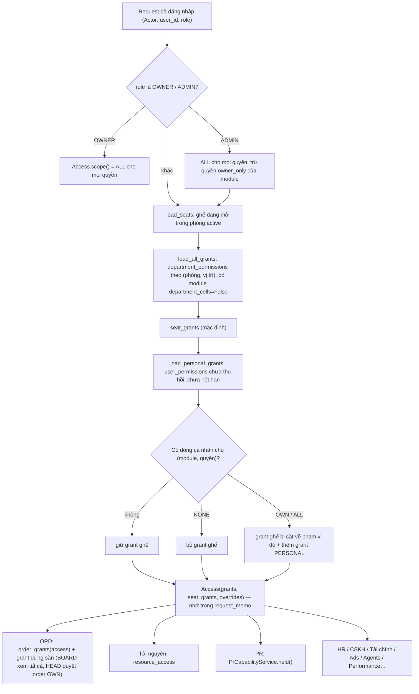
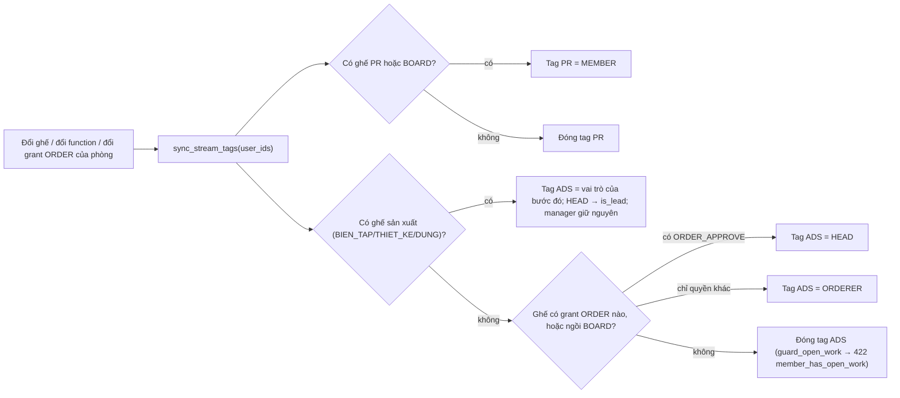

# Tổ chức & phân quyền

> Module này trả lời hai câu hỏi cho mọi màn hình và mọi API: **người này thuộc phòng ban nào** và **người này được làm gì**. OWNER (và một phần ADMIN) quản lý nó ở **Quản trị › Phòng ban** (`/admin/departments`), **Quản trị › Quản lý tài khoản** (`/admin/accounts`), trang **Quyền** của từng người (`/admin/people/[id]`) và **Quản trị › Đang phát triển** (`/admin/developing`).

Tài liệu gốc (lịch sử thiết kế): [`docs/org/ORG_AND_PERMISSIONS_PLAN.md`](../org/ORG_AND_PERMISSIONS_PLAN.md), [`docs/org/PERMISSIONS_UNIFICATION.md`](../org/PERMISSIONS_UNIFICATION.md). Phần tài khoản (đăng nhập, mã nhân viên, ảnh đại diện…) ở [account.md](account.md).

## Khái niệm & thuật ngữ

| Thuật ngữ | Nghĩa |
|---|---|
| **Vai trò hệ thống** (`users.role`, `Role`) | `OWNER` "Chủ sở hữu", `ADMIN` "Quản trị viên", `TEAM_LEAD` "Trưởng phòng", `EMPLOYEE` "Nhân viên" (`domain/identity/labels.py`). OWNER và ADMIN đứng trên mọi phòng ban. |
| **Phòng ban** (`departments`) | Dữ liệu, không phải code. Có `code`, `name`, `function`, `active`, `sort_order`, `parent_id` (phòng cha), `block` ("Khối …"). |
| **Chức năng** (`function`, `DepartmentFunction`) | Phòng ban là gì đối với phần còn lại của app: `BIEN_TAP` / `THIET_KE` / `DUNG` (3 bước sản xuất của luồng order), `PR` (PR Thương Hiệu), `BOARD` (Ban Giám đốc), `RESOURCES` (Phòng Tài nguyên), `NONE` (phòng thường: ADS, HCNS, Kế toán…, quyền chỉ đến từ grant). |
| **Ghế / seat** (`department_members`, `Seat`) | Một chỗ đang mở của một người trong một phòng. Một người có thể ngồi nhiều phòng. |
| **Vị trí** (`Position`) | `HEAD` = "Trưởng phòng" của phòng đó, `MEMBER` = "Nhân viên". Một phòng có thể có nhiều HEAD (mỗi chi nhánh một người). |
| **Trưởng quản lý** (`manager_user_id` trên ghế) | HEAD của cùng phòng mà MEMBER báo cáo. HEAD không có trưởng quản lý trong phòng mình. |
| **Module** (`MODULES`) | Một nhóm quyền: `ORDER`, `PR`, `RESOURCES`, `PERFORMANCE`, `ADS`, `AGENTS`, `CSKH`, `HR`, `FINANCE`, `ASSISTANT`. |
| **Grant phòng ban** (`department_permissions`) | Ô "module × quyền × vị trí → phạm vi" của một phòng. Ai ngồi ghế đó thì được. |
| **Grant cá nhân** (`user_permissions`) | Một dòng cho một người, một quyền, một phạm vi. Ghi đè lên grant phòng ban (xem quy tắc 6). Không bao giờ xoá: thu hồi = `revoked_at`. |
| **Phạm vi** (scope) | `NONE` = không có; `OWN` = "của mình" (nghĩa riêng từng quyền, ví dụ: đơn gửi tới mình, nhân viên phòng mình làm trưởng); `ALL` = toàn bộ. |
| **Access** | Kết quả tính quyền một lần cho một người trong một request (`application/org/access.py`). Mọi module đọc từ đây. |
| **Luồng / stream / tag** (`org_units`, `org_unit_members`) | Mô hình cũ: hai "Luồng" PR ("Luồng PR") và ADS ("Luồng Order (ORD)"; chip `short_label` PR/ORD). Mã kỹ thuật vẫn là `PR` / `ADS`, chỉ chữ hiển thị là ORD. Từ khi có phòng ban, **tag được suy ra từ ghế**, không ai gắn tag bằng tay nữa. |
| **Untagged** | Không có tag nào đang mở: không thấy luồng nào (`/api/units/me` `units=[]`, `is_untagged=true`, route PR trả 404). |
| **Pháp nhân** (`legal_entities`) | Công ty / hộ kinh doanh mà một người thuộc về (`users.legal_entity_id`). |
| **Chi nhánh** (`users.branch`, `BRANCHES`) | `VP_HN` "VP - Hà Nội", `CS_HN` "CS - Hà Nội", `CS_HN2` "CS - Hà Nội 2", `CS_SG` "CS - Sài Gòn". |
| **Module đang phát triển** | Module bị ẩn với mọi người trừ OWNER (`system_settings` `developing_modules`). |

## Luồng chính

### Một request được tính quyền thế nào

### Ghế sinh ra tag luồng

## Quy tắc nghiệp vụ hiện hành

### Luồng (stream) và tag

1. **Untagged = không thấy luồng nào.** `UnitMembership.entries=()` → `/api/units/me` trả `units=[]` và `is_untagged=true`; các router PR được gắn cổng `require_unit(UnitCode.PR)` lúc include (`api/main.py`, `api/deps.py:require_unit`) nên người ngoài nhận 404 `unit_not_visible`, không phải 403. Công cụ Telegram của PR có cổng riêng `tools/unit_gate.py`. Mời qua mã mời không tự tạo tag (chỉ tạo ghế, xem quy tắc 20).
2. **OWNER và ADMIN thấy mọi luồng** (`UnitMembership.sees_all`, chế độ "Tất cả", `can_view_all`), kể cả khi không có tag. Trong luồng ORD, ADMIN có **mọi quyền** như OWNER (`domain/orders/pipeline.py`, `AdsPermissions.full()`); cột "Admin" cũ của ma trận ORD không còn được đọc.
3. **Tag do ghế quyết định, không gắn tay.** Mọi thay đổi ghế, `function`, `active` của phòng, hay grant module `ORDER` của phòng đều gọi `sync_stream_tags` (`application/org/departments.py:sync_stream_tags`). Quy tắc suy ra ở sơ đồ trên (`_ads_tag`, `_in_pr`). Tag mới mở nhận mã nhân viên của tài khoản. Không sửa `org_unit_members.role / is_lead / manager_user_id` bằng tay.
4. **Cửa cũ "gắn tag" (API units) giờ là cửa vào ghế.** `POST/PATCH/DELETE /api/units/{code}/members` gọi `departments.place / unplace / set_unit_manager`:
   - Ai được vào cửa (`UnitAdminService.tags_in`): OWNER, ADMIN; `TEAM_LEAD` đang có tag ở luồng đó; người giữ `PR_MEMBERS_MANAGE` (mặc định Trưởng phòng PR) cho luồng PR. Không phải OWNER/ADMIN thì không gắn/gỡ chính mình, không đụng tài khoản OWNER/ADMIN → 403 `unit_tag_forbidden`. Người không ở luồng và không gắn được ở đâu → 404 `unit_not_visible`.
   - **Đặt người** (thêm tag, đổi vai trò / Leader / trưởng quản lý, gỡ tag) thì hẹp hơn (`_require_placer`, `assigns`): **chỉ OWNER**, ngoại lệ là người giữ `PR_MEMBERS_MANAGE` thêm / gỡ MEMBER của luồng PR. Còn lại → 403 `unit_tag_forbidden` "Chỉ chủ sở hữu mới gắn người vào phòng ban, vai trò và người quản lý." Vì vậy `/api/units/me` `can_tag` = mọi luồng cho OWNER, rỗng cho người khác.
   - Phần còn lại của dòng thành viên (NAS, token/ngày) sửa được bởi ai qua được `tags_in` (`can_edit_members`). Mã nhân viên đổi khác giá trị cũ thì chỉ OWNER/ADMIN (403 `member_code_forbidden`).
   - Lỗi khác: 422 `already_tagged`, `role_not_for_unit`, `self_untag`, `member_has_open_work` (còn order hay bước đang mở), `unit_manager_invalid`; 404 `member_not_tagged`; 422 `user_not_found`.
5. **Danh sách người chưa có tag**: `GET /api/units/untagged` (tài khoản active không có tag mở, mới nhất trước) cho ai qua được `tags_in` ở ít nhất một luồng, còn lại 403 `unit_tag_forbidden` (`UnitAdminService.untagged`). `GET /api/units/directory` (mọi tài khoản + tag + ghế, cho picker "Thêm người") cho người gắn tag được hoặc **bất kỳ HEAD nào**; HEAD không gắn tag chỉ thấy người **chưa ngồi phòng nào** (`UnitAdminService.directory`), còn lại 403 `unit_admin_forbidden`.

### Phòng ban và ghế

6. **Quyền hiệu lực = vai trò hệ thống + ghế + dòng cá nhân** (`application/org/access.py:_load_access`).
   - OWNER: `ALL` mọi quyền. ADMIN: `ALL` mọi quyền trừ các quyền `owner_only` của module (`Access.scope`).
   - Ghế: grant của phòng theo vị trí, cộng dồn qua mọi ghế, lấy phạm vi rộng nhất. Ghế trong phòng `active=false` không tính (`load_seats`).
   - **Dòng cá nhân ĐẶT phạm vi** của quyền đó: `NONE` gỡ mặc định của ghế, `OWN` cắt một grant ghế `ALL` xuống `OWN` (vẫn giữ `function` của phòng), `ALL` cho toàn bộ. Nhiều dòng cùng quyền → lấy rộng nhất. Quyền có sẵn theo vai trò hệ thống không bị ghi đè.
   - Grant dựng sẵn của luồng order (`application/org/seats.py:builtin_order_grants`): ghế `BOARD` → `VIEW ALL`; **mọi ghế HEAD** → `ORDER_APPROVE OWN` (`HEAD_ORDER_GRANT`). Chúng cũng chịu dòng cá nhân (`application/units/directory.py:order_grants`, `seats.overridden`).
7. **Ai sửa phòng ban** (`DepartmentService`, `application/org/departments.py`):
   - Tạo / sửa phòng, sửa grant: **chỉ OWNER** (`_require_owner`) → 403 `department_forbidden`.
   - Đọc danh sách phòng + catalog: OWNER, ADMIN, và bất kỳ HEAD nào. Đọc thành viên / grant của một phòng: OWNER, ADMIN, HEAD của chính phòng đó (`_may_read`).
   - Xếp / gỡ ghế: OWNER bất kỳ ai, bất kỳ đâu. Một HEAD chỉ ở phòng mình làm trưởng, chỉ vị trí MEMBER, không phải OWNER/ADMIN (`PROTECTED_ROLES`), không phải chính mình (`_may_seat`). HEAD chỉ nhận người **chưa ngồi phòng nào** (người ngồi nhiều phòng là việc của OWNER), và người được nhận báo cáo cho HEAD đó. HEAD chỉ gỡ / sửa người thuộc `head_team` của mình: MEMBER của phòng mình làm trưởng báo cáo cho mình, hoặc không báo cáo ai khi mình là HEAD duy nhất. Sai → 403 `department_forbidden`.
   - ADMIN không xếp ghế (trừ khi chính họ là HEAD của phòng đó).
8. **Trưởng quản lý hợp lệ** = HEAD đang active của cùng phòng, không phải chính người đó (`check_manager`) → 422 `department_manager_invalid` (qua cửa units: `unit_manager_invalid`). Người bị đổi từ HEAD xuống MEMBER hay rời phòng thì mọi người báo cáo cho họ trong phòng đó mất trưởng quản lý (`_drop_reports`).
9. **Gỡ ghế cuối cùng của luồng ORD** khi người đó còn order mở hoặc giữ bước đang mở → 422 `member_has_open_work` (`sync_stream_tags(guard_open_work=True)`).
10. **Grant mặc định khi tạo phòng**: `seed_module_defaults` thêm mặc định của mọi module theo `function` (PR, RESOURCES, PERFORMANCE, CSKH, HR, FINANCE). Module `ORDER` **không** có mặc định theo function: phòng tạo trên màn Phòng ban không có quyền order nào cho tới khi OWNER tích. (Phòng tạo bởi script nhập sơ đồ tổ chức thì có `BASIC_ORDER_GRANTS`, quy tắc 18.) `ensure_default_departments` tạo 6 phòng gốc `DEFAULT_DEPARTMENTS` (ADS, BT, TK, D, PR, TN) cho DB dựng từ model (bộ test).
11. **Sửa grant phòng**: `PUT /api/departments/{id}/grants` `{module, cells: {POSITION: {PERMISSION: scope}}}` thay toàn bộ ô gửi lên. Ô sai vị trí / quyền / phạm vi, hoặc là quyền `personal_only` (3 cổng duyệt PR) → 422 `department_grant_invalid`. Module không tồn tại, module chỉ cấp cá nhân (`department_cells=False`), hoặc module đang phát triển với người không phải OWNER → 422 `department_module_invalid`. Chỉ grant `ORDER` mới gọi lại `sync_stream_tags`.
12. **Mã phòng**: `normalise_department_code` – bỏ dấu (Đ→D), bỏ khoảng trắng, ký tự khác thành `-`, tối đa 12, cho phép gạch nối bên trong ("MEDIA (TK)" → `MEDIA-TK`, "ĐT&TTNB" → `DT-TTNB`). Rỗng → 422 `department_code_missing`, trùng → `department_code_taken`. Tên sai → `department_name_invalid`; khối sai → `department_block_invalid`; phòng cha là chính nó / tạo vòng → `department_parent_invalid`. Phòng cha **không** truyền quyền xuống phòng con.

### Phân quyền cá nhân (trang "Quyền")

13. **Ai mở trang Quyền của một người** (`application/org/permissions.py:PersonalPermissionService._may_edit`): OWNER mở của bất kỳ ai (kể cả mình); ADMIN mở của bất kỳ ai **trừ OWNER và chính mình**; người khác → 403 `permission_forbidden`. Áp dụng cho đọc, POST, PUT, DELETE. Frontend vẽ link "Quyền" theo `lib/api.ts:mayEditPermissions` (cùng quy tắc).
14. **Ô nào tích được** (`_grantable`): mọi quyền của mọi module **trừ** `MANAGE_PERMISSIONS` (đặt ở Phòng ban) và 3 cổng duyệt PR (`personal_only`, cấp ở màn PR, xem [pr.md](pr.md)). Các quyền `owner_only` (Trợ lý AI, Hệ số điểm…) ADMIN cũng tích / bỏ tích được cho người khác. Mặc định từ ghế cũng bỏ tích được.
15. **Lưu checklist** `PUT /api/permissions/people/{id}/grants` `{module, permissions: {PERM: scope|null}}` (`set_personal`), chỉ các quyền gửi lên:
    - bằng mặc định (ghế + dựng sẵn, `_inherited`) → xoá dòng cá nhân;
    - khác mặc định → đúng một dòng cá nhân với phạm vi đó (`NONE` khi bỏ tích một mặc định);
    - quyền vai trò hệ thống đã có (OWNER mọi quyền, ADMIN mọi quyền trừ `owner_only`) → 422 `permission_held_by_role` (đổi vai trò thay vì bỏ tích);
    - quyền không tích được → 422 `permission_not_grantable`; phạm vi không hợp lệ → `permission_scope_invalid`.
16. **Cấp lẻ** `POST /api/permissions/people/{id}/grants` (`grant`): 422 `permission_module_invalid` (module không có hoặc đang ẩn với người cấp), `permission_invalid`, `permission_use_pr_grant` (cổng duyệt PR), `permission_not_grantable`, `permission_expiry_past` (`effective_to` trước hôm nay), `permission_duplicate`. **Thu hồi** `DELETE …/grants/{grant_id}` → `revoked_at`, 404 `permission_not_found`. Tài khoản đã xoá → 404 `account_not_found`. Audit `USER_PERMISSION_GRANTED` / `USER_PERMISSION_REVOKED`.
17. **`MANAGE_PERMISSIONS`** (quyền chung của mọi module, "Cấp / thu hồi quyền cho người khác"): giờ chỉ còn phục vụ màn cấp cổng duyệt PR có phạm vi (`Access.manages`): OWNER mọi người; ADMIN mọi người trừ OWNER; `ALL` mọi người trừ OWNER/ADMIN; `OWN` = MEMBER của phòng mình làm trưởng; không ai (trừ OWNER) tự sửa mình. Trưởng phòng PR có `OWN` mặc định (`default_pr_grants`).

### Sơ đồ tổ chức, pháp nhân, nhập từ file HR

18. **Nhập sơ đồ tổ chức + nhân sự** (`application/org/hr_import.py:HrOrgImport`, chạy bằng `scripts/hr_org_import.py`): mặc định chạy thử (cùng transaction rồi rollback); `--apply --passwords file.xlsx` mới ghi (file mật khẩu tạm mode 600). Chỉ in số đếm và mã phòng, không in tên hay mật khẩu. Việc nó làm:
    - Đổi tên tại chỗ các phòng cũ (BGD→BOD, TK/BT/D→MEDIA-TK/MEDIA-BT/MEDIA-QD dưới MEDIA, SALE→TELE, CSKH→QHKH, TCKT→KT) để giữ ghế, grant, điểm, tài nguyên; tạo các phòng còn thiếu trong `DEPARTMENTS` với mặc định module + `BASIC_ORDER_GRANTS` (HEAD: VIEW OWN, ORDER_CREATE, ORDER_APPROVE OWN, FINAL_REVIEW, PRIORITY, CANCEL OWN; MEMBER: VIEW OWN, ORDER_CREATE, CANCEL OWN); `VPTCKT` chép grant của `BOD` (`COPY_GRANTS`); xoá `KHAC`, `CS` nếu không còn gì trỏ tới, không thì tắt (`REMOVED`).
    - Người theo mã nhân viên: tài khoản đã có → cập nhật họ tên, chức danh, chi nhánh, pháp nhân; mới → tài khoản không có Telegram, mật khẩu tạm ngẫu nhiên (`password_temporary`), trạng thái WORKING nếu đã qua "Ngày chính thức" else PROBATION. Ghế = phòng trong file (HEAD theo chức danh `is_head_title`; ai đang là HEAD thì giữ), các ghế khác đóng (trừ khi còn việc sản xuất mở, và trừ ngoại lệ `KEEP_SEATS`). Trưởng quản lý = HEAD cùng chi nhánh, else HEAD duy nhất.
    - Không đọc số CCCD, điện thoại, ngày sinh.
19. **Pháp nhân** (`application/org/legal_entities.py:LegalEntityService`): `GET /api/legal-entities` (mọi người đã đăng nhập; trả thêm `branches` và `can_edit`; `include_inactive` chỉ có tác dụng với người sửa được). Tạo / sửa: OWNER và ADMIN (`may_edit_entities`) → 403 `legal_entity_forbidden`. Không xoá, chỉ tắt (`active`). Mã chuẩn hoá `normalise_entity_code` (A-Z0-9 + gạch nối, ≤20). Lỗi 422 `legal_entity_code_missing`, `legal_entity_code_taken`, `legal_entity_name_invalid`, `legal_entity_tax_code_invalid`; 404 `legal_entity_not_found`. Audit `LEGAL_ENTITY_CREATED/UPDATED`. Gắn pháp nhân / chi nhánh / chức danh cho một người: xem `PATCH /work-info` ở [account.md](account.md).

### Mời thành viên

20. **Ai mời được** (`application/invite_service.py:InviteService.may_invite`): vai trò `TEAM_LEAD` trở lên (`may_create_invites`), **hoặc** HEAD của bất kỳ phòng nào (bất kể vai trò hệ thống), **hoặc** Leader một ban sản xuất / HEAD trong luồng ORD (cách cũ, `placement_for`). Còn lại → 403 `invite_forbidden`. Mã mời chỉ cho vai trò thấp hơn người tạo (`can_invite_role`); người mời là HEAD / Leader thì mời được `EMPLOYEE` dù chính họ là EMPLOYEE.
21. **Mã mời của Trưởng phòng xếp người mới vào phòng** (`department_for`, `_seat`): mã lưu `department_id` + `manager_user_id` = người mời. Người mời làm trưởng nhiều phòng: gửi `department_id`, không gửi thì lấy phòng sản xuất trước, else phòng đầu; phòng không phải mình làm trưởng → 422 `invite_department_invalid`. Khi `/join`, người mới ngồi MEMBER phòng đó, báo cáo người mời (nếu người mời không còn là HEAD ở đó thì không có trưởng quản lý), rồi `sync_stream_tags` suy tag.
22. **Cách cũ (mã không có phòng)**: `placement_for` – Leader ban sản xuất → nhân viên ban đó, trưởng quản lý = người mời; HEAD ORD → ORDERER, trưởng quản lý = người mời; `TEAM_LEAD` có tag PR → MEMBER PR. OWNER/ADMIN (không làm trưởng phòng nào) mời thì người mới không có ghế, không có tag. `joins_label` mô tả nơi người mới vào ("Nhân viên <phòng> · Trưởng quản lý: X"), hiện trong câu trả lời bot và panel web.
23. **Các cửa**: Telegram `/create_invite` (handler tự kiểm tra như trên) và `/join` (đổi mã); web `GET/POST /api/invites`, `POST /api/invites/{id}/disable` (danh sách = mã của chính mình; tắt: TEAM_LEAD mã của mình, ADMIN/OWNER mọi mã); API nội bộ `/api/v1/invites`. Panel "Mời thành viên" trong `/account` (`app/account/invites.tsx`, `mayInvite`) mở khi `/api/account/me` `heads_department` hoặc vai trò đủ. `created_by_telegram_id` là BIGINT (id Telegram > 2^31).

### Bot Telegram

24. **Bot cơ bản cho mọi người, bot đầy đủ cho số ít** (`bot/commands.py:has_full_bot`): đầy đủ (chat AI, công cụ, lệnh quản trị) khi `role=OWNER` hoặc `Actor.full_bot`. `full_bot` được gán mỗi update trong `ActorMiddleware` qua `application/org/bot_access.py:with_unified_access` = OWNER, **HEAD của một phòng function `PR`**, hoặc người được tích `ASSISTANT/CHAT` ("Trợ lý AI"). ADMIN vẫn chỉ có bot cơ bản. Một `Role` trần (không có Actor) chỉ là OWNER.
25. **Lệnh cơ bản** (`CommandSpec.basic`): `/start`, `/help`, `/whoami`, `/web`, `/join`, `/cancel`, `/cancel_flow`, `/create_invite` (handler tự quyết), cùng thông báo, đơn HR, nhắc việc, nút công việc. Chặn bởi `BasicCommandsMiddleware` và một guard đầu nhánh hội thoại (không chat AI, không dùng quota). Menu mặc định = lệnh cơ bản; OWNER nhận menu đầy đủ qua `BotCommandScopeChat` khi bot khởi động (`bot/main.py`).
26. **Quyền công cụ bot** đọc `actor_has_permission` (`domain/permissions/matrix.py`) = ma trận vai trò ∪ `Actor.extra_permissions`. `extra_permissions` = quyền nền (baseline) của các capability PR người đó có `ALL` qua ghế / dòng cá nhân, **trừ** `user.manage`, `user.role.manage`, `user.status.manage` (`SYSTEM_PERMISSIONS`); cộng `assistant.report` nếu có Trợ lý AI. Công cụ `pr.capability.grant/revoke` cần `script.review` và để `PrCapabilityService.manages` quyết.

### Nhãn vai trò, module đang phát triển, bộ nhớ theo request

27. **Nhãn một người** (`application/account/account_service.py:member_role_label`, dùng cho dòng `/api/account/members` và trang hồ sơ): OWNER/ADMIN → tên vai trò hệ thống; else `job_title` nếu có; else mỗi ghế một nhãn `seat_label` ("Trưởng phòng Tài Chính-Kế Toán", "Nhân viên Biên Tập"; tên "Phòng X" bỏ chữ "Phòng"; tên "Ban X" thành "Trưởng Ban X" / "Thành viên Ban X"), nối bằng " · "; else vai trò hệ thống. **Không bao giờ** dùng tag ORD. Riêng `/api/units/{code}/members` vẫn trả vai trò trong luồng.
28. **Module đang phát triển** (`application/org/developing.py`): `system_settings` `developing_modules` = `{"modules": [...]}`; chỉ module trong `DEVELOPABLE` (hiện chỉ `FINANCE`) tôn trọng nó. `hidden_modules(session, role)`: OWNER không bị ẩn gì, người khác (cả ADMIN) bị ẩn cả danh sách. Module ẩn: không menu, API 403 (do access của module tự hỏi, ví dụ `load_finance_access`), catalog Phòng ban (`CatalogResponse.build(hidden)`), đọc grant phòng, trang Quyền và ghi grant cá nhân (422 `permission_module_invalid`) đều bỏ qua nó. Grant đã lưu vẫn còn, phát hành lại là hiện lại. Đổi danh sách: OWNER, `PUT /api/permissions/developing-modules` → 403 `developing_forbidden`, 422 `developing_invalid`, audit `system.developing_modules.updated`.
29. **Bộ nhớ theo request** (`application/org/access.py:request_memo`): một dict trong `session.info`, bị xoá sau mỗi flush, commit, soft rollback, hoặc INSERT/UPDATE/DELETE hàng loạt (`do_orm_execute`). `load_access` (khi không truyền `seats=`), `UnitDirectoryService.membership_for` và `developing_modules` nhớ kết quả ở đó. **Chỉ lưu giá trị bất biến (frozen).** `AccessCache` là bộ nhớ riêng của một service, khoá theo (user, role), `forget(user_id)` sau khi ghi.

## Phân quyền

| Việc | Ai được | Lỗi |
|---|---|---|
| Tạo / sửa phòng, sửa grant phòng | OWNER | 403 `department_forbidden` |
| Đọc danh sách phòng + catalog | OWNER, ADMIN, mọi HEAD | 403 `department_forbidden` |
| Đọc thành viên / grant một phòng | OWNER, ADMIN, HEAD phòng đó | 403 `department_forbidden` |
| Xếp / gỡ ghế | OWNER; HEAD: MEMBER chưa ngồi đâu / `head_team` của mình, phòng mình | 403 `department_forbidden` |
| Trang Quyền cá nhân | OWNER mọi người; ADMIN trừ OWNER và chính mình | 403 `permission_forbidden` |
| Đặt người vào luồng qua `/api/units/{code}/members` | OWNER; holder `PR_MEMBERS_MANAGE` cho MEMBER PR | 403 `unit_tag_forbidden` |
| Sửa NAS / token của dòng thành viên | OWNER, ADMIN, TEAM_LEAD có tag luồng đó, holder `PR_MEMBERS_MANAGE` (PR) | 403 `unit_tag_forbidden` |
| Cài đặt luồng ORD (`/admin/settings`) | OWNER, ADMIN (`administers`) | 403 `unit_admin_forbidden` |
| Pháp nhân (tạo / sửa) | OWNER, ADMIN | 403 `legal_entity_forbidden` |
| Module đang phát triển | OWNER | 403 `developing_forbidden` |
| Mời thành viên | TEAM_LEAD+, mọi HEAD, Leader / HEAD trong ORD | 403 `invite_forbidden` |
| Đổi vai trò hệ thống (`POST /api/account/members/{id}/role`) | OWNER | 403 `role_change_forbidden` |

**Đăng ký module** (`domain/org/modules.py:MODULES`, `ModuleSpec`): mỗi module khai báo enum quyền, nhãn, nghĩa của `OWN`, phạm vi cho phép (`scopes`), `defaults` theo function, `scope_labels` riêng, và:
- `personal_only`: quyền không thành ô phòng ban (3 cổng duyệt PR `GRANT_BACKED`, giữ trong `pr_user_capabilities`);
- `owner_only`: OWNER có theo vai trò, ADMIN thì **không** có theo vai trò (phải được tích). Hiện có ở PERFORMANCE (`COEFFICIENT`), AGENTS (`MANAGE`), CSKH, HR (`SENSITIVE`), FINANCE, ASSISTANT (`CHAT`) – xem từng module;
- `department_cells=False`: chỉ cấp cá nhân, không ô phòng ban, không hiện ở Phòng ban (hiện là `ASSISTANT`);
- mọi module có thêm `MANAGE_PERMISSIONS` (scope `OWN`/`ALL`).

Quyền chi tiết từng module: [ord.md](ord.md), [pr.md](pr.md), [resources.md](resources.md), [performance.md](performance.md), [ads.md](ads.md), [agents.md](agents.md), [cskh.md](cskh.md), [hr.md](hr.md), [finance.md](finance.md), [assistant.md](assistant.md).

## Dữ liệu

| Bảng / khoá | Cột chính | Ghi chú |
|---|---|---|
| `departments` | `code`, `name`, `function`, `active`, `sort_order`, `parent_id`, `block` | Không xoá (trừ script nhập HR với phòng không ai trỏ tới). |
| `department_members` | `department_id`, `user_id`, `position`, `manager_user_id`, `joined_at`, `left_at` | Rời phòng = `left_at`. Ghế đang mở = `left_at IS NULL`. |
| `department_permissions` | `department_id`, `position`, `module`, `permission`, `scope` | Không có dòng = `NONE`. |
| `user_permissions` | `user_id`, `module`, `permission`, `scope` (`NONE`/`OWN`/`ALL`), `note`, `granted_by_user_id`, `effective_to`, `revoked_at`, `revoked_by_user_id` | Không xoá; `scope=NONE` được phép từ 0098. |
| `org_units`, `org_unit_members` | `role`, `is_lead`, `member_code`, `personal_nas_url`, `manager_user_id`, `daily_tokens`, `left_at` | Tag luồng, suy ra từ ghế. Không xoá dòng. |
| `legal_entities` | `code`, `name`, `tax_code`, `active`, `sort_order` | 6 dòng seed ở 0095. |
| `users` | `job_title`, `branch`, `legal_entity_id`, `member_code` | Xem [account.md](account.md). |
| `invite_codes` | `department_id`, `manager_user_id`, `unit_id`, `unit_role`, `created_by_telegram_id` (BIGINT) | Mã không lưu bản rõ (`code_hash`). |
| `system_settings` `developing_modules` | `{"modules": [...]}` | 0105 seed `["FINANCE"]`. |

## Code ở đâu

| Lớp | File |
|---|---|
| domain | `domain/org/models.py` (`DepartmentFunction`, `Position`, `Seat`, `Grant`, `DEFAULT_DEPARTMENTS`, `BASIC_ORDER_GRANTS`, `BRANCHES`, `branch_of`, `normalise_department_code`, `seat_label`), `domain/org/modules.py` (`MODULES`, `ModuleSpec`, `CommonPermission`, `default_pr_grants`), `domain/units/models.py` (`UnitMembership`, `UnitCode`, `UnitMemberRole`), `domain/identity/labels.py`, `domain/identity/invites.py`, `domain/permissions/matrix.py` |
| application | `application/org/access.py` (`load_access`, `Access`, `request_memo`, `AccessCache`), `application/org/seats.py` (`load_seats`, `load_grants`, `grants_of`, `builtin_order_grants`, `function_staff`), `application/org/departments.py` (`DepartmentService`, `sync_stream_tags`, `place`/`unplace`/`set_unit_manager`, `head_team`, `reports_of`, `department_people`), `application/org/permissions.py` (`PersonalPermissionService`), `application/org/developing.py`, `application/org/legal_entities.py`, `application/org/hr_import.py`, `application/org/bot_access.py`, `application/units/directory.py` (`UnitDirectoryService.membership_for`, `order_grants`), `application/units/admin.py` (`UnitAdminService`), `application/invite_service.py` |
| api | `api/routers/departments.py` (`/api/departments`), `api/routers/permissions.py` (`/api/permissions`), `api/routers/units.py` (`/api/units/me`, `/directory`, `/untagged`, `/{code}/members`), `api/routers/legal_entities.py`, `api/routers/web_invites.py`, `api/routers/invites.py`, `api/deps.py` (`require_unit`) |
| bot | `bot/commands.py` (`CommandSpec.basic`, `has_full_bot`), `bot/middlewares.py` (`ActorMiddleware`, `BasicCommandsMiddleware`), `bot/main.py`, `tools/unit_gate.py` |
| scripts | `scripts/hr_org_import.py` |
| frontend | `app/admin/departments/page.tsx`, `app/admin/accounts/page.tsx` (bảng tài khoản, `SeatsCell`, `AddToDepartmentDialog`, `SeatDialog`, `RoleDialog`), `app/admin/people/[id]/page.tsx` (Quyền), `app/admin/developing/page.tsx`, `app/admin/units/` (chuyển hướng sang `/admin/accounts`), `components/admin-tabs.tsx` (`adminTabsFor`, `headsDepartments`), `components/department-tags.tsx` (`DepartmentTags`, `.dept-tag`, ★ = HEAD, `SeedingTag`), `components/account-fields.tsx` (`LegalEntityField`, `LegalEntitiesDialog`, `WorkInfoDialog`), `components/row-menu.tsx`, `components/unit-panel.tsx` (nút tài khoản + `SettingsForm`), `app/account/invites.tsx`, `lib/api.ts` (`mayEditPermissions`), `lib/finance.ts` (`developingApi`) |
| tests | `tests/unit/test_unified_permissions.py`, `test_departments.py`, `test_streams.py`, `streams.py` (helper `tag`/`untag`/`tag_pr`/`ensure_units`), `test_invite_placement.py`, `test_callbacks_and_invites.py`, `test_basic_bot.py`, `test_hr_org_import.py`, `test_hot_routes.py`, `test_account_stats.py` (`test_06b/06c` nhãn vai trò), `test_finance_crm.py::test_05` (module đang phát triển), `test_telegram_id_width.py`; `tests/integration/test_personal_permission_override_migration.py`, `test_org_structure_migration.py`, `test_invite_department_migration.py`; `frontend/tests/permissions.test.tsx`, `accounts-admin.test.tsx`, `units-screens.test.tsx`, `membership.test.tsx` |

## API

| Method | Path | Ai | Ghi chú |
|---|---|---|---|
| GET | `/api/departments` | OWNER, ADMIN, HEAD | Danh sách + số người. |
| GET | `/api/departments/catalog` | như trên | `modules[]` (bỏ module ẩn và `department_cells=False`), `permissions[].scope_labels`. |
| POST | `/api/departments` | OWNER | `code, name, function, sort_order, parent_id, block`. |
| PATCH | `/api/departments/{id}` | OWNER | Chỉ các khoá gửi; `parent_id`/`block` riêng. |
| GET | `/api/departments/{id}/members` | OWNER, ADMIN, HEAD phòng đó | |
| PUT | `/api/departments/{id}/members` | OWNER, HEAD (giới hạn) | `{user_id, position, manager_user_id}`. |
| DELETE | `/api/departments/{id}/members/{user_id}` | OWNER, HEAD (giới hạn) | 404 `member_not_seated`. |
| GET / PUT | `/api/departments/{id}/grants?module=` | đọc như members / ghi OWNER | Body `{module, cells}`. |
| GET | `/api/permissions/people/{id}` | OWNER, ADMIN (giới hạn) | Mỗi module: `rows[{permission, scope, sources[DEPARTMENT\|PERSONAL], gate_grants, by_role, inherited, personal}]`, `can_manage`, `grantable`. |
| POST | `/api/permissions/people/{id}/grants` | như trên | Một dòng cá nhân (`effective_to`, `note`). |
| PUT | `/api/permissions/people/{id}/grants` | như trên | Checklist `{module, permissions}`. |
| DELETE | `/api/permissions/people/{id}/grants/{grant_id}` | như trên | 204. |
| GET / PUT | `/api/permissions/developing-modules` | OWNER | |
| GET | `/api/units/me` | mọi người | `units`, `is_untagged`, `can_view_all`, `can_admin`, `can_tag`, `can_edit_members`, `departments` (ghế), `can_view_profiles`, `nav_pins`, khối quyền của từng module. |
| GET | `/api/units/directory` | người gắn tag được, HEAD | Dòng có `departments`. |
| GET | `/api/units/untagged` | người gắn tag được | |
| GET / POST | `/api/units/{code}/members` | đọc: thành viên luồng, OWNER, ADMIN | Trả `{"members": [...], "assignable_roles": [...]}` (không có envelope `data`); dòng có `departments`, `seeding`. |
| PATCH / DELETE | `/api/units/{code}/members/{user_id}` | xem quy tắc 4 | |
| GET / POST / PATCH | `/api/legal-entities[/{id}]` | đọc mọi người, ghi OWNER/ADMIN | |
| GET / POST | `/api/invites`, POST `/api/invites/{id}/disable` | quy tắc 20 | Web. |
| GET / POST | `/api/v1/invites`, POST `/api/v1/invites/{id}/disable` | system actor | API nội bộ. |
| POST | `/api/account/members/{id}/role` | OWNER | Đổi vai trò hệ thống (xem [account.md](account.md)). |

## Cạm bẫy & chưa làm

- **Người có dòng cá nhân ORDER nhưng không ngồi phòng nào**: `membership.grants` = `None` (`application/units/directory.py:_membership_for`, `grants = order_grants(access) if seats else None`), luồng order đọc ma trận vai trò cũ từ tag, nên dòng cá nhân ORDER của người đó **không có tác dụng**. Muốn cấp quyền order lẻ cho ai thì người đó cần ít nhất một ghế.
- Tắt một phòng (`active=false`) làm mọi ghế trong phòng đó biến mất khỏi `load_seats` (và tag được tính lại) nhưng không đóng `left_at`.
- `request_memo` chỉ được chứa giá trị frozen. Đừng đọc access, rồi ghi ghế, rồi đọc tiếp mà mong thấy kết quả cũ: lần ghi đã xoá memo (đúng ý đồ).
- `Access.manages` có docstring cũ nói trang Quyền "của riêng OWNER" – sai, xem quy tắc 13.
- Phòng tạo trên màn Phòng ban không có quyền ORDER mặc định (quy tắc 10) – dễ quên khi thêm phòng mới cần đặt order.
- Không có thông báo cho người được cấp / bị thu hồi quyền.
- Màn `/admin/departments` chỉ hiện cho OWNER/ADMIN (`adminTabsFor`), dù HEAD đọc được API danh sách phòng.
- Test cũ còn đỏ: `tests/unit/test_streams.py::test_03` (Trưởng phòng PR gắn được người vào PR từ 0067, test vẫn chờ 403).
- Cảnh báo hệ thống của bot (nơi nhận hỏng, tin không gửi được) gửi Trưởng phòng PR thay vì OWNER – xem [platform.md](platform.md).

## Mốc thay đổi

- 0048 (08/10/2026): bỏ "luật cũ" coi người không tag là PR MEMBER; mọi tài khoản active chưa có tag được gắn PR một lần. Từ đây untagged = không luồng nào.
- 0050 (09/10): `org_unit_members.manager_user_id` (Trưởng quản lý).
- 0051 (09/10): `invite_codes.unit_id/unit_role/manager_user_id` – mã mời xếp người vào luồng.
- 0055 (12/10): `invite_codes.created_by_telegram_id` lên BIGINT (`/create_invite` hỏng với id > 2^31).
- 0061 (14/10): bảng `departments`, `department_members`, `department_permissions`; tag luồng suy từ ghế; đặt người vào luồng chỉ còn OWNER.
- 17/10: giao diện bỏ gắn tag, dùng chip phòng ban; `/admin/units` → `/admin/accounts`; HEAD xếp MEMBER vào phòng mình.
- 0066 (16/10): một mô hình quyền (`MODULES`, `user_permissions`, `load_access`); ADMIN có mọi quyền ORD, cột Admin cũ bỏ.
- 0067 (16/10): Trưởng phòng PR có `PR_MEMBERS_VIEW` + `PR_MEMBERS_MANAGE`; bot đầy đủ cho Trưởng phòng PR (`full_bot`, `extra_permissions`).
- 19/10: nhãn `TEAM_LEAD` = "Trưởng phòng".
- 21/10: mọi HEAD có `ORDER_APPROVE OWN` dựng sẵn.
- 31/10: `ModuleSpec.department_cells`, module `ASSISTANT` (cấp cá nhân); bot đầy đủ cho người có Trợ lý AI.
- 02/11 (0088): `invite_codes.department_id` – mã mời của Trưởng phòng xếp người vào phòng; nhãn vai trò = các ghế.
- 0095 (09/11): `departments.parent_id/block`, bảng `legal_entities`, `users.legal_entity_id/job_title/branch`; script `hr_org_import.py`.
- 0098 (10/11): `user_permissions.scope` nhận `NONE`; dòng cá nhân đặt phạm vi; trang Quyền mở cho ADMIN (trừ OWNER và chính mình), ADMIN tích được quyền `owner_only`.
- 12/11: `request_memo` cho `load_access` / `membership_for`.
- 0105 (13/11): `developing_modules` seed `FINANCE`; tab "Đang phát triển".
