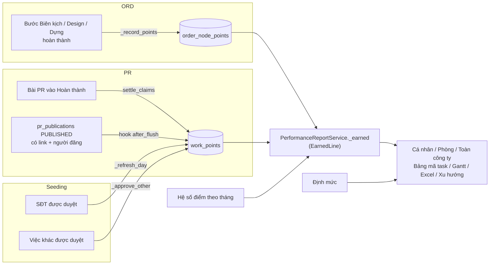
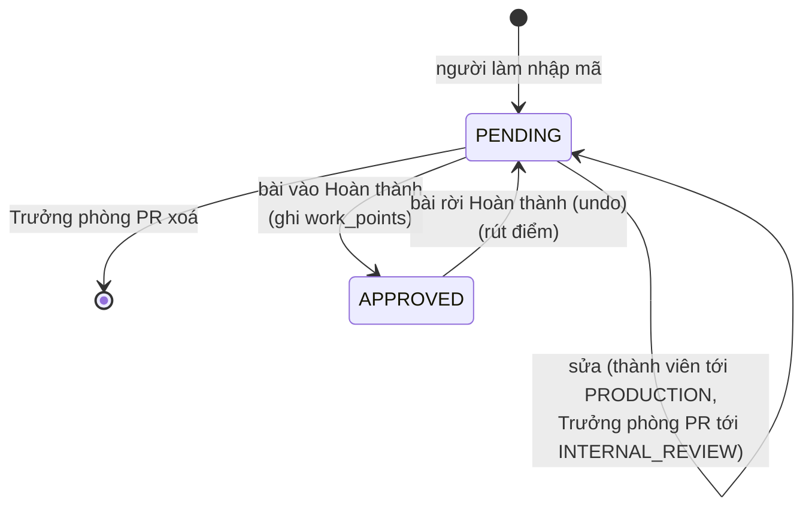

# Hiệu suất (điểm hiệu suất)

> Module đếm **điểm** mỗi người làm được trong tháng, từ mã task công việc của các bước ORD, mã task của bài PR, bài đăng có link và seeding; rồi dựng báo cáo cá nhân / phòng / toàn công ty, bảng mã task, biểu đồ Gantt, định mức và hệ số điểm. Mọi nhân viên dùng; trên giao diện là nhánh menu **"Hiệu suất"** (`/performance/*`) và tab "Hiệu suất" trên trang hồ sơ `/people/[id]`.

Module này chỉ **đọc** điểm và báo cáo. Điểm được **ghi** ở nơi làm ra nó: bước ORD (`order_node_points`, xem [ord.md](ord.md) về danh mục mã task và cách nộp), bài PR / đăng bài / seeding (`work_points`, xem [pr.md](pr.md) về luồng PR và seeding). Đây không phải "Hiệu suất M6" cũ của PR (`/api/pr/performance`, phút chuẩn + đánh giá tháng) — cái đó ở [../handover/05_WORK_KPI_PERFORMANCE.md](../handover/05_WORK_KPI_PERFORMANCE.md) §G.

## Khái niệm & thuật ngữ

- **Mã task công việc**: một dòng trong danh mục điểm (`unit_design_codes` của unit ADS): pha Biên kịch N1-N5, Design T1-T5, Dựng D1-D7, mỗi mã có `points`. "Việc khác" N0/T0/D0 cho người làm tự gõ điểm. Chi tiết ở [ord.md](ord.md).
- **Hình thức**: làm mới 100%, chỉnh sửa 50%, resize 20%, animated 125%, after effects 150%… Điểm một dòng = điểm mã × % hình thức × số lượng (làm tròn nửa lên).
- **Sổ điểm (ledger)**: bảng chứa điểm đã kiếm. Có hai sổ:
  - `order_node_points` — một dòng / người / bước ORD (Biên kịch, Design, Dựng);
  - `work_points` — mọi điểm khác: mã task PR, đăng bài, SĐT seeding, việc khác seeding.
- **Dòng điểm (`EarnedLine`)**: một dòng đọc từ một trong hai sổ, đã chuẩn hoá chung (nguồn, người, phòng, pha, mã, điểm, thời điểm). Mọi báo cáo đọc qua `PerformanceReportService._earned`.
- **Nguồn (source)**: `ORDER` (bước ORD), `PR_CONTENT` (mã task PR), `PR_PUBLISH` (đăng bài có link), `SEEDING_PHONES`, `SEEDING_OTHER`.
- **Pha báo cáo**: `BIEN_TAP`, `THIET_KE`, `DUNG`, `PUBLISH` "Đăng bài", `SEEDING` "Seeding", `OTHER` "Việc khác" (`PHASE_ORDER`). Dòng PR hiện là "Nội dung (PR)" / "Thiết kế (PR)" / "Dựng (PR)".
- **Task xong**: dòng được đếm là một task hoàn thành — chỉ nguồn `ORDER` và `PR_CONTENT` (`EarnedLine.counts_step`). Đăng bài và seeding chỉ cộng điểm.
- **Dự kiến / đang làm (pending)**: bước ORD đang mở của người đó, chấm theo mã đang mang. Hiện riêng, **không bao giờ** cộng vào tổng.
- **Hệ số điểm**: số nhân điểm của một người theo tháng (mặc định 1).
- **Định mức**: số điểm một người cần đạt trong tháng.
- **Phiếu mã task PR (claim)**: danh sách mã một người khai cho một pha (Nội dung / Sản xuất) của một bài PR (`pr_point_claims`).
- **Hoàn thành (done) của bài PR**: stage `READY_TO_PUBLISH`, `PUBLISHED`, `MEASURED`, `ARCHIVED` (`PR_DONE_STAGES`).

## Luồng chính

Điểm đi từ đâu vào đâu:

Vòng đời một phiếu mã task PR (không ai duyệt):

## Quy tắc nghiệp vụ hiện hành

### Ghi điểm từ bước ORD

1. **Khi một bước sản xuất hoàn thành, mỗi người trên bước được điểm của mã họ làm.** `application/orders/command_service.py:_record_points`, gọi trong `_complete_node`. Chỉ khi `UnitSettings.design_codes_enabled` bật và bước thuộc `TASK_PHASES` (Biên kịch, Design, Dựng).
   - Design: mỗi người được giao (`order_node_assignees` đang mở) lấy **danh sách của riêng mình** (`work_items`). Bước Design giao trước 0073 (không có dòng assignee) hoặc đơn sinh nhật: người được giao lấy `order.design_items`; đơn sinh nhật không có mã thì vẫn được `T1` x1 (`DesignCodeService.birthday_items`).
   - Biên kịch / Dựng: người được giao lấy `node.task_items`.
   - Người có danh sách rỗng không được dòng nào.
2. **Một dòng / người / bước** (unique `node_id, user_id`). Bước bị trả rồi làm xong lại: dòng được **cập nhật** mã + điểm, giữ `first_completed_at` (= tháng của lần xong đầu) và giữ phòng ban cũ.
3. **Phòng ban của điểm** (`order_node_points.department_id`) = phòng của người đó có chức năng đúng pha của bước (bước Dựng → phòng Dựng), không có thì ghế đầu tiên, không có ghế thì NULL (`application/org/seats.py:points_department`). Cố định lúc ghi: người chuyển phòng sau đó vẫn để điểm cũ ở phòng cũ.
4. Không backfill điểm cho bước xong trước 0074.
5. **Huỷ order** (OWNER/ADMIN có thể huỷ đơn đang chạy): điểm đã kiếm giữ nguyên; bước đang mở rời khỏi "dự kiến" (`DEAD_STAGES`). **Xoá order** (`application/tasks/delete_service.py`) xoá luôn `order_node_points` của nó.

### Ghi điểm ngoài ORD (`work_points`)

6. **Mỗi dòng có `source_key` duy nhất**, ghi lại tại chỗ, không bao giờ nhân đôi (`application/performance/work_ledger.py:put_points` / `drop_points`). Phòng ban = ghế phòng PR nếu có, không thì ghế đầu tiên; cố định lúc ghi. `points` là điểm **trước** hệ số.

   | Nguồn | `source_key` | Pha | Điểm | Thời điểm tính (`earned_at`) |
   |---|---|---|---|---|
   | `PR_CONTENT` | `pr_claim:<claim id>:<phase>` | BIEN_TAP / THIET_KE / DUNG | theo mã | lúc bài vào Hoàn thành |
   | `PR_PUBLISH` | `pr_publication:<id>` | PUBLISH | `PUBLISH_POINTS` = 10 | `published_at` |
   | `SEEDING_PHONES` | `seeding_phones:<user>:<YYYY-MM-DD>` | SEEDING | `PHONE_POINTS` = 200 × số SĐT đã duyệt nộp trong ngày đó | 12:00 giờ VN ngày nộp |
   | `SEEDING_OTHER` | `seeding_other:<report id>` | OTHER | số điểm người nộp ghi | `submitted_at` |

7. **+10 điểm mỗi bài đăng có link** (`application/performance/publish_points.py`): một hook `after_flush` toàn cục (cài từ `db/models/__init__.py`, cạnh hook đồng bộ `tasks`) theo dõi mọi `pr_publications`. Dòng `PUBLISHED` + `url` không rỗng + có `publisher_user_id` + có `published_at` → 10 điểm cho người đăng. Sửa dòng thì ghi lại (đổi người đăng, bỏ link, gỡ bài, đảo ngược → mất điểm); xoá dòng → mất điểm. Phòng ban: ghế PR trước, rồi theo `sort_order`. Mỗi lần đăng (mỗi kênh) một lần. Không backfill bài đăng trước 0085. Code PR ghi publication **không bị sửa**.
8. **SĐT seeding**: mỗi lần duyệt/không duyệt, `SeedingService._refresh_day` đếm lại số SĐT đã duyệt của người đó trong ngày nộp (giờ VN) và ghi lại dòng của ngày đó; còn 0 thì xoá dòng.
9. **Việc khác seeding**: được duyệt → `put_points`; bị từ chối → `drop_points`. Người `manage` tự nộp thì duyệt ngay.
10. **Xoá một bài PR** (`delete_service._drop_pr_points`): xoá phiếu mã task của bài và các dòng `work_points` của phiếu + các bài đăng của nó (`work_points` không có foreign key).

### Điểm PR (mã task cho bài PR)

11. **Không ai duyệt mã task PR.** Mỗi người tự nhập mã của mình; Trưởng phòng PR / OWNER / ADMIN (`reviews_pr`) xem lại, sửa hoặc xoá mã của người khác. Điểm cộng khi bài hoàn thành. Service `application/performance/pr_points.py:PrPointService`, router `api/routers/pr_points.py` (`/api/performance/pr`, **không** phải route PR nên không bị `require_unit` gác — nó tự kiểm `in_pr`).
12. **Hai pha** (`STAGE_PHASES`):
    - **Nội dung** (`CONTENT`) nhận mã `BIEN_TAP`; chỉ **người phụ trách bài** (`owner_user_id`) tự nhập được.
    - **Sản xuất** (`PRODUCTION`) nhận mã `THIET_KE` và/hoặc `DUNG`; **bất kỳ ai trong PR** (`in_pr` = có tag PR hoặc OWNER/ADMIN) tự nhập phần của mình — producer và người cùng làm, mỗi người một phiếu.
    Mã của pha khác → **422 `pr_points_phase_invalid`**. Không chọn mã nào → **422 `pr_points_codes_required`**. Mã được giải bằng chính danh mục ORD (`DesignCodeService.resolve`), nên Dựng vẫn chỉ được **một** mã (lỗi của danh mục, ví dụ `task_code_single`, `design_code_invalid`). Ghi chú ≤ 1000 ký tự.
13. **Ai sửa được tới đâu** (`PrPointService._stage`):
    - Thành viên sửa mã của mình khi bài ở `PR_MEMBER_EDIT_STAGES` = IDEA … PRODUCTION. Sau khi gửi duyệt nội bộ → **422 `pr_points_locked`**.
    - Trưởng phòng PR / OWNER / ADMIN sửa của mình và của người khác (`POST …/claims` với `user_id`, người đó phải đang active, không thì 422 `pr_points_person`), hoặc xoá phiếu (`DELETE /api/performance/pr/claims/{id}`), tới hết `INTERNAL_REVIEW` (`PR_HEAD_EDIT_STAGES`). Người khác xoá → **403 `pr_points_forbidden`**.
    - Bài đã Hoàn thành hoặc đã huỷ (`CANCELLED`) → khoá với mọi người: **422 `pr_points_not_open`**.
    - Không thuộc PR → **403 `pr_points_forbidden`**; bài/phiếu không tồn tại → **404 `pr_points_not_found`**.
    Mã mở **ngay từ khi tạo bài**. Phiếu là một dòng / (bài, pha, người); nhập lại là ghi đè và trở về `PENDING`.
14. **Điểm cộng khi bài hoàn thành** (`application/performance/pr_points_settle.py:settle_claims`). `PrContentWorkflowService.apply` gọi nó khi một lần chuyển stage đi qua ranh giới Hoàn thành (vào hoặc ra). Vào: mỗi phiếu chưa đếm → một dòng `work_points` / pha có mã, `earned_at` = lúc đó; phiếu thành `APPROVED` ("Đã cộng điểm"). Ra (undo): rút điểm, phiếu về `PENDING`. Idempotent.
15. **Ý nghĩa `status` của phiếu**: `PENDING` = chưa cộng (dòng `REJECTED` cũ cũng đọc như chưa cộng), `APPROVED` = đã cộng. Các cột `decided_by_user_id`, `return_reason`, `decision_note` chỉ còn từ dữ liệu cũ.
16. **Cổng mã task**: bài không được rời một pha khi pha đó chưa có phiếu (`pr_code_gate`, 422 `pr_task_codes_required`) — xem [pr.md](pr.md) quy tắc 9-11.
17. **Danh sách phiếu** `GET /api/performance/pr/claims?status=`: Trưởng phòng PR thấy của mọi người, người khác chỉ của mình; tối đa 300 dòng mới nhất; `status=PENDING` = mọi phiếu chưa `APPROVED`.
18. Audit: `pr.points.claimed` (cả khi Trưởng phòng sửa hộ, `by_head`), `pr.points.removed`.

### Ai xem điểm của ai

19. **Quyền xem** (`application/performance/access.py:performance_access` → `PerformanceAccess`):
    - Ai cũng xem điểm **của mình**.
    - Trưởng phòng (bất kỳ ghế `HEAD`) xem thêm **nhân viên báo cáo trực tiếp** cho mình: người ngồi ghế trong phòng mình làm trưởng có `manager_user_id` = mình, chặt (`org/departments.reports_of`). Không xem cả phòng.
    - **Toàn công ty** (`view_all`): OWNER, ADMIN, hoặc người có `PERFORMANCE VIEW` phạm vi `ALL` (grant phòng ban hoặc cá nhân; mặc định không ai có, kể cả Ban Giám đốc).
    - **Xuất Excel** (`export`): OWNER, ADMIN hoặc `PERFORMANCE EXPORT`; route còn đòi `view_team` (là trưởng phòng hoặc view_all).
    Không đủ quyền → **403 `performance_forbidden`**; người không tồn tại / đã xoá → **404 `performance_person_not_found`**.
20. **Gantt rộng hơn**: ở `/timeline`, mọi trưởng phòng được xem như người xem toàn công ty (mọi phòng hoặc mọi người có bước trong tháng) — route tự nâng `view_all` chỉ cho Gantt. Thành viên thường hỏi theo phòng → 403.
21. Người có `PERFORMANCE VIEW ALL` cũng mở được hồ sơ mọi người (`AccountService.may_view_profile`, `/api/units/me` `can_view_profiles`) — xem [account.md](account.md).

### Báo cáo

22. **Mọi con số đọc từ cả hai sổ** qua `PerformanceReportService._earned` (`application/performance/report_service.py`), theo tháng giờ Việt Nam: ORD theo `first_completed_at`, `work_points` theo `earned_at`. Mỗi điểm hiện **sau hệ số** của người đó cho tháng đó.
23. **Một người** (`person`): `figures` = tổng điểm, số task xong, dự kiến (điểm + số bước, theo hệ số tháng hiện tại), bị trả trong tháng theo lý do (`order_events.return_reason`: làm lỗi `WORKER_FAULT` / đổi yêu cầu `CHANGED_REQUEST` / mã chưa hợp lý `WRONG_CODES`), trễ hạn (`deadline_met = false`, chỉ dòng ORD), điểm tháng trước; điểm theo 5 cụm ngày (1-7, 8-14, 15-21, 22-28, 29+); theo pha; các dòng `EARNED` / `PENDING_REVIEW` / `IN_PROGRESS` (dòng ngoài ORD có `source`, `link`, `order_id` null); bảng mã task của riêng người đó.
24. **Phòng** (`team`): một dòng / người, điểm cao trước. Trưởng phòng: nhân viên trực tiếp, lọc theo một phòng mình làm trưởng (phòng khác → 403). Người xem toàn công ty: người của một phòng (`department_people` = đang ngồi ghế + ai có điểm tính cho phòng đó trong tháng), hoặc không chọn phòng = mọi người có ghế + mọi người có điểm. Kèm xu hướng, bảng mã task, định mức.
25. **Toàn công ty** (`overview`, chỉ `view_all`): theo phòng (dòng không phòng = "Chưa có phòng"), top 10 người, top 15 mã task theo điểm. **Xu hướng** (`trend`): tổng 6 tháng tới tháng đang xem, chia theo phòng.
26. **Bảng số lượng theo mã task** (`codes`, `_tally_codes`): một dòng / pha × mã × hình thức; dòng "Việc khác" gộp một dòng / pha; số lượng, số người, số bước, điểm sau hệ số; xếp theo pha → mã → hình thức. Có `department_id` thì chỉ đếm điểm tính cho phòng đó. Đăng bài / SĐT / việc khác dùng mã giả cố định (`PUBLISH_CODE_ID`, `PHONE_CODE_ID`, `OTHER_CODE_ID`).
27. **Excel** (`application/performance/excel.py:report_workbook`, chạy qua `asyncio.to_thread`): sheet "Tổng hợp" (một dòng / người, có "Định mức" và "% định mức"), "Chi tiết" (một dòng / dòng điểm, kèm hệ số), "Theo mã task". Người trong file = người của bảng `/team`. Tên file `diem-hieu-suat-YYYY-MM.xlsx`.
28. **Tiến độ (Gantt)** (`timeline`), mỗi người một nhóm, các thanh:
    - bước ORD **xong lần đầu** trong tháng: từ lúc nhận (dòng assignee → node accepted/assigned/activated → order submitted) tới lúc xong; `late` = `deadline_met` false;
    - bước ORD **đang mở** (`DANG_LAM`, `DANG_SUA`, `CHO_DUYET`) bắt đầu trước cuối tháng và `max(now, deadline)` ≥ đầu tháng; deadline = hạn sửa nếu có, không thì hạn; `late` = quá hạn;
    - bước được **chọn trước** trên order (`preassigned_user_id`, node `CHUA_TOI`, order chưa xong — `_upcoming`): trạng thái `UPCOMING` "Chưa tới lượt", từ bây giờ tới hạn bước (không có thì `desired_deadline_at` của order); không tính vào điểm dự kiến;
    - dòng ngoài ORD (PR, đăng bài, seeding): một **dấu** trong ngày được tính.
    Toàn công ty không chọn phòng: bỏ người không có thanh nào.

### Định mức

29. **Định mức tháng của một người** = số ngày công chuẩn × `points_per_hour` × `hours_per_day` × `quota_pct` (`domain/performance/quota.py:month_quota`). Ngày công chuẩn = số ngày trong tháng − mọi Chủ nhật − ½ mỗi thứ Bảy. Mặc định 60 × 8 × 85% = 408 điểm/ngày (ví dụ tháng có 24,5 ngày công = 9.996 điểm). Kèm `to_date` (định mức tới hôm nay) và `by_week` (theo 5 cụm ngày).
30. **Cài đặt** ở `system_settings` khoá `performance_quota` (`application/performance/quota.py:QuotaService`). Giới hạn: `points_per_hour` 1-600, `hours_per_day` 1-24, `quota_pct` 1-100; sai → **422 `quota_invalid`** + `details.field`. Ghi: người được đặt hệ số (`may_set_coefficients`: OWNER hoặc người có `PERFORMANCE COEFFICIENT`), không thì **403 `performance_quota_forbidden`**. Audit `performance.quota.updated`.
31. Mọi báo cáo mang `quota` (người, phòng, toàn công ty, Gantt); mỗi điểm của xu hướng mang định mức một người của tháng đó. Chưa có định mức riêng từng người.

### Hệ số điểm

32. **Mỗi điểm một người kiếm trong tháng được nhân hệ số** (`application/performance/coefficients.py`). Hệ số 0,01 – 10, tối đa 2 chữ số thập phân; sai → **422 `coefficient_invalid`** (`details.field`). Mặc định 1.
33. Bảng `user_point_coefficients` chỉ thêm (append-only): một dòng = từ tháng `effective_month` trở đi. Hệ số của một tháng = dòng có `effective_month` muộn nhất không sau tháng đó; cùng tháng thì dòng ghi sau thắng. Tháng trước giữ hệ số của nó.
34. **Cách nhân**: từng dòng nhân riêng, làm tròn nửa lên (`weigh`); tổng = cộng các dòng đã nhân. Điểm tháng trước dùng hệ số tháng trước; điểm dự kiến dùng hệ số tháng hiện tại.
35. **Chỉ hiển thị điểm sau hệ số** ở mọi báo cáo (dòng, mã, tuần, pha, phòng, top, xu hướng, Gantt, Excel) và ở "Chỉ số công việc" trên hồ sơ (`stats_service`). Bảng mã task trên trang task ORD vẫn hiện điểm gốc của danh mục.
36. **Ai đặt**: chỉ OWNER. `PERFORMANCE COEFFICIENT` là quyền `owner_only` (`ModuleSpec.owner_only`): ADMIN không có theo role. Người được OWNER cấp quyền này cũng đặt được (`may_set_coefficients`). Khác → **403 `performance_coefficient_forbidden`**. Audit `user.point_coefficient.set`.

## Phân quyền

Module quyền `PERFORMANCE` (`domain/performance/models.py`, đăng ký trong `domain/org/modules.py` `MODULES`), không có grant mặc định — cấp theo phòng ở Quản trị › Phòng ban hoặc cá nhân ở `/admin/people/[id]` (xem [org.md](org.md)).

| Quyền | Phạm vi | Ý nghĩa |
|---|---|---|
| `VIEW` | `OWN` (sàn, ai cũng có: của mình + nhân viên trực tiếp) / `ALL` | `ALL` = xem toàn công ty |
| `EXPORT` | `NONE` / `ALL` | Xuất Excel |
| `COEFFICIENT` | `NONE` / `ALL`, **owner_only** | Đặt hệ số điểm và định mức |

OWNER/ADMIN có `view_all` + `export` theo role; `COEFFICIENT` chỉ OWNER theo role.

Quyền riêng của điểm PR / seeding (không qua module): `reviews_pr` = OWNER, ADMIN, hoặc ghế `HEAD` của phòng `function = PR`; `in_pr` = có tag PR hoặc OWNER/ADMIN.

Cờ cho menu: `/api/units/me` `performance {view_team, view_all, export, manage_coefficients, review_pr}`, `seeding {…}`.

## Dữ liệu

| Bảng | Cột chính | Migration |
|---|---|---|
| `order_node_points` | `node_id`, `order_id`, `user_id`, `phase`, `items` (JSON `DesignItem`), `points` (trước hệ số), `first_completed_at`, `updated_at`; unique (`node_id`, `user_id`) | 0074 |
| `order_node_points.department_id` | phòng tính điểm, điền lại cho dòng cũ theo cùng quy tắc | 0075 |
| `user_point_coefficients` | `user_id`, `effective_month` (ngày 1), `coefficient` Numeric(5,2) (CHECK > 0 và ≤ 10), `note`, `created_by_user_id`, `created_at` | 0076 |
| `system_settings` key `performance_quota` | `points_per_hour`, `hours_per_day`, `quota_pct` | không migration |
| `work_points` | `source`, `source_key` (unique), `user_id`, `department_id`, `phase`, `items`, `points` (trước hệ số), `earned_at`, `ref_code`, `ref_title`, `ref_link`, `created_at` | 0085 |
| `pr_point_claims` | `content_id` (CASCADE), `stage`, `user_id`, `items` `{phase: [...]}`, `points`, `note`, `status` PENDING/APPROVED/REJECTED, `submitted_at`, cột quyết định cũ | 0085; 0090 chuyển dữ liệu |
| `seeding_*` (4 bảng) | xem [pr.md](pr.md) | 0085 |

0090 (chỉ dữ liệu): phiếu của bài chưa Hoàn thành → rút điểm, về `PENDING`; phiếu của bài đã Hoàn thành chưa đếm (PENDING hoặc REJECTED cũ) → đếm ngay, `earned_at` = lần đầu bài vào Hoàn thành (theo lịch sử chuyển stage, không có thì `updated_at`), thành `APPROVED`.

## Code ở đâu

| Lớp | Đường dẫn |
|---|---|
| Domain | `domain/performance/models.py` (quyền, nhãn, giới hạn hệ số), `domain/performance/quota.py` (toán định mức), `domain/performance/work_points.py` (nguồn, pha, `PR_*_STAGES`, `PUBLISH_POINTS`, `PHONE_POINTS`, mã giả), `domain/performance/errors.py`, `domain/orders/design_codes.py` (`DesignItem`, `total_points`) |
| Application | `application/performance/access.py`, `report_service.py`, `excel.py`, `coefficients.py`, `quota.py`, `work_ledger.py`, `pr_points.py`, `pr_points_settle.py`, `pr_code_gate.py`, `publish_points.py`, `review_notifications.py`; `application/orders/command_service.py:_record_points`; `application/org/seats.py:points_department`; `application/seeding/service.py`; `application/account/stats_service.py` |
| API | `api/routers/performance.py` (`/api/performance`), `api/routers/pr_points.py` (`/api/performance/pr`), `api/schemas/performance.py`, `api/schemas/pr_points.py`; Next proxy `/api/performance/:path*` |
| Frontend | `app/performance/{me,team,company,timeline,pr-claims,coefficients}/page.tsx` (`/performance` chuyển về `me`), `components/performance.tsx` (`PerformancePanel`, `Tiles`/`figureTiles`, `QuotaBar`, `ColumnChart`, `trendColumns`, `BarList`, `PhaseSplit`, `PerformanceLines`, `CodeTable`, `SOURCE_TAGS`, `lineHref`, `PHASE_NAMES`, `reportStyle`, `BAR_FILL`), `components/performance-gantt.tsx` (`Gantt`, `GanttLegend`, `monthFrame`, `barGeometry`, `packLanes`, `BAR_TONE`, `BarBox`), `components/performance-quota.tsx` (`QuotaSettingsPanel`), `components/pr-points-panel.tsx`, `components/shell.tsx` (`performanceBranch`), `lib/confirmations.ts` (`quotaConfirmation`, `pointCoefficientConfirmation`, `prClaimConfirmation`) |
| Test backend | `tests/unit/test_performance_reports.py` (`test_01`-`test_13b`), `test_pr_points_seeding.py` (`test_01`-`test_07`), `test_task_codes.py` (`test_11`: huỷ order giữ điểm), `test_account_stats.py`; `tests/integration/test_points_department_migration.py`, `test_point_coefficient_migration.py`, `test_work_points_migration.py`, `test_pr_points_no_approval_migration.py`, `test_task_code_migrations.py` |
| Test frontend | `tests/performance-reports.test.tsx` (gồm "Tiến độ (Gantt)", "Định mức"), `tests/pr-points-seeding.test.tsx`, `tests/task-codes.test.tsx`, `tests/person-page.test.tsx` |

Giao diện (menu "Hiệu suất", `performanceBranch`):

| Mục | Đường dẫn | Ai thấy |
|---|---|---|
| Điểm của tôi | `/performance/me` | mọi người |
| Tiến độ (Gantt) | `/performance/timeline` | mọi người |
| Phòng của tôi | `/performance/team` | `view_team` |
| Toàn công ty | `/performance/company` | `view_all` |
| Điểm PR | `/performance/pr-claims` (tab Chưa cộng / Đã cộng, chỉ đọc) | `review_pr` |
| Hệ số & định mức | `/performance/coefficients` ("Hệ số điểm & định mức") | `manage_coefficients` |

Gantt: cột trái dính (người: tên, phòng, điểm; bước: mã order, chip bước, mã task, điểm, trạng thái, "trễ hạn"), các ngày trong tháng (Chủ nhật tô nền, cột hôm nay đỏ + vạch giờ hiện tại), thanh tô nhạt theo màu bước (Biên kịch accent, Design vàng, Dựng xanh) với viền 4px; đang mở = nét đứt, đặc tới hôm nay rồi sọc tới hạn; trễ = viền đỏ; ◆ ở hạn của bước đang mở; "Chưa tới lượt" = chấm. Mặc định **gập mọi người** (các bước xếp tối đa 4 làn — `packLanes`, "mở để xem thêm N"); bấm để mở một dòng / bước. Nút tháng ‹ ›, chọn phòng, tìm (người / order / mã). Bấm thanh → `/tasks/<mã>`; dòng seeding không có link.

## API

- `GET /api/performance/access` — `view_team`, `view_all`, `export`, `manage_coefficients`.
- `GET /api/performance/people/{id|me}?month=` — báo cáo một người (+ `quota`, `codes`).
- `GET /api/performance/team?month=&department_id=` — bảng phòng (+ `trend`, `codes`, `quota`, `departments`).
- `GET /api/performance/timeline?month=&department_id=` — Gantt.
- `GET /api/performance/overview?month=` — toàn công ty (`view_all`).
- `GET /api/performance/export.xlsx?month=&department_id=` — Excel.
- `GET /api/performance/quota?month=` (+ `can_edit`) · `PUT /api/performance/quota` `{points_per_hour, hours_per_day, quota_pct}`.
- `GET /api/performance/coefficients?month=` — mọi tài khoản active với hệ số đang áp dụng, `effective_month`, note, `next_coefficient`/`next_month`.
- `GET /api/performance/coefficients/{user_id}` — lịch sử.
- `PUT /api/performance/coefficients/{user_id}` `{coefficient, month: YYYY-MM, note}`.
- `GET /api/performance/pr/catalog` — mã task ORD đang dùng theo pha + hình thức (người trong PR).
- `GET /api/performance/pr/contents/{content_id}` — hai pha của một bài: mở hay không, ai nhập được, `may_edit_others`, các phiếu, `done`.
- `POST /api/performance/pr/contents/{content_id}/claims` `{stage, task_codes: {PHASE: [picks]}, note, user_id?}`.
- `GET /api/performance/pr/claims?status=` — danh sách phiếu.
- `DELETE /api/performance/pr/claims/{claim_id}` — Trưởng phòng PR xoá phiếu (204).

## Cạm bẫy & chưa làm

- **Hai sổ, một cửa đọc.** Báo cáo mới phải đọc qua `_earned` (hoặc các hàm công khai của `PerformanceReportService`), đừng query thẳng một sổ — sẽ thiếu điểm PR/seeding.
- **Ngoại lệ**: `stats_service` ("Chỉ số công việc" trên hồ sơ) chỉ đọc `order_node_points`, nên điểm PR / đăng bài / seeding không có ở đó (có ở tab "Hiệu suất" phía trên).
- **"Dự kiến" chỉ có bước ORD.** Phiếu mã PR chưa cộng không xuất hiện ở điểm dự kiến; nó chỉ hiện trên panel của bài và trang "Điểm PR".
- `_record_points` không chạy khi `design_codes_enabled` tắt: bước xong lúc đó không có điểm, và không backfill khi bật lại.
- Điểm PR được ghi **ngay trong transaction đổi stage**; undo khỏi Hoàn thành rút điểm và đổi `earned_at` lần sau khi vào lại.
- `PrClaimDecidedError` (`pr_claim_decided`, 409) vẫn còn trong `domain/performance/errors.py` nhưng không còn chỗ nào raise.
- `GET /api/performance/access` không trả `review_pr`; cờ đó chỉ có trong `/api/units/me`.
- Thông báo "có mã task PR chờ duyệt" (`pr_points_review_requested`) đã bỏ; enum giữ để đọc dòng inbox cũ.
- Số điểm đăng bài (10) và SĐT (200) là hằng số trong `domain/performance/work_points.py`, chưa cấu hình được.
- Chưa có định mức riêng từng người.
- Dữ liệu demo local: không script nào seed điểm.

## Mốc thay đổi

- 0074 (2026-10-23): danh mục mã task có điểm trên mọi bước sản xuất; `order_node_points` ghi khi bước xong.
- 0075 (2026-10-24): `order_node_points.department_id`; báo cáo điểm đợt 1 (cá nhân / phòng / toàn công ty / Excel), quyền `PERFORMANCE`.
- 0076 (2026-10-26): hệ số điểm theo tháng (`user_point_coefficients`). Cùng ngày: bảng số lượng theo mã task, Gantt "Tiến độ".
- 2026-10-27: mọi trưởng phòng xem Gantt của mọi phòng.
- 2026-10-29: định mức (`performance_quota`).
- 0085 (2026-10-30): sổ thứ hai `work_points`; mã task PR (có duyệt, mở từ APPROVED / READY_TO_PUBLISH); +10 đăng bài; điểm seeding.
- 2026-10-31: mã task PR mở từ khi tạo bài; cổng mã task khi chuyển pha; thông báo Trưởng phòng PR.
- 0090 (2026-11-03): bỏ duyệt mã task PR; điểm cộng khi bài hoàn thành; thành viên sửa tới PRODUCTION, Trưởng phòng PR tới INTERNAL_REVIEW; trang "Duyệt điểm PR" thành "Điểm PR" chỉ đọc.
- 2026-11-03: OWNER/ADMIN huỷ được order đang chạy, điểm đã kiếm giữ nguyên.
