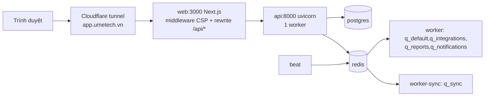
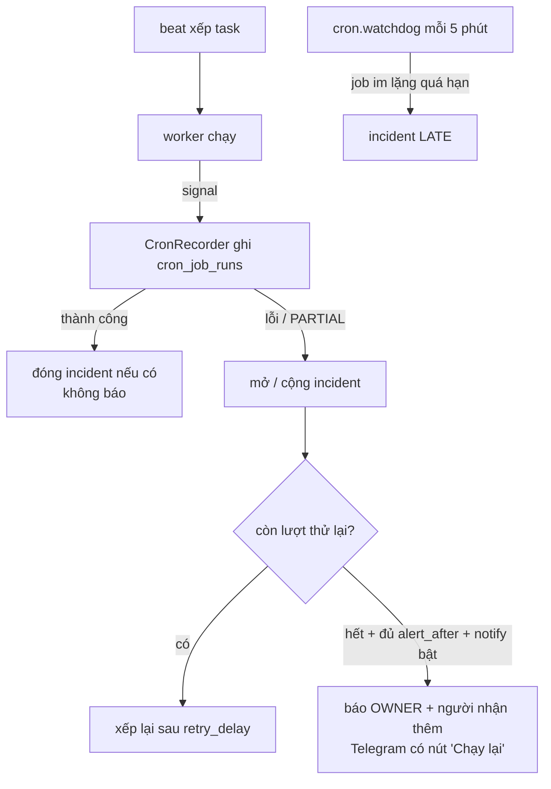

# Nền tảng dùng chung

> Những quy ước và hạ tầng mọi module dựa vào: giao diện thương hiệu Apexmed, định dạng ngày giờ, ô chọn có tìm kiếm, menu (nav + ghim), các tab Quản trị, chịu tải (một tiến trình API, hàng đợi, giới hạn bộ nhớ, sao lưu, đo hiệu năng), theo dõi tác vụ định kỳ, mạng production, deploy, và những test đọc mã nguồn. Ai sửa bất kỳ màn hình hay service nào cũng nên đọc qua.

Bối cảnh: `docs/ops/SCALING_PLAN.md` (chịu tải), `docs/ops/CRON_MONITOR_PLAN.md` (tác vụ định kỳ). Code là chuẩn. Phân quyền và bộ nhớ đệm theo request: [org.md](org.md).

## Khái niệm & thuật ngữ

- **APM Management**: tên sản phẩm trên màn hình. Package Python vẫn là `meobot`; bot Telegram và trang `/terms`, `/privacy` cố ý vẫn ghi TasksBot (phục vụ duyệt ứng dụng TikTok / Meta).
- **Token màu (design token)**: biến CSS `--accent`, `--surface`, `--yellow`… định nghĩa trong `frontend/src/app/globals.css` cho sáng / tối.
- **Nhánh menu (nav branch / `NavGroup`)**: một mục menu có mục con, có `key` cố định (`performance`, `hr`, `finance`, `cskh`, `orders`, `ads`, `pr`, `resources`, `library`).
- **Ghim (pin)**: người dùng đưa một nhánh menu lên nhóm "Đã ghim" ở đầu.
- **Job**: một tác vụ Celery chạy theo lịch (beat) hoặc một tác vụ chạy trên host (sao lưu DB). **Incident**: chuỗi lần chạy lỗi liên tiếp của một job.
- **Job thường xuyên (frequent)**: chạy ít nhất mỗi giờ (`FREQUENT_SECONDS` 3600).
- **Hàng đợi (queue)**: `q_default`, `q_integrations`, `q_reports`, `q_notifications`, `q_sync`.
- **p95**: 95% yêu cầu xong trong khoảng thời gian này. **Giờ cao điểm** = 8:00-18:00 giờ Việt Nam (`PEAK_HOURS_VN`).

## Luồng chính

### Một request từ Internet tới API (production)

### Theo dõi một job định kỳ

## Quy tắc hiện hành

### Giao diện thương hiệu

1. Trước khi làm bất kỳ màn hình nào: nạp skill dự án `.claude/skills/apexmed-ui` (quy tắc + công thức). Thương hiệu: tên **APM Management**, dòng phụ `PRODUCT_SUBTITLE` = "Quản trị vận hành" (`frontend/src/components/logo.tsx`); trang đăng nhập ghi "Hệ thống quản trị nội bộ Apexmed". Logo: chữ "A" Apexmed + chữ thập (`components/logo.tsx`, `app/icon.svg`, `app/apple-icon.png`). Màu luồng: PR = xanh thương hiệu, ORD = magenta.
2. Màu chỉ dùng qua token trong `globals.css` (sáng + tối) và lớp thương hiệu `@layer`: gradient cho `bg-[var(--accent)]`, bóng thẻ, `.brand-rail` (thanh bên navy), `.brand-topbar`, `.brand-eyebrow`. Token thêm gần đây: `--yellow` / `--yellow-ink` / `--yellow-soft`, `--purple` / `--teal` (+ `-soft`).
3. Font **tự host**: `frontend/src/app/fonts.ts` dùng `next/font/local` với các tệp `frontend/src/fonts/*.woff2` (Exo 2 cho tiêu đề, Be Vietnam Pro cho chữ thường, Jura cho nhãn; Exo 2 và Jura là font biến thiên; đã cắt còn Latin + tiếng Việt; giấy phép OFL nằm cạnh). Lý do: build production từng hỏng khi Google Fonts trả lỗi. Vitest thay `next/font/local` và `next/font/google` bằng `frontend/tests/next-font-stub.ts` (`vitest.config.ts`). Đừng đặt font trong `src/app/`: `shell-layouts.test.ts` coi mọi thư mục ở đó là một route.
4. Điện thoại: dưới breakpoint `lg` thanh bên là ngăn kéo (`#app-sidebar`, nút ☰ "Menu" góc trên trái; đóng khi đổi trang / Esc / bấm nền; khoá cuộn body; nhánh hiện tại mở sẵn). Trên desktop các nhánh bắt đầu gập. `.sr-only { left: 0 }` trong `globals.css` để chữ dành cho trình đọc màn hình không kéo rộng trang. Lưới có thể chứa nội dung rộng cần `grid-cols-[minmax(0,1fr)]` dưới breakpoint của nó. Mọi trang phải vừa 360 / 390 / 768 px, không cuộn ngang.
5. Kiểm tra bằng mắt: `docker compose build web && docker compose up -d web`, rồi `.claude/skills/apexmed-ui/scripts/shoot.sh OUT /đường-dẫn…` (chụp PNG sáng + tối; tài khoản thử của `scripts/seed_test_logins.py`). `next dev` không hydrate được dưới CSP nghiêm, nên phải dùng image build. Playwright MCP được ghim trong `.mcp.json`.

### Ngày giờ

6. Một định dạng duy nhất: **`dd/mm/yyyy HH:mm`**, 24 giờ, giờ Việt Nam (`Asia/Ho_Chi_Minh`). Frontend dùng `frontend/src/lib/datetime.ts`: `formatDateTime`, `formatDate` (Intl `en-GB`, `hourCycle h23`; chuỗi trần `YYYY-MM-DD` giữ nguyên ngày đó). Các hàm `formatWhen`, `formatDay`, `formatShortDay`, `formatDeadline`, `formatResourceWhen/Day` đều gọi về đây. **Không** dùng `toLocaleString("vi-VN")` cho ngày (nó đặt giờ trước ngày).
7. Ô trên bảng order bỏ năm: `formatShortDateTime` (`dd/mm HH:mm`) / `formatShortDate` (`dd/mm`); ngày đầy đủ nằm trong `title`.
8. Backend: mọi thời điểm người dùng đọc thấy (tin bot, HR, nhắc việc, ghi chú lịch sử order…) dùng `%d/%m/%Y %H:%M`. Mẫu *phân tích* (nhập Excel, chuẩn hoá sheet) và câu lặp ("08:00 mỗi ngày") không đổi.
9. **Không dùng ô ngày native.** Mọi ô ngày / ngày-giờ là `frontend/src/components/date-input.tsx` `DateInput` / `DateTimeInput`: gõ `dd/mm/yyyy [HH:mm]` (tự chèn dấu), gõ dở = không gửi gì, rời ô thì trả lại giá trị đúng cuối cùng, dán `YYYY-MM-DD[THH:mm]` cũng nhận. Nút lịch mở `DatePopover` riêng (portal, `position: fixed`, tự lật lên trên khi thiếu chỗ, tuần bắt đầu thứ Hai, chọn giờ/phút 24h, giờ nhanh 08:00 / 12:00 / 17:30 / 23:59, "Hôm nay" / "Xoá" (không có khi `required`) / "Xong"; Esc bắt ở pha capture của `document` để Modal bao ngoài không đóng; `z-[120]` trên Modal `z-[100]`). Giá trị vào/ra vẫn là dạng native `YYYY-MM-DD` / `YYYY-MM-DDTHH:mm`; `onChange` nhận `{target: {value}}`. Test gõ vào ô này phải gõ `dd/mm/yyyy HH:mm` và so `toHaveValue` theo dạng đó.

### Ô chọn có tìm kiếm

10. `Select` dùng chung (`frontend/src/components/pr.tsx`) chuyển sang `components/searchable-select.tsx` `SearchableSelect` khi có từ `SEARCH_THRESHOLD` (8) lựa chọn trở lên (không áp dụng cho `multiple` / `size`). `<select>` native vẫn ở trong trang (ẩn bằng mắt, `data-searchable`; giữ label, value, `onChange`, focus bàn phím, nên `selectOptions` trong test vẫn chạy). Một nút mặt chỉ cho chuột (`data-select-trigger`, `aria-hidden`, chữ vẽ bằng CSS `attr(data-label)` để không lặp chữ) mở panel portal (`z-[120]`, `data-select-panel`) có ô "Gõ để tìm…" (bỏ dấu, không phân biệt hoa thường, đ → d). Enter / Space / ↓ / một chữ cái trên select mở panel; ↑ ↓ Enter Esc bên trong; chọn thì đặt giá trị native và phát sự kiện `change` thật. `<select>` thô (ô phạm vi quyền, số dòng mỗi trang, giờ/phút) không đổi.

### Menu

11. `frontend/src/components/shell.tsx:navFor(me, sessionRole)` trả danh sách phẳng theo thứ tự: Dashboard, Hiệu suất, Bảng order (+ Effort), Phòng Ads, Phòng PR, Nhân sự, Tài chính, Đội agent, Chăm sóc khách hàng, Phòng Tài nguyên, Thư viện, Quản trị (cuối). Mỗi nhánh chỉ hiện khi `/api/units/me` cho phép (ví dụ "Bảng order" khi có ghế/quyền ORD hoặc xem tất cả; "Đội agent" khi `agents.chat`).
12. `arrangeNav(nav, pins)` vẽ menu: "Bảng order" (+ Effort), "Phòng Ads", "Phòng PR" gom dưới thư mục **"Phòng Marketing"** (key `media`) tại chỗ nhánh đầu tiên trong số đó, **chỉ khi** người dùng có từ 2 nhánh trở lên (một nhánh thì đứng riêng). Các nhánh đã ghim đứng đầu theo thứ tự ghim trong nhóm "Đã ghim" (`role="group"`), ra khỏi "Phòng Marketing" và **luôn mở** (tiêu đề thường, không nút gập). Ghim `media` thì cả thư mục lên và mở. Ghim một nhánh người dùng không thấy thì bỏ qua.
13. Nút ghim trên mỗi tiêu đề ("Ghim X" / "Bỏ ghim X", `aria-pressed`): trên `lg` hiện khi hover/focus, trong ngăn kéo điện thoại luôn hiện, ẩn khi thanh bên thu về chỉ còn icon.
14. Ghim lưu **phía server**, của riêng mỗi người: `system_settings` khoá `nav_pins:<user id>`, giá trị `{"pins": [...]}` (`src/meobot/application/account/nav_pins.py`). Key khớp `^[a-z][a-z0-9_-]{0,31}$`, tối đa `MAX_PINS` 20, bỏ trùng; sai → 422 `nav_pins_invalid`. Đọc trong `/api/units/me` `nav_pins`; ghi `PUT /api/account/nav-pins {pins}` (`api.setNavPins`). Shell cập nhật cache units/me ngay và trả lại nếu lỗi; không dùng `useMutation`, không hỏi xác nhận.
15. Nhãn menu xuống dòng từ `lg` (`lg:whitespace-normal`) để không tràn thanh bên. Badge (ví dụ "Đề xuất tài nguyên", "Duyệt hồ sơ") là `NavItem.badge`; shell tải lại units/me mỗi 60 s.

### Quản trị

16. Một mục menu "Quản trị" `/admin` (chuyển tới tab đầu tiên được phép). Tab (`frontend/src/components/admin-tabs.tsx:ADMIN_TABS`, `adminTabsFor`), theo thứ tự:

| Tab | Đường | Ai thấy |
|---|---|---|
| Phòng ban | `/admin/departments` | OWNER / ADMIN |
| Quản lý tài khoản | `/admin/accounts` | OWNER / ADMIN, hoặc người làm trưởng ít nhất một phòng |
| Tài khoản CRM | `/admin/crm` | `ads.edit_revenue` |
| Thiết lập ORD | `/admin/settings` | `can_admin` có `ADS` |
| Kết nối AI | `/admin/ai` | OWNER |
| Đội agent | `/admin/agents` | `agents.manage` |
| Hiệu năng | `/admin/performance` | OWNER / ADMIN |
| Tác vụ định kỳ | `/admin/cron` | OWNER / ADMIN |
| Đang phát triển | `/admin/developing` | OWNER |

Đường cũ chuyển hướng: `/admin/units` → `/admin/accounts`, `/admin/ads` → `/ads/connections`, `/ads/jobs` → `/admin/cron`, `/ads/crm` → `/admin/crm`. Chi tiết từng tab: [org.md](org.md), [account.md](account.md), [ads.md](ads.md), [ord.md](ord.md), [assistant.md](assistant.md), [agents.md](agents.md), [finance.md](finance.md).

### Chịu tải

17. **API là MỘT tiến trình** (`uvicorn --workers 1` trong `docker-compose.yml`). Nhiều thứ dựa vào điều này: đăng ký câu trả lời agent và phòng họp ([agents.md](agents.md)), cache kịch bản đã duyệt ([ord.md](ord.md)), bộ đếm hiệu năng. Việc tốn CPU trong một `async def` làm chậm **mọi** request khác.
18. Đọc / dựng workbook phải qua `asyncio.to_thread`. Test `tests/unit/test_event_loop_guard.py` đọc mã nguồn: không `async def` nào trong `src/meobot` được **gọi trực tiếp** các hàm trong tập `HEAVY` (`Workbook`, `load_workbook`, `read_workbook`, `parse_workbook`, `export_rows`, `template_workbook`, `report_workbook`, `table_from_xlsx`, `read_upload`, `_profiles_workbook`, `_read_sheets`). Viết hàm nặng mới thì thêm tên vào `HEAVY`.
19. Hàng đợi (`src/meobot/tasks/celery_app.py:task_routes`): `ads.*` → `q_sync`, chỉ service **`worker-sync`** đọc (2 slot, tên node `sync@%h`), để đồng bộ Meta / CRM kéo dài nhiều phút không chiếm chỗ. Service `worker` (3 slot, `worker@%h`) đọc `q_default,q_integrations,q_reports,q_notifications`. `cskh.*`, `pr.*`, `sheets.*`, `drive.*` → `q_integrations`; `cron.*`, `finance.*`, `system.*` → `q_default`; `notifications.*`, `reminders.*` → `q_notifications`. Mặc định Celery: `task_time_limit` 600 s, `task_soft_time_limit` 540 s, `acks_late`, `prefetch_multiplier` 1. Test: `tests/unit/test_tasks.py::test_long_syncs_have_their_own_queue`.
20. Giới hạn bộ nhớ compose: postgres 1536M, api 1G, worker / worker-sync 768M, web 512M, bot 384M, redis / beat / zalo-bridge 256M, agent-tunnel 64M. Postgres có `command:` riêng: `shared_buffers=384MB`, `effective_cache_size=1GB`, `work_mem=8MB`, `maintenance_work_mem=128MB`, `log_min_duration_statement=500` với `log_parameter_max_length=0` (không ghi giá trị tham số: tên, SĐT…), `shm_size: 256mb`. Đổi các tham số này là khởi động lại PostgreSQL: deploy ngoài giờ (sau 19:00).
21. Sao lưu hằng ngày (chạy trên host, không phải Celery): `deploy/backup/db-backup-daily.sh` (cài thành `/root/bin/db-backup-daily.sh`, cron 02:30 giờ VN): `pg_dump -Fc`, kiểm bằng `pg_restore -l`, giữ 3 bản trên máy, chép lên Google Drive (rclone remote `gdrive`), trên Drive giữ 14 bản ngày + 1 bản mỗi Chủ nhật cho 8 tuần trước đó; không mã hoá. Cuối script báo về "Tác vụ định kỳ": `python -m meobot.application.cron.host_job --key host.db_backup --status ok|failed --started <epoch> --message "..."` (`HOST_JOB_KEYS`). Kiểm tra khôi phục: `deploy/backup/restore-check.sh` (khôi phục vào DB nháp trong container postgres, so vài số đếm, xoá DB nháp).
22. Đo hiệu năng: bảng `perf_stats_hourly` (0103), mỗi (giờ, loại `HTTP`/`QUEUE`, method, tên) giữ count, tổng, max, số chậm (≥ 1 s cho HTTP, ≥ 60 s chờ hàng đợi), lỗi 5xx, số task bị bỏ vì quá `expires` (`dropped`), và histogram 9 cột `b0..b8` theo `BOUNDS` (`src/meobot/domain/ops/perf_stats.py`, `percentile_ms`). Tên HTTP = **template route**, không bao giờ là đường thật hay query. Không lưu ai gọi, gửi gì.
    - Phía API: `RequestContextMiddleware._count` (`api/middleware.py`) ghi vào `PerfCollector` (`app.state.perf_collector`); `PerfFlusher` (chạy trong lifespan) mỗi 60 s cộng dồn vào DB (`save_tallies`) và xoá dữ liệu cũ hơn `KEEP_DAYS` 30 ngày.
    - Phía worker: `tasks/perf_monitor.py` đo thời gian chờ từ header `meobot_sent_at` (đóng dấu bởi `celery_app._stamp_sent_at` ở `before_task_publish`); `task_revoked` vì hết hạn = `dropped`.
    - Tắt bằng `Settings.perf_stats_enabled` (test tắt sẵn).
    - Màn **Quản trị › Hiệu năng** (`/admin/performance`, `GET /api/cron/performance?days=1..30`, OWNER / ADMIN, khác → 403 `perf_forbidden`; `frontend/src/lib/perf.ts:formatMs`). Kết luận "bad" khi p95 giờ cao điểm > 300 ms (`API_P95_LIMIT_MS`) và có ≥ 200 request: nghĩa là nên làm "đợt 2" (nhiều tiến trình API). Chưa đủ số liệu → "none".
23. Route nóng đã tối ưu (test `tests/unit/test_hot_routes.py`): `/api/pr/people` tính `can_manage_permissions` bằng `PrCapabilityService.manages_many` (một lần `load_seats` cho mọi người); `/api/board/counts` dùng `TaskBoardService.totals` (mỗi unit dựng source một lần, `BoardSource.count` không vẽ dòng) và `TaskBoardService.membership` nhớ theo request. Bộ nhớ đệm theo request `application/org/access.request_memo`: xem [org.md](org.md). Chỉ cất giá trị bất biến vào đó.

### Tác vụ định kỳ ("Tác vụ định kỳ", 0077 + 0080)

24. Mỗi task Celery chạy theo beat là một job; lịch đọc thẳng từ `beat_schedule` (`application/cron/schedule.py`), không giữ bản sao. Mỗi lần chạy được tín hiệu Celery ghi lại (`tasks/cron_monitor.py` → `application/cron/recorder.py`), kết quả `SUCCESS` / `PARTIAL` (xong nhưng báo một phần lỗi) / `FAILED`.
25. Chính sách mặc định (`domain/cron/models.py:default_policy`): job chạy thưa hơn mỗi giờ thử lại 2 lần cách 30 phút rồi báo ngay (`alert_after` 1), giữ lịch sử mọi lần thành công; job thường xuyên không tự thử lại, báo sau 5 lần lỗi liên tiếp, không giữ dòng thành công. Job host (`host.db_backup`) không thử lại, báo ở lần lỗi đầu, bật thông báo.
26. Chỉ báo **lỗi**, và chỉ khi job bật `notify` (0080): OWNER luôn nhận, cộng `notify_user_ids` (trống = chỉ OWNER). Một tin mỗi incident mỗi người, qua outbox + hộp thư web (`application/cron/alerts.py`, notification `cron_job_failed`). Tin Telegram của OWNER có nút "Chạy lại" (`application/outbound_keyboards.py:_cron_rerun_markup`). Lần chạy tốt kế tiếp đóng incident **im lặng**. Mặc định 0080: chỉ hai job kéo Meta của Phòng Ads bật, báo cho trưởng phòng ADS; các job khác tắt (incident vẫn hiện trên màn).
27. Job đánh dấu `RUNNING` quá `RUNNING_STALE_SECONDS` (900 s) bị coi là chết. Job chưa chạy sau một chu kỳ + `LATE_GRACE_SECONDS` (5 phút) mở incident `LATE`; `cron.watchdog` kiểm mỗi 5 phút. `cron.purge_runs` mỗi ngày xoá lịch sử (lỗi giữ 90 ngày, thành công của job thường xuyên 24 giờ).
28. Quyền (`application/cron/monitor_service.py`): đọc và "Chạy lại" = OWNER, ADMIN; sửa chính sách / tắt theo dõi / người nhận = OWNER; khác → 403 `cron_forbidden`. "Chạy lại" xếp task y như beat (cùng queue, tham số), gắn `MANUAL` + người bấm; đang chạy → 409 `cron_job_running`; job host → 422 `cron_host_job`; job lạ → 404 `cron_job_not_found`; chính sách sai → 422 `cron_policy_invalid`.

### Mạng production và log

29. Trên VPS production: ufw bật (chặn mọi kết nối vào, chỉ mở cổng SSH). **Cổng Docker publish bỏ qua ufw**, nên mọi `ports:` trong compose phải là `127.0.0.1:…` (web `127.0.0.1:8811`, api `127.0.0.1:8810`, postgres `127.0.0.1:5432`; 9router ở `/root/9router` `127.0.0.1:20128`, mở dashboard bằng `ssh -N -L 20128:127.0.0.1:20128 gtg-prod`). Người dùng chỉ vào qua Cloudflare tunnel `app.umetech.vn` → `http://web:3000`.
30. Log: `RedactingFilter` (`src/meobot/core/logging.py`) che trên **thông điệp đã render** (httpx đặt URL trong `args`), che bí mật trong query URL (`*token`, `key`, `secret`…) và bot token dính sau `/bot`. Test `tests/unit/test_log_redaction.py`.

### Deploy

31. `.github/workflows/deploy.yml`: push `master` → job `deploy-production`; push `dev` → `deploy-dev` (cũng chạy được bằng tay `workflow_dispatch`). Mỗi job SSH vào server (production dùng **khoá SSH**, dev dùng mật khẩu), `script_stop: true` (một dòng lỗi là dừng, code cũ vẫn chạy), rồi trong `/root/gtgtask`:
    1. `git fetch` + `git reset --hard origin/<nhánh>`;
    2. `docker compose --profile web --profile tunnel build`;
    3. `pg_dump -Fc` vào `~/db-backups/before-deploy-<ngày-giờ>.dump`; production giữ 5 bản `before-deploy-*` mới nhất, dev giữ 10 bản `*.dump` mới nhất;
    4. `docker compose ... run --rm api alembic upgrade head` bằng image mới;
    5. `docker compose --profile web --profile tunnel up -d`.
32. **Workflow deploy không chạy test, lint, typecheck nào.** Cổng chất lượng nằm ở `.github/workflows/ci.yml`, chạy trên PR vào `dev`/`master` (3 job: `Docs + migration rules` = `scripts/check_changes.py --docs-only`; `Backend (ruff, mypy, pytest)` với Postgres 17 + Redis 7; `Frontend (tsc, vitest)`). Nó chỉ chặn được khi `master`/`dev` được bảo vệ trên GitHub (bắt buộc PR + 3 check) - push thẳng vẫn deploy không qua CI. Không push khi chưa được giao (quy tắc cứng trong `CLAUDE.md`).
33. Profile `tunnel` trên server bật cả `cloudflared` (cần `CLOUDFLARE_TUNNEL_TOKEN`) và `agent-tunnel` ([agents.md](agents.md)).

### Test đọc mã nguồn

34. Một số test frontend và backend **đọc file nguồn** thay vì chạy code. Chuyển code giữa các file thì phải sửa cả test:
    - `frontend/tests/confirmation.test.tsx` (#173): mọi file có `useMutation` phải import `@/components/confirm` hoặc nằm trong danh sách miễn.
    - `frontend/tests/ux.test.tsx`: danh sách href của menu và nội dung một số file.
    - `frontend/tests/shell-layouts.test.ts`: mọi thư mục trong `src/app/` là một route.
    - `frontend/tests/security.test.ts`: cấm `hasPermission` / `canApprove` / `ROLE_RANK` trong frontend.
    - Mã chi tiết PR đọc qua `readPrContentDetailSource()` trong `frontend/tests/helpers.tsx`.
    - `tests/unit/test_event_loop_guard.py` (quy tắc 18); `tests/unit/test_web_security.py::test_41` (đường HTTP duy nhất phát link đăng nhập là route OWNER, có audit).
35. Lỗi có sẵn: danh sách chính xác ở `.github/known-failures.txt` (mã `<classname> :: <name>` của báo cáo JUnit). `scripts/junit_gate.py` chỉ cho qua đúng các lỗi đó, báo lỗi **mới**, và báo khi một lỗi trong danh sách đã xanh (phải xoá dòng). Gồm `frontend/tests/security.test.ts` #37 (`x-forwarded-proto`), các test menu trong `design-ban`/`design-library`/`token-deadline` và "Hệ số điểm" trong `performance-reports` (đỏ trên master 14/11/2026); backend 12 unit (test quét mã nguồn / so schema, `test_streams::test_03`) và 98 integration (fixture PR dùng vai trò trước 0066, cổng mã task PR, test migration so revision của mình với model hôm nay); 2 test trong `tests/unit/test_provider_compatibility.py` chập chờn khi chạy cả bộ.

### Quy trình thay đổi và rào chắn cho Claude Code

36. `scripts/check_changes.py` là định nghĩa "xong" của một thay đổi: từ file đổi (so với `HEAD`, thêm `--base <ref>` cho commit của nhánh) → module qua `MODULE_MAP` (cùng bảng với `CLAUDE.md`) → ruff + format + mypy + pytest trên test mà doc module liệt kê, test vừa đổi và `ALWAYS_BACKEND_TESTS`; frontend đổi → tsc + toàn bộ vitest; mọi bộ test đi qua `junit_gate.py`. Luật docs: module có code đổi mà `docs/modules/<module>.md` không đổi → FAILED, trừ khi `--docs-ok "<lý do>"` (trên CI: dòng `docs-ok: <lý do>` trong mô tả PR). Migration mới: không trùng số, `CLAUDE.md` phải ghi đúng `Migration head`. Xanh hết → ghi dấu vân tay code vào `.git/apm-check.stamp`.
37. `.claude/settings.json` (commit chung) đặt model `opus` + effort `high` cho Opus 5.5 và hai hook. `.claude/hooks/guard.py` (PreToolUse): ai cũng bị chặn đọc/in `.env`/`secrets/`/`handover/` gốc, `docker compose config` không `--quiet`, in env trong container, `git push`. Máy không có `.claude/owner.local` (dev mới): chặn commit trên `master`/`dev`/`main`; hỏi người trước khi sửa file trong `RED_ZONES` và trước lệnh trong `ASK_COMMANDS` (`ssh`, `rm -rf`, `reset --hard`, `alembic downgrade`, xoá volume…); nhắc khi sửa test có sẵn. `.claude/hooks/stop_check.py` (Stop): dev mới không kết thúc lượt được khi code đổi chưa khớp dấu vân tay; chỉ chặn một lần mỗi lượt (`stop_hook_active`).
38. Skill `.claude/skills/apm-change` là quy trình model phải theo (đọc doc → phân loại Xanh/Vàng/Đỏ, dừng xin duyệt → hỏi thay vì đoán → test trước → docs → `check_changes.py` → agent `.claude/agents/apm-reviewer.md` → báo cáo theo mẫu). Hướng dẫn cho người: `CONTRIBUTING.md`. `owner.local` chỉ là dấu hiệu, không phải bảo mật: việc chặn thật nằm ở branch protection trên GitHub.

## Phân quyền

| Màn / API | Ai |
|---|---|
| Ghim menu | Mỗi người, của riêng mình |
| Hiệu năng (`/api/cron/performance`) | OWNER, ADMIN |
| Tác vụ định kỳ: đọc, chạy lại | OWNER, ADMIN |
| Tác vụ định kỳ: sửa chính sách, người nhận | OWNER |
| Tab Quản trị | Xem bảng ở quy tắc 16 |

## Dữ liệu

| Bảng | Migration | Nội dung |
|---|---|---|
| `cron_jobs` | 0077 (+ `notify`, `notify_user_ids` ở 0080) | Một dòng mỗi job: bật theo dõi, chính sách (`retries`, `retry_delay_seconds`, `alert_after`, `keep_successes`), tóm tắt lần chạy cuối. |
| `cron_job_runs` | 0077 | Lịch sử lần chạy (trạng thái, người kích hoạt `SCHEDULE` / `RETRY` / `MANUAL`, lần thử, lỗi). |
| `cron_job_incidents` | 0077 | Chuỗi lỗi: loại `FAILED` / `LATE`, số lần, lỗi cuối, đã báo lúc nào. |
| `perf_stats_hourly` | 0103 | Số liệu hiệu năng theo giờ (quy tắc 22). |
| `system_settings` khoá `nav_pins:<user id>` | — | Ghim menu. |

Model ORM: `db/models/cron.py`, `db/models/perf_stat.py`.

## Code ở đâu

| Việc | File |
|---|---|
| Logo, tên sản phẩm | `frontend/src/components/logo.tsx` |
| Token, lớp thương hiệu, `.sr-only` | `frontend/src/app/globals.css` |
| Font | `frontend/src/app/fonts.ts`, `frontend/src/fonts/` |
| Ngày giờ | `frontend/src/lib/datetime.ts`, `frontend/src/components/date-input.tsx` |
| Ô chọn tìm kiếm | `frontend/src/components/searchable-select.tsx`, `Select` trong `components/pr.tsx` |
| Menu, ngăn kéo điện thoại, ghim | `frontend/src/components/shell.tsx` (`navFor`, `arrangeNav`, `MEDIA_KEY`); `src/meobot/application/account/nav_pins.py`; route `api/routers/account.py` (`/nav-pins`), đọc ở `api/routers/units.py` |
| Tab Quản trị | `frontend/src/components/admin-tabs.tsx`, `frontend/src/app/admin/` |
| Tác vụ định kỳ | `src/meobot/domain/cron/` (`models.py`, `catalog.py` nhãn/nhóm job), `src/meobot/application/cron/` (`recorder.py`, `monitor_service.py`, `alerts.py`, `schedule.py`, `host_job.py`), `src/meobot/tasks/cron_monitor.py`, `src/meobot/api/routers/cron.py`, `frontend/src/app/admin/cron/page.tsx` |
| Hiệu năng | `src/meobot/domain/ops/perf_stats.py`, `src/meobot/application/ops/perf_stats.py`, `src/meobot/tasks/perf_monitor.py`, `src/meobot/api/middleware.py`, `frontend/src/app/admin/performance/page.tsx`, `frontend/src/lib/perf.ts` |
| Queue, beat | `src/meobot/tasks/celery_app.py` |
| Compose, deploy, backup | `docker-compose.yml`, `.github/workflows/deploy.yml`, `deploy/backup/` |
| Test | `frontend/tests/datetime.test.ts`, `date-input.test.tsx`, `searchable-select.test.tsx`, `nav-pins.test.tsx`, `cron-monitor.test.tsx`, `perf-report.test.tsx`, `theme-toggle.test.tsx`; `tests/unit/test_nav_pins.py`, `test_cron_monitor.py` (`test_13/14` cho job host), `test_perf_stats.py`, `test_event_loop_guard.py`, `test_hot_routes.py`, `test_tasks.py`, `test_log_redaction.py`; `tests/integration/test_cron_monitor_migration.py`, `test_cron_notify_migration.py`, `test_perf_stats_migration.py` |

## API

| Method | Đường | Ai | Ghi chú |
|---|---|---|---|
| PUT | `/api/account/nav-pins` | mình | `{pins}`; 422 `nav_pins_invalid`. |
| GET | `/api/cron` | OWNER / ADMIN | Tổng quan mọi job. |
| GET | `/api/cron/jobs/{key}` | OWNER / ADMIN | Lịch sử + incident của một job. |
| POST | `/api/cron/jobs/{key}/run` | OWNER / ADMIN | "Chạy lại" (202, `task_id`). |
| PATCH | `/api/cron/jobs/{key}` | OWNER | `{enabled, retries (0-5), retry_delay_minutes (1-720), alert_after (1-100), keep_successes, notify, notify_user_ids}`, gửi khoá nào sửa khoá đó. |
| GET | `/api/cron/performance?days=` | OWNER / ADMIN | 1-30 ngày. |

## Cạm bẫy & chưa làm

- Đừng tăng `--workers` của API trước khi chuyển các trạng thái trong tiến trình (agent, phòng họp, cache kịch bản, bộ đếm hiệu năng) ra ngoài ("đợt 2" của `SCALING_PLAN.md`).
- Thêm biến môi trường mới: thêm vào **cả** `core/config.py`, `.env.example` **và** anchor `x-app-env` trong `docker-compose.yml`; thiếu anchor thì container im lặng dùng mặc định.
- Thêm cổng publish mới: luôn `127.0.0.1:`.
- Thêm task Celery dài: cho vào `q_sync` hoặc đặt `expires`; job mới tự hiện trên "Tác vụ định kỳ" khi beat có lịch.
- Script sao lưu trên production cần người dùng đồng ý trước khi cài / đổi.
- Dev giữ 10 bản dump **bất kỳ** trong `~/db-backups/` (mẫu `*.dump`), nên bản sao lưu làm tay ở đó cũng có thể bị xoá; production chỉ xoá `before-deploy-*`.

## Mốc thay đổi

- 2026-10-17: Giao diện thương hiệu Apexmed, đổi tên APM Management.
- 2026-10-21: Một định dạng ngày giờ; `DateInput` thay ô ngày native; bảng order bỏ năm.
- 2026-10-22: Ô chọn có tìm kiếm.
- 2026-10-27 (0077): Tác vụ định kỳ. 2026-10-28 (0080): thông báo theo từng job, chỉ báo lỗi.
- 2026-11-10: Production deploy bằng khoá SSH.
- 2026-11-11 (0103): Chịu tải đợt 1 (thread offload, `worker-sync`, giới hạn bộ nhớ, sao lưu ngày, đo hiệu năng); font tự host; bố cục điện thoại; dòng phụ "Quản trị vận hành".
- 2026-11-12: Tối ưu route nóng, `request_memo`; "Phòng Marketing" (trước là "Phòng Media") + ghim menu.
- 2026-11-13: "Tác vụ định kỳ" quay lại Quản trị; "Tài khoản CRM" thành tab Quản trị.
- 2026-11-14: Quy trình cho dev mới: CI trên PR (`ci.yml`), `check_changes.py` + `junit_gate.py` + `known-failures.txt`, hook Claude Code (`guard.py`, `stop_check.py`), skill `apm-change`, agent `apm-reviewer`, `CONTRIBUTING.md`.
