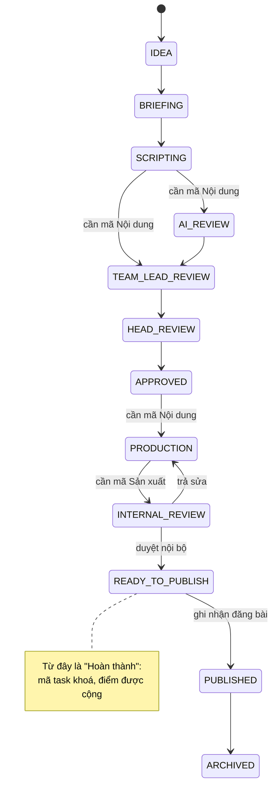
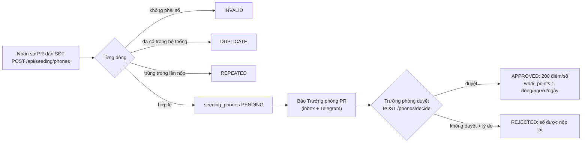

# Phòng PR (Luồng PR)

> Phòng PR làm nội dung truyền thông (bài, video) cho thương hiệu: lên ý tưởng, viết kịch bản, duyệt, sản xuất, đăng bài. Trên giao diện là nhánh menu **"Phòng PR"** (nằm trong thư mục "Phòng Marketing"), các task PR còn hiện trên bảng task chung `/tasks?unit=PR` và trang chi tiết `/tasks/<mã>`.

> **Luồng PR đã đóng băng.** Không được đổi hành vi backend của PR hay các route PR (`/api/pr/*`). Mọi tính năng mới (điểm PR, seeding, cổng mã task…) đều nằm **bên cạnh** luồng PR: chỉ đọc giai đoạn của bài, hoặc móc vào một chỗ duy nhất (`PrContentWorkflowService.apply`). Muốn đổi luồng PR thì phải hỏi chủ dự án trước.

Lõi cũ của PR (máy trạng thái nội dung, AI review, 3 cổng duyệt, sản xuất, đăng bài, undo, sổ công việc Work, KPI M2, hiệu suất M6) đã được mô tả kỹ trong tài liệu bàn giao, ở đây không lặp lại:

- [../handover/04_CONTENT_WORKFLOW.md](../handover/04_CONTENT_WORKFLOW.md) — 14 stage, các trigger, ma trận chuyển trạng thái, AI review, sản xuất, đăng bài, xoá, undo, thông báo.
- [../handover/05_WORK_KPI_PERFORMANCE.md](../handover/05_WORK_KPI_PERFORMANCE.md) — sổ công việc (Work ledger), KPI M2, hiệu suất M6 cũ của PR (`/api/pr/performance`), kỳ báo cáo.
- [../handover/06_PERMISSIONS_AND_SECURITY.md](../handover/06_PERMISSIONS_AND_SECURITY.md) — capability PR và grant có phạm vi.

Tài liệu này chỉ nói những gì được thêm **sau** lõi đó. Điểm hiệu suất của PR và seeding được tính ở [performance.md](performance.md); ở đây chỉ nói phần dính tới luồng PR.

## Khái niệm & thuật ngữ

- **Luồng (stream)**: đơn vị kỹ thuật `UnitCode.PR` ("Luồng PR", chip `PR`). Người có "tag" PR (một dòng `org_unit_members` của unit PR) mới thấy các route PR. Tag **không gõ tay**: nó được suy ra từ ghế phòng ban (`sync_stream_tags`, xem [org.md](org.md)).
- **Phòng PR / nhân sự PR**: người có ghế mở (`department_members.left_at IS NULL`) trong một phòng ban đang hoạt động có `function = PR`. Hàm `application/org/seats.py:function_staff(session, DepartmentFunction.PR)`. Khác với "có tag PR": ghế Ban Giám đốc (`BOARD`) cũng sinh tag PR nhưng **không** phải nhân sự PR.
- **Trưởng phòng PR**: người có ghế `HEAD` trong một phòng PR. Role hệ thống `TEAM_LEAD` hiển thị là "Trưởng phòng" (`domain/identity/labels.py`). Đừng nhầm với tên các cổng duyệt "Duyệt Trưởng nhóm" (`TEAM_LEAD_REVIEW`) và "Duyệt Trưởng phòng" (`HEAD_REVIEW`) — đó là cổng của luồng, không phải chức danh.
- **Capability PR**: quyền chi tiết của PR (`PrCapability` trong `domain/pr/policy.py`, 21 giá trị). 18 cái lấy từ grant phòng ban / grant cá nhân; 3 cổng duyệt (`PR_TEAM_LEAD_REVIEW`, `PR_HEAD_REVIEW`, `PR_INTERNAL_REVIEW` = `GRANT_BACKED`) vẫn cấp riêng từng người, có phạm vi, trong `pr_user_capabilities`.
- **Mã task PR / phiếu điểm (claim)**: danh sách mã task công việc (N…, T…, D… — cùng danh mục với ORD) mà một người khai cho một pha của một bài PR. Bảng `pr_point_claims`. Hai pha: **Nội dung** (`CONTENT`, mã Biên kịch N…) và **Sản xuất** (`PRODUCTION`, mã Design T… và/hoặc Dựng D…).
- **Hoàn thành (done)**: bài ở `READY_TO_PUBLISH`, `PUBLISHED`, `MEASURED` hoặc `ARCHIVED` (`PR_DONE_STAGES` trong `domain/performance/work_points.py`). Trên bảng task đây là ô "Hoàn thành".
- **Seeding**: nhóm trong phòng PR đi "gieo" số điện thoại khách. Menu "Báo cáo công việc/Seeding" (`/seeding`).
- **KPI seeding**: một con số SĐT cho cả nhóm, theo tuần (thứ Hai - Chủ nhật) và theo tháng.

## Luồng chính

Luồng nội dung PR (rút gọn; bảng đầy đủ ở [04_CONTENT_WORKFLOW.md](../handover/04_CONTENT_WORKFLOW.md) §4-5). Các mũi tên có ghi "cần mã" là chỗ cổng mã task chặn khi bật `pr_task_codes_required`.

Seeding: nộp SĐT / việc khác và duyệt.

## Quy tắc nghiệp vụ hiện hành

### Ai vào được PR

1. **Route PR chỉ mở cho người có tag PR hoặc OWNER/ADMIN.** Mọi router PR (`pr`, `pr_work_quota`, `pr_content_work`, `pr_work_recurring`, `pr_work_maintenance`, `pr_work`, `pr_performance`, `pr_members`) được gắn `Depends(require_unit(UnitCode.PR))` lúc include (`api/main.py`, biến `pr_gate`). Người ngoài nhận **404** `unit_not_found` (details `reason: unit_not_visible`), không phải 403, để không lộ là có gì bên trong (`api/deps.py:require_unit`). Route OAuth callback của kênh (`pr.oauth_callback_router`) không bị gác vì đến bằng redirect không có phiên.
2. **Tài khoản chưa có tag thì không có luồng nào** (`entries=()`, `/api/units/me` `units=[]` + `is_untagged`), route PR trả 404. OWNER và ADMIN thấy mọi luồng (`UnitMembership.sees_all`).
3. **Tool Telegram của PR** cũng bị gác cùng câu như web: `tools/unit_gate.py` bọc handler, hỏi `UnitDirectoryService.require(actor, PR)`.

### Bảng task và người được nêu tên

4. **Dòng PR trên bảng task chung** có ba ô pha `ORDER` / `PRODUCTION` / `DONE`, không có ô duyệt riêng — chi tiết ở [board.md](board.md).
5. **Chỉ nhân sự PR được nêu tên là người đang giữ việc.** `application/board/holders.py:pr_member_ids` = `function_staff(PR)`; `pr_reviewers` và `pr_production_assigners` chỉ nêu những người này. OWNER/ADMIN ngoài phòng PR (hay giám đốc ngồi ghế BOARD) vẫn **làm được** nhưng không bao giờ hiện là "Chờ X …".
6. **Mọi ô chọn người của PR chỉ đưa nhân sự PR.** Backend: `/api/pr/people` trả mọi người (để hiện tên) kèm cờ `pr_staff`; ô "Giao sản xuất" trên trang task (`application/tasks/detail_service.py:_pr_producers`) = nhân sự PR có `PR_PRODUCTION_EXECUTE`. Frontend: `prStaff(people, keep)` trong `frontend/src/lib/api.ts` lọc theo `pr_staff` nhưng giữ lại người đã được chọn từ trước (`keep`); dữ liệu thiếu cờ `pr_staff` thì giữ. Dùng ở: người phụ trách khi tạo bài, producer (dialog trên bảng + trang bài), người nhận task PR, người phụ trách kênh, bộ lọc/chủ thể/người nhận của sổ công việc, việc định kỳ, kế hoạch KPI, bảo trì, grant. Kiểm tra hợp lệ khi giao việc ở backend **không đổi**.

### Duyệt hàng loạt "Duyệt task"

7. Trên `/tasks?unit=PR`, Trưởng phòng PR (ghế HEAD trong phòng `function = PR`) hoặc OWNER/ADMIN thấy ô tích ở mỗi dòng + "Chọn tất cả trên trang" (`selecting` trong `frontend/src/app/tasks/page.tsx`, thanh `components/task-bulk-bar.tsx`). Nút "Duyệt task" gửi **một** `POST /api/pr/reviews/bulk-approve` cho mỗi cổng (`TEAM_LEAD_REVIEW` / `HEAD_REVIEW` / `INTERNAL_REVIEW`) với các dòng đã tích đang đứng ở cổng đó; dòng ở chỗ khác bị bỏ qua. Đổi URL là bỏ chọn. Backend (`PrBulkApprovalService`) vẫn kiểm tra quyền + grant có phạm vi cho từng bài, all-or-nothing trong một cổng.

### "Giao sản xuất" trên bảng PR

8. Trên `/pr/content`, thẻ bài ở `APPROVED` / `PRODUCTION` có nút "Giao sản xuất" (`ContentCard onAssign`, `BoardLane assignFor`) cho người có `PR_PRODUCTION_ASSIGN` (đọc từ `GET /api/pr/members/{me}/effective-permissions`). Nút mở `components/assign-producer-dialog.tsx` (xác nhận `assignProducerConfirmation`, gọi `POST /api/pr/contents/{id}/producer`). Dialog để ở file riêng vì test `content-views.test.tsx` cấm `producer_user_id` trong `app/pr/content/page.tsx`.

### Cổng mã task PR

9. **Bài không được rời một pha khi pha đó chưa có mã task.** `application/performance/pr_code_gate.py:stage_needed`:
   - IDEA / BRIEFING / SCRIPTING → một cổng duyệt (AI_REVIEW, TEAM_LEAD_REVIEW, HEAD_REVIEW, APPROVED) cần mã **Nội dung**;
   - APPROVED → PRODUCTION cần mã **Nội dung**;
   - PRODUCTION → INTERNAL_REVIEW cần mã **Sản xuất**.

   "Có mã" = có ít nhất một phiếu (`pr_point_claims`) của pha đó, của bất kỳ ai, trạng thái nào cũng được. Kiểm tra ở `PrContentWorkflowService.apply` (`application/pr_workflow_service.py`) cho **mọi trigger trừ UNDO** — một chỗ duy nhất nên web, Telegram, duyệt hàng loạt đều bị chặn. Lỗi **422 `pr_task_codes_required`** (`details.stage` = `CONTENT` / `PRODUCTION`).
10. Trang task hiện nút bị làm mờ thay vì để người dùng bấm rồi lỗi: `TaskActionView.blocked` (cho `TRANSITION`, `START_PRODUCTION`, `SUBMIT_PRODUCTION`) = câu giải thích từ `missing_codes` (`application/tasks/detail_service.py:_codes_missing`); frontend vẽ nút disabled + ghi chú `data-testid="action-blocked"`.
11. **Công tắc** `UnitSettings.pr_task_codes_required` (mặc định **bật**), chỉ đọc từ settings của unit PR (`codes_required`). Database không có unit PR thì không hỏi gì. Thế giới test (`tests/unit/streams.py:ensure_units`) tạo unit PR với công tắc **tắt**.

### Mã task PR (điểm PR) — phần dính tới luồng

12. Không ai duyệt mã task PR. Mỗi người tự nhập mã của mình; Trưởng phòng PR / OWNER / ADMIN xem lại và sửa/xoá của người khác. Mã khoá và điểm được cộng khi bài **hoàn thành** (`settle_claims`, gọi trong `apply` khi bài đi qua ranh giới done). Quy tắc chi tiết (ai sửa được ở stage nào, lỗi, điểm) ở [performance.md](performance.md) §"Điểm PR".
13. Panel "Điểm hiệu suất (PR)" trên trang task PR: `components/pr-points-panel.tsx` `PrPointsPanel` (hai thẻ "Mã task Nội dung" / "Mã task Sản xuất"; pill "Cần chọn trước khi chuyển pha" khi người xem chưa có phiếu).

### Thành viên & phân quyền PR

14. **Màn "Thành viên & Phân quyền (PR)"** (`/pr/permissions`): tab Thành viên / Vai trò & quyền / Quyền duyệt cấp thêm. Không còn tab ORD; link cũ `?team=ads` chuyển sang `/admin/units` (→ `/admin/accounts`).
15. **Tab Thành viên chỉ liệt kê nhân sự phòng PR**: `usePrRoster` trong `frontend/src/app/pr/permissions/members.tsx` giữ các dòng `/api/units/PR/members` có một ghế `function = PR` (dòng không có `departments` — API cũ — thì tính theo tag). Giám đốc ngồi ghế BOARD vẫn thấy màn PR nhưng không nằm trong danh sách. Thẻ người hiện tag PR/ADS và tag "Seeding".
16. **"Thêm thành viên"**: người được tag PR (`can_tag`) có chế độ "Thành viên đã có (ngoài luồng PR)" đưa một tài khoản có sẵn vào PR; "Tài khoản mới" tạo tài khoản qua `POST /api/pr/members` rồi xếp ghế PR (`departments.place(PR, MEMBER)` trong router). Người thêm không có `user.manage` (tức Trưởng phòng PR qua `PR_MEMBERS_MANAGE`) chỉ tạo được **Nhân viên** (`PrMembershipService.assignable_roles`).
17. **"Quyền duyệt cấp thêm"** chỉ đưa người có tag PR; grant của người ngoài PR nằm trong mục gập "Người ngoài luồng PR vẫn còn quyền" (vẫn thu hồi được). Grant/thu hồi cổng duyệt qua `/api/pr/capabilities/grant|revoke`; ai được cấp do `PrCapabilityService.manages` quyết (OWNER mọi người, ADMIN mọi người trừ OWNER, người giữ `MANAGE_PERMISSIONS` trong module PR với phạm vi tương ứng; không bao giờ tự cấp cho mình). Trưởng phòng PR giữ `MANAGE_PERMISSIONS` OWN mặc định.
18. **Xem danh sách**: `PrMembershipService.may_read` = `user.read` theo role (OWNER/ADMIN) hoặc `PR_MEMBERS_VIEW`. **Thêm người**: `may_add` = `user.manage` hoặc `PR_MEMBERS_MANAGE`. Các route `/api/pr/members`, `/api/pr/roles`, `/effective-permissions` gác theo hai hàm này.
19. **Trưởng phòng PR quản lý tài khoản của nhân viên PR**: `may_manage_accounts` (role có `user.status.manage`, hoặc — với người dưới role hệ thống — `PR_MEMBERS_MANAGE`) bật các nút; từng dòng có `can_manage_account` từ `manages_account`: người đích có tag PR, role `EMPLOYEE` hoặc `TEAM_LEAD`, không phải chính mình. Các route `/api/pr/members/{id}/role|deactivate|reactivate|revoke` truyền `authorized_by_module` cho `UserService`; OWNER/ADMIN và chính mình vẫn bị từ chối; đổi role chỉ giữa `EMPLOYEE` và `TEAM_LEAD`.
20. **"Loại khỏi PR" chỉ rời PR**, không khoá tài khoản. `POST /api/pr/members/{id}/revoke`: kiểm tra như mọi thao tác vòng đời (`UserService.check_target`), đóng các ghế trong phòng PR (`departments.unplace(PR, guard_open_work=True)`), tag PR tự rơi theo, audit `pr.member.removed`. Tài khoản vẫn active. Muốn chấm dứt tài khoản thì dùng `/revoke_user` (Telegram) hoặc `/api/access/users/{id}/revoke`; khôi phục là `POST /api/account/members/{id}/restore` (chỉ OWNER, xem [account.md](account.md)). Xem thêm "Cạm bẫy" về `member_has_open_work`.

### Báo cáo công việc / Seeding

21. **Ai thấy gì** (`application/seeding/service.py:seeding_access` → `SeedingAccess`):
    - `manage` = Trưởng phòng PR / OWNER / ADMIN (`reviews_pr`): quản nhóm, đặt KPI, duyệt.
    - `member` = đang ở nhóm seeding (`seeding_members` chưa `removed_at`).
    - `pr_staff` = có ghế trong phòng PR.
    - `sees` (= menu, nộp SĐT, nộp việc khác, xem danh sách **của mình**) = member hoặc manage hoặc pr_staff.
    - `sees_kpi` (tab Tổng quan + "Thành viên Seeding", chỉ đọc với nhóm) = member hoặc manage.
    Không đủ quyền → **403 `seeding_forbidden`**.
22. **Nhóm seeding** do người `manage` quản (`/members` GET/POST/DELETE; `/candidates` = người đang active có ghế phòng PR, chưa trong nhóm). Người trong nhóm đeo tag "Seeding" (`SeedingTag` trong `components/department-tags.tsx`, CSS `.dept-tag[data-kind="seeding"]`) — dữ liệu `seeding` trên `/api/units/{code}/members`, các dòng `/api/account/members` và danh sách người của seeding (`seeding_member_ids`). Tag hiện trên thẻ roster PR, Quản lý tài khoản, Tài khoản › Thành viên, trang seeding.
23. **KPI** (`PUT /api/seeding/targets {kind: WEEK|MONTH, day, target|null}`): một số cho cả nhóm, tuần bắt đầu thứ Hai, tháng bắt đầu ngày 1; `target` 0 – 1.000.000, `null` xoá. Thanh % = số SĐT **đã duyệt** có `submitted_at` (giờ Việt Nam) trong kỳ ÷ KPI. Bảng người: mọi ai có số trong kỳ, kể cả người không trong nhóm.
24. **Nộp SĐT** (`POST /api/seeding/phones {text}`): một số một dòng, tối đa 1.000 dòng. Chuẩn hoá (`domain/seeding/phones.py:normalise_phone`): bỏ khoảng trắng, chấm, gạch, ngoặc; `00` đầu → `+`; `+84` / `84` → `0`; số 9 chữ số bắt đầu 3/5/7/8/9 được thêm lại số 0. **Không kiểm tra định dạng số** (nhận cả số nước ngoài, giữ dạng `+` + chữ số): chỉ `INVALID` khi dòng có ký tự khác chữ số (ngoài `+` đầu) hoặc ngoài 6–15 chữ số. Kết quả từng dòng: `NEW` (vào hàng chờ), `DUPLICATE` (đã có trong hệ thống ở trạng thái khác REJECTED — chặn cả bằng partial unique index `uq_seeding_phones_live`), `REPEATED` (trùng trong lần nộp), `INVALID`. Số bị từ chối được nộp lại.
25. **Việc khác** (`POST /api/seeding/other {description, points}`): mô tả ≤ 2000 ký tự, điểm 1 – 100.000. Người `manage` tự nộp thì **được duyệt ngay**; còn lại chờ duyệt. (SĐT do người `manage` nộp thì vẫn chờ duyệt, chỉ không gửi thông báo.)
26. **Duyệt** (`POST /phones/decide`, `/other/decide` `{ids, approve, note}`): chỉ `manage`; chỉ đụng dòng đang PENDING. **Không duyệt phải có lý do** (`note`), thiếu → **422 `seeding_invalid`** `field: note`; người nộp thấy "Lý do: …" trên dòng của mình. Điểm được ghi vào `work_points` — xem [performance.md](performance.md).
27. **Thông báo cho Trưởng phòng PR** (`application/performance/review_notifications.py:ReviewNotifier.seeding_waiting`): khi một người **không phải** `manage` nộp SĐT hợp lệ hoặc việc khác → sự kiện `SEEDING_REVIEW_REQUESTED`, gửi tới mọi Trưởng phòng PR đang active (nếu không có ai thì gửi OWNER), không gửi cho chính người nộp. Ghi inbox web trước (`target_kind` `seeding` → mở `/seeding?tab=review`), rồi bản Telegram (template `performance.review`) nếu có chat riêng.
28. **Giao diện** `/seeding` (layout riêng): tab Tổng quan (đồng hồ KPI tuần/tháng, đặt KPI cho manage, bảng người), Nộp SĐT (kết quả từng dòng + số của mình), Việc khác, Duyệt (N) (duyệt/không duyệt hàng loạt; bộ lọc "Người gửi" = người có dòng đang chờ kèm số lượng, lọc cả hai danh sách, đổi bộ lọc thì bỏ tích — chỉ ở frontend), Thành viên. `?tab=review` mở tab Duyệt. Trang khởi động từ `GET /api/seeding/access`. Menu "Phòng PR › Báo cáo công việc/Seeding" qua `prBranch(me)` trong `components/shell.tsx` khi `seeding.member || manage || submit`; badge = số đang chờ (chỉ cho manage).

### Cảnh báo của bot

29. **Cảnh báo riêng của bot gửi Trưởng phòng PR**: cảnh báo sức khoẻ nơi nhận ("⚠️ MỘT NƠI NHẬN ĐANG CÓ VẤN ĐỀ" / đã hồi phục — `tasks/destination_health._alert`) và cảnh báo tin không gửi được khi không liên lạc được người khởi tạo (`application/delivery_alert_service.py:_alert_destinations`) đi tới mọi Trưởng phòng PR liên lạc được (`RecipientResolver.pr_heads` / `system_alert_recipients`); không có ai thì về OWNER. Người nhận đầu giữ idempotency key cũ, người sau thêm `:<chat_id>`. Yêu cầu quyền truy cập / quota / HR vẫn gửi OWNER.
30. Trưởng phòng PR có **bot đầy đủ** trên Telegram như OWNER (`application/org/bot_access.py`, `full_bot`); xem [assistant.md](assistant.md) / [platform.md](platform.md).

## Phân quyền

| Ai | Được gì trong PR |
|---|---|
| OWNER, ADMIN | Mọi capability PR (`PrCapabilityService.held`: `access.sees_all`), thấy mọi route PR. Cổng duyệt có phạm vi: OWNER/ADMIN giữ theo role. |
| Ghế `HEAD` phòng PR | Bộ capability của `TEAM_LEAD` cũ + `PR_MEMBERS_VIEW` + `PR_MEMBERS_MANAGE` + `MANAGE_PERMISSIONS` OWN (`domain/org/modules.py:default_pr_grants`). `reviews_pr` = sửa mã task PR của người khác, quản seeding. |
| Ghế `MEMBER` phòng PR | Bộ capability của `EMPLOYEE` cũ. |
| Ghế phòng BOARD (Ban Giám đốc) | Bộ của `EMPLOYEE` cho cả HEAD và MEMBER; có tag PR nhưng **không** là nhân sự PR. |
| Phòng khác | Không có gì trong PR (trừ grant cá nhân). |
| 3 cổng duyệt `GRANT_BACKED` | Không cấp qua phòng ban (`personal_only`); cấp từng người trong `pr_user_capabilities` qua `/api/pr/capabilities/grant`. Dòng cũ có `requires_role_baseline` hỏi `legacy_baseline` (OWNER/ADMIN hoặc Trưởng phòng PR). |

Grant phòng ban/cá nhân của module `PR` chỉnh ở Quản trị › Phòng ban và trang "Quyền" của từng người — xem [org.md](org.md).

## Dữ liệu

| Bảng / cột | Ý nghĩa | Migration |
|---|---|---|
| `pr_content_items`, `pr_content_transition_events`, `pr_approval_events`, `pr_production_submissions`, `pr_publications`, … | Lõi PR | trước 0043, xem [08_DATABASE_AND_MIGRATIONS.md](../handover/08_DATABASE_AND_MIGRATIONS.md) |
| `tasks` | 1-1 với `pr_content_items` (`source_type`), đồng bộ bằng hook `before_flush` — không ghi tay | 0043, xem [board.md](board.md) |
| `org_unit_members` (unit PR) | Tag PR, suy từ ghế | có từ trước; 0048 tag các tài khoản chưa có tag vào PR |
| `department_permissions` module `PR` | Grant capability theo phòng × vị trí | 0066 (0067 thêm `PR_MEMBERS_VIEW/MANAGE` cho HEAD phòng PR) |
| `user_permissions` module `PR` | Grant cá nhân | 0066 |
| `pr_user_capabilities` | 3 cổng duyệt, có phạm vi | lõi cũ |
| `pr_point_claims` | Phiếu mã task PR: `content_id` (CASCADE), `stage` CONTENT/PRODUCTION, `user_id`, `items` JSON theo pha, `points`, `status`; unique (content, stage, user) | 0085 (0090 đổi nghĩa `status`) |
| `seeding_members` | Nhóm seeding; unique `user_id` khi `removed_at IS NULL` | 0085 |
| `seeding_targets` | KPI: `kind` WEEK/MONTH, `period_start`, `target`; unique (kind, period_start) | 0085 |
| `seeding_phones` | SĐT đã nộp: `phone` (số VN: chỉ chữ số, bắt đầu 0; số nước ngoài: `+`/chữ số), `submitted_by_user_id`, `status`, quyết định; unique `phone` khi `status <> 'REJECTED'` | 0085 |
| `seeding_other_reports` | Việc khác: mô tả, `points > 0`, `status`, quyết định | 0085 |
| `org_units.settings` (unit PR) `pr_task_codes_required` | Công tắc cổng mã task | không migration (mặc định true) |

## Code ở đâu

| Lớp | Đường dẫn |
|---|---|
| Domain | `domain/pr/` (models, workflow, policy — `PrCapability`, `GRANT_BACKED`), `domain/performance/work_points.py` (stage, `PR_*_STAGES`), `domain/seeding/{phones,errors}.py`, `domain/org/modules.py` (`default_pr_grants`, `PR_PERSONAL_ONLY`) |
| Application | `application/pr_*.py` (lõi), `pr_workflow_service.py` (`apply`: cổng mã + settle), `pr_membership_service.py`, `pr_capability_service.py`, `application/performance/{pr_code_gate,pr_points,pr_points_settle,publish_points,review_notifications}.py`, `application/seeding/service.py`, `application/board/holders.py` (`pr_member_ids`), `application/org/seats.py` (`function_staff`), `application/org/departments.py` (`place`/`unplace`), `application/recipient_resolver.py` (`pr_heads`) |
| API | `api/routers/pr.py`, `pr_members.py`, `pr_work*.py`, `pr_content_work.py`, `pr_performance.py` (gác PR); `pr_points.py`, `seeding.py` (không gác PR); `api/deps.py:require_unit`; `api/main.py` |
| Telegram | `tools/unit_gate.py`, `tools/pr_*_tools.py` |
| Frontend | `app/pr/*` (content, work, tasks, channels, permissions, reports), `app/seeding/{layout,page}.tsx`, `app/tasks/page.tsx` (bulk), `components/task-bulk-bar.tsx`, `components/assign-producer-dialog.tsx`, `components/pr-points-panel.tsx`, `components/department-tags.tsx` (`SeedingTag`), `components/shell.tsx` (`PR_GROUP`, `prBranch`), `lib/api.ts` (`prStaff`) |
| Test backend | `tests/unit/test_pr_points_seeding.py`, `test_pr_membership_admin.py` (`test_4c/4f/5e/7a`), `test_board.py` (`test_10/10b/10c`), `test_release_hardening.py::TestAlertsReachThePrHead`, `test_unified_permissions.py`, `test_streams.py`, `test_pr_workflow_policy.py`, `tests/unit/streams.py` (`tag_pr`, `ensure_units`, `pr_world`), `tests/integration/test_work_points_migration.py`, `test_pr_points_no_approval_migration.py` |
| Test frontend | `tests/pr-points-seeding.test.tsx`, `pr-board-assign.test.tsx`, `task-table.test.tsx` ("the Trưởng phòng PR ticks rows"), `task-detail.test.tsx` ("greys a move out"), `membership.test.tsx`, `content-views.test.tsx` |

## API

Lõi PR (`/api/pr/contents`, `/transition`, `/reviews`, `/production…`, `/publications`, `/work…`, `/performance`) — xem [04](../handover/04_CONTENT_WORKFLOW.md) / [05](../handover/05_WORK_KPI_PERFORMANCE.md). Phần được nhắc ở đây:

- `POST /api/pr/reviews/bulk-approve` — duyệt nhiều bài ở một cổng, all-or-nothing.
- `POST /api/pr/contents/{id}/producer` — giao/bỏ giao producer.
- `GET /api/pr/people` — mọi người đang active, kèm `pr_staff`.
- `GET /api/pr/members` · `POST /api/pr/members` · `GET /api/pr/members/{id}` — roster, thêm người (tạo tài khoản Nhân viên + ghế PR).
- `POST /api/pr/members/{id}/role|deactivate|reactivate` — vòng đời tài khoản (OWNER/ADMIN hoặc Trưởng phòng PR với nhân viên PR).
- `POST /api/pr/members/{id}/revoke` — "Loại khỏi PR".
- `GET /api/pr/members/{id}/effective-permissions` · `GET /api/pr/members/{id}/responsibilities` · `GET /api/pr/roles` (có `positions`).
- `GET /api/pr/capabilities` · `POST /api/pr/capabilities/grant` · `POST /api/pr/capabilities/revoke` — cổng duyệt có phạm vi.
- `GET /api/units/PR/members` — roster thô (`{"members": [...], "assignable_roles": [...]}`, không có envelope `data`).
- `GET /api/seeding/access` — `member`, `manage`, `submit`, `sees_kpi`, `awaiting`, `awaiting_phones`, `awaiting_other`, `phone_points` (cũng có trong `/api/units/me` `seeding`).
- `GET /api/seeding/overview?day=` — KPI tuần/tháng + số liệu từng người.
- `PUT /api/seeding/targets` — đặt/xoá KPI.
- `GET /api/seeding/members` · `GET /api/seeding/candidates` · `POST /api/seeding/members` · `DELETE /api/seeding/members/{user_id}`.
- `POST /api/seeding/phones` · `GET /api/seeding/phones?status=&mine=` · `POST /api/seeding/phones/decide`.
- `POST /api/seeding/other` · `GET /api/seeding/other?status=&mine=` · `POST /api/seeding/other/decide`.
- Điểm PR `/api/performance/pr/*` — xem [performance.md](performance.md).

Next proxy: `/api/pr/:path*`, `/api/seeding/:path*` (`frontend/next.config.mjs`).

## Cạm bẫy & chưa làm

- **Đừng sửa luồng PR** để thêm tính năng. Móc vào `PrContentWorkflowService.apply` (như cổng mã và `settle_claims`) hoặc hook `after_flush` (như điểm đăng bài) — và chỉ khi thật cần.
- **Tag PR ≠ nhân sự PR.** Muốn "người của phòng PR" thì dùng `function_staff(PR)` / `pr_member_ids`, không dùng `membership.has(PR)`. Ngược lại `PrMembershipService.manages_account` (quyền Trưởng phòng PR trên tài khoản) và `in_pr` của điểm PR lại đọc **tag** PR.
- **`member_has_open_work` khi "Loại khỏi PR"**: docstring và CLAUDE.md nói bị từ chối khi người đó "còn việc PR đang mở", nhưng `sync_stream_tags(guard_open_work=True)` chỉ kiểm tra **việc ORD đang mở** (`holds_open_order_work`) và chỉ khi tag **ADS** bị rơi. Việc PR đang mở không chặn.
- Cổng mã task tính **bất kỳ phiếu nào** của pha (của ai cũng được), không bắt chính người làm có phiếu.
- Cổng mã không áp cho UNDO; bài đang đứng ở pha đã qua sẽ không bị kiểm tra lại.
- Test cũ còn lỗi biết trước: `tests/unit/test_streams.py::test_03` (từ 0067 Trưởng phòng PR được tag vào PR; test vẫn chờ 403).
- `/pr/content` (bảng PR theo stage) vẫn tồn tại, có trong menu là "Quản lý task".
- Số điểm cố định (10đ đăng bài, 200đ/SĐT) là hằng số, chưa cấu hình được.
- Chưa có thông báo Telegram cho mã task PR (đã bỏ cùng việc duyệt). Event `pr_points_review_requested` còn trong enum chỉ để đọc dòng inbox cũ.

## Mốc thay đổi

- Lõi PR (bước 1A–1F, Work M1–M6): xem tài liệu bàn giao 04/05.
- 0043: một bảng `tasks` chung cho PR + ORD.
- 0048 (2026-10-08): tài khoản chưa có tag = không có luồng; route PR trả 404; người cũ được tag PR.
- 0061 (2026-10-14): phòng ban; tag PR suy ra từ ghế.
- 0066 (2026-10-16): phân quyền thống nhất — capability PR theo grant phòng ban; 3 cổng duyệt vẫn cấp riêng.
- 0067 (2026-10-16): `PR_MEMBERS_VIEW/MANAGE` cho Trưởng phòng PR; bot đầy đủ cho Trưởng phòng PR.
- 2026-10-19: `TEAM_LEAD` hiển thị "Trưởng phòng"; Trưởng phòng PR quản tài khoản nhân viên PR; "Duyệt task" hàng loạt; dòng PR trên bảng 3 ô pha; cảnh báo bot gửi Trưởng phòng PR.
- 2026-10-20: nút "Giao sản xuất" trên bảng PR.
- 0085 (2026-10-30): điểm PR (có duyệt), +10 đăng bài, nhóm seeding. Cùng ngày: "Loại khỏi PR" chỉ rời PR; mọi ô chọn người PR chỉ đưa nhân sự PR; roster chỉ nhân sự PR.
- 2026-10-31: cổng mã task (`pr_code_gate`, `pr_task_codes_required`); mã mở từ đầu; "Báo cáo công việc/Seeding" mở cho mọi nhân sự PR; không duyệt phải có lý do; thông báo Trưởng phòng PR; tag "Seeding".
- 0090 (2026-11-03): bỏ duyệt mã task PR, điểm cộng khi bài hoàn thành. Cùng ngày: bộ lọc "Người gửi" ở tab Duyệt seeding.
- 2026-11-14: Nộp SĐT seeding bỏ kiểm tra định dạng — nhận số nước ngoài (`+`/chữ số, 6–15 chữ số); số VN chuẩn hoá như cũ. Không migration.
