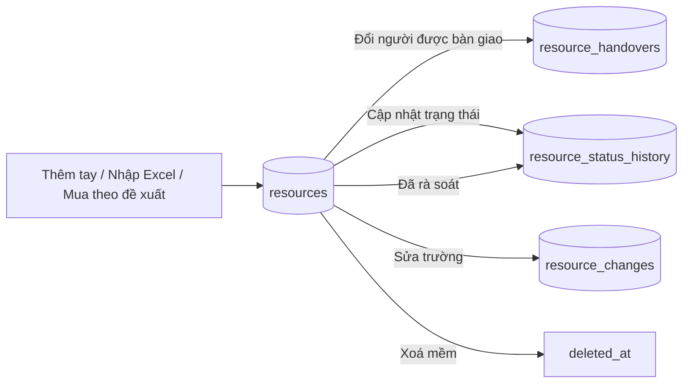
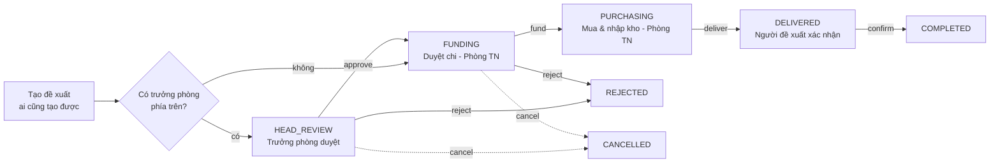

# Phòng Tài nguyên (Resources)

> Sổ kho tài khoản và kênh của công ty (Via, Page, Nhóm, AI, TKQC, BM, CapCut, Gmail…) thay cho file Excel kiểm kê, cùng luồng **đề xuất mua tài nguyên**. Người dùng chính là Phòng Tài nguyên (quản lý kho), Ban Giám đốc (xem + báo cáo), trưởng phòng và mọi nhân viên (tài nguyên mình đang giữ, đề xuất). Trên giao diện: nhánh menu **"Phòng Tài nguyên"**, các trang dưới `/resources/*`.

Kế hoạch gốc: `docs/resources/RESOURCE_MANAGEMENT_PLAN.md` (bối cảnh; code là chuẩn). Hệ quyền chung (phòng ban, ghế, quyền cá nhân) xem [org.md](org.md).

## Khái niệm & thuật ngữ

- **Tài nguyên** (`resources`): một tài khoản / kênh. Có **mã tài nguyên** do APM cấp (`ADS-001`, `MEDIA-TK-001`: mã phòng ban + số đếm 3 chữ số) và **ID tài nguyên** (`external_id`, ID của nền tảng; trống thì lấy luôn mã tài nguyên).
- **Ban quản lý** (`department_id`): phòng ban sở hữu tài nguyên.
- **Người được bàn giao / người giữ** (`holder_user_id`): người đang dùng. `NULL` = đang ở Phòng Tài nguyên.
- **Danh mục lựa chọn** (`resource_options`, `OptionKind`): `TYPE` Loại, `ROLE` Quyền đang có, `STATUS` Trạng thái, `ORIGIN` Nguồn gốc, `TWO_FACTOR` Bảo mật 2 lớp, `HANDOVER` Bàn giao về Tài nguyên. Mỗi mục có `code` ổn định (Excel và báo cáo khớp theo code) và `name` (đổi tên được).
- **Nhóm trạng thái** (`StatusGroup`): `NORMAL` Bình thường, `ATTENTION` Cần chú ý (Hạn chế, Checkpoint), `LOST` Mất (Die, Mất), `CLOSED` Đã đóng (Đã thu hồi, Ngừng dùng). Báo cáo đếm theo nhóm nên thêm trạng thái mới không làm sai báo cáo.
- **Trưởng quản lý**: `manager_user_id` trên ghế của một thành viên = trưởng phòng mà người đó báo cáo. Trưởng phòng chỉ quản lý tài nguyên của **người gắn với mình**.
- **Rà soát** (`reviewed_at`): lần cuối ai đó xác nhận tài nguyên còn đúng. Quá N ngày (mặc định 30) thì báo "Quá hạn rà soát".
- **Trạng thái nhân sự** (`users.employment_status`): `WORKING` Đang làm, `PROBATION` Thử việc, `ON_LEAVE` Tạm nghỉ, `MOVED` Chuyển ban, `LEFT` Đã nghỉ việc, `MATERNITY`, `UNPAID_LEAVE`. Khác với trạng thái tài khoản đăng nhập.
- **OWN / ALL**: phạm vi quyền. Ở module này `VIEW OWN` là mức sàn ai cũng có (của mình, người gắn với mình), `ALL` = toàn công ty.

## Luồng chính

### Vòng đời một tài nguyên

Ba bảng lịch sử chỉ được thêm, không sửa / xoá (trigger DB chặn).

### Đề xuất tài nguyên (5 bước)

## Quy tắc nghiệp vụ hiện hành

### Xem và quản lý

1. **Mọi tài khoản** (có ghế hay không) đều xem, sửa, cập nhật trạng thái, rà soát được tài nguyên **mình đang giữ**. `application/resources/access.py:resource_access` (`view_held = True`), `ResourceAccess.may_manage`.
2. **Trưởng phòng** (có ghế HEAD) làm như vậy với tài nguyên của **người gắn với mình**: người ngồi trong phòng mình làm trưởng và có `manager_user_id` = mình (chặt; không xem cả phòng, không xem tài nguyên không ai giữ; thành viên không báo cáo cho ai thì không trưởng phòng nào quản). `org/departments.reports_of`, `ResourceAccess.managed_people`.
3. `VIEW ALL` (hoặc ghế Ban Giám đốc `BOARD`, hoặc OWNER/ADMIN) xem mọi tài nguyên. Ghế BOARD còn được `REPORT` sẵn.
4. Tài nguyên ngoài phạm vi xem → 404 `resource_not_found`. Thấy được nhưng không quản lý được → 403 `resource_forbidden`. `ResourceService._visible`, `_managed`.
5. Chỉ người có `EDIT` mới: đổi ban quản lý (403 "Chỉ Phòng Tài nguyên đổi được ban quản lý."), đổi ID tài nguyên và loại tài nguyên (403 "Chỉ Phòng Tài nguyên đổi được …"), đổi người được bàn giao. `ResourceService.update`, `change_holder`.
6. Thêm tài nguyên cần `CREATE`. Nhập Excel cần `IMPORT` (commit tự mang quyền tạo). Xoá cần `DELETE`.
7. PATCH không đổi người giữ và trạng thái (có nút riêng) → 422 `resource_field_not_editable`; trường lạ → 422 `resource_field_invalid`. Mã tài nguyên không bao giờ đổi.

### Dữ liệu một tài nguyên

8. Mã tài nguyên cấp từ `resource_code_counters` theo mã phòng ban (`_allocate_code`; hết số → `resource_code_exhausted`). Mã cũ từ Excel được giữ và đẩy bộ đếm lên (`_bump_counter`); sai dạng → `resource_code_invalid`, trùng → `resource_code_taken`. Dạng mã: `is_resource_code` (mã phòng ban được chứa dấu `-` bên trong).
9. ID tài nguyên để trống (form, API, Excel) không lỗi: lấy mã tài nguyên làm ID, cả khi tạo lẫn khi xoá trắng lúc sửa.
10. ID trùng trong cùng loại (chỉ tính tài nguyên chưa xoá) → 422 `resource_id_taken`. Lựa chọn sai loại → 422 `resource_option_invalid`. Người giữ không hợp lệ → 422 `resource_holder_invalid`.
11. "Link" là chữ tự do: không kiểm tra `http(s)`, không tự thêm `https://`. Giao diện chỉ vẽ thành liên kết khi là địa chỉ web thật (`isWebLink`).
12. Module **không bao giờ lưu mật khẩu**. Chữ giống mật khẩu / 2FA / mã khôi phục (`domain/resources/models.py:looks_like_secret`) chỉ **cảnh báo** (`secret_warning`), không chặn.
13. Đổi người được bàn giao: một dòng `resource_handovers` với lý do `NEW` Cấp mới / `TRANSFER` Chuyển người / `RETURN` Thu hồi; người mới trùng người cũ → 422 `resource_holder_unchanged`; để trống = về Phòng Tài nguyên.
14. Cập nhật trạng thái: một dòng `resource_status_history`, `reviewed_at` = bây giờ. Chọn lại đúng trạng thái cũ = dòng `review_only`. "Đã rà soát" cũng ghi một dòng `review_only`.
15. Sửa trường: mỗi trường đổi = một dòng `resource_changes` (giá trị cũ → mới, ai, lúc nào).
16. **Xoá** là xoá mềm (`ResourceService.delete`): `deleted_at`, `deleted_by_user_id`, một dòng `resource_changes` field `deleted`, audit `resource.deleted`. Mọi truy vấn (danh sách, chi tiết, tra cứu, báo cáo, ID khi nhập, đề xuất) bỏ qua dòng đã xoá. ID được dùng lại (unique index chỉ trên dòng còn sống); mã không bao giờ dùng lại.
17. Mỗi dòng danh sách và chi tiết có cờ `can_edit` (= `may_manage`), `can_handover` (= `EDIT`), `can_delete`, `can_change_identity`. Form khoá "Ban quản lý", "Loại", "ID" khi không có quyền (`limited`).

### Cảnh báo

18. Tính lúc đọc, không lưu (`application/resources/alerts.py:alerts_for`):
    - `HOLDER_INACTIVE` (tài khoản người giữ bị khoá / xoá), `HOLDER_LEFT` (người giữ `LEFT`), `HOLDER_MOVED` (người giữ `MOVED` hoặc không còn ghế ở phòng quản lý);
    - `STATUS_LOST` (nhóm LOST), `STATUS_ATTENTION` (nhóm ATTENTION);
    - `REVIEW_OVERDUE` (quá `review_days` từ `reviewed_at`, trừ nhóm CLOSED).
    - Đỏ (`RED_ALERTS`): 3 cảnh báo người giữ + `STATUS_LOST`; còn lại vàng.
19. Ngưỡng rà soát `review_days` lưu ở `system_settings` key `resources` (422 `resource_review_days_invalid`).

### Danh sách

20. Cột "Ngày bàn giao" (`handed_over_at` = dòng bàn giao mới nhất, `null` nếu chưa có) đứng ngay sau "Loại". Sắp theo `handed_over_at` dùng ngày bàn giao mới nhất, không có thì ngày tạo. `/resources` mặc định sắp cột này giảm dần (`?desc=false` để đảo); `/resources/mine` cũng vậy. `service.py:_sort_rows`.
21. Cột "Trạng thái" đứng trước "Trạng thái nhân viên". Trong bảng có `actions`, dòng có `can_edit` vẽ trạng thái thành nút (`ResourceStatusButton`, `NO_ROW_NAV`) mở "Cập nhật trạng thái"; còn lại là viên màu thường (server vẫn kiểm `may_manage`).
22. Cuối mỗi dòng có menu "⋯" (`ResourceRowActions`): Sửa, Cập nhật trạng thái, Đã rà soát, Đổi người được bàn giao, Xoá - theo cờ của dòng. Trang hồ sơ có nút "Xoá" (`DeleteResourceButton`).
23. Bộ lọc API: `department_id`, `type_id`, `holder` (`none` = không ai giữ), `status_id`, `handover_id`, `employment_status`, `q`, `alerts=true`, `mine=true`, `sort`, `desc`, `limit` (≤500), `offset`.

### Báo cáo

24. Cần `REPORT` (hoặc xem toàn bộ). Đếm trong phạm vi người xem. `application/resources/reports.py`:
    - phòng ban × loại, số đã bàn giao (`HANDED_OVER_CODE` = `DONE`) và tỉ lệ;
    - số tài nguyên theo trạng thái ở cuối một tháng, đọc từ lịch sử trạng thái (tháng đã qua giữ nguyên số); tháng sai → 422 `month_invalid`;
    - danh sách cảnh báo (mỗi tài nguyên một dòng, kèm mọi cảnh báo).
25. "Tra cứu nhân viên" (`/people/{id}`) cần `REPORT`.

### Excel

26. **Xuất**: các dòng theo bộ lọc hiện tại; ID và SĐT là ô chữ (`@`) để không mất số 0 đầu / số dài. `excel.py:export_rows`.
27. **File mẫu** (`GET /import/template.xlsx`, cần `IMPORT`): **một** sheet "Mẫu nhập", hàng tiêu đề ở hàng 1: Mã NV / Loại / ID / Tên / Trạng thái / Link / Ghi chú; drop-down Loại và Trạng thái; hai dòng ví dụ bị bỏ qua khi ghi chú còn nguyên `SAMPLE_NOTE`. Không có cột Ban. `template_workbook`.
28. **Nhập** = 2 bước cùng một lần đọc: `preview` (không ghi, báo lỗi từng dòng) và `commit` (chỉ ghi khi **không dòng nào lỗi**, 422 `import_has_errors`; file rỗng → `import_empty`; file hỏng → `import_file_invalid`). File ≤8 MB, gửi base64. `ResourceImportService`.
29. Tìm hàng tiêu đề theo cột (trong các hàng đầu), không cố định hàng. Sheet thiếu cột Loại / ID / Tên (ví dụ tab "Người sử dụng") bị bỏ qua; sheet tổng hợp (có cột gộp mà không có cột Ban) bị bỏ qua.
30. Ban của một dòng: cột "Ban quản lý" nếu có (thắng); nếu không, tên sheet khớp một phòng ban; sheet "Mẫu nhập" thì **lấy theo người giữ**: phòng ADS trước, rồi Dựng, Thiết kế, Biên tập, rồi phòng đầu tiên (`department_of_seats`). Khi đó Mã NV là bắt buộc: thiếu mã, mã lạ, hoặc người chưa có ghế → lỗi dòng. `_resolve_department`.
31. Người giữ chỉ khớp theo **Mã NV** = `users.member_code` (`_match_holder`). Mã không ai mang → **lỗi** (không ghi gì cho tới khi tài khoản có mã đó). Không có mã → không người giữ + cảnh báo (khi dòng có ban riêng). Cột tên chỉ để đọc, không bao giờ dùng làm khoá. File **không tạo tài khoản**. Riêng cột "Ai đang giữ mã 2 lớp" khớp theo tên; không tìm thấy = cảnh báo.
32. Loại trống → "Khác" (`FALLBACK_TYPE_CODE` = `OTHER`) + cảnh báo; tên trống → "<loại> <id>" + cảnh báo; ID trống → mã tài nguyên + cảnh báo. Không có cột tháng nào → trạng thái `ACTIVE` + cảnh báo. Cột tháng (`T10/2026`…) thành lịch sử trạng thái, mỗi ô một dòng ghi ngày 1 của tháng, ô cuối là trạng thái hiện tại.
33. Dòng chỉ có mã / loại / tên người được giữ chỗ (dòng đánh số sẵn của mẫu) bị bỏ qua. Mã dùng hai lần trong file: dòng sau mất mã cũ và được cấp mã mới; mã hoặc ID đã có trong DB → lỗi.
34. Tên lựa chọn khớp lỏng (khoảng trắng quanh `/`, chứa duy nhất). Ô "Die / Mất" cũ đọc thành "Die" (`_ALIASES`). `create_options=true` khi commit: tạo các mục danh mục còn thiếu (Loại, Quyền, Nguồn gốc…).

### Đề xuất tài nguyên

35. Ai cũng tạo được. Bắt buộc: loại, số lượng 1-500 (`MAX_QUANTITY`, 422 `request_quantity_invalid`), mục đích, lý do (`request_purpose_missing`, `request_reason_missing`). Dự toán và "Cần trước" không bắt buộc; dự toán âm → `request_budget_invalid`, ngày đã qua → `request_needed_by_past`. Mã `DX-NNNN` từ bộ đếm `resource_code_counters` (prefix `REQ:DX`). `application/resources/requests.py:ResourceRequestService`.
36. Người duyệt bước trưởng phòng được chốt lúc gửi trong `head_approver_ids`: trưởng phòng mà người gửi báo cáo, nếu không thì mọi trưởng phòng của các phòng của họ. Không có ai → bỏ bước (sự kiện `HEAD_SKIPPED`), vào thẳng `FUNDING`.
37. Ai làm gì (`_actions`):
    - `HEAD_REVIEW`: người trong `head_approver_ids` hoặc OWNER/ADMIN → `approve` / `reject`.
    - `FUNDING`: người có `CREATE` (Phòng Tài nguyên) → `fund` / `reject`.
    - `PURCHASING`: người có `CREATE` → `deliver`.
    - `DELIVERED`: người gửi hoặc OWNER/ADMIN → `confirm`.
    - Người gửi `cancel` khi còn `HEAD_REVIEW` hoặc `FUNDING`.
38. Từ chối phải có lý do → 422 `request_note_missing`. Bước đã chuyển → 409 `resource_request_moved`. Không phải bước của mình → 403.
39. `deliver` cần `lines` (mỗi dòng `ID | Link`, bỏ dòng trống), đúng bằng `quantity` dòng, không trùng nhau, không trùng ID đã có trong kho cùng loại → nếu sai 422 `request_lines_invalid` + `details.problems`; `actual_cost` bắt buộc (422 `request_cost_missing`); `supplier` tuỳ chọn. Mỗi dòng thành một tài nguyên: người giữ = người gửi, ban = ban của người gửi (`department_of_seats`, không có thì Phòng Tài nguyên; không có cả hai → `request_department_missing`), nguồn gốc `BOUGHT`, bàn giao `DONE`, ghi chú "Mua theo đề xuất DX-…", `request_id` trỏ về đề xuất.
40. Ai xem một đề xuất: người gửi, người duyệt đã ghi, người có `CREATE`, người xem toàn bộ (BGĐ), OWNER/ADMIN.
41. **Thông báo** (`application/resources/request_notifications.py`, template `resources.request`, hộp thư web + bản Telegram): chờ trưởng phòng → các trưởng phòng; tới `FUNDING` / `PURCHASING` → Phòng Tài nguyên; `DELIVERED` → người gửi; từ chối → người gửi (kèm lý do); huỷ → người mà đề xuất đang chờ; `COMPLETED` → Phòng Tài nguyên. Không ai nhận tin về việc của chính mình.
42. **Badge menu**: `/api/units/me` `resources.requests_awaiting` = số đề xuất đang chờ mình (`awaiting_count`), hiện cạnh "Đề xuất tài nguyên" (viên magenta, chấm trên icon khi sidebar thu gọn). Shell tải lại units/me mỗi 60 giây; các trang đề xuất làm mới sau khi tạo / xử lý.

### Trạng thái nhân sự

43. `PUT /api/account/members/{id}/employment-status`: OWNER/ADMIN hoặc người có `HR_STATUS`, nếu không 403 `employment_status_forbidden`; đặt OWNER hoặc chính mình thành "Đã nghỉ việc" → 403 `employment_status_left_forbidden`. Dòng thành viên mang `employment_status(_label)`. Cột "Nhân sự" ở Tài khoản › Thành viên. Đổi từ hồ sơ HR cũng đi qua `application/resources/employment.py:apply_employment_status` (xem [hr.md](hr.md)).

## Phân quyền

Module `RESOURCES` trong `department_permissions` (ghế) + `user_permissions` (cá nhân). Đăng ký ở `domain/org/modules.py`.

| Quyền | Scope | Ý nghĩa |
|---|---|---|
| `VIEW` | `OWN` / `ALL` | OWN = mức sàn (của mình, người gắn với mình), không có "Không". ALL = mọi tài nguyên |
| `CREATE` | ALL | Thêm tài nguyên; duyệt chi + mua & nhập kho trong đề xuất |
| `DELETE` | ALL | Xoá mềm |
| `EDIT` | ALL | Sửa **mọi** tài nguyên, đổi người giữ, đổi ban / ID / loại |
| `IMPORT` | ALL | Nhập Excel, tải file mẫu |
| `SETTINGS` | ALL | Danh mục lựa chọn, ngưỡng rà soát |
| `REPORT` | ALL | Báo cáo, cảnh báo, tra cứu theo nhân viên |
| `HR_STATUS` | ALL | Đổi trạng thái nhân sự |

Mặc định theo function phòng ban (`default_resource_grants`, áp cho phòng tạo sau):

| Phòng | HEAD | MEMBER |
|---|---|---|
| `RESOURCES` (Phòng Tài nguyên) | mọi quyền ALL | VIEW, CREATE, DELETE, EDIT, REPORT ALL |
| `BOARD` (Ban Giám đốc) | VIEW ALL, REPORT | VIEW ALL, REPORT |
| Phòng khác | VIEW OWN | VIEW OWN |

- OWNER/ADMIN (`sees_all`) = mọi quyền (`EVERYTHING`).
- Trên trang Phòng ban, ô VIEW chỉ có "Mặc định (của mình, người gắn với mình)" / "Toàn bộ" (`RESOURCE_SCOPE_LABELS`, `ModuleSpec.scope_labels`).
- `/api/units/me` khối `resources`: `view`, `view_all`, `view_list`, `create`, `delete`, `edit`, `import_excel`, `settings`, `report`, `hr`, `requests_awaiting`.
- Menu "Danh sách tài nguyên" chỉ hiện khi `view_list` (= view_all, EDIT, CREATE, hoặc trưởng phòng có người gắn với mình). Nhân viên thường thấy "Tài nguyên của tôi" + "Đề xuất tài nguyên".

## Dữ liệu

| Bảng | Nội dung | Migration |
|---|---|---|
| `resource_options` | Danh mục lựa chọn (kind, code, name, `status_group`, thứ tự, active) | 0065, 0072 |
| `resources` | Tài nguyên; `deleted_at` / `deleted_by_user_id` (0071), `request_id` (0070); partial unique `(type_id, external_id)` trên dòng còn sống | 0065 |
| `resource_code_counters` | Bộ đếm mã theo prefix (cả `REQ:DX`) | 0065 |
| `resource_handovers` | Lịch sử bàn giao (append-only) | 0065 |
| `resource_status_history` | Lịch sử trạng thái (append-only) | 0065 |
| `resource_changes` | Nhật ký sửa trường (append-only) | 0065 |
| `resource_requests` | Đề xuất (`head_approver_ids`, stage, site, budget, needed_by nullable từ 0071, actual_cost, supplier) | 0070 |
| `resource_request_events` | Sự kiện đề xuất | 0070 |
| `users.employment_status` | Trạng thái nhân sự | 0065 |
| `system_settings` `resources` | `review_days` | - |

- Trigger chặn UPDATE/DELETE trên 3 bảng lịch sử, cho cả PostgreSQL và SQLite, gắn vào `after_create` của bảng (`db/models/resource.py`).
- Không có cột mật khẩu nào. Không thêm.
- Danh mục gieo sẵn: `SEED_OPTIONS` (20 loại, 9 quyền, 7 trạng thái, 6 nguồn gốc, 3 bảo mật 2 lớp, 3 bàn giao). Script `scripts/seed_resource_catalog.py` (idempotent) đưa danh mục lên DB đang chạy theo (kind, code): `docker compose exec -T api python - < scripts/seed_resource_catalog.py`.

## Code ở đâu

| Lớp | Đường dẫn |
|---|---|
| domain | `src/meobot/domain/resources/models.py` (quyền, danh mục, cảnh báo, mã, `looks_like_secret`, `EmploymentStatus`), `src/meobot/domain/resources/requests.py` (stage, site, sự kiện) |
| application | `src/meobot/application/resources/access.py`, `service.py`, `alerts.py`, `reports.py`, `excel.py`, `employment.py`, `requests.py`, `request_notifications.py` |
| models | `src/meobot/db/models/resource.py` |
| api | `src/meobot/api/routers/resources.py`, `src/meobot/api/routers/resource_requests.py` (include **trước** `resources.router` vì `/{resource_id}`), `src/meobot/api/schemas/resources.py`, `units.py:_resources_block`, `account.py` (employment-status) |
| scripts | `scripts/seed_resource_catalog.py` |
| frontend | trang `frontend/src/app/resources/{page,[id],mine,people,reports,import,settings,requests,requests/new,requests/[id]}`; `frontend/src/components/resource-table.tsx`, `resource-form.tsx` (`ResourceFormDialog`), `resource-dialogs.tsx` (`ChangeHolderDialog`, `UpdateStatusDialog`, `ReviewDialog`), `resource-actions.tsx` (`ResourceRowActions`, `ResourceStatusButton`, `DeleteResourceButton`); `frontend/src/lib/resources.ts` (`resourceScreens`, `isWebLink`); nhánh menu trong `frontend/src/components/shell.tsx` |
| tests | `tests/unit/test_resources.py`, `tests/unit/test_resource_requests.py`, `tests/integration/test_resource_migrations.py`; frontend `frontend/tests/resources.test.tsx`, `frontend/tests/resource-requests.test.tsx` |

(`frontend/src/components/resource-drafts.tsx` và `tests/unit/test_pr_resources_on_create.py` là "tài nguyên duyệt" của bài PR, không thuộc module này - xem [pr.md](pr.md).)

## API

`/api/resources` (`api/routers/resources.py`):

| Method | Path | Ghi chú |
|---|---|---|
| GET | `/access` | Cờ quyền |
| GET / POST | `/options` | Danh mục (ghi: `SETTINGS`) |
| PATCH | `/options/{option_id}` | |
| PUT | `/options/order` | Sắp lại (422 `resource_option_order_invalid`) |
| GET / PUT | `/settings` | `review_days` |
| GET | `/people`, `/people/{user_id}` | Tra cứu nhân viên |
| GET | `` (gốc) | Danh sách, bộ lọc ở mục 23 |
| GET | `/export.xlsx` | |
| POST | `` (gốc) | Thêm (`CREATE`) |
| GET | `/reports/summary?month=YYYY-MM` | |
| GET | `/reports/warnings` | |
| GET | `/reports/previous-month` | |
| GET | `/import/template.xlsx` | |
| POST | `/import/preview`, `/import/commit` | Body `{data: base64, create_options}` |
| GET / PATCH | `/{resource_id}` | |
| POST | `/{resource_id}/holder` | Đổi người giữ |
| POST | `/{resource_id}/status` | Cập nhật trạng thái |
| POST | `/{resource_id}/review` | Đã rà soát |
| DELETE | `/{resource_id}?note=` | Xoá mềm, 204 |

`/api/resources/requests` (`api/routers/resource_requests.py`):

| Method | Path | Ghi chú |
|---|---|---|
| GET | `` | `?tab=all|mine|open`, trả kèm `awaiting_count` |
| GET | `/form` | Loại, nơi dùng, người duyệt dự kiến |
| GET | `/holding?type_id=` | Số tài nguyên đang hoạt động cùng loại mình giữ |
| POST | `` | Tạo |
| GET | `/{request_id}` | `steps[]` (`person_name`, `person_user_id`, `status_label`, `at`, `note`), `actions` |
| POST | `/{request_id}/actions` | `{action: approve|reject|fund|deliver|confirm|cancel, note, lines, actual_cost, supplier}` |

Khác: `PUT /api/account/members/{id}/employment-status`.

Audit: `resource.created`, `resource.updated`, `resource.holder.changed`, `resource.status.updated`, `resource.reviewed`, `resource.deleted`, `resource.option.created/updated`, `resource.settings.updated`, `resource.imported`, `resource.request.created/decided/delivered`.

## Cạm bẫy & chưa làm

- Docstring đầu `application/resources/excel.py` và của `template_workbook` / route template còn nói "headers on row 5" và "cột ban" - đã cũ. Code tìm hàng tiêu đề theo cột, file mẫu không có cột Ban.
- Docstring đầu `access.py` nói "người không có ghế không có gì" - đã cũ; ai cũng có `view_held`.
- `resource_requests` và `resources.request_id` nối hai luồng: xoá mềm tài nguyên không xoá đề xuất.
- Bước "Duyệt chi" vẫn thuộc Phòng Tài nguyên. Kế hoạch Tài chính đợt 3 (B7) dự định chuyển sang module Tài chính nhưng **chưa chuyển** - xem [finance.md](finance.md).
- Module PR có "tài nguyên" riêng (tài liệu duyệt của bài) - tên giống, khác hoàn toàn.
- Chưa làm (đợt 2): phiếu cấp phát, thu hồi hàng loạt, sự cố, thông báo cảnh báo định kỳ.

## Mốc thay đổi

| Migration | Ngày | Thay đổi |
|---|---|---|
| 0065 | 15/10/2026 | Module Tài nguyên đợt 1: danh mục, tài nguyên, lịch sử append-only, quyền `RESOURCES`, `users.employment_status`, Excel |
| - | 16/10/2026 | Danh mục theo sheet của Phòng TN (20 loại…), script `seed_resource_catalog.py` |
| 0066 | 16/10/2026 | Quyền thống nhất: quyền module đọc qua `load_access` |
| - | 19-20/10/2026 | Excel: người giữ chỉ khớp Mã NV; mã lạ = lỗi; file mẫu một sheet không cột Ban; link tự do; ID trống lấy mã |
| 0069 | 21/10/2026 | Quyền `CREATE` cho Phòng TN (HEAD + MEMBER) |
| 0070 | 21/10/2026 | Đề xuất tài nguyên |
| - | 21/10/2026 | Ai cũng quản lý tài nguyên mình giữ; trưởng phòng chỉ người gắn với mình; cột "Ngày bàn giao" |
| 0071 | 21/10/2026 | Xoá mềm + quyền `DELETE`; dự toán / cần trước không bắt buộc; menu "⋯" trên bảng |
| 0072 | 22/10/2026 | Tách trạng thái "Die / Mất" thành "Die" (`DIE`) và "Mất" (`LOST`); badge đề xuất trên menu |
| - | 23/10/2026 | Ô trạng thái bấm được; nhãn scope VIEW riêng |
| - | 10/11/2026 | Thêm trạng thái nhân sự `MATERNITY`, `UNPAID_LEAVE` (HR) |
